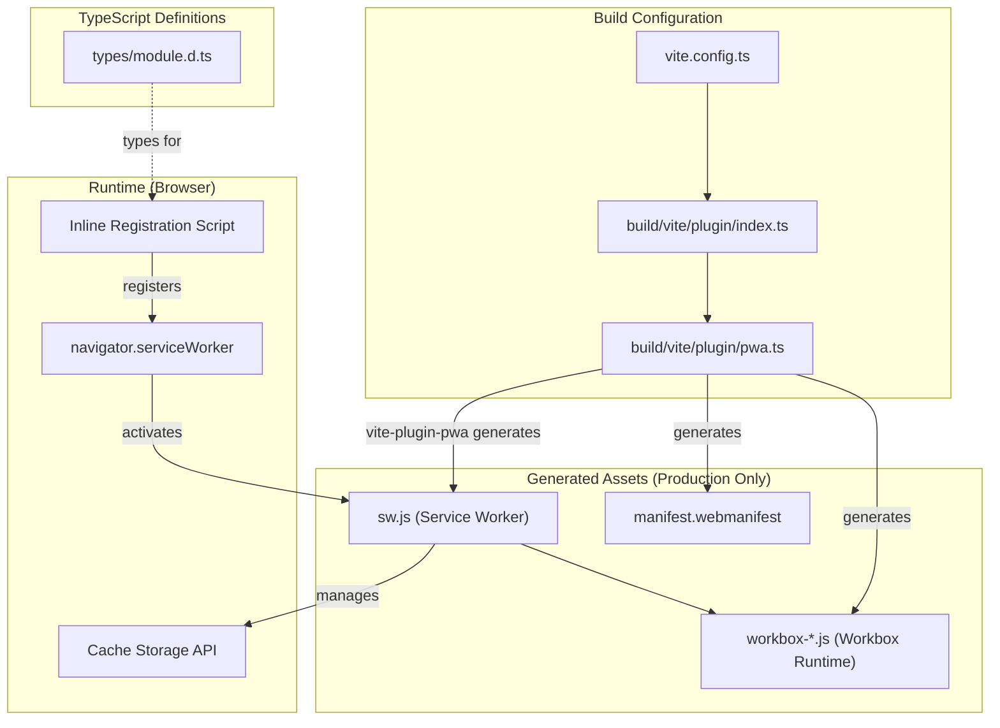
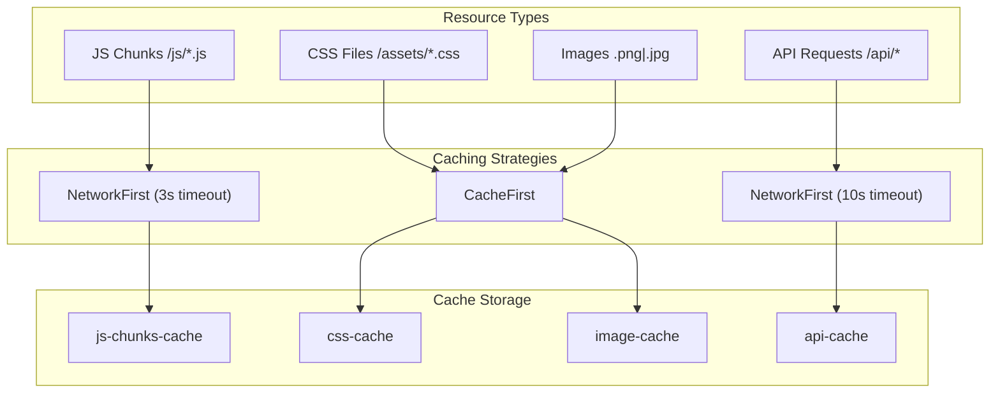
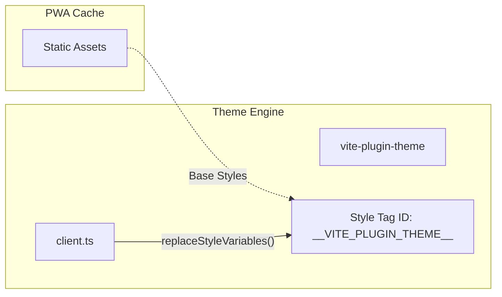

<!-- source: DeepWiki mcp.deepwiki.com · repo jeecgboot/JeecgBoot · page 6.2 PWA Implementation · fetched 2026-10-29 -->

# PWA Implementation

<details>
<summary>Relevant source files</summary>

The following files were used as context for generating this wiki page:

- [jeecgboot-vue3/build/config/themeConfig.ts](jeecgboot-vue3/build/config/themeConfig.ts)
- [jeecgboot-vue3/build/vite/plugin/theme-plugin/antdDarkThemePlugin.ts](jeecgboot-vue3/build/vite/plugin/theme-plugin/antdDarkThemePlugin.ts)
- [jeecgboot-vue3/build/vite/plugin/theme-plugin/client/client.ts](jeecgboot-vue3/build/vite/plugin/theme-plugin/client/client.ts)
- [jeecgboot-vue3/build/vite/plugin/theme-plugin/client/colorUtils.ts](jeecgboot-vue3/build/vite/plugin/theme-plugin/client/colorUtils.ts)
- [jeecgboot-vue3/build/vite/plugin/theme-plugin/constants.ts](jeecgboot-vue3/build/vite/plugin/theme-plugin/constants.ts)
- [jeecgboot-vue3/build/vite/plugin/theme-plugin/index.ts](jeecgboot-vue3/build/vite/plugin/theme-plugin/index.ts)
- [jeecgboot-vue3/build/vite/plugin/theme-plugin/injectClientPlugin.ts](jeecgboot-vue3/build/vite/plugin/theme-plugin/injectClientPlugin.ts)
- [jeecgboot-vue3/build/vite/plugin/theme-plugin/preprocessor/less/index.ts](jeecgboot-vue3/build/vite/plugin/theme-plugin/preprocessor/less/index.ts)
- [jeecgboot-vue3/build/vite/plugin/theme-plugin/utils.ts](jeecgboot-vue3/build/vite/plugin/theme-plugin/utils.ts)
- [jeecgboot-vue3/build/vite/plugin/theme.ts](jeecgboot-vue3/build/vite/plugin/theme.ts)
- [jeecgboot-vue3/src/settings/projectSetting.ts](jeecgboot-vue3/src/settings/projectSetting.ts)
- [jeecgboot-vue3/src/utils/getConfigByMenuType.ts](jeecgboot-vue3/src/utils/getConfigByMenuType.ts)
- [jeecgboot-vue3/src/views/super/online/cgform/auto/comp/superquery/SuperQuery.vue](jeecgboot-vue3/src/views/super/online/cgform/auto/comp/superquery/SuperQuery.vue)
- [jeecgboot-vue3/types/config.d.ts](jeecgboot-vue3/types/config.d.ts)
- [jeecgboot-vue3/vite.config.ts](jeecgboot-vue3/vite.config.ts)

</details>


## Purpose and Scope

This document describes the Progressive Web App (PWA) implementation in JeecgBoot's Vue3 frontend. The PWA functionality provides offline support, resource caching, and improved loading performance through service worker integration. This implementation utilizes `vite-plugin-pwa` with Workbox and is optimized for lazy-loaded Vue Router applications.

For general frontend build configuration, see [6.1 Project Structure & Configuration](). For theme-related dynamic asset management, see [2.3.1 Build System & PWA Configuration]().

---

## Architecture Overview

The PWA system consists of three main components: build-time plugin configuration, generated service worker files, and TypeScript type definitions for runtime integration.

### PWA Component Interaction



**Sources:** [jeecgboot-vue3/vite.config.ts:162-163](), [jeecgboot-vue3/types/config.d.ts:1-50]()

---

## Plugin Configuration

The PWA plugin is configured in `build/vite/plugin/pwa.ts` and only activates during production builds.

### Core Configuration Options

The implementation uses a manual registration type to allow fine-grained control over updates.

| Option | Value | Purpose |
|--------|-------|---------|
| `registerType` | `'manual'` | Service worker registration is manual |
| `injectRegister` | `'inline'` | Registration code is inlined in HTML to avoid caching issues |
| `includeAssets` | `['favicon.ico', 'logo.png']` | Static assets to precache |

### Manifest Configuration

The PWA manifest defines the app metadata for installation:

```typescript
manifest: {
  name: 'JeecgBoot',
  short_name: 'Jeecg',
  theme_color: '#ffffff',
  icons: [
    { src: '/logo.png', sizes: '192x192', type: 'image/png' },
    { src: '/logo.png', sizes: '512x512', type: 'image/png' }
  ]
}
```

**Sources:** [jeecgboot-vue3/vite.config.ts:1-20](), [jeecgboot-vue3/src/settings/projectSetting.ts:22-51]()

---

## Workbox Caching Configuration

The Workbox configuration defines precaching patterns and runtime caching strategies, optimized to avoid preloading all route chunks simultaneously.

### Precache Strategy

The precache configuration only caches critical resources, not lazy-loaded route components, to ensure the initial load remains fast.

| Pattern | Purpose | Rationale |
|---------|---------|-----------|
| `index.html` | Entry HTML file | Required to avoid non-precached-url errors |
| `manifest.webmanifest` | PWA manifest | Enables installation |
| `assets/index-*.css` | Entry CSS only | Main styles, not route-specific CSS |
| `js/index-*.js` | Entry JavaScript | Application bootstrap code |
| `js/*-vendor-*.js` | Vendor chunks | Core libraries (Vue, Ant Design) |

### Runtime Caching Strategies

The implementation uses different caching strategies for different resource types:



#### JS Chunk Caching (NetworkFirst)
Lazy-loaded route chunks use `NetworkFirst` strategy to ensure users get the latest code. If the network is unavailable or times out (3 seconds), it falls back to the cache.

#### CSS and Image Caching (CacheFirst)
CSS files and images are cached aggressively using `CacheFirst` since they change less frequently and are usually versioned by hashes in JeecgBoot's build system [jeecgboot-vue3/vite.config.ts:118-119]().

**Sources:** [jeecgboot-vue3/vite.config.ts:112-120](), [jeecgboot-vue3/src/settings/projectSetting.ts:174-175]()

---

## Build Integration

The PWA plugin integrates into the Vite build pipeline through the plugin registration system in `vite.config.ts`.

### Build Conditions

The plugin is conditionally added based on the environment:
1. `isBuild === true`: PWA is only generated during production builds [jeecgboot-vue3/vite.config.ts:32-32]().
2. Platform Check: PWA is typically skipped for Electron builds as Electron provides its own offline handling.

### Manual Chunking & Caching
JeecgBoot uses a custom `manualChunks` function to optimize chunking for caching:

[jeecgboot-vue3/vite.config.ts:122-135]()
```typescript
manualChunks(id: string) {
  const normalizedId = id.replace(/\\/g, '/');
  if (!normalizedId.includes('node_modules/')) {
    return;
  }
  const segments = normalizedId.split('node_modules/').pop()!.split('/');
  const pkgName = segments[0].startsWith('@') ? `${segments[0]}/${segments[1]}` : segments[0];
  const packageToChunk: Record<string, string> = {
    vue: 'vue-vendor',
    'vue-router': 'vue-vendor',
    'emoji-mart-vue-fast': 'emoji-mart-vue-fast',
  };
  return packageToChunk[pkgName];
}
```

This ensures that core libraries like `vue` and `vue-router` are bundled into a stable `vue-vendor` chunk, which the PWA can cache effectively.

**Sources:** [jeecgboot-vue3/vite.config.ts:109-141](), [jeecgboot-vue3/build/config/themeConfig.ts:1-8]()

---

## Theme and PWA Interaction

JeecgBoot supports dynamic theme switching, which interacts with how styles are cached.

### Theme CSS Extraction
The `viteThemePlugin` extracts theme-related CSS into a separate file during build [jeecgboot-vue3/build/vite/plugin/theme-plugin/index.ts:132-148](). This file is named using a hash [jeecgboot-vue3/build/vite/plugin/theme-plugin/index.ts:67-67]() and is typically excluded from the initial PWA precache to allow dynamic replacement at runtime.

### Dynamic Style Injection
At runtime, `replaceStyleVariables` in the client-side theme plugin handles the application of new colors [jeecgboot-vue3/build/vite/plugin/theme-plugin/client/client.ts:58-83](). These dynamic styles are managed in the browser's DOM rather than the PWA's static cache to ensure theme changes are reflected immediately without requiring a service worker update.



**Sources:** [jeecgboot-vue3/build/vite/plugin/theme-plugin/client/client.ts:7-10](), [jeecgboot-vue3/build/vite/plugin/theme-plugin/index.ts:132-148](), [jeecgboot-vue3/build/vite/plugin/theme.ts:12-45]()

---

## Service Worker Lifecycle

The service worker follows a specific lifecycle managed by Workbox:

1.  **Registration**: The inline script in `index.html` registers `sw.js`.
2.  **Installation**: Downloads precached resources defined in the build config.
3.  **Activation**: The `skipWaiting: true` and `clientsClaim: true` options ensure the new service worker takes control immediately.
4.  **Handling Updates**: When a new build is detected, the `manual` registration type allows the application to prompt the user or handle the refresh logic.

**Sources:** [jeecgboot-vue3/vite.config.ts:112-115](), [jeecgboot-vue3/src/settings/projectSetting.ts:200-201]()

---

