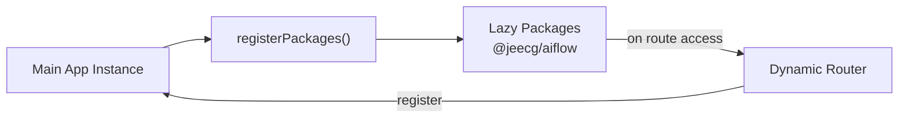

<!-- source: DeepWiki mcp.deepwiki.com · repo jeecgboot/JeecgBoot · page 6.3 Component Development · fetched 2026-10-29 -->

# Component Development

<details>
<summary>Relevant source files</summary>

The following files were used as context for generating this wiki page:

- [jeecgboot-vue3/build/vite/plugin/index.ts](jeecgboot-vue3/build/vite/plugin/index.ts)
- [jeecgboot-vue3/src/api/common/api.ts](jeecgboot-vue3/src/api/common/api.ts)
- [jeecgboot-vue3/src/components/Form/index.ts](jeecgboot-vue3/src/components/Form/index.ts)
- [jeecgboot-vue3/src/components/Form/src/componentMap.ts](jeecgboot-vue3/src/components/Form/src/componentMap.ts)
- [jeecgboot-vue3/src/components/Form/src/hooks/useForm.ts](jeecgboot-vue3/src/components/Form/src/hooks/useForm.ts)
- [jeecgboot-vue3/src/components/Form/src/jeecg/hooks/useTreeBiz.ts](jeecgboot-vue3/src/components/Form/src/jeecg/hooks/useTreeBiz.ts)
- [jeecgboot-vue3/src/components/Form/src/jeecg/props/props.ts](jeecgboot-vue3/src/components/Form/src/jeecg/props/props.ts)
- [jeecgboot-vue3/src/components/Icon/src/Icon.vue](jeecgboot-vue3/src/components/Icon/src/Icon.vue)
- [jeecgboot-vue3/src/components/jeecg/JVxeTable/index.ts](jeecgboot-vue3/src/components/jeecg/JVxeTable/index.ts)
- [jeecgboot-vue3/src/components/jeecg/JVxeTable/useVxeTableRegister.ts](jeecgboot-vue3/src/components/jeecg/JVxeTable/useVxeTableRegister.ts)
- [jeecgboot-vue3/src/components/registerGlobComp.ts](jeecgboot-vue3/src/components/registerGlobComp.ts)
- [jeecgboot-vue3/src/router/helper/routeHelper.ts](jeecgboot-vue3/src/router/helper/routeHelper.ts)
- [jeecgboot-vue3/src/utils/dynamicPages.ts](jeecgboot-vue3/src/utils/dynamicPages.ts)
- [jeecgboot-vue3/src/utils/monorepo/registerPackages.ts](jeecgboot-vue3/src/utils/monorepo/registerPackages.ts)
- [jeecgboot-vue3/src/views/demo/jeecg/JeecgComponents.vue](jeecgboot-vue3/src/views/demo/jeecg/JeecgComponents.vue)
- [jeecgboot-vue3/src/views/demo/jeecg/jeecgComponents.data.ts](jeecgboot-vue3/src/views/demo/jeecg/jeecgComponents.data.ts)
- [jeecgboot-vue3/src/views/system/address/address.api.ts](jeecgboot-vue3/src/views/system/address/address.api.ts)
- [jeecgboot-vue3/src/views/system/address/address.data.ts](jeecgboot-vue3/src/views/system/address/address.data.ts)
- [jeecgboot-vue3/src/views/system/address/components/DepartLeftTree.vue](jeecgboot-vue3/src/views/system/address/components/DepartLeftTree.vue)
- [jeecgboot-vue3/src/views/system/address/index.vue](jeecgboot-vue3/src/views/system/address/index.vue)
- [jeecgboot-vue3/src/views/system/departUser/depart.user.data.ts](jeecgboot-vue3/src/views/system/departUser/depart.user.data.ts)
- [jeecgboot-vue3/src/views/system/position/PositionModal.vue](jeecgboot-vue3/src/views/system/position/PositionModal.vue)
- [jeecgboot-vue3/src/views/system/position/TenantPositionList.vue](jeecgboot-vue3/src/views/system/position/TenantPositionList.vue)

</details>


This page provides guidance for developing reusable Vue3 components within the JeecgBoot frontend application. It covers component architecture patterns, registration strategies, and the integration of core component libraries.

For detailed information on specific component categories, see:
- [Table Components](#6.3.1) — Detailed usage of `BasicTable` and `JVxeTable` for data grids.
- [Form Components](#6.3.2) — Documentation for the dynamic form system and custom field components.

## Component Architecture Overview

JeecgBoot leverages Vue 3's Composition API and TypeScript to build a modular component ecosystem. The architecture emphasizes separation of concerns through hooks and a centralized component registry.

```mermaid
graph TB
    subgraph "Registration Layer"
        registerGlobComp["registerGlobComp.ts<br/>Global UI Components"]
        componentMap["componentMap.ts<br/>Form Field Registry"]
        registerPackages["registerPackages.ts<br/>Monorepo Modules"]
    end

    subgraph "Core Components"
        BasicForm["BasicForm.vue<br/>Dynamic Form Engine"]
        BasicTable["BasicTable.vue<br/>Data Grid Wrapper"]
        JVxeTable["JVxeTable<br/>Editable Grid"]
    end

    subgraph "Jeecg Custom Components"
        JDictSelectTag["JDictSelectTag<br/>Dictionary Select"]
        JSelectUser["JSelectUser<br/>User Selector"]
        JPopup["JPopup<br/>Popup Selector"]
        JAreaLinkage["JAreaLinkage<br/>Region Linkage"]
    end

    registerGlobComp --> BasicForm
    componentMap --> JDictSelectTag
    componentMap --> JSelectUser
    registerPackages --> "@jeecg/aiflow"
    BasicForm --> componentMap
```

**Sources:** [jeecgboot-vue3/src/components/registerGlobComp.ts:1-39](), [jeecgboot-vue3/src/components/Form/src/componentMap.ts:11-86]()

## Component Registration Strategies

JeecgBoot supports several methods for registering and loading components to balance bundle size and developer productivity.

### 1. Global Registration
Common UI components (e.g., `Icon`, `Button`) are registered globally in `registerGlobComp.ts` so they can be used in templates without local imports.
- **Ant Design Vue Components:** These are automatically handled by `unplugin-vue-components` and `AntDesignVueResolver` for on-demand loading [jeecgboot-vue3/build/vite/plugin/index.ts:66-85]().
- **Jeecg Components:** Specific components like `Tinymce` are registered as async components to optimize initial load [jeecgboot-vue3/src/components/registerGlobComp.ts:28-34]().

### 2. Form Component Mapping
The `componentMap` acts as a registry for the `BasicForm` engine. By mapping a string key to a component, developers can define forms using JSON-like schemas.

| Component Key | Source File | Purpose |
|:---|:---|:---|
| `JDictSelectTag` | `jeecg/components/JDictSelectTag.vue` | Dictionary-based dropdowns [jeecgboot-vue3/src/components/Form/src/componentMap.ts:58-58]() |
| `JSelectUser` | `jeecg/components/JSelectUser.vue` | Enterprise user selection [jeecgboot-vue3/src/components/Form/src/componentMap.ts:55-55]() |
| `JUpload` | `jeecg/components/JUpload/JUpload.vue` | Advanced file upload [jeecgboot-vue3/src/components/Form/src/componentMap.ts:84-84]() |
| `JEasyCron` | `jeecg/components/JEasyCron/EasyCronInput.vue` | Cron expression generator [jeecgboot-vue3/src/components/Form/src/componentMap.ts:77-77]() |

**Sources:** [jeecgboot-vue3/src/components/Form/src/componentMap.ts:11-86]()

### 3. Monorepo Package Registration
For modular enterprise features (like AI Flow), JeecgBoot uses a dynamic registration system to load packages only when needed.



The `registerPackages` utility maintains a cache of loaded modules and provides a `baseImport` mechanism so that external packages can safely import utilities from the core project (e.g., `/@/utils/` and `/@/hooks/`) [jeecgboot-vue3/src/utils/monorepo/registerPackages.ts:30-57]().

**Sources:** [jeecgboot-vue3/src/utils/monorepo/registerPackages.ts:17-57](), [jeecgboot-vue3/src/utils/monorepo/registerPackages.ts:126-140]()

## Developing with Schemas

A core pattern in JeecgBoot is defining UI via schemas. This is most prevalent in `BasicForm` and `BasicTable`.

### Form Schema Example
Instead of writing complex templates, developers define an array of `FormSchema` objects. The `component` property refers to the keys in `componentMap`.

```typescript
export const schemas: FormSchema[] = [
  {
    field: 'gender',
    component: 'JDictSelectTag',
    label: 'Gender',
    componentProps: {
      dictCode: 'sex', // Loads data from system dictionary
    },
    colProps: { span: 12 },
  },
  {
    field: 'dept',
    component: 'JSelectDept',
    label: 'Department',
    colProps: { span: 12 },
  }
];
```

**Sources:** [jeecgboot-vue3/src/views/demo/jeecg/jeecgComponents.data.ts:6-216]()

## Component Logic Hooks

JeecgBoot provides specialized hooks to encapsulate complex component logic, particularly for data-heavy business components.

### `useForm`
Provides programmatic control over the `BasicForm` instance, including validation, value retrieval, and schema updates.
- **Methods:** `validate`, `getFieldsValue`, `setFieldsValue`, `updateSchema` [jeecgboot-vue3/src/components/Form/src/hooks/useForm.ts:49-145]().

### `useTreeBiz`
A specialized hook for business components that involve tree structures (like Department or Category selectors). It handles:
- **Data Loading:** Async fetching of tree nodes [jeecgboot-vue3/src/components/Form/src/jeecg/hooks/useTreeBiz.ts:220-236]().
- **Selection Logic:** Managing checked keys and expanded states [jeecgboot-vue3/src/components/Form/src/jeecg/hooks/useTreeBiz.ts:136-179]().
- **Parent Retrieval:** Automatically fetching parent IDs to expand the tree to the selected node [jeecgboot-vue3/src/components/Form/src/jeecg/hooks/useTreeBiz.ts:74-106]().

**Sources:** [jeecgboot-vue3/src/components/Form/src/hooks/useForm.ts:13-148](), [jeecgboot-vue3/src/components/Form/src/jeecg/hooks/useTreeBiz.ts:9-254]()

## Dynamic View Loading

The system resolves components dynamically during routing. The `transformObjToRoute` function processes backend-provided menu data and maps the `component` string to actual Vue files [jeecgboot-vue3/src/router/helper/routeHelper.ts:139-162]().

If a component path matches a monorepo package (like `/super/airag/aiflow`), the system uses `loadPackageComponent` to fetch it from the external module [jeecgboot-vue3/src/router/helper/routeHelper.ts:131-135]().

**Sources:** [jeecgboot-vue3/src/router/helper/routeHelper.ts:108-136](), [jeecgboot-vue3/src/utils/monorepo/registerPackages.ts:101-113]()

---

