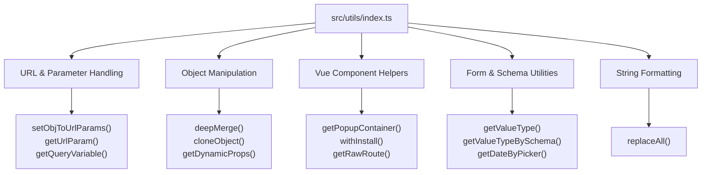
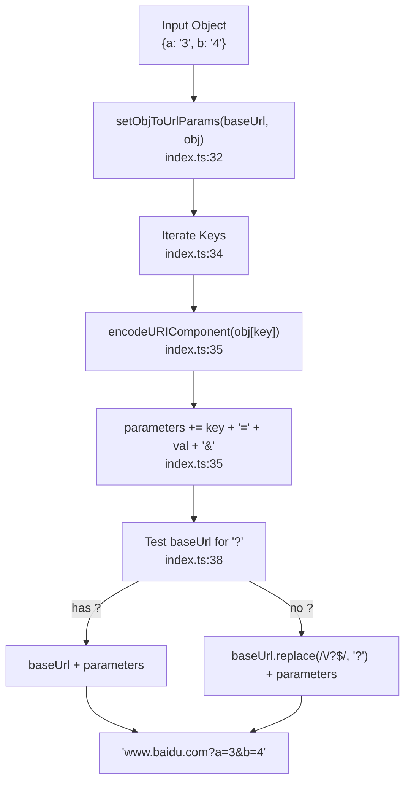
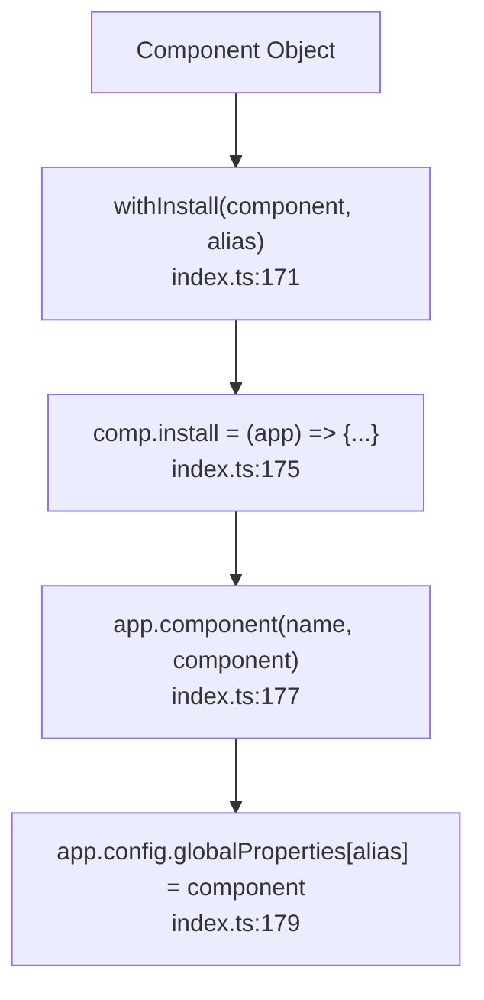

<!-- source: DeepWiki mcp.deepwiki.com · repo jeecgboot/JeecgBoot · page 6.4 Utility Functions & Helpers · fetched 2026-10-29 -->

# Utility Functions & Helpers

<details>
<summary>Relevant source files</summary>

The following files were used as context for generating this wiki page:

- [jeecgboot-vue3/src/components/Form/src/hooks/useFormEvents.ts](jeecgboot-vue3/src/components/Form/src/hooks/useFormEvents.ts)
- [jeecgboot-vue3/src/components/Form/src/jeecg/components/JPopupDict.vue](jeecgboot-vue3/src/components/Form/src/jeecg/components/JPopupDict.vue)
- [jeecgboot-vue3/src/components/Form/src/jeecg/components/modal/JPopupOnlReportModal.vue](jeecgboot-vue3/src/components/Form/src/jeecg/components/modal/JPopupOnlReportModal.vue)
- [jeecgboot-vue3/src/components/Table/src/components/TableAction.vue](jeecgboot-vue3/src/components/Table/src/components/TableAction.vue)
- [jeecgboot-vue3/src/components/jeecg/OnLine/hooks/usePopBiz.ts](jeecgboot-vue3/src/components/jeecg/OnLine/hooks/usePopBiz.ts)
- [jeecgboot-vue3/src/hooks/system/useListPage.ts](jeecgboot-vue3/src/hooks/system/useListPage.ts)
- [jeecgboot-vue3/src/layouts/default/header/MultipleHeader.vue](jeecgboot-vue3/src/layouts/default/header/MultipleHeader.vue)
- [jeecgboot-vue3/src/layouts/default/header/index.less](jeecgboot-vue3/src/layouts/default/header/index.less)
- [jeecgboot-vue3/src/layouts/default/index.vue](jeecgboot-vue3/src/layouts/default/index.vue)
- [jeecgboot-vue3/src/utils/index.ts](jeecgboot-vue3/src/utils/index.ts)

</details>


## Overview

The `src/utils/index.ts` file serves as the central utility module for the JeecgBoot Vue3 frontend, providing core helper functions organized into functional categories. These utilities handle common tasks ranging from URL parameter manipulation to Vue component integration, form schema processing, and date formatting. The file implements a mix of pure functions and Vue-specific helpers, ensuring consistent behavior across the application.

**Sources:** [jeecgboot-vue3/src/utils/index.ts:1-270]()

## Core Utility Categories



**Sources:** [jeecgboot-vue3/src/utils/index.ts:1-270]()

## URL and Parameter Handling

### URL Helper Functions

| Function | Purpose | Implementation Detail |
|----------|---------|-----------------------|
| `setObjToUrlParams` | Append object as URL query params | Handles encoding and existing `?` check [32-39]() |
| `getUrlParam` | Extract parameter from `document.location` | Splits by `?` and `&` to find key [189-208]() |
| `getQueryVariable` | Parse all query parameters from a URL string | Manual string parsing into an object [245-259]() |
| `openWindow` | Open URL in new window with security options | Supports `noopener` and `noreferrer` [54-62]() |

**Sources:** [jeecgboot-vue3/src/utils/index.ts:32-39](), [jeecgboot-vue3/src/utils/index.ts:54-62](), [jeecgboot-vue3/src/utils/index.ts:189-208](), [jeecgboot-vue3/src/utils/index.ts:245-259]()

### URL Parameter Construction Flow



**Sources:** [jeecgboot-vue3/src/utils/index.ts:32-39]()

### URL Hash Tag Constant
The constant `URL_HASH_TAB` is used to handle external URLs that contain hash symbols (`#`), which can conflict with Vue Router's hash mode.
```typescript
export const URL_HASH_TAB = `__AGWE4H__HASH__TAG__PWHRG__`;
```
**Sources:** [jeecgboot-vue3/src/utils/index.ts:10-11]()

## Object and Data Manipulation

### Deep Merge Function
The `deepMerge` function recursively merges a target object into a source object. It includes specific logic for JeecgBoot's Online Form where labels may be long (QQYUN-7872).

```typescript
export function deepMerge<T = any>(src: any = {}, target: any = {}): T {
  let key: string;
  for (key in target) {
    if (isObject(src[key]) && isObject(target[key])) {
      src[key] = deepMerge(src[key], target[key]);
    } else {
      src[key] = target[key];
    }
  }
  return src;
}
```
**Sources:** [jeecgboot-vue3/src/utils/index.ts:41-52]()

### Object Utilities
- `cloneObject`: Performs a deep clone using `JSON.parse(JSON.stringify(obj))` [167-169]().
- `getDynamicProps`: Unwraps reactive Vue properties using `unref` [65-74]().

**Sources:** [jeecgboot-vue3/src/utils/index.ts:65-74](), [jeecgboot-vue3/src/utils/index.ts:167-169]()

## Vue Component Helpers

### Component Registration
The `withInstall` function adds an `install` method to a component, making it compatible with `app.use()`. It also supports global property aliasing.


**Sources:** [jeecgboot-vue3/src/utils/index.ts:171-183]()

### UI Mount Node
`getPopupContainer` resolves the DOM node where UI elements (like Ant Design Modals or Tooltips) should mount. It defaults to the parent node or `document.body`.
**Sources:** [jeecgboot-vue3/src/utils/index.ts:18-20]()

## Specialized Business Logic Helpers

### Form Schema Value Types
JeecgBoot uses `getValueType` and `getValueTypeBySchema` to determine the data type of a form field. This is critical for query generation and data binding. These functions handle cases where `componentProps` might be a function (issues #8976, #8738).

**Sources:** [jeecgboot-vue3/src/utils/index.ts:82-122]()

### Date Picker Normalization
`getDateByPicker` adjusts date strings based on the picker type (`year`, `month`, `week`) to ensure the first day of the period is sent to the backend.

| Picker | Adjustment Logic |
|--------|-----------------|
| `year` | Sets month to 0, date to 1 (`YYYY-MM-DD`) |
| `month` | Sets date to 1 (`YYYY-MM-DD`) |
| `week` | Sets to `startOf('week')` |

**Sources:** [jeecgboot-vue3/src/utils/index.ts:129-146]()

### BPM Deal Button Visibility
The `showDealBtn` function determines if a workflow "Deal" button should be visible based on the `bpmStatus`.
```typescript
export function showDealBtn(bpmStatus) {
  if (bpmStatus != '1' && bpmStatus != '3' && bpmStatus != '4') {
    return true;
  }
  return false;
}
```
**Sources:** [jeecgboot-vue3/src/utils/index.ts:267-272]()

## External Dependencies
The utility module integrates several key libraries:
- `big.js`: Used for precise numeric operations [8]().
- `dayjs`: Used for date manipulation and formatting [9]().
- `/@/utils/is`: Local type checking utilities (`isObject`, `isFunction`, `isString`) [6]().

**Sources:** [jeecgboot-vue3/src/utils/index.ts:5-9]()

---

