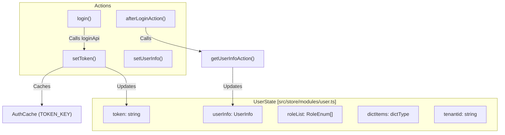
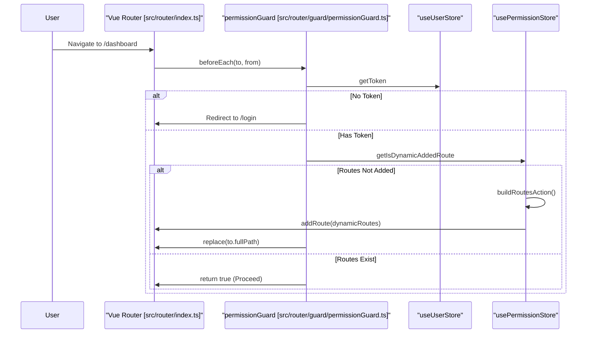

<!-- source: DeepWiki mcp.deepwiki.com · repo jeecgboot/JeecgBoot · page 6.5 State Management & Routing · fetched 2026-10-29 -->

# State Management & Routing

Relevant source files

The following files were used as context for generating this wiki page:

- [jeecgboot-vue3/VITE8-UPGRADE-LOG.md](jeecgboot-vue3/VITE8-UPGRADE-LOG.md)
- [jeecgboot-vue3/package.json](jeecgboot-vue3/package.json)
- [jeecgboot-vue3/pnpm-lock.yaml](jeecgboot-vue3/pnpm-lock.yaml)
- [jeecgboot-vue3/src/router/constant.ts](jeecgboot-vue3/src/router/constant.ts)
- [jeecgboot-vue3/src/router/guard/paramMenuGuard.ts](jeecgboot-vue3/src/router/guard/paramMenuGuard.ts)
- [jeecgboot-vue3/src/router/guard/permissionGuard.ts](jeecgboot-vue3/src/router/guard/permissionGuard.ts)
- [jeecgboot-vue3/src/router/index.ts](jeecgboot-vue3/src/router/index.ts)
- [jeecgboot-vue3/src/router/routes/basic.ts](jeecgboot-vue3/src/router/routes/basic.ts)
- [jeecgboot-vue3/src/store/modules/app.ts](jeecgboot-vue3/src/store/modules/app.ts)
- [jeecgboot-vue3/src/store/modules/defIndex.ts](jeecgboot-vue3/src/store/modules/defIndex.ts)
- [jeecgboot-vue3/src/store/modules/errorLog.ts](jeecgboot-vue3/src/store/modules/errorLog.ts)
- [jeecgboot-vue3/src/store/modules/locale.ts](jeecgboot-vue3/src/store/modules/locale.ts)
- [jeecgboot-vue3/src/store/modules/lock.ts](jeecgboot-vue3/src/store/modules/lock.ts)
- [jeecgboot-vue3/src/store/modules/multipleTab.ts](jeecgboot-vue3/src/store/modules/multipleTab.ts)
- [jeecgboot-vue3/src/store/modules/user.ts](jeecgboot-vue3/src/store/modules/user.ts)

The JeecgBoot frontend utilizes **Pinia** for state management and **Vue Router 5** for navigation control. The system implements a dynamic permission-based routing architecture where routes are built at runtime based on the user's roles and permissions retrieved from the backend.

## State Management (Pinia)

JeecgBoot uses Pinia (v3.x) to manage global state across the application. The stores are modularized and follow a strict `defineStore('id', { ... })` pattern to ensure compatibility with the latest version [jeecgboot-vue3/VITE8-UPGRADE-LOG.md:81-81]().

### Core Store Modules

| Store Module | ID | Purpose |
|:---|:---|:---|
| `user.ts` | `app-user` | Manages user profile, authentication tokens, roles, and dictionary data [jeecgboot-vue3/src/store/modules/user.ts:38-38](). |
| `app.ts` | `app` | Handles project configuration, dark mode, and global layout visibility [jeecgboot-vue3/src/store/modules/app.ts:31-31](). |
| `permission.ts`| `app-permission`| Manages dynamic route building and menu state based on user permissions [jeecgboot-vue3/src/store/modules/user.ts:14-14](). |
| `multipleTab.ts`| `app-multiple-tab`| Tracks opened tabs, manages Keep-Alive caching, and handles tab navigation [jeecgboot-vue3/src/store/modules/multipleTab.ts:90-90](). |
| `locale.ts` | `app-locale` | Manages internationalization (i18n) settings and path-to-title mapping [jeecgboot-vue3/src/store/modules/locale.ts:23-23](). |

### Data Flow: Authentication & User State
The `useUserStore` acts as the central hub for authentication. When a user logs in via `loginApi`, the store persists the token and user information both in memory and in the local cache [jeecgboot-vue3/src/store/modules/user.ts:152-157]().

**Pinia User Store Structure**

**Sources:** [jeecgboot-vue3/src/store/modules/user.ts:26-59](), [jeecgboot-vue3/src/store/modules/user.ts:144-161]()

## Routing Architecture

The routing system is split into **Basic Routes** (static) and **Dynamic Routes** (permission-based).

### Router Configuration
The router is initialized in `src/router/index.ts`. It supports both standard web environments and **Electron** environments by switching to hash-based routing when necessary [jeecgboot-vue3/src/router/index.ts:20-28]().

*   **Static Routes:** Include Login, 404 Error, and Redirect routes [jeecgboot-vue3/src/router/routes/basic.ts:6-51]().
*   **Dynamic Routes:** Built via `permissionStore.buildRoutesAction()` during the navigation guard process [jeecgboot-vue3/src/router/guard/permissionGuard.ts:175-181]().

### Navigation Guards
JeecgBoot implements several guards to manage access control and dynamic loading:

1.  **PermissionGuard:** The primary guard. It checks for the existence of a token. If the user is authenticated but dynamic routes haven't been added, it triggers the route building process [jeecgboot-vue3/src/router/guard/permissionGuard.ts:39-192]().
2.  **ParamMenuGuard:** Configures dynamic parameters for menus based on the current route [jeecgboot-vue3/src/router/guard/paramMenuGuard.ts:9-29]().

**Navigation Guard Flow**

**Sources:** [jeecgboot-vue3/src/router/guard/permissionGuard.ts:32-193](), [jeecgboot-vue3/src/router/index.ts:31-37]()

## Permission-Based Route Building

Dynamic routing allows the system to render menus and accessible paths based on the user's role and backend configuration.

### Route Building Process
1.  **Trigger:** The `permissionGuard` detects that `isDynamicAddedRoute` is false [jeecgboot-vue3/src/router/guard/permissionGuard.ts:170-172]().
2.  **Fetch:** `permissionStore.buildRoutesAction()` is called.
3.  **Filter:** Depending on the `permissionMode` (Back-end or Role-based), the store filters or transforms the menu data into `RouteRecordRaw` objects.
4.  **Inject:** Routes are added to the router instance using `router.addRoute()` [jeecgboot-vue3/src/router/guard/permissionGuard.ts:176-178]().
5.  **Fallback:** The `PAGE_NOT_FOUND_ROUTE` is always added last to ensure correct 404 handling for dynamic paths [jeecgboot-vue3/src/router/guard/permissionGuard.ts:180-180]().

### Tab Management & Caching
The `useMultipleTabStore` manages the `tabList`, which represents the currently open pages in the UI. It also handles **Keep-Alive** logic by maintaining a `cacheTabList` [jeecgboot-vue3/src/store/modules/multipleTab.ts:91-100]().

*   **Caching Logic:** Tabs are cached based on the `ignoreKeepAlive` meta property. Special handling is provided for Online Coding modules (e.g., `OnlineAutoList`) to ensure their state is preserved correctly [jeecgboot-vue3/src/store/modules/multipleTab.ts:116-142]().
*   **Persistence:** If enabled in `projectSetting`, the tab list is persisted to local storage using the `MULTIPLE_TABS_KEY` [jeecgboot-vue3/src/store/modules/multipleTab.ts:95-95]().

**Sources:** [jeecgboot-vue3/src/store/modules/multipleTab.ts:21-26](), [jeecgboot-vue3/src/store/modules/multipleTab.ts:200-209]()

---

