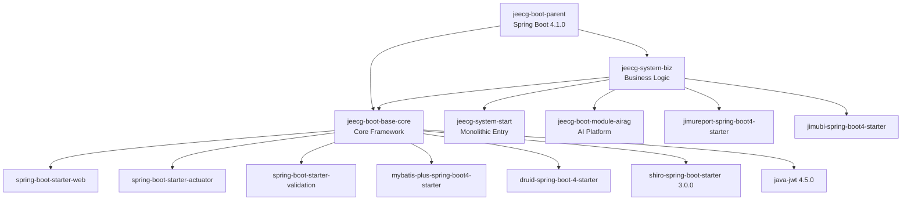
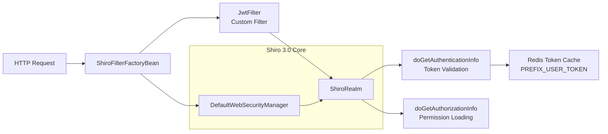

<!-- source: DeepWiki mcp.deepwiki.com · repo jeecgboot/JeecgBoot · page 7 Backend Development · fetched 2026-10-29 -->

# Backend Development

Relevant source files

The following files were used as context for generating this wiki page:

- [jeecg-boot/jeecg-boot-base-core/pom.xml](jeecg-boot/jeecg-boot-base-core/pom.xml)
- [jeecg-boot/jeecg-boot-base-core/src/main/java/org/jeecg/common/util/encryption/AesEncryptUtil.java](jeecg-boot/jeecg-boot-base-core/src/main/java/org/jeecg/common/util/encryption/AesEncryptUtil.java)
- [jeecg-boot/jeecg-boot-base-core/src/main/java/org/jeecg/config/shiro/ShiroConfig.java](jeecg-boot/jeecg-boot-base-core/src/main/java/org/jeecg/config/shiro/ShiroConfig.java)
- [jeecg-boot/jeecg-boot-module/jeecg-boot-module-airag/pom.xml](jeecg-boot/jeecg-boot-module/jeecg-boot-module-airag/pom.xml)
- [jeecg-boot/jeecg-module-system/jeecg-system-biz/pom.xml](jeecg-boot/jeecg-module-system/jeecg-system-biz/pom.xml)
- [jeecg-boot/jeecg-module-system/jeecg-system-biz/src/main/java/org/jeecg/config/jimureport/JimuDragExternalServiceImpl.java](jeecg-boot/jeecg-module-system/jeecg-system-biz/src/main/java/org/jeecg/config/jimureport/JimuDragExternalServiceImpl.java)
- [jeecg-boot/jeecg-module-system/jeecg-system-biz/src/main/java/org/jeecg/config/jimureport/JimuReportTokenService.java](jeecg-boot/jeecg-module-system/jeecg-system-biz/src/main/java/org/jeecg/config/jimureport/JimuReportTokenService.java)
- [jeecg-boot/jeecg-module-system/jeecg-system-start/pom.xml](jeecg-boot/jeecg-module-system/jeecg-system-start/pom.xml)
- [jeecg-boot/jeecg-module-system/jeecg-system-start/src/test/java/org/jeecg/modules/system/test/SysUserApiTest.java](jeecg-boot/jeecg-module-system/jeecg-system-start/src/test/java/org/jeecg/modules/system/test/SysUserApiTest.java)
- [jeecg-boot/jeecg-server-cloud/jeecg-visual/jeecg-cloud-test/jeecg-cloud-test-more/pom.xml](jeecg-boot/jeecg-server-cloud/jeecg-visual/jeecg-cloud-test/jeecg-cloud-test-more/pom.xml)
- [jeecg-boot/pom.xml](jeecg-boot/pom.xml)

This page provides a technical guide to backend development in JeecgBoot, covering the Maven module structure, core framework components, REST API patterns, data access utilities, exception handling, and service integration. For overall system architecture, see [Architecture](#2). For security implementation details, see [Security](#8).

## Maven Module Structure & Dependencies

JeecgBoot uses a multi-module Maven project structure managed by a parent POM. The architecture separates core utilities, business logic, and deployment configurations to support both monolithic and microservices deployment modes.

### Parent POM Configuration

The root `jeecg-boot-parent` POM manages all dependency versions and provides common build configurations:

| Dependency | Version | Purpose |
|------------|---------|---------|
| Spring Boot | 4.1.0 | Core framework |
| Spring Cloud | 2025.1.2 | Microservices support |
| Spring Cloud Alibaba | 2025.1.0.0 | Nacos, Sentinel integration |
| MyBatis-Plus | 3.5.16 | ORM and database access |
| Apache Shiro | 3.0.0 | Authentication and authorization |
| Druid | 1.2.28 | Database connection pool |
| Dynamic DataSource | 4.5.0 | Multi-database support |
| JimuReport | 2.5.0 | Reporting engine |
| Hutool | 5.8.25 | Utility library |

**Dependency Management**

The parent POM uses `<dependencyManagement>` to centralize version control without forcing child modules to inherit all dependencies. Key managed dependencies include:

- `jeecg-boot-base-core` - Core utilities module [jeecg-boot/pom.xml:208-212]()
- `jeecg-system-biz` - System business logic [jeecg-boot/pom.xml:196-200]()
- `jeecg-boot-common` - Shared tools and starters [jeecg-boot/pom.xml:203-207]()

**Sources:** [jeecg-boot/pom.xml:1-86](), [jeecg-boot/jeecg-boot-base-core/pom.xml:104-143]()

### Core Module Dependencies

The `jeecg-boot-base-core` module provides foundational components used by all other modules:

**Database Driver Support**

The `jeecg-boot-base-core` module includes runtime dependencies for multiple database drivers:

- MySQL 8.0.27 [jeecg-boot/jeecg-boot-base-core/pom.xml:147-152]()
- PostgreSQL 42.2.25 [jeecg-boot/jeecg-boot-base-core/pom.xml:168-173]()
- SQL Server 12.6.1 [jeecg-boot/jeecg-boot-base-core/pom.xml:154-159]()
- Oracle 11.2.0.3 [jeecg-boot/jeecg-boot-base-core/pom.xml:161-166]()
- Kingbase8 9.0.0 (人大金仓) [jeecg-boot/jeecg-boot-base-core/pom.xml:175-180]()
- DM8 8.1.3.140 (达梦数据库) [jeecg-boot/jeecg-boot-base-core/pom.xml:182-191]()

**Sources:** [jeecg-boot/jeecg-boot-base-core/pom.xml:42-233](), [jeecg-boot/jeecg-module-system/jeecg-system-biz/pom.xml:13-59]()

## Core Framework Components

The `jeecg-boot-base-core` module provides foundational utilities and configurations used throughout the application.

### Shiro Security Configuration

The `ShiroConfig` class configures Apache Shiro 3.0 for JWT-based authentication and authorization:

**Filter Chain Configuration**

The `shiroFilter` method [jeecg-boot/jeecg-boot-base-core/src/main/java/org/jeecg/config/shiro/ShiroConfig.java:68-175]() configures access rules. Key excluded paths include:

- `/sys/login`, `/sys/logout`, `/sys/mLogin` - Authentication endpoints [line 90-92]()
- `/sys/randomImage/**`, `/sys/checkCaptcha` - CAPTCHA endpoints [line 87-88]()
- `/sys/thirdLogin/**` - Third-party OAuth login [line 93]()
- `/sys/getEncryptedString` - AES encryption key endpoint [line 94]()
- `/jmreport/**` - JimuReport endpoints [line 142]()
- `/drag/view`, `/drag/page/queryById` - JimuBI dashboard endpoints [line 147-148]()
- Static resources: `/**/*.js`, `/**/*.css`, `/**/*.html`, `/**/*.glb`, `/**/*.wasm`, etc. [line 117-131]()

YML-based exclusions are also supported via `jeecgBaseConfig.getShiro().getExcludeUrls()` [line 75-83]().

**Sources:** [jeecg-boot/jeecg-boot-base-core/src/main/java/org/jeecg/config/shiro/ShiroConfig.java:47-175]()

### Encryption Utilities

The `AesEncryptUtil` class provides AES encryption with dual-mode support for backward compatibility:

| Mode | Algorithm | Padding | Usage |
|------|-----------|---------|-------|
| New (Default) | AES/CBC | PKCS5Padding | Frontend CryptoJS compatibility [line 21-28]() |
| Legacy | AES/CBC | NoPadding | Historical password data [line 31-39]() |

The `resolvePassword` method [line 42-64]() attempts PKCS5 decryption first, falling back to legacy NoPadding mode, then treating input as plaintext if both fail.

**Sources:** [jeecg-common/util/encryption/AesEncryptUtil.java:1-107]()

## REST API Development

### Controller Pattern

JeecgBoot follows a standard three-layer architecture. Controllers handle HTTP requests and return `Result<T>` objects.

**Standard Controller Methods**

Typical CRUD controllers implement methods like `queryPageList`, `add`, `edit`, and `delete`. The `SysUserController` demonstrates these patterns in unit tests [jeecg-boot/jeecg-module-system/jeecg-system-start/src/test/java/org/jeecg/modules/system/test/SysUserApiTest.java:80-174]().

- `testQuery`: Tests paginated list retrieval via `GET /sys/user/list` [line 86-105]()
- `testAdd`: Tests record creation via `POST /sys/user/add` [line 111-128]()
- `testEdit`: Tests updates via `PUT /sys/user/edit` [line 135-158]()
- `testDelete`: Tests deletion via `DELETE /sys/user/delete` [line 165-173]()

**Sources:** [jeecg-boot/jeecg-module-system/jeecg-system-start/src/test/java/org/jeecg/modules/system/test/SysUserApiTest.java:33-174]()

## Service Integration

JeecgBoot provides standardized interfaces for integrating external services and reporting engines.

### JimuReport Integration

#### Token Service
The `JimuReportTokenService` [jeecg-boot/jeecg-module-system/jeecg-system-biz/src/main/java/org/jeecg/config/jimureport/JimuReportTokenService.java:32]() bridges JeecgBoot's authentication with JimuReport:

- `getToken`: Extracts token from request via `TokenUtils` [line 40-46]()
- `getUsername`: Extracts username from JWT [line 49-51]()
- `verifyToken`: Validates token against Redis [line 64-66]()
- `getUserInfo`: Returns `SYS_USER_CODE` and `SYS_ORG_CODE` for SQL variable substitution [line 69-86]()

#### Drag Service (Dictionary Integration)
The `JimuDragExternalServiceImpl` [jeecg-boot/jeecg-module-system/jeecg-system-biz/src/main/java/org/jeecg/config/jimureport/JimuDragExternalServiceImpl.java:32]() implements `IOnlDragExternalService` for JimuBI:

- `getManyDictItems`: Batch query for multiple dictionary codes and table-based dictionaries [line 47-80]()
- `getDictItems`: Query single dictionary code [line 88-99]()
- `addLog`: Delegates logging to `baseCommonService` [line 106-123]()

**Sources:** [jeecg-boot/jeecg-module-system/jeecg-system-biz/src/main/java/org/jeecg/config/jimureport/JimuReportTokenService.java:1-130](), [jeecg-boot/jeecg-module-system/jeecg-system-biz/src/main/java/org/jeecg/config/jimureport/JimuDragExternalServiceImpl.java:1-124]()

## Database Migration with Flyway

JeecgBoot uses Flyway for version-controlled database schema migrations. The `jeecg-system-start` module includes the `flyway-core` dependency [jeecg-boot/jeecg-module-system/jeecg-system-start/pom.xml:29-33]().

Migrations are used to automate schema updates, such as modifying column types for JimuBI components [jeecg-boot/jeecg-module-system/jeecg-system-start/src/main/resources/flyway/sql/mysql/V3.8.3_1__upgrade_jimubi.sql:1-3]().

---

## Summary

JeecgBoot's backend development framework provides:

1. **Modular Maven Structure**: Parent POM with Spring Boot 4.1.0 and Spring Cloud 2025 support.
2. **Security Integration**: Shiro 3.0 + JWT with custom `JwtFilter`.
3. **Encryption**: `AesEncryptUtil` for secure password handling.
4. **Service Integration**: Standardized interfaces for JimuReport and JimuBI.
5. **Database Migration**: Versioned schema control via Flyway.

For specific subsystems, refer to:
- [Maven Module Structure & Dependencies](#7.1)
- [Query Generation & Data Permissions](#7.2)
- [REST API Development](#7.3)
- [Exception Handling](#7.4)
- [Service Integration](#7.5)
- [Configuration Management](#7.6)
- [Database Migration with Flyway](#7.7)

---

