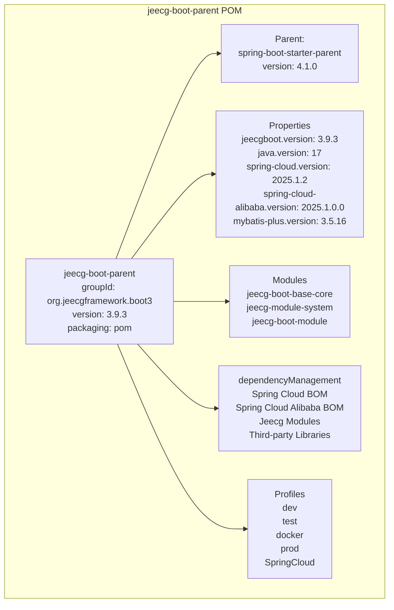
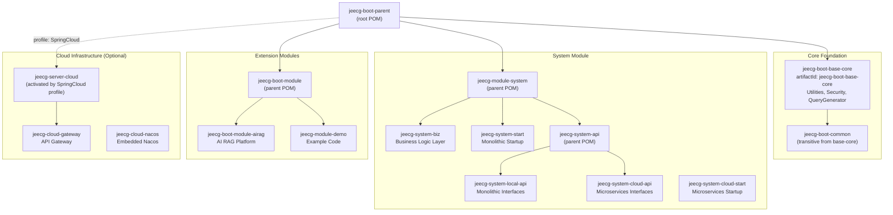
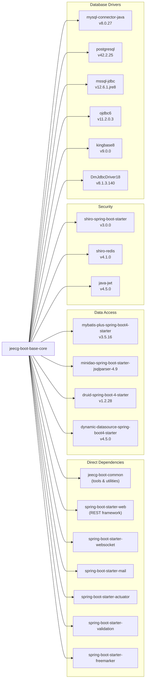
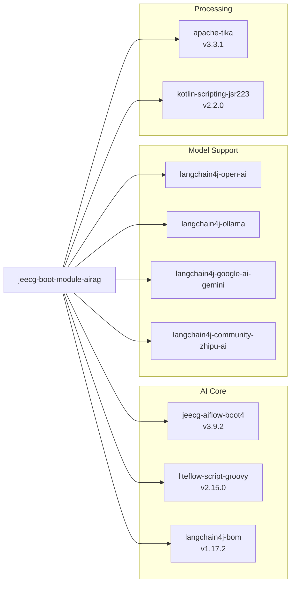

<!-- source: DeepWiki mcp.deepwiki.com · repo jeecgboot/JeecgBoot · page 7.1 Maven Module Structure & Dependencies · fetched 2026-10-29 -->

# Maven Module Structure & Dependencies

Relevant source files

The following files were used as context for generating this wiki page:

- [jeecg-boot/jeecg-boot-base-core/pom.xml](jeecg-boot/jeecg-boot-base-core/pom.xml)
- [jeecg-boot/jeecg-boot-base-core/src/main/java/org/jeecg/common/util/encryption/AesEncryptUtil.java](jeecg-boot/jeecg-boot-base-core/src/main/java/org/jeecg/common/util/encryption/AesEncryptUtil.java)
- [jeecg-boot/jeecg-boot-base-core/src/main/java/org/jeecg/config/shiro/ShiroConfig.java](jeecg-boot/jeecg-boot-base-core/src/main/java/org/jeecg/config/shiro/ShiroConfig.java)
- [jeecg-boot/jeecg-boot-module/jeecg-boot-module-airag/pom.xml](jeecg-boot/jeecg-boot-module/jeecg-boot-module-airag/pom.xml)
- [jeecg-boot/jeecg-boot-module/jeecg-module-demo/pom.xml](jeecg-boot/jeecg-boot-module/jeecg-module-demo/pom.xml)
- [jeecg-boot/jeecg-boot-module/pom.xml](jeecg-boot/jeecg-boot-module/pom.xml)
- [jeecg-boot/jeecg-module-system/jeecg-system-api/jeecg-system-cloud-api/pom.xml](jeecg-boot/jeecg-module-system/jeecg-system-api/jeecg-system-cloud-api/pom.xml)
- [jeecg-boot/jeecg-module-system/jeecg-system-api/pom.xml](jeecg-boot/jeecg-module-system/jeecg-system-api/pom.xml)
- [jeecg-boot/jeecg-module-system/pom.xml](jeecg-boot/jeecg-module-system/pom.xml)
- [jeecg-boot/jeecg-server-cloud/jeecg-cloud-gateway/pom.xml](jeecg-boot/jeecg-server-cloud/jeecg-cloud-gateway/pom.xml)
- [jeecg-boot/jeecg-server-cloud/jeecg-demo-cloud-start/pom.xml](jeecg-boot/jeecg-server-cloud/jeecg-demo-cloud-start/pom.xml)
- [jeecg-boot/jeecg-server-cloud/jeecg-system-cloud-start/pom.xml](jeecg-boot/jeecg-server-cloud/jeecg-system-cloud-start/pom.xml)
- [jeecg-boot/jeecg-server-cloud/jeecg-visual/jeecg-cloud-test/jeecg-cloud-test-rabbitmq/pom.xml](jeecg-boot/jeecg-server-cloud/jeecg-visual/jeecg-cloud-test/jeecg-cloud-test-rabbitmq/pom.xml)
- [jeecg-boot/jeecg-server-cloud/jeecg-visual/jeecg-cloud-test/jeecg-cloud-test-rocketmq/pom.xml](jeecg-boot/jeecg-server-cloud/jeecg-visual/jeecg-cloud-test/jeecg-cloud-test-rocketmq/pom.xml)
- [jeecg-boot/jeecg-server-cloud/jeecg-visual/jeecg-cloud-test/jeecg-cloud-test-seata/jeecg-cloud-test-seata-account/pom.xml](jeecg-boot/jeecg-server-cloud/jeecg-visual/jeecg-cloud-test/jeecg-cloud-test-seata/jeecg-cloud-test-seata-account/pom.xml)
- [jeecg-boot/pom.xml](jeecg-boot/pom.xml)

## Purpose and Scope

This page documents the Maven multi-module structure of JeecgBoot's backend, explaining how the parent POM manages dependencies, how modules are organized, and the dependency relationships between modules. This covers the build configuration, version management strategy, and key third-party library integration.

For information about frontend build configuration, see [Build System & PWA Configuration](#2.3.1). For microservices-specific configuration, see [Service Discovery & Configuration (Nacos)](#2.4.1). For deployment configuration, see [Docker Deployment](#9.1).

---

## Parent POM Structure

The root `jeecg-boot-parent` POM serves as the dependency management center for the entire project, inheriting from `spring-boot-starter-parent` and managing all module versions centrally.

### Parent POM Configuration

**Sources:** [jeecg-boot/pom.xml:1-28](), [jeecg-boot/pom.xml:30-86](), [jeecg-boot/pom.xml:88-92]()

### Version Property Management

The parent POM defines version properties for all dependencies, enabling centralized version upgrades:

| Property | Version | Purpose |
|----------|---------|---------|
| `jeecgboot.version` | 3.9.3 | Internal module version |
| `java.version` | 17 | JDK version (supports 17, 21, 24, 25) |
| `spring-cloud.version` | 2025.1.2 | Spring Cloud framework |
| `spring-cloud-alibaba.version` | 2025.1.0.0 | Spring Cloud Alibaba |
| `mybatis-plus.version` | 3.5.16 | MyBatis-Plus ORM |
| `druid.version` | 1.2.28 | Druid connection pool |
| `shiro.version` | 3.0.0 | Apache Shiro security (Jakarta EE native) |
| `jimureport-spring-boot-starter.version` | 2.5.0 | JimuReport integration |
| `knife4j-spring-boot-starter.version` | 4.5.0 | API documentation |
| `hutool.version` | 5.8.25 | Hutool utilities |

**Sources:** [jeecg-boot/pom.xml:30-86]()

---

## Module Hierarchy and Structure

JeecgBoot follows a hierarchical multi-module structure with clear separation of concerns:

**Sources:** [jeecg-boot/pom.xml:88-92](), [jeecg-boot/jeecg-module-system/jeecg-system-api/pom.xml:15-18](), [jeecg-boot/jeecg-boot-module/pom.xml:1-20]()

---

## Core Module: jeecg-boot-base-core

The `jeecg-boot-base-core` module provides foundational utilities and configurations used by all other modules.

### Base Core Dependencies

**Sources:** [jeecg-boot/jeecg-boot-base-core/pom.xml:42-240]()

### Key Configuration Classes in Base Core

The `jeecg-boot-base-core` module contains critical configuration classes:

| Class | Purpose | Key Methods/Features |
|-------|---------|----------------------|
| `ShiroConfig` | Shiro security configuration | Filter chain definition, JWT filter setup, exclusion URLs [jeecg-boot/jeecg-boot-base-core/src/main/java/org/jeecg/config/shiro/ShiroConfig.java:68-150]() |
| `AesEncryptUtil` | AES encryption utilities | Dual-mode decryption (PKCS5Padding + NoPadding legacy) [jeecg-boot/jeecg-boot-base-core/src/main/java/org/jeecg/common/util/encryption/AesEncryptUtil.java:42-64]() |

---

## AI Module: jeecg-boot-module-airag

The `jeecg-boot-module-airag` module integrates LLM and RAG capabilities into the JeecgBoot ecosystem.

### AI Module Dependencies

**Sources:** [jeecg-boot/jeecg-boot-module/jeecg-boot-module-airag/pom.xml:33-188]()

---

## Dependency Management Strategy

### BOM (Bill of Materials) Imports

The parent POM imports major framework BOMs to ensure version consistency across microservices:

- **Spring Cloud BOM**: `spring-cloud-dependencies` version `2025.1.2` [jeecg-boot/pom.xml:179-185]()
- **Spring Cloud Alibaba BOM**: `spring-cloud-alibaba-dependencies` version `2025.1.0.0` [jeecg-boot/pom.xml:187-193]()
- **LangChain4j BOM**: Used in AI module for consistent model integration [jeecg-boot/jeecg-boot-module/jeecg-boot-module-airag/pom.xml:42-57]()

### Version Override Strategy

JeecgBoot overrides specific transitive dependency versions to resolve conflicts or support Spring Boot 4/Jakarta EE requirements:

- **MyBatis-Plus**: Uses `mybatis-plus-spring-boot4-starter` for modern Spring compatibility [jeecg-boot/jeecg-boot-base-core/pom.xml:105-109]()
- **Shiro**: Upgraded to `3.0.0` for native Jakarta EE support [jeecg-boot/jeecg-boot-base-core/pom.xml:207-209]()
- **Druid**: Upgraded to `druid-spring-boot-4-starter` [jeecg-boot/jeecg-boot-base-core/pom.xml:123-126]()

---

## Microservices Module Structure

When deployed in microservices mode, the project uses the `jeecg-server-cloud` hierarchy:

| Module | Purpose | Key Dependencies |
|--------|---------|------------------|
| `jeecg-cloud-gateway` | API Gateway with Sentinel and Redis rate limiting | `spring-cloud-starter-gateway-server-webflux`, `spring-cloud-alibaba-sentinel-gateway` [jeecg-boot/jeecg-server-cloud/jeecg-cloud-gateway/pom.xml:25-40]() |
| `jeecg-system-cloud-start` | System microservice entry point | `jeecg-boot-starter-cloud`, `jeecg-system-biz` [jeecg-boot/jeecg-server-cloud/jeecg-system-cloud-start/pom.xml:15-38]() |
| `jeecg-demo-cloud-start` | Demo microservice entry point | `jeecg-module-demo` [jeecg-boot/jeecg-server-cloud/jeecg-demo-cloud-start/pom.xml:32-37]() |
| `jeecg-system-cloud-api` | Feign client interfaces for System | `spring-cloud-starter-openfeign` [jeecg-boot/jeecg-module-system/jeecg-system-api/jeecg-system-cloud-api/pom.xml:15-19]() |

---

## Build Configuration & Profiles

### Resource Filtering

The parent POM configures resource filtering to inject Maven properties into configuration files while protecting binary assets:

- **Filtered**: `src/main/resources` [jeecg-boot/pom.xml:588-592]()
- **Excluded from Filtering**: Binary extensions like `woff`, `pdf`, `glb`, `wasm`, `png`, `zip` to prevent corruption [jeecg-boot/pom.xml:602-636]()

### Build Profiles

Profiles allow for environment-specific configurations:

- **dev**: Active by default, targets local Nacos [jeecg-boot/pom.xml:654-672]()
- **SpringCloud**: Activates the `jeecg-server-cloud` module for microservices compilation [jeecg-boot/pom.xml:744-750]()

**Sources:** [jeecg-boot/pom.xml:654-751]()

---

