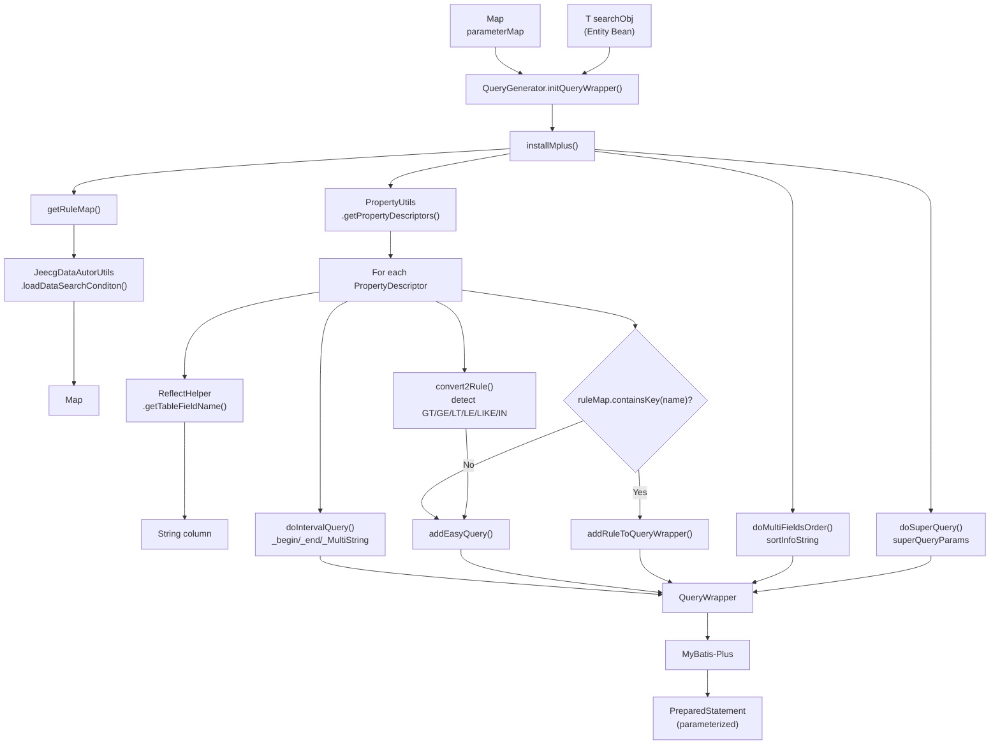
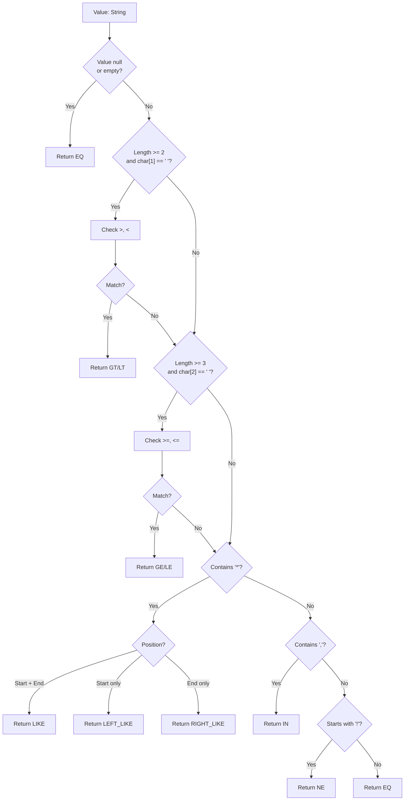
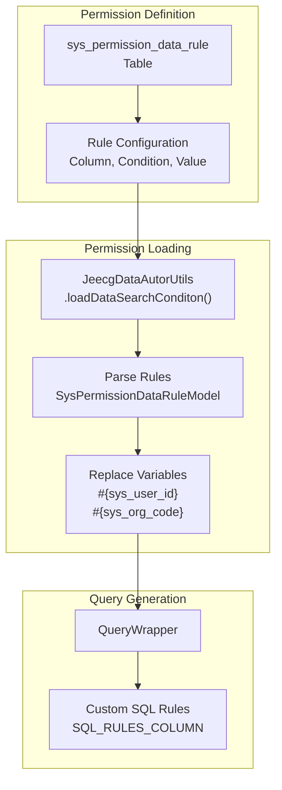
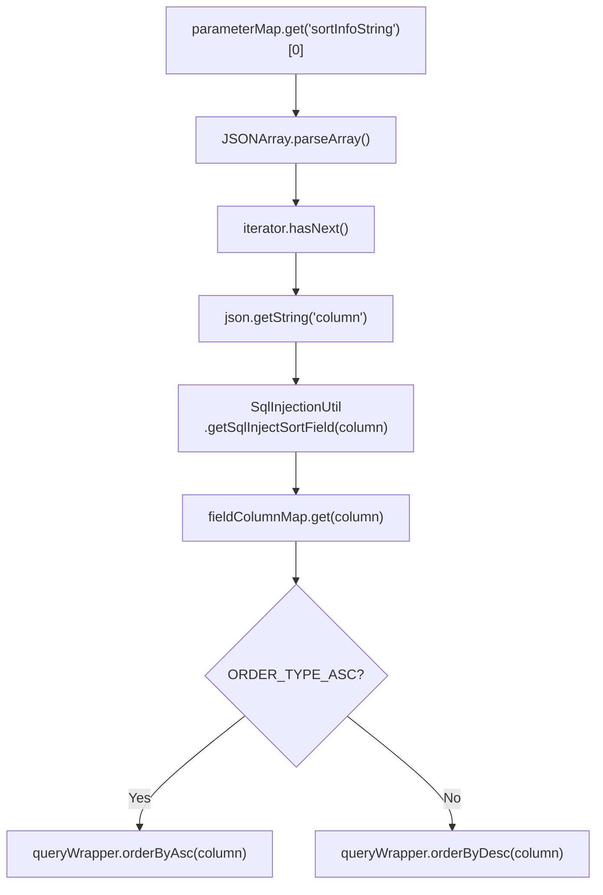

<!-- source: DeepWiki mcp.deepwiki.com · repo jeecgboot/JeecgBoot · page 7.2 Query Generation & Data Permissions · fetched 2026-10-29 -->

# Query Generation & Data Permissions

<details>
<summary>Relevant source files</summary>

The following files were used as context for generating this wiki page:

- [check_jeecgenv.py](check_jeecgenv.py)
- [jeecg-boot/jeecg-boot-base-core/src/main/java/org/jeecg/common/system/query/QueryGenerator.java](jeecg-boot/jeecg-boot-base-core/src/main/java/org/jeecg/common/system/query/QueryGenerator.java)
- [jeecg-boot/jeecg-boot-base-core/src/main/java/org/jeecg/common/system/util/JwtUtil.java](jeecg-boot/jeecg-boot-base-core/src/main/java/org/jeecg/common/system/util/JwtUtil.java)
- [jeecg-boot/jeecg-boot-base-core/src/main/java/org/jeecg/common/system/util/SqlConcatUtil.java](jeecg-boot/jeecg-boot-base-core/src/main/java/org/jeecg/common/system/util/SqlConcatUtil.java)
- [jeecg-boot/jeecg-boot-base-core/src/main/java/org/jeecg/common/util/oConvertUtils.java](jeecg-boot/jeecg-boot-base-core/src/main/java/org/jeecg/common/util/oConvertUtils.java)
- [jeecg-boot/jeecg-boot-base-core/src/main/java/org/jeecg/config/WebMvcConfiguration.java](jeecg-boot/jeecg-boot-base-core/src/main/java/org/jeecg/config/WebMvcConfiguration.java)
- [jeecg-boot/jeecg-boot-base-core/src/main/java/org/jeecg/config/mybatis/MybatisPlusSaasConfig.java](jeecg-boot/jeecg-boot-base-core/src/main/java/org/jeecg/config/mybatis/MybatisPlusSaasConfig.java)
- [jeecg-boot/jeecg-boot-base-core/src/main/java/org/jeecg/config/oss/MinioConfig.java](jeecg-boot/jeecg-boot-base-core/src/main/java/org/jeecg/config/oss/MinioConfig.java)
- [jeecg-boot/jeecg-boot-base-core/src/main/java/org/jeecg/config/oss/OssConfiguration.java](jeecg-boot/jeecg-boot-base-core/src/main/java/org/jeecg/config/oss/OssConfiguration.java)
- [jeecg-boot/jeecg-module-system/jeecg-system-start/src/test/java/org/jeecg/modules/system/test/MockControllerTest.java](jeecg-boot/jeecg-module-system/jeecg-system-start/src/test/java/org/jeecg/modules/system/test/MockControllerTest.java)

</details>


## Purpose and Scope

This document covers the query generation and data permissions system in JeecgBoot's backend. The `QueryGenerator` utility provides a declarative approach to building database queries from HTTP request parameters while automatically enforcing row-level security through data permission rules.

**Scope:**
- Dynamic query generation from request parameters
- Query rule types and syntax
- Data permission enforcement (row-level security)
- Interval queries, multi-field sorting, and advanced query features
- SQL concatenation utilities for custom queries

**Related Pages:**
- For API development patterns, see [REST API Development](#7.3)
- For authentication and RBAC model, see [Authorization & Permissions](#8.2)
- For row-level security configuration, see [Data Permissions & Row-Level Security](#8.3)

---

## QueryGenerator Architecture

`QueryGenerator` transforms HTTP request parameters into MyBatis Plus `QueryWrapper<T>` instances with automatic query rule parsing, type conversion, data permission injection, and SQL injection prevention.

### Core Processing Flow

The following diagram illustrates how `QueryGenerator` processes input parameters and entity metadata to produce a secured query.

Title: QueryGenerator Data Flow


**Sources:** [jeecg-boot/jeecg-boot-base-core/src/main/java/org/jeecg/common/system/query/QueryGenerator.java:92-217]()

---

## Query Rules and Rule Detection

`QueryGenerator` supports multiple query rule types that are automatically detected from parameter values based on prefixes or special characters.

### Query Rule Detection Logic

The system parses parameter values to determine the appropriate `QueryRuleEnum`.

Title: Query Rule Detection Flow


### Supported Rules

| Rule | Value | SQL Operator | Example Input | SQL Output |
|------|-------|--------------|---------------|------------|
| `GT` | `>` | `>` | `> 100` | `field > 100` |
| `GE` | `>=` | `>=` | `>= 100` | `field >= 100` |
| `NE` | `!=` | `<>` | `!admin` | `field <> 'admin'` |
| `IN` | `in` | `IN` | `1,2,3` | `field IN (1,2,3)` |
| `LIKE` | `like` | `LIKE` | `*admin*` | `field LIKE '%admin%'` |

**Sources:** [jeecg-boot/jeecg-boot-base-core/src/main/java/org/jeecg/common/system/query/QueryGenerator.java:486-554]()

---

## Basic Usage Pattern

### In a Controller

Controllers typically initialize the `QueryWrapper` using the incoming `HttpServletRequest`.

```java
@GetMapping("/list")
public Result<IPage<User>> queryPageList(
    User user,
    @RequestParam(name="pageNo", defaultValue="1") Integer pageNo,
    @RequestParam(name="pageSize", defaultValue="10") Integer pageSize,
    HttpServletRequest req) {
    
    // Initialize QueryWrapper with automatic rule parsing
    QueryWrapper<User> queryWrapper = QueryGenerator.initQueryWrapper(user, req.getParameterMap());
    
    Page<User> page = new Page<>(pageNo, pageSize);
    return Result.OK(userService.page(page, queryWrapper));
}
```

**Sources:** [jeecg-boot/jeecg-boot-base-core/src/main/java/org/jeecg/common/system/query/QueryGenerator.java:92-98]()

---

## Data Permissions System

### Architecture Overview

Data permissions provide row-level security by automatically injecting `WHERE` conditions based on user roles, departments, and custom rules.

Title: Row-Level Security Injection


### System Variables

Variables are automatically replaced with context from `JwtUtil`.

| Variable | Description | Source |
|----------|-------------|--------|
| `#{sys_user_id}` | Current user ID | `JwtUtil.getUsername()` via claim |
| `#{sys_org_code}` | Current department code | JWT token claim |

**Sources:** [jeecg-boot/jeecg-boot-base-core/src/main/java/org/jeecg/common/system/query/QueryGenerator.java:800-894](), [jeecg-boot/jeecg-boot-base-core/src/main/java/org/jeecg/common/system/util/JwtUtil.java:101-109]()

---

## Advanced Query Features

### Interval Queries

Supports range filtering using `_begin` and `_end` suffixes.

**Implementation:**
[jeecg-boot/jeecg-boot-base-core/src/main/java/org/jeecg/common/system/query/QueryGenerator.java:228-245]()
```java
private static void doIntervalQuery(QueryWrapper<?> queryWrapper, Map<String, String[]> parameterMap, String type, String name, String column) {
    // Logic to handle _begin and _end suffixes
}
```

### Multi-Field Sorting

Sorting priority is handled in `doMultiFieldsOrder()`.

Title: Sorting Translation Flow


**Sources:** [jeecg-boot/jeecg-boot-base-core/src/main/java/org/jeecg/common/system/query/QueryGenerator.java:247-360](), [jeecg-boot/jeecg-boot-base-core/src/main/java/org/jeecg/common/system/util/SqlConcatUtil.java:249-289]()

---

## SQL Concatenation Utilities

`SqlConcatUtil` builds SQL strings for JDBC-based queries or reports where MyBatis Plus is not used directly.

### Database-Specific SQL Generation

The utility handles dialect differences, particularly for SQL Server `N''` literals.

[jeecg-boot/jeecg-boot-base-core/src/main/java/org/jeecg/common/system/util/SqlConcatUtil.java:138-142]()
```java
if(DataBaseConstant.DB_TYPE_SQLSERVER.equals(dataBaseType)){
    return " N'"+str+"' ";
}else{
    return " '"+str+"' ";
}
```

**Sources:** [jeecg-boot/jeecg-boot-base-core/src/main/java/org/jeecg/common/system/util/SqlConcatUtil.java:119-150]()

---

## Security Considerations

### SQL Injection Prevention

1. **Parameterized Queries:** All user input is bound via `PreparedStatement`.
2. **Sort Field Filtering:** Sort columns are validated against entity properties.
   [jeecg-boot/jeecg-boot-base-core/src/main/java/org/jeecg/common/system/query/QueryGenerator.java:349]()
3. **Special Character Escaping:** MySQL `_` and `%` are escaped in LIKE queries.
   [jeecg-boot/jeecg-boot-base-core/src/main/java/org/jeecg/common/system/query/QueryGenerator.java:1028-1038]()

### Multi-Tenant Isolation

Tenant isolation is enforced at the MyBatis Plus interceptor level, separate from the query generator, but integrated via `TenantContext`.

[jeecg-boot/jeecg-boot-base-core/src/main/java/org/jeecg/config/mybatis/MybatisPlusSaasConfig.java:96-129]()

**Sources:** [jeecg-boot/jeecg-boot-base-core/src/main/java/org/jeecg/config/mybatis/MybatisPlusSaasConfig.java:96-129](), [jeecg-boot/jeecg-boot-base-core/src/main/java/org/jeecg/common/system/query/QueryGenerator.java:1028-1038]()

---

