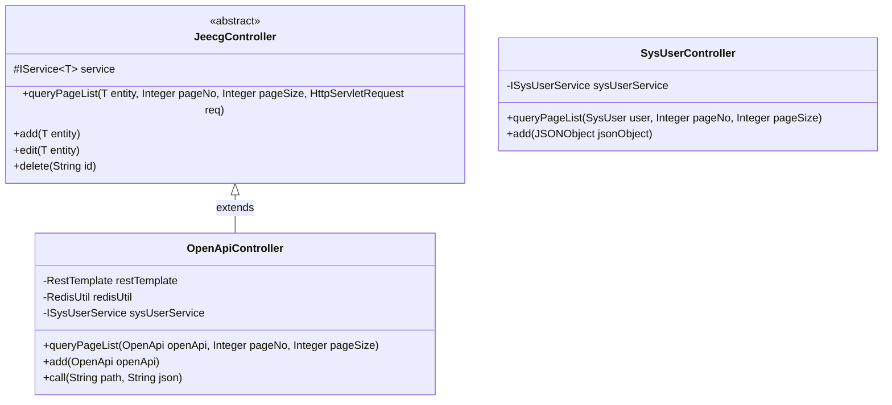
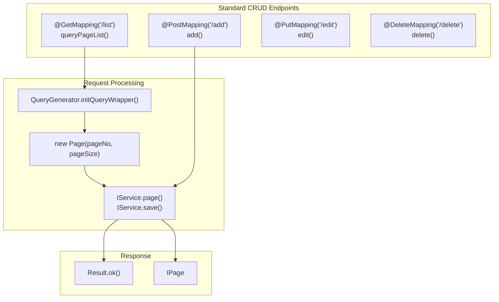
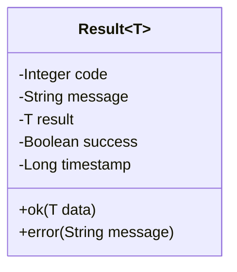
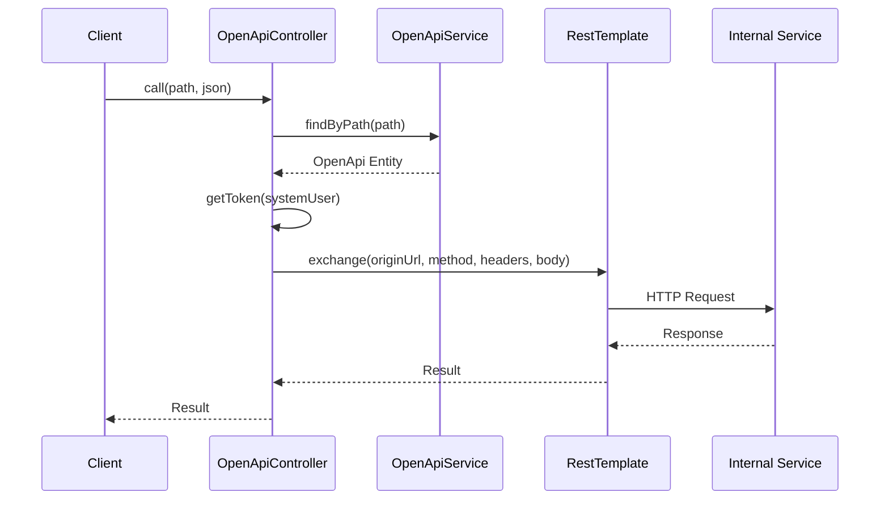

<!-- source: DeepWiki mcp.deepwiki.com · repo jeecgboot/JeecgBoot · page 7.3 REST API Development · fetched 2026-10-29 -->

# REST API Development

Relevant source files

The following files were used as context for generating this wiki page:

- [jeecg-boot/jeecg-boot-base-core/src/main/java/org/jeecg/common/constant/enums/DepartCategoryEnum.java](jeecg-boot/jeecg-boot-base-core/src/main/java/org/jeecg/common/constant/enums/DepartCategoryEnum.java)
- [jeecg-boot/jeecg-boot-base-core/src/main/java/org/jeecg/common/constant/enums/PositionLevelEnum.java](jeecg-boot/jeecg-boot-base-core/src/main/java/org/jeecg/common/constant/enums/PositionLevelEnum.java)
- [jeecg-boot/jeecg-boot-base-core/src/main/java/org/jeecg/common/system/vo/LoginUser.java](jeecg-boot/jeecg-boot-base-core/src/main/java/org/jeecg/common/system/vo/LoginUser.java)
- [jeecg-boot/jeecg-boot-base-core/src/main/java/org/jeecg/common/util/RestDesformUtil.java](jeecg-boot/jeecg-boot-base-core/src/main/java/org/jeecg/common/util/RestDesformUtil.java)
- [jeecg-boot/jeecg-boot-base-core/src/main/java/org/jeecg/common/util/RestUtil.java](jeecg-boot/jeecg-boot-base-core/src/main/java/org/jeecg/common/util/RestUtil.java)
- [jeecg-boot/jeecg-boot-base-core/src/main/java/org/jeecg/config/DruidConfig.java](jeecg-boot/jeecg-boot-base-core/src/main/java/org/jeecg/config/DruidConfig.java)
- [jeecg-boot/jeecg-boot-module/jeecg-boot-module-airag/src/main/java/org/jeecg/modules/airag/llm/handler/PluginToolBuilder.java](jeecg-boot/jeecg-boot-module/jeecg-boot-module-airag/src/main/java/org/jeecg/modules/airag/llm/handler/PluginToolBuilder.java)
- [jeecg-boot/jeecg-module-system/jeecg-system-api/jeecg-system-cloud-api/src/main/java/org/jeecg/common/system/api/ISysBaseAPI.java](jeecg-boot/jeecg-module-system/jeecg-system-api/jeecg-system-cloud-api/src/main/java/org/jeecg/common/system/api/ISysBaseAPI.java)
- [jeecg-boot/jeecg-module-system/jeecg-system-api/jeecg-system-cloud-api/src/main/java/org/jeecg/common/system/api/fallback/SysBaseAPIFallback.java](jeecg-boot/jeecg-module-system/jeecg-system-api/jeecg-system-cloud-api/src/main/java/org/jeecg/common/system/api/fallback/SysBaseAPIFallback.java)
- [jeecg-boot/jeecg-module-system/jeecg-system-api/jeecg-system-local-api/src/main/java/org/jeecg/common/system/api/ISysBaseAPI.java](jeecg-boot/jeecg-module-system/jeecg-system-api/jeecg-system-local-api/src/main/java/org/jeecg/common/system/api/ISysBaseAPI.java)
- [jeecg-boot/jeecg-module-system/jeecg-system-biz/src/main/java/org/jeecg/config/init/TomcatFactoryConfig.java](jeecg-boot/jeecg-module-system/jeecg-system-biz/src/main/java/org/jeecg/config/init/TomcatFactoryConfig.java)
- [jeecg-boot/jeecg-module-system/jeecg-system-biz/src/main/java/org/jeecg/modules/api/controller/SystemApiController.java](jeecg-boot/jeecg-module-system/jeecg-system-biz/src/main/java/org/jeecg/modules/api/controller/SystemApiController.java)
- [jeecg-boot/jeecg-module-system/jeecg-system-biz/src/main/java/org/jeecg/modules/monitor/actuator/CustomActuatorConfig.java](jeecg-boot/jeecg-module-system/jeecg-system-biz/src/main/java/org/jeecg/modules/monitor/actuator/CustomActuatorConfig.java)
- [jeecg-boot/jeecg-module-system/jeecg-system-biz/src/main/java/org/jeecg/modules/monitor/service/impl/MailHealthIndicator.java](jeecg-boot/jeecg-module-system/jeecg-system-biz/src/main/java/org/jeecg/modules/monitor/service/impl/MailHealthIndicator.java)
- [jeecg-boot/jeecg-module-system/jeecg-system-biz/src/main/java/org/jeecg/modules/openapi/controller/OpenApiController.java](jeecg-boot/jeecg-module-system/jeecg-system-biz/src/main/java/org/jeecg/modules/openapi/controller/OpenApiController.java)
- [jeecg-boot/jeecg-module-system/jeecg-system-biz/src/main/java/org/jeecg/modules/system/controller/SysDepartRoleController.java](jeecg-boot/jeecg-module-system/jeecg-system-biz/src/main/java/org/jeecg/modules/system/controller/SysDepartRoleController.java)
- [jeecg-boot/jeecg-module-system/jeecg-system-biz/src/main/java/org/jeecg/modules/system/controller/SysUserController.java](jeecg-boot/jeecg-module-system/jeecg-system-biz/src/main/java/org/jeecg/modules/system/controller/SysUserController.java)
- [jeecg-boot/jeecg-module-system/jeecg-system-biz/src/main/java/org/jeecg/modules/system/service/ISysAnnouncementService.java](jeecg-boot/jeecg-module-system/jeecg-system-biz/src/main/java/org/jeecg/modules/system/service/ISysAnnouncementService.java)
- [jeecg-boot/jeecg-module-system/jeecg-system-biz/src/main/java/org/jeecg/modules/system/service/impl/SysUserServiceImpl.java](jeecg-boot/jeecg-module-system/jeecg-system-biz/src/main/java/org/jeecg/modules/system/service/impl/SysUserServiceImpl.java)
- [jeecg-boot/jeecg-module-system/jeecg-system-start/src/main/java/org/jeecg/JeecgSystemApplication.java](jeecg-boot/jeecg-module-system/jeecg-system-start/src/main/java/org/jeecg/JeecgSystemApplication.java)

## Purpose and Scope

This document covers the development of RESTful APIs in JeecgBoot's backend using Spring MVC. It explains controller patterns, request/response handling, standard CRUD operations, and the standardized `Result` wrapper pattern.

For API documentation configuration with SpringDoc and Knife4j, see [OpenAPI/Swagger Configuration](#7.3.1). For API security and authentication mechanisms, see [API Security & Authorization](#7.3.2). For centralized error handling strategies, see [Exception Handling](#7.4).

---

## Controller Base Class Pattern

JeecgBoot provides `JeecgController<T, S>` as the base class for REST controllers, offering common functionality for CRUD operations and query generation.

### JeecgController Structure

**Sources:** [jeecg-boot/jeecg-module-system/jeecg-system-biz/src/main/java/org/jeecg/modules/openapi/controller/OpenApiController.java:47-49](), [jeecg-boot/jeecg-module-system/jeecg-system-biz/src/main/java/org/jeecg/modules/system/controller/SysUserController.java:72-74]()

---

## Standard CRUD Operations

JeecgBoot follows a consistent pattern for CRUD operations. Each operation uses standardized annotations and return types.

### CRUD Endpoint Pattern

### List/Query Endpoint
The standard list endpoint supports pagination and dynamic query generation via `QueryGenerator`.

[jeecg-boot/jeecg-module-system/jeecg-system-biz/src/main/java/org/jeecg/modules/openapi/controller/OpenApiController.java:69-76]()

### Add/Edit Endpoints
Controllers use `@RequestBody` for JSON deserialization and service-layer calls for persistence.

[jeecg-boot/jeecg-module-system/jeecg-system-biz/src/main/java/org/jeecg/modules/openapi/controller/OpenApiController.java:85-93]()

**Sources:** [jeecg-boot/jeecg-module-system/jeecg-system-biz/src/main/java/org/jeecg/modules/openapi/controller/OpenApiController.java:69-124]()

---

## Request Handling Patterns

JeecgBoot utilizes Spring MVC annotations for various parameter types.

### Request Parameter Types

| Annotation | Purpose | Example | Location |
|------------|---------|---------|----------|
| `@PathVariable` | URL path segments | `/call/{path}` | [OpenApiController.java:157]() |
| `@RequestParam` | Query parameters | `?pageNo=1` | [OpenApiController.java:70]() |
| `@RequestBody` | JSON request body | POST/PUT body | [SysUserController.java:164]() |
| `@RequestHeader` | HTTP headers | `X-Access-Token` | [OpenApiController.java:180]() |

### RestUtil Utility
For inter-service or external REST calls, JeecgBoot provides `RestUtil` which wraps `RestTemplate`.

[jeecg-boot/jeecg-boot-base-core/src/main/java/org/jeecg/common/util/RestUtil.java:58-106]()

**Sources:** [jeecg-boot/jeecg-boot-base-core/src/main/java/org/jeecg/common/util/RestUtil.java:23-53](), [jeecg-boot/jeecg-module-system/jeecg-system-biz/src/main/java/org/jeecg/modules/openapi/controller/OpenApiController.java:157-186]()

---

## Response Handling

JeecgBoot uses a standardized `Result<T>` wrapper class for all API responses.

### Result Wrapper Pattern

### Success Response
[jeecg-boot/jeecg-module-system/jeecg-system-biz/src/main/java/org/jeecg/modules/openapi/controller/OpenApiController.java:75]()

### Error Response
[jeecg-boot/jeecg-module-system/jeecg-system-biz/src/main/java/org/jeecg/modules/openapi/controller/OpenApiController.java:164]()

**Sources:** [jeecg-boot/jeecg-module-system/jeecg-system-biz/src/main/java/org/jeecg/modules/openapi/controller/OpenApiController.java:69-76]()

---

## Dynamic API Invocation (OpenAPI)

JeecgBoot supports a dynamic API gateway through `OpenApiController.call()`, allowing external systems to call internal services via a proxy.

### API Call Flow

[jeecg-boot/jeecg-module-system/jeecg-system-biz/src/main/java/org/jeecg/modules/openapi/controller/OpenApiController.java:157-195]()

**Sources:** [jeecg-boot/jeecg-module-system/jeecg-system-biz/src/main/java/org/jeecg/modules/openapi/controller/OpenApiController.java:157-200]()

---

## Server Configuration

The backend runs on an embedded Undertow or Tomcat server, configured via `application.yml` and specialized Java configurations.

### Server Entry Point
The application starts via `JeecgSystemApplication`.

[jeecg-boot/jeecg-module-system/jeecg-system-start/src/main/java/org/jeecg/JeecgSystemApplication.java:24-52]()

### Connector Customization
`TomcatFactoryConfig` allows relaxing character restrictions for specific symbols like `[]` and `{}` in URLs.

[jeecg-boot/jeecg-module-system/jeecg-system-biz/src/main/java/org/jeecg/config/init/TomcatFactoryConfig.java:20-31]()

**Sources:** [jeecg-boot/jeecg-module-system/jeecg-system-start/src/main/java/org/jeecg/JeecgSystemApplication.java:41-50](), [jeecg-boot/jeecg-module-system/jeecg-system-biz/src/main/java/org/jeecg/config/init/TomcatFactoryConfig.java:15-33]()

---

## Best Practices

1.  **Use JeecgController**: Inherit from the base class to leverage `QueryGenerator` and standardized CRUD.
2.  **Return Result Wrapper**: Always wrap response data in `Result.ok()` or `Result.error()`.
3.  **Permission Annotations**: Use Shiro annotations like `@RequiresRoles` or `@RequiresPermissions` on controller methods.
4.  **Pagination**: Always provide default values for `pageNo` (1) and `pageSize` (10).
5.  **Validation**: Validate request parameters early; return `Result.error()` if requirements are not met.

**Sources:** [jeecg-boot/jeecg-module-system/jeecg-system-biz/src/main/java/org/jeecg/modules/openapi/controller/OpenApiController.java:84-88](), [jeecg-boot/jeecg-module-system/jeecg-system-biz/src/main/java/org/jeecg/modules/system/controller/SysUserController.java:154-155]()

---

