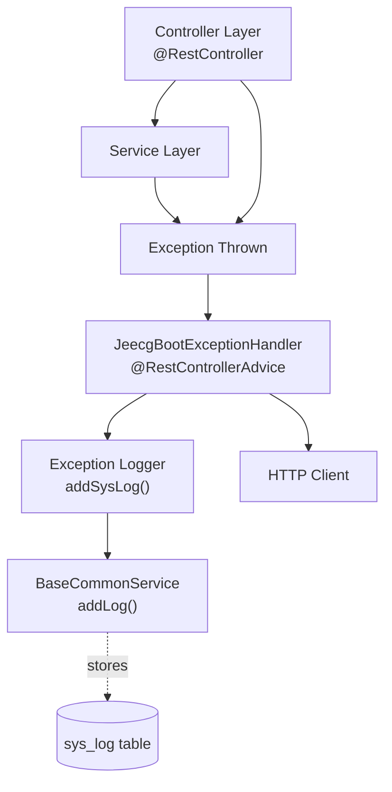
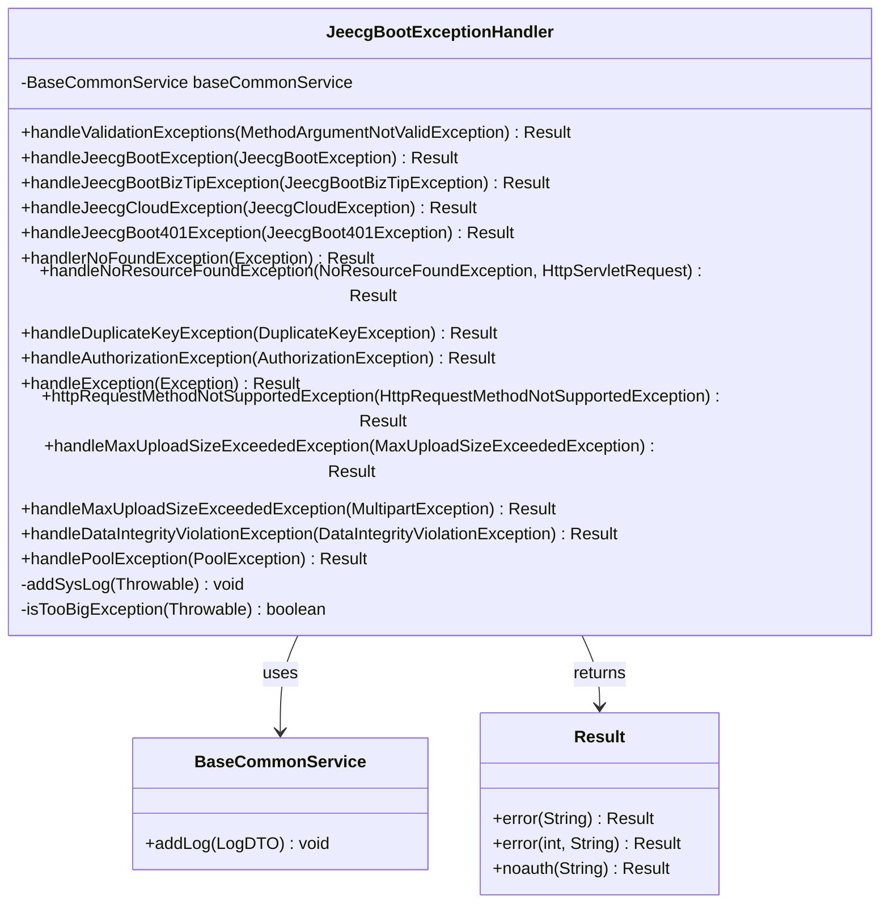
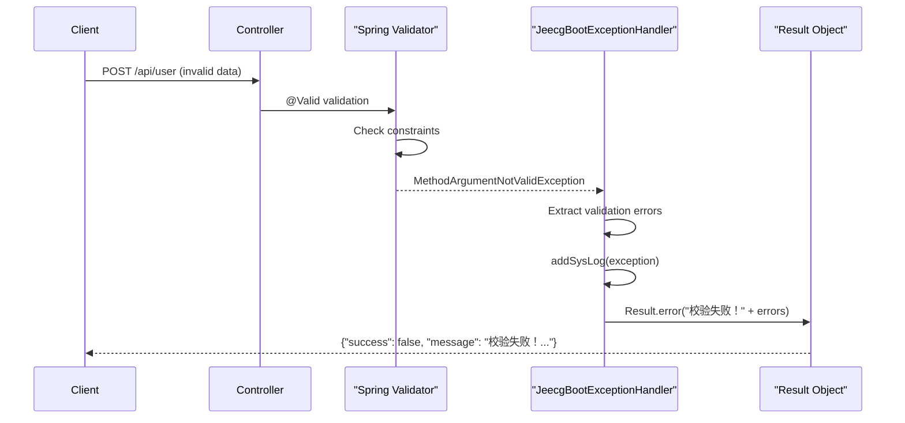
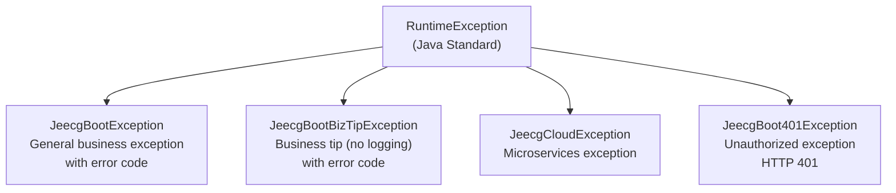
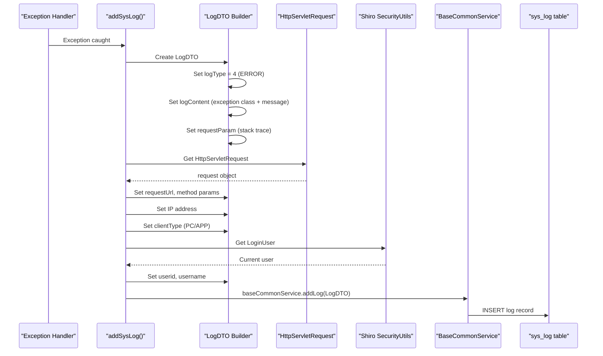
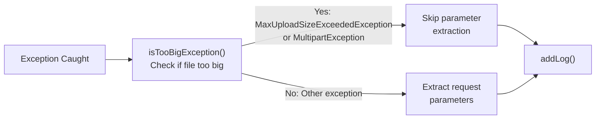
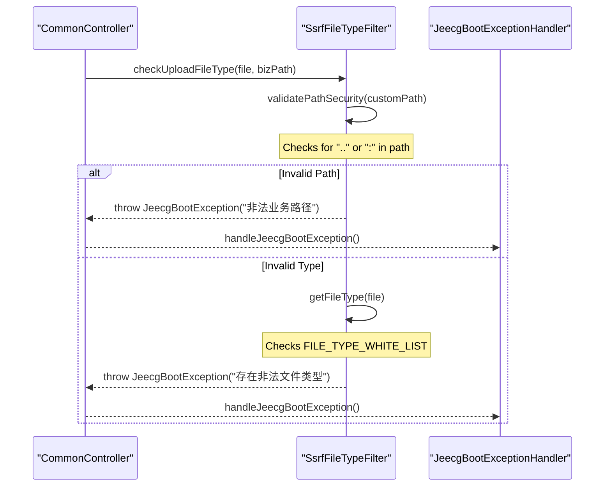
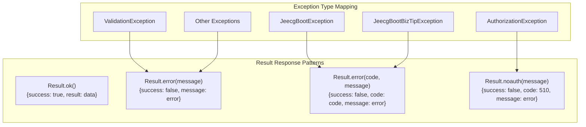
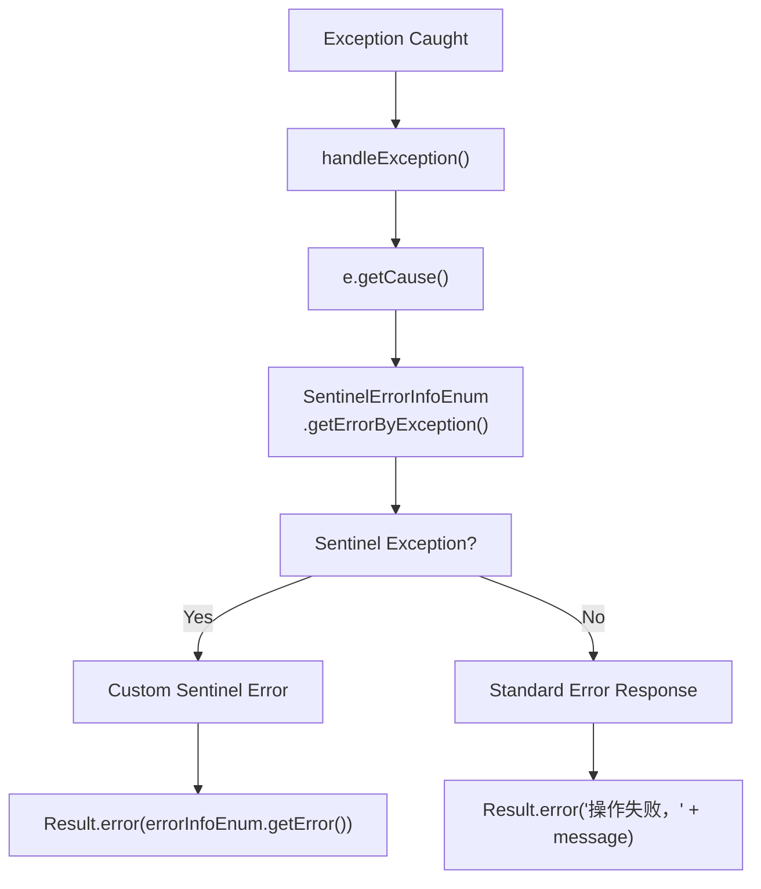

<!-- source: DeepWiki mcp.deepwiki.com · repo jeecgboot/JeecgBoot · page 7.4 Exception Handling · fetched 2026-10-29 -->

# Exception Handling

<details>
<summary>Relevant source files</summary>

The following files were used as context for generating this wiki page:

- [jeecg-boot/jeecg-boot-base-core/src/main/java/org/jeecg/common/exception/JeecgBootExceptionHandler.java](jeecg-boot/jeecg-boot-base-core/src/main/java/org/jeecg/common/exception/JeecgBootExceptionHandler.java)
- [jeecg-boot/jeecg-boot-base-core/src/main/java/org/jeecg/common/util/CommonUtils.java](jeecg-boot/jeecg-boot-base-core/src/main/java/org/jeecg/common/util/CommonUtils.java)
- [jeecg-boot/jeecg-boot-base-core/src/main/java/org/jeecg/common/util/MinioUtil.java](jeecg-boot/jeecg-boot-base-core/src/main/java/org/jeecg/common/util/MinioUtil.java)
- [jeecg-boot/jeecg-boot-base-core/src/main/java/org/jeecg/common/util/filter/SsrfFileTypeFilter.java](jeecg-boot/jeecg-boot-base-core/src/main/java/org/jeecg/common/util/filter/SsrfFileTypeFilter.java)
- [jeecg-boot/jeecg-boot-base-core/src/main/java/org/jeecg/common/util/oss/OssBootUtil.java](jeecg-boot/jeecg-boot-base-core/src/main/java/org/jeecg/common/util/oss/OssBootUtil.java)
- [jeecg-boot/jeecg-module-system/jeecg-system-biz/src/main/java/org/jeecg/modules/system/controller/CommonController.java](jeecg-boot/jeecg-module-system/jeecg-system-biz/src/main/java/org/jeecg/modules/system/controller/CommonController.java)
- [jeecg-boot/jeecg-module-system/jeecg-system-biz/src/main/java/org/jeecg/modules/system/controller/SysAnnouncementController.java](jeecg-boot/jeecg-module-system/jeecg-system-biz/src/main/java/org/jeecg/modules/system/controller/SysAnnouncementController.java)
- [jeecg-boot/jeecg-module-system/jeecg-system-biz/src/main/java/org/jeecg/modules/system/controller/SysUploadController.java](jeecg-boot/jeecg-module-system/jeecg-system-biz/src/main/java/org/jeecg/modules/system/controller/SysUploadController.java)
- [jeecg-boot/jeecg-module-system/jeecg-system-biz/src/main/java/org/jeecg/modules/system/service/impl/SysAnnouncementServiceImpl.java](jeecg-boot/jeecg-module-system/jeecg-system-biz/src/main/java/org/jeecg/modules/system/service/impl/SysAnnouncementServiceImpl.java)
- [jeecg-boot/jeecg-module-system/jeecg-system-biz/src/main/java/org/jeecg/modules/system/service/impl/SysCommentServiceImpl.java](jeecg-boot/jeecg-module-system/jeecg-system-biz/src/main/java/org/jeecg/modules/system/service/impl/SysCommentServiceImpl.java)

</details>


## Purpose and Scope

This document describes the global exception handling mechanism in JeecgBoot, including the centralized exception handler, custom exception types, error logging, and standardized error responses. The exception handling system ensures that all errors in the application are caught, logged, and returned to clients in a consistent format.

For REST API development patterns, see [7.3](). For security-specific error handling including authentication failures, see [8.1](). For SQL injection prevention and related exceptions, see [8.5]().

---

## Global Exception Handler Architecture

JeecgBoot implements a centralized exception handling mechanism using Spring's `@RestControllerAdvice` annotation. All exceptions thrown by controllers are intercepted and processed by the `JeecgBootExceptionHandler` class, which converts them into standardized JSON responses.

### Exception Handling Flow



**Sources:** [jeecg-boot/jeecg-boot-base-core/src/main/java/org/jeecg/common/exception/JeecgBootExceptionHandler.java:1-50]()

---

## Exception Handler Class Structure

The `JeecgBootExceptionHandler` class serves as the central exception handling component and is located in the `jeecg-boot-base-core` module.

### Class Definition



**Sources:** [jeecg-boot/jeecg-boot-base-core/src/main/java/org/jeecg/common/exception/JeecgBootExceptionHandler.java:48-316]()

---

## Exception Handler Methods

The `JeecgBootExceptionHandler` defines multiple `@ExceptionHandler` methods, each targeting specific exception types. These methods intercept exceptions, log them, and return appropriate HTTP responses.

### Exception Handler Mapping

| Exception Type | Handler Method | HTTP Status | Error Message Pattern |
|----------------|----------------|-------------|----------------------|
| `MethodArgumentNotValidException` | `handleValidationExceptions()` | 200 (error) | "校验失败！" + validation errors |
| `JeecgBootException` | `handleJeecgBootException()` | 200 (error) | Custom error code + message |
| `JeecgBootBizTipException` | `handleJeecgBootBizTipException()` | 200 (error) | Custom error code + message (no logging) |
| `JeecgCloudException` | `handleJeecgCloudException()` | 200 (error) | Exception message |
| `JeecgBoot401Exception` | `handleJeecgBoot401Exception()` | 401 | Custom message |
| `NoHandlerFoundException` | `handlerNoFoundException()` | 200 (error) | "路径不存在，请检查路径是否正确" |
| `NoResourceFoundException` | `handleNoResourceFoundException()` | 200 (error) | "路径不存在" (Special debug for WebSocket) |
| `DuplicateKeyException` | `handleDuplicateKeyException()` | 200 (error) | "数据库中已存在该记录" |
| `UnauthorizedException` / `AuthorizationException` | `handleAuthorizationException()` | 200 (noauth) | "没有权限，请联系管理员分配权限！" |
| `HttpRequestMethodNotSupportedException` | `httpRequestMethodNotSupportedException()` | 200 (error) | Method not supported message |
| `MaxUploadSizeExceededException` | `handleMaxUploadSizeExceededException()` | 200 (error) | "文件大小超出10MB限制..." |
| `MultipartException` | `handleMaxUploadSizeExceededException()` | 200 (error) | "文件大小超出限制..." |
| `DataIntegrityViolationException` | `handleDataIntegrityViolationException()` | 200 (error) | Database integrity violation message |
| `PoolException` | `handlePoolException()` | 200 (error) | "Redis 连接异常!" |
| `Exception` (catch-all) | `handleException()` | 200 (error) | "操作失败，" + exception message |

**Sources:** [jeecg-boot/jeecg-boot-base-core/src/main/java/org/jeecg/common/exception/JeecgBootExceptionHandler.java:55-230]()

### Validation Exception Handling



**Sources:** [jeecg-boot/jeecg-boot-base-core/src/main/java/org/jeecg/common/exception/JeecgBootExceptionHandler.java:55-60]()

---

## Custom Exception Types

JeecgBoot defines several custom exception classes to represent different error scenarios:

### Exception Type Hierarchy



### Exception Characteristics

| Exception Class | Logging | HTTP Status | Use Case |
|-----------------|---------|-------------|----------|
| `JeecgBootException` | Yes | 200 (error result) | General business errors with error codes |
| `JeecgBootBizTipException` | No | 200 (error result) | User-facing tips that don't need logging |
| `JeecgCloudException` | Yes | 200 (error result) | Microservices communication errors |
| `JeecgBoot401Exception` | Yes | 401 | Authentication failures |

**Sources:** [jeecg-boot/jeecg-boot-base-core/src/main/java/org/jeecg/common/exception/JeecgBootExceptionHandler.java:65-100]()

---

## Exception Logging System

All exceptions (except `JeecgBootBizTipException`) are automatically logged to the database through the `addSysLog()` method. The logging system captures detailed information about the exception context.

### Logging Flow



### LogDTO Structure

The `LogDTO` object created for exception logging includes:

| Field | Description | Example |
|-------|-------------|---------|
| `logType` | Always set to `CommonConstant.LOG_TYPE_4` (error log) | 4 |
| `logContent` | Exception class name and message | "JeecgBootException: 操作失败" |
| `requestParam` | Full stack trace via `ExceptionUtils.getStackTrace()` | Complete exception stack |
| `method` | HTTP request parameters (if available) | "id=123&name=test" |
| `requestUrl` | URI that caused the exception | "/sys/user/list" |
| `ip` | Client IP address | "192.168.1.100" |
| `clientType` | PC or APP based on User-Agent | ClientTerminalTypeEnum.PC |
| `userid` | Username of authenticated user | "admin" |
| `username` | Real name of authenticated user | "管理员" |

**Sources:** [jeecg-boot/jeecg-boot-base-core/src/main/java/org/jeecg/common/exception/JeecgBootExceptionHandler.java:250-292]()

### File Upload Exception Handling

Special handling exists for file upload exceptions to prevent errors when retrieving request parameters:



**Sources:** [jeecg-boot/jeecg-boot-base-core/src/main/java/org/jeecg/common/exception/JeecgBootExceptionHandler.java:262-269](), [jeecg-boot/jeecg-boot-base-core/src/main/java/org/jeecg/common/exception/JeecgBootExceptionHandler.java:302-314]()

---

## File Security and SSRF Prevention

JeecgBoot implements strict file type and path validation to prevent SSRF and Path Traversal attacks. When exceptions occur during these checks, they are caught by the global handler.

### File Validation Workflow



**Sources:** [jeecg-boot/jeecg-boot-base-core/src/main/java/org/jeecg/common/util/filter/SsrfFileTypeFilter.java:179-190](), [jeecg-boot/jeecg-module-system/jeecg-system-biz/src/main/java/org/jeecg/modules/system/controller/CommonController.java:75-81]()

---

## Response Format

All exceptions are converted to standardized `Result` objects before being returned to clients. This ensures consistent API responses across the application.

### Result Object Structure



**Sources:** [jeecg-boot/jeecg-boot-base-core/src/main/java/org/jeecg/common/exception/JeecgBootExceptionHandler.java:55-230]()

---

## Sentinel Flow Control Exception Handling

The system integrates with Alibaba Sentinel for flow control and handles Sentinel-specific exceptions with custom error messages defined in `SentinelErrorInfoEnum`.

### Sentinel Exception Processing



**Sources:** [jeecg-boot/jeecg-boot-base-core/src/main/java/org/jeecg/common/exception/JeecgBootExceptionHandler.java:139-150]()

---

## Database Exception Handling

The system provides specialized handling for database-related exceptions, including duplicate keys and integrity violations.

### Database Exception Types

| Exception | Handler | Error Message |
|-----------|---------|---------------|
| `DuplicateKeyException` | `handleDuplicateKeyException()` | "数据库中已存在该记录" |
| `DataIntegrityViolationException` | `handleDataIntegrityViolationException()` | "执行数据库异常,违反了完整性..." |

**Sources:** [jeecg-boot/jeecg-boot-base-core/src/main/java/org/jeecg/common/exception/JeecgBootExceptionHandler.java:126-131](), [jeecg-boot/jeecg-boot-base-core/src/main/java/org/jeecg/common/exception/JeecgBootExceptionHandler.java:208-216]()

---

## Shiro Authorization Exception Handling

Shiro security exceptions are handled specifically to provide appropriate authorization error messages:

```java
@ExceptionHandler({UnauthorizedException.class, AuthorizationException.class})
public Result<?> handleAuthorizationException(AuthorizationException e){
    log.error(e.getMessage(), e);
    return Result.noauth("没有权限，请联系管理员分配权限！");
}
```

The system catches both `UnauthorizedException` and `AuthorizationException` from Apache Shiro and returns a standardized "no authorization" response via `Result.noauth()`.

**Sources:** [jeecg-boot/jeecg-boot-base-core/src/main/java/org/jeecg/common/exception/JeecgBootExceptionHandler.java:133-137]()

---

