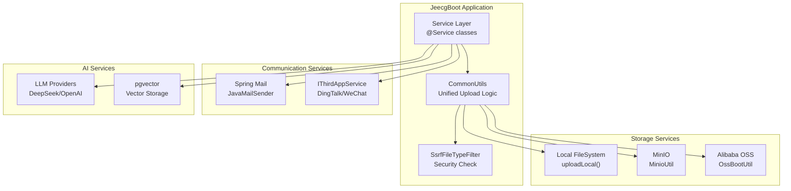
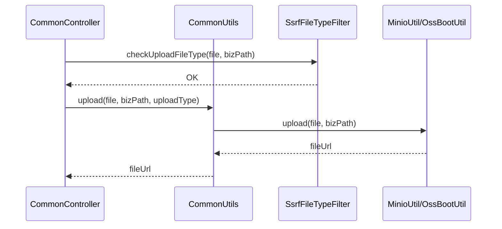

<!-- source: DeepWiki mcp.deepwiki.com · repo jeecgboot/JeecgBoot · page 7.5 Service Integration · fetched 2026-10-29 -->

# Service Integration

Relevant source files

The following files were used as context for generating this wiki page:

- [jeecg-boot/jeecg-boot-base-core/src/main/java/org/jeecg/common/exception/JeecgBootExceptionHandler.java](jeecg-boot/jeecg-boot-base-core/src/main/java/org/jeecg/common/exception/JeecgBootExceptionHandler.java)
- [jeecg-boot/jeecg-boot-base-core/src/main/java/org/jeecg/common/util/CommonUtils.java](jeecg-boot/jeecg-boot-base-core/src/main/java/org/jeecg/common/util/CommonUtils.java)
- [jeecg-boot/jeecg-boot-base-core/src/main/java/org/jeecg/common/util/MinioUtil.java](jeecg-boot/jeecg-boot-base-core/src/main/java/org/jeecg/common/util/MinioUtil.java)
- [jeecg-boot/jeecg-boot-base-core/src/main/java/org/jeecg/common/util/filter/SsrfFileTypeFilter.java](jeecg-boot/jeecg-boot-base-core/src/main/java/org/jeecg/common/util/filter/SsrfFileTypeFilter.java)
- [jeecg-boot/jeecg-boot-base-core/src/main/java/org/jeecg/common/util/oss/OssBootUtil.java](jeecg-boot/jeecg-boot-base-core/src/main/java/org/jeecg/common/util/oss/OssBootUtil.java)
- [jeecg-boot/jeecg-module-system/jeecg-system-biz/src/main/java/org/jeecg/modules/system/controller/CommonController.java](jeecg-boot/jeecg-module-system/jeecg-system-biz/src/main/java/org/jeecg/modules/system/controller/CommonController.java)
- [jeecg-boot/jeecg-module-system/jeecg-system-biz/src/main/java/org/jeecg/modules/system/controller/SysAnnouncementController.java](jeecg-boot/jeecg-module-system/jeecg-system-biz/src/main/java/org/jeecg/modules/system/controller/SysAnnouncementController.java)
- [jeecg-boot/jeecg-module-system/jeecg-system-biz/src/main/java/org/jeecg/modules/system/controller/SysUploadController.java](jeecg-boot/jeecg-module-system/jeecg-system-biz/src/main/java/org/jeecg/modules/system/controller/SysUploadController.java)
- [jeecg-boot/jeecg-module-system/jeecg-system-biz/src/main/java/org/jeecg/modules/system/service/impl/SysAnnouncementServiceImpl.java](jeecg-boot/jeecg-module-system/jeecg-system-biz/src/main/java/org/jeecg/modules/system/service/impl/SysAnnouncementServiceImpl.java)
- [jeecg-boot/jeecg-module-system/jeecg-system-biz/src/main/java/org/jeecg/modules/system/service/impl/SysCommentServiceImpl.java](jeecg-boot/jeecg-module-system/jeecg-system-biz/src/main/java/org/jeecg/modules/system/service/impl/SysCommentServiceImpl.java)
- [jeecg-boot/jeecg-module-system/jeecg-system-biz/src/main/java/org/jeecg/modules/system/service/impl/ThirdAppDingtalkServiceImpl.java](jeecg-boot/jeecg-module-system/jeecg-system-biz/src/main/java/org/jeecg/modules/system/service/impl/ThirdAppDingtalkServiceImpl.java)

This document describes the integration of third-party services in JeecgBoot. The platform provides configuration-based integration with external services including email, SMS, file storage, authentication providers, AI models, and various cloud APIs. For information about AI-specific integrations (LLM providers, embedding services, RAG system), see [AI Platform (AIGC)](#3).

## Overview

JeecgBoot integrates with external services through Spring Boot's configuration system. Service credentials and endpoints are defined in environment-specific YAML files. The system supports a variety of communication, storage, and utility services through a strategy pattern, where the active provider is selected via configuration keys like `jeecg.uploadType`.

**Service Integration Architecture**

Sources: [jeecg-boot/jeecg-boot-base-core/src/main/java/org/jeecg/common/util/CommonUtils.java:45-162](), [jeecg-boot/jeecg-module-system/jeecg-system-biz/src/main/java/org/jeecg/modules/system/service/impl/ThirdAppDingtalkServiceImpl.java:62-100]()

## Email Service Integration

Email functionality is configured through Spring Boot's `spring.mail.*` properties. The system uses `JavaMailSender` for sending emails, with support for scheduled task notifications.

### Configuration Properties

| Property | Description | Example |
|----------|-------------|---------|
| `spring.mail.host` | SMTP server hostname | `smtp.163.com` |
| `spring.mail.username` | Email account username | `jeecgos@163.com` |
| `spring.mail.password` | Email account password | Placeholder: `??` |
| `spring.mail.properties.mail.smtp.auth` | Enable SMTP authentication | `true` |
| `spring.mail.timeJobSend` | Enable scheduled email tasks | `false` (default) |

Sources: [jeecg-boot/jeecg-module-system/jeecg-system-start/src/main/resources/application-dev.yml:37-49]()

## File Storage Integration

JeecgBoot supports three file storage strategies: local filesystem, MinIO object storage, and Alibaba OSS. The active strategy is configured via `jeecg.uploadType`.

### Storage Strategy Selection

The `CommonUtils.upload` method serves as a unified entry point for file uploads, routing requests to the appropriate utility based on the `uploadType` parameter.

### Security and Validation
All file uploads undergo security checks in `SsrfFileTypeFilter` to prevent path traversal and restricted file type uploads.
- **Path Traversal**: `checkPathTraversal` ensures `bizPath` does not contain `..` or illegal characters [jeecg-boot/jeecg-boot-base-core/src/main/java/org/jeecg/common/util/filter/SsrfFileTypeFilter.java:214-225]().
- **File Type White List**: Includes common images (jpg, png), documents (doc, pdf), and media (mp4, mp3) [jeecg-boot/jeecg-boot-base-core/src/main/java/org/jeecg/common/util/filter/SsrfFileTypeFilter.java:30-77]().
- **Header Validation**: Checks file magic numbers to prevent extension spoofing (e.g., blocking `.jsp` disguised as `.jpg`) [jeecg-boot/jeecg-boot-base-core/src/main/java/org/jeecg/common/util/filter/SsrfFileTypeFilter.java:80-83]().

### Local Filesystem Storage
Local storage uses the `jeecg.path.upload` property as the root directory. `CommonUtils.uploadLocal` handles file saving and path normalization [jeecg-boot/jeecg-boot-base-core/src/main/java/org/jeecg/common/util/CommonUtils.java:169-181]().

### MinIO Object Storage
Integrated via `MinioUtil`. It supports bucket creation, file upload, and generating pre-signed URLs for private bucket access [jeecg-boot/jeecg-boot-base-core/src/main/java/org/jeecg/common/util/MinioUtil.java:56-105]().
- **Pre-signed URL**: `getObjectUrl` generates temporary GET links for external access [jeecg-boot/jeecg-boot-base-core/src/main/java/org/jeecg/common/util/MinioUtil.java:163-176]().

### Alibaba OSS
Integrated via `OssBootUtil`. It uses the Aliyun OSS SDK to manage object storage and provides a `staticDomain` option for CDN integration [jeecg-boot/jeecg-boot-base-core/src/main/java/org/jeecg/common/util/oss/OssBootUtil.java:99-150]().

Sources: [jeecg-boot/jeecg-boot-base-core/src/main/java/org/jeecg/common/util/CommonUtils.java:149-162](), [jeecg-boot/jeecg-boot-base-core/src/main/java/org/jeecg/common/util/MinioUtil.java:56-105](), [jeecg-boot/jeecg-boot-base-core/src/main/java/org/jeecg/common/util/oss/OssBootUtil.java:99-150](), [jeecg-boot/jeecg-boot-base-core/src/main/java/org/jeecg/common/util/filter/SsrfFileTypeFilter.java:30-83]()

## Third-Party App Integration (DingTalk/WeChat)

JeecgBoot provides deep integration with enterprise platforms like DingTalk and WeChat Enterprise for user synchronization and message notification.

### DingTalk Integration
The `ThirdAppDingtalkServiceImpl` handles communication with the DingTalk API. Key features include:
- **Access Token Management**: Retrieves tokens using tenant-specific configurations [jeecg-boot/jeecg-module-system/jeecg-system-biz/src/main/java/org/jeecg/modules/system/service/impl/ThirdAppDingtalkServiceImpl.java:91-99]().
- **Department Sync**: Recursively synchronizes local department structures to DingTalk [jeecg-boot/jeecg-module-system/jeecg-system-biz/src/main/java/org/jeecg/modules/system/service/impl/ThirdAppDingtalkServiceImpl.java:103-156]().
- **User Sync**: Maps local users to DingTalk accounts and manages lifecycle events.

### Message Notification
System announcements can be pushed to third-party apps. `SysAnnouncementController` uses `ThirdAppDingtalkServiceImpl` and `ThirdAppWechatEnterpriseServiceImpl` to broadcast messages when a notification is published [jeecg-boot/jeecg-module-system/jeecg-system-biz/src/main/java/org/jeecg/modules/system/controller/SysAnnouncementController.java:82-85]().

Sources: [jeecg-boot/jeecg-module-system/jeecg-system-biz/src/main/java/org/jeecg/modules/system/service/impl/ThirdAppDingtalkServiceImpl.java:62-156](), [jeecg-boot/jeecg-module-system/jeecg-system-biz/src/main/java/org/jeecg/modules/system/controller/SysAnnouncementController.java:75-86]()

## Exception Handling in Integrations

Service integrations use a global exception handler `JeecgBootExceptionHandler` to provide standardized error responses.

| Exception Class | Triggering Service | Response Behavior |
|-----------------|-------------------|-------------------|
| `MaxUploadSizeExceededException` | File Upload | Returns "文件大小超出10MB限制" [jeecg-boot/jeecg-boot-base-core/src/main/java/org/jeecg/common/exception/JeecgBootExceptionHandler.java:180-185]() |
| `JeecgCloudException` | Microservices/Feign | Returns internal service error message [jeecg-boot/jeecg-boot-base-core/src/main/java/org/jeecg/common/exception/JeecgBootExceptionHandler.java:84-89]() |
| `DuplicateKeyException` | Database/Storage | Returns "数据库中已存在该记录" [jeecg-boot/jeecg-boot-base-core/src/main/java/org/jeecg/common/exception/JeecgBootExceptionHandler.java:126-131]() |

Sources: [jeecg-boot/jeecg-boot-base-core/src/main/java/org/jeecg/common/exception/JeecgBootExceptionHandler.java:50-212]()

## API Documentation Integration

Swagger/OpenAPI documentation is integrated via Knife4j with security configuration in `Swagger3Config`.

### Swagger Security
To protect integrated service endpoints, `Swagger3Config` injects the `X-ACCESS-TOKEN` security requirement for all non-excluded paths [jeecg-boot/jeecg-boot-base-core/src/main/java/org/jeecg/config/Swagger3Config.java:141-151]().

**Excluded Paths (No Token Required)**:
- `/sys/login`
- `/sys/thirdLogin/**`
- `/sys/user/register`
- `/sys/sms`

Sources: [jeecg-boot/jeecg-boot-base-core/src/main/java/org/jeecg/config/Swagger3Config.java:42-52](), [jeecg-boot/jeecg-boot-base-core/src/main/java/org/jeecg/config/Swagger3Config.java:134-152]()

---

