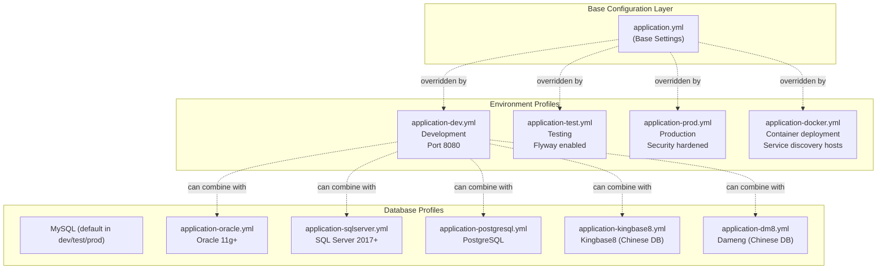
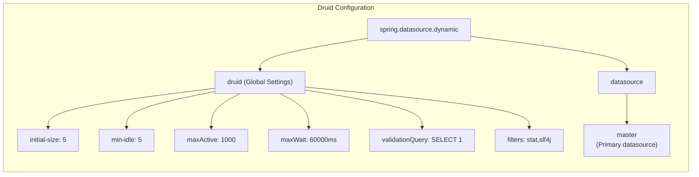
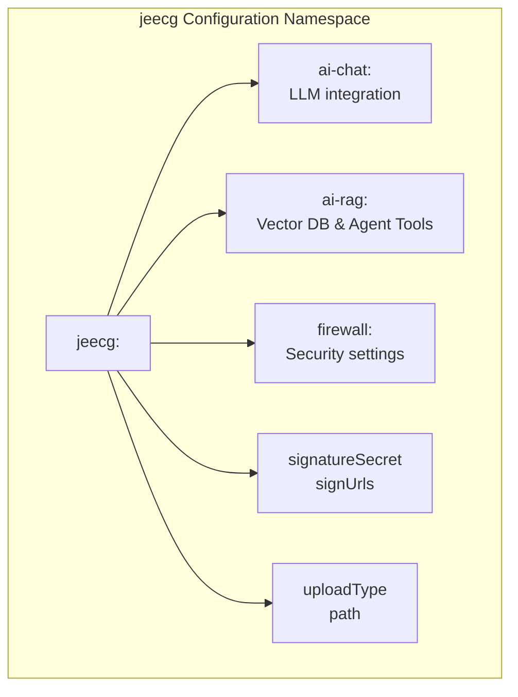
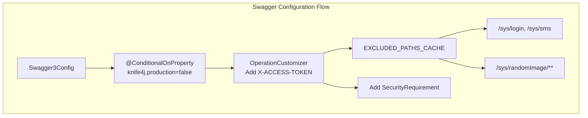
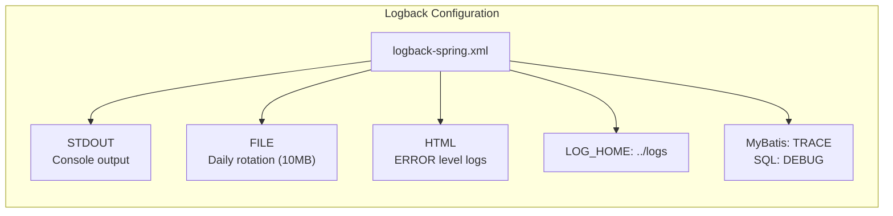

<!-- source: DeepWiki mcp.deepwiki.com · repo jeecgboot/JeecgBoot · page 7.6 Configuration Management · fetched 2026-10-29 -->

# Configuration Management

<details>
<summary>Relevant source files</summary>

The following files were used as context for generating this wiki page:

- [jeecg-boot/jeecg-boot-base-core/src/main/resources/config/default-spring-doc.properties](jeecg-boot/jeecg-boot-base-core/src/main/resources/config/default-spring-doc.properties)
- [jeecg-boot/jeecg-module-system/jeecg-system-start/src/main/resources/application-dev.yml](jeecg-boot/jeecg-module-system/jeecg-system-start/src/main/resources/application-dev.yml)
- [jeecg-boot/jeecg-module-system/jeecg-system-start/src/main/resources/application-dm8.yml](jeecg-boot/jeecg-module-system/jeecg-system-start/src/main/resources/application-dm8.yml)
- [jeecg-boot/jeecg-module-system/jeecg-system-start/src/main/resources/application-docker.yml](jeecg-boot/jeecg-module-system/jeecg-system-start/src/main/resources/application-docker.yml)
- [jeecg-boot/jeecg-module-system/jeecg-system-start/src/main/resources/application-kingbase8.yml](jeecg-boot/jeecg-module-system/jeecg-system-start/src/main/resources/application-kingbase8.yml)
- [jeecg-boot/jeecg-module-system/jeecg-system-start/src/main/resources/application-oracle.yml](jeecg-boot/jeecg-module-system/jeecg-system-start/src/main/resources/application-oracle.yml)
- [jeecg-boot/jeecg-module-system/jeecg-system-start/src/main/resources/application-postgresql.yml](jeecg-boot/jeecg-module-system/jeecg-system-start/src/main/resources/application-postgresql.yml)
- [jeecg-boot/jeecg-module-system/jeecg-system-start/src/main/resources/application-prod.yml](jeecg-boot/jeecg-module-system/jeecg-system-start/src/main/resources/application-prod.yml)
- [jeecg-boot/jeecg-module-system/jeecg-system-start/src/main/resources/application-sqlserver.yml](jeecg-boot/jeecg-module-system/jeecg-system-start/src/main/resources/application-sqlserver.yml)
- [jeecg-boot/jeecg-module-system/jeecg-system-start/src/main/resources/application-test.yml](jeecg-boot/jeecg-module-system/jeecg-system-start/src/main/resources/application-test.yml)
- [jeecg-boot/jeecg-module-system/jeecg-system-start/src/main/resources/jeecg/jeecg_config.properties](jeecg-boot/jeecg-module-system/jeecg-system-start/src/main/resources/jeecg/jeecg_config.properties)
- [jeecg-boot/jeecg-module-system/jeecg-system-start/src/main/resources/logback-spring.xml](jeecg-boot/jeecg-module-system/jeecg-system-start/src/main/resources/logback-spring.xml)

</details>


This document describes the configuration management system in JeecgBoot, including the structure of configuration files, environment-specific profiles, and key configuration categories. Configuration management in JeecgBoot uses Spring Boot's profile-based approach to support multiple deployment environments and database types.

For database-specific configuration details, see [Multi-Database Support](#4.2). For deployment environment setup, see [Environment Configuration](#9.2).

## Configuration File Structure

JeecgBoot uses Spring Boot YAML configuration files organized by deployment profile. The configuration system supports multiple environments and database types through Spring's `@Profile` mechanism.

### Configuration Profile Hierarchy



**Sources:** [jeecg-boot/jeecg-module-system/jeecg-system-start/src/main/resources/application-dev.yml:1-19]() | [jeecg-boot/jeecg-module-system/jeecg-system-start/src/main/resources/application-test.yml:1-19]() | [jeecg-boot/jeecg-module-system/jeecg-system-start/src/main/resources/application-prod.yml:1-19]() | [jeecg-boot/jeecg-module-system/jeecg-system-start/src/main/resources/application-docker.yml:1-19]()

### Profile Activation

Profiles are activated through the `spring.profiles.active` property, which can be set via:
- Command line arguments: `--spring.profiles.active=dev`
- Environment variables: `SPRING_PROFILES_ACTIVE=prod`
- IDE run configuration
- Docker environment variables

Multiple profiles can be activated simultaneously (e.g., `dev,oracle` for development with Oracle database).

## Core Configuration Categories

### Server Configuration

Server configuration defines the HTTP server behavior, including port, context path, and compression.

| Property | Dev/Test | Production | Docker | Description |
|----------|----------|------------|--------|-------------|
| `server.port` | 8080 | 8080 | 8080 | HTTP listening port |
| `server.servlet.context-path` | /jeecg-boot | /jeecg-boot | /jeecg-boot | Application context path |
| `server.compression.enabled` | true | true | true | Enable response compression |
| `server.compression.min-response-size` | 1024 | 1024 | 1024 | Minimum size for compression |

**Sources:** [jeecg-boot/jeecg-module-system/jeecg-system-start/src/main/resources/application-dev.yml:1-11]()

### Database Configuration

JeecgBoot uses Alibaba Druid for connection pooling and dynamic datasource management via `dynamic-datasource-spring-boot-starter`.

#### Druid Connection Pool Settings



**Sources:** [jeecg-boot/jeecg-module-system/jeecg-system-start/src/main/resources/application-dev.yml:119-153]()

#### Database-Specific Connection Strings

| Database | Driver Class | URL Pattern | Profile |
|----------|-------------|-------------|---------|
| MySQL | `com.mysql.cj.jdbc.Driver` | `jdbc:mysql://127.0.0.1:3306/jeecg-boot?...` | default |
| Oracle | `oracle.jdbc.OracleDriver` | `jdbc:oracle:thin:@127.0.0.1:1521:helowin` | oracle |
| SQL Server | `com.microsoft.sqlserver.jdbc.SQLServerDriver` | `jdbc:sqlserver://127.0.0.1:1433;...` | sqlserver |
| PostgreSQL | `org.postgresql.Driver` | `jdbc:postgresql://127.0.0.1:5432/postgres?...` | postgresql |
| Kingbase8 | `com.kingbase8.Driver` | `jdbc:kingbase8://127.0.0.1:4321/test` | kingbase8 |
| Dameng | `dm.jdbc.driver.DmDriver` | `jdbc:dm://127.0.0.1:30236?schema=SYSDBA...` | dm8 |

**Sources:** [jeecg-boot/jeecg-module-system/jeecg-system-start/src/main/resources/application-dev.yml:150-153](), [jeecg-boot/jeecg-module-system/jeecg-system-start/src/main/resources/application-oracle.yml:137-140](), [jeecg-boot/jeecg-module-system/jeecg-system-start/src/main/resources/application-sqlserver.yml:138-141](), [jeecg-boot/jeecg-module-system/jeecg-system-start/src/main/resources/application-postgresql.yml:150-153](), [jeecg-boot/jeecg-module-system/jeecg-system-start/src/main/resources/application-kingbase8.yml:146-149](), [jeecg-boot/jeecg-module-system/jeecg-system-start/src/main/resources/application-dm8.yml:129-132]()

### Cache Configuration (Redis)

Redis configuration is defined under the `spring.data.redis` namespace.

```yaml
spring:
  data:
    redis:
      database: 0
      host: 127.0.0.1          # Docker: jeecg-boot-redis
      port: 6379
      password:
```

**Sources:** [jeecg-boot/jeecg-module-system/jeecg-system-start/src/main/resources/application-dev.yml:159-164](), [jeecg-boot/jeecg-module-system/jeecg-system-start/src/main/resources/application-docker.yml:155-160]()

### ORM Configuration (MyBatis-Plus)

MyBatis-Plus configuration defines mapper locations and ID generation strategy.

| Property | Value | Description |
|----------|-------|-------------|
| `mybatis-plus.mapper-locations` | `classpath*:org/jeecg/**/xml/*Mapper.xml` | Mapper XML file locations |
| `mybatis-plus.global-config.db-config.id-type` | ASSIGN_ID | Use snowflake ID generation |
| `mybatis-plus.global-config.db-config.table-underline` | true | Table names use underscore naming |
| `mybatis-plus.configuration.call-setters-on-nulls` | true | Set null fields in Map results |

**Sources:** [jeecg-boot/jeecg-module-system/jeecg-system-start/src/main/resources/application-dev.yml:166-180]()

### JeecgBoot Application Configuration

The `jeecg` namespace contains application-specific configuration for AI, security, and storage.



**Sources:** [jeecg-boot/jeecg-module-system/jeecg-system-start/src/main/resources/application-dev.yml:184-250]()

#### AI Integration Configuration

JeecgBoot integrates with various AI providers (DeepSeek, OpenAI, Zhipu, Qwen) for chat, drawing, voice, and RAG.

```yaml
jeecg:
  ai-chat:
    enabled: true
    model: deepseek-v4-pro
    apiKey: ??
    apiHost: https://api.deepseek.com/v1
    timeout: 60
  ai-rag:
    allow-sensitive-nodes: sql,stdio,code
    embed-store:
      host: 127.0.0.1
      port: 5432
      database: vector_db
```

**Sources:** [jeecg-boot/jeecg-module-system/jeecg-system-start/src/main/resources/application-dev.yml:188-248]()

#### Security Firewall Configuration

The firewall configuration controls platform security features and low-code development modes.

| Property | Dev | Production | Description |
|----------|----------|------------|-------------|
| `jeecg.firewall.dataSourceSafe` | false | false | Require datasource for online reports |
| `jeecg.firewall.lowCodeMode` | dev | dev | `dev` enables online development, `prod` restricts it |

**Sources:** [jeecg-boot/jeecg-module-system/jeecg-system-start/src/main/resources/application-dev.yml:251-255](), [jeecg-boot/jeecg-module-system/jeecg-system-start/src/main/resources/application-prod.yml:204-208]()

#### File Upload Configuration

Supports `local`, `minio`, and `alioss` storage.

| Property | Description | Values |
|----------|-------------|--------|
| `jeecg.uploadType` | Storage backend | `local`, `minio`, `alioss` |
| `jeecg.path.upload` | Local root directory | `/opt/upFiles` |

**Sources:** [jeecg-boot/jeecg-module-system/jeecg-system-start/src/main/resources/application-dm8.yml:239-246]()

### API Documentation Configuration (Knife4j/Swagger)

Knife4j provides enhanced Swagger UI. The configuration class `Swagger3Config` manages security requirements.



**Sources:** [jeecg-boot/jeecg-boot-base-core/src/main/java/org/jeecg/config/Swagger3Config.java:30-151](), [jeecg-boot/jeecg-module-system/jeecg-system-start/src/main/resources/application-dev.yml:319-328]()

## Logging Configuration

JeecgBoot uses Logback with daily rotation and HTML error logging capabilities.



**Sources:** [jeecg-boot/jeecg-module-system/jeecg-system-start/src/main/resources/logback-spring.xml:4-77]()

## Framework Configuration

### Flyway Database Migration

| Property | Dev | Test | Prod | Description |
|----------|-----|------|------|-------------|
| `enabled` | false | true | false | Enable Flyway on startup |
| `clean-disabled` | true | true | **true** | Prevent data loss |

**Sources:** [jeecg-boot/jeecg-module-system/jeecg-system-start/src/main/resources/application-dev.yml:23-29](), [jeecg-boot/jeecg-module-system/jeecg-system-start/src/main/resources/application-test.yml:20-26](), [jeecg-boot/jeecg-module-system/jeecg-system-start/src/main/resources/application-prod.yml:20-24]()

### Quartz Scheduler Configuration

Uses JDBC job store for clustered deployments.

```yaml
spring:
  quartz:
    job-store-type: jdbc
    auto-startup: true
    properties:
      org.quartz.jobStore.isClustered: true
      org.quartz.jobStore.tablePrefix: QRTZ_
```

**Sources:** [jeecg-boot/jeecg-module-system/jeecg-system-start/src/main/resources/application-dev.yml:48-75]()

### Spring MVC & Resource Configuration

```yaml
spring:
  mvc:
    pathmatch:
      matching-strategy: ant_path_matcher
  resource:
    static-locations: classpath:/static/,classpath:/public/
```

**Sources:** [jeecg-boot/jeecg-module-system/jeecg-system-start/src/main/resources/application-dev.yml:100-106]()

---

