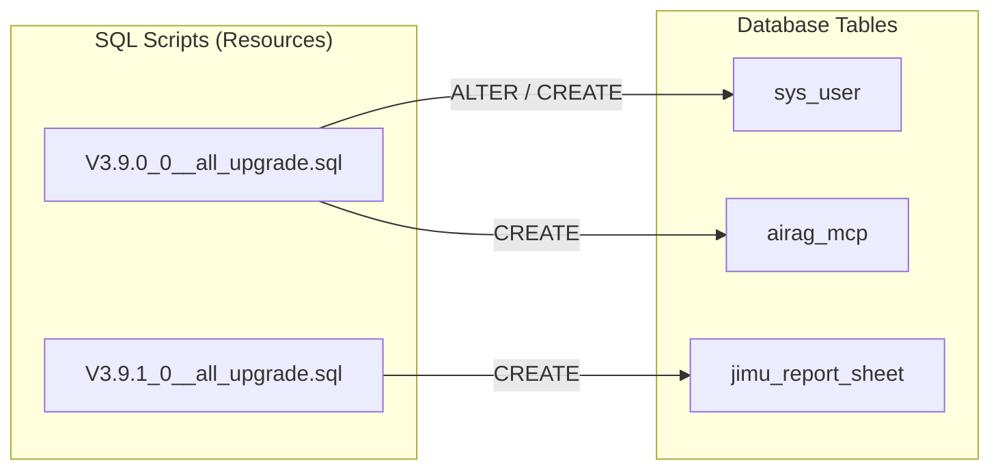

<!-- source: DeepWiki mcp.deepwiki.com · repo jeecgboot/JeecgBoot · page 7.7 Database Migration with Flyway · fetched 2026-10-29 -->

# Database Migration with Flyway

<details>
<summary>Relevant source files</summary>

The following files were used as context for generating this wiki page:

- [jeecg-boot/UPGRADE-3.9.3.md](jeecg-boot/UPGRADE-3.9.3.md)
- [jeecg-boot/db/Dockerfile](jeecg-boot/db/Dockerfile)
- [jeecg-boot/db/jeecgboot-mysql-5.7.sql](jeecg-boot/db/jeecgboot-mysql-5.7.sql)
- [jeecg-boot/db/tables_xxl_job.sql](jeecg-boot/db/tables_xxl_job.sql)
- [jeecg-boot/jeecg-module-system/jeecg-system-start/src/main/java/org/jeecg/config/flyway/FlywayConfig.java](jeecg-boot/jeecg-module-system/jeecg-system-start/src/main/java/org/jeecg/config/flyway/FlywayConfig.java)
- [jeecg-boot/jeecg-module-system/jeecg-system-start/src/main/resources/flyway/sql/mysql/V3.9.0_0__all_upgrade.sql](jeecg-boot/jeecg-module-system/jeecg-system-start/src/main/resources/flyway/sql/mysql/V3.9.0_0__all_upgrade.sql)
- [jeecg-boot/jeecg-module-system/jeecg-system-start/src/main/resources/flyway/sql/mysql/V3.9.1_0__all_upgrade.sql](jeecg-boot/jeecg-module-system/jeecg-system-start/src/main/resources/flyway/sql/mysql/V3.9.1_0__all_upgrade.sql)
- [jeecg-boot/jeecg-server-cloud/jeecg-visual/jeecg-cloud-xxljob/doc/db/tables_xxl_job.sql](jeecg-boot/jeecg-server-cloud/jeecg-visual/jeecg-cloud-xxljob/doc/db/tables_xxl_job.sql)

</details>


## Purpose and Scope

This document describes JeecgBoot's Flyway integration for version-controlled database schema migrations. The system provides automated database schema upgrades when the application starts, with support for multi-datasource environments and MySQL databases. This ensures that schema changes (such as new tables for AI modules or updated system permissions) are propagated across environments consistently.

---

## Overview

JeecgBoot integrates Flyway to manage database schema versions through SQL migration scripts. The integration is designed to be non-intrusive: migration failures are logged but do not prevent application startup. Currently, the automated migration logic is specifically implemented for MySQL databases, though the framework supports 8 database types for manual operations [jeecg-boot/jeecg-module-system/jeecg-system-start/src/main/java/org/jeecg/config/flyway/FlywayConfig.java:132-134]().

**Key Characteristics:**
- **Opt-in Feature:** Disabled by default via `spring.flyway.enabled: false` [jeecg-boot/jeecg-module-system/jeecg-system-start/src/main/java/org/jeecg/config/flyway/FlywayConfig.java:38-39]().
- **Multi-datasource Aware:** Specifically targets the `"master"` datasource within a `DynamicRoutingDataSource` setup [jeecg-boot/jeecg-module-system/jeecg-system-start/src/main/java/org/jeecg/config/flyway/FlywayConfig.java:109-110]().
- **Production-safe Defaults:** The `clean` operation is disabled by default to prevent accidental data loss [jeecg-boot/jeecg-module-system/jeecg-system-start/src/main/java/org/jeecg/config/flyway/FlywayConfig.java:98-99]().

**Sources:** [jeecg-boot/jeecg-module-system/jeecg-system-start/src/main/java/org/jeecg/config/flyway/FlywayConfig.java:1-137]()

---

## FlywayConfig Architecture

The `FlywayConfig` class serves as the central orchestration point for migrations. It utilizes Spring's `@PostConstruct` to trigger the migration logic immediately after the bean is initialized but before the web server starts accepting traffic.

### Natural Language to Code Entity Mapping

| System Concept | Code Entity | File Reference |
| :--- | :--- | :--- |
| **Migration Trigger** | `@PostConstruct public void migrate()` | [FlywayConfig.java:101-102]() |
| **Datasource Resolver** | `DynamicRoutingDataSource` | [FlywayConfig.java:107]() |
| **MySQL Filter** | `databaseType.contains("mysql")` | [FlywayConfig.java:112]() |
| **Migration Engine** | `org.flywaydb.core.Flyway` | [FlywayConfig.java:114]() |
| **Script Location** | `flyway/sql/mysql` | [FlywayConfig.java:50]() |

### Execution Flow Diagram

```mermaid
graph TD
    [Start] --> [PostConstruct_migrate]
    [PostConstruct_migrate] --> CheckEnabled{"enabled == true?"}
    CheckEnabled -- "No" --> [Exit]
    CheckEnabled -- "Yes" --> GetDS["Cast to DynamicRoutingDataSource"]
    GetDS --> IterateDS["Iterate dataSources Map"]
    IterateDS --> FilterMaster{"Key == 'master'?"}
    FilterMaster -- "Yes" --> CheckMySQL{"URL contains 'mysql'?"}
    FilterMaster -- "No" --> IterateDS
    CheckMySQL -- "Yes" --> ConfigureFlyway["Flyway.configure()"]
    CheckMySQL -- "No" --> LogWarn["Log: Only MySQL Supported"]
    ConfigureFlyway --> ExecMigrate["flyway.migrate()"]
    ExecMigrate --> Success["Log: Success"]
    ExecMigrate -- "FlywayException" --> CatchError["Log Error (Non-blocking)"]
    Success --> [End]
    CatchError --> [End]
```

**Sources:** [jeecg-boot/jeecg-module-system/jeecg-system-start/src/main/java/org/jeecg/config/flyway/FlywayConfig.java:101-137]()

---

## Configuration Properties

The behavior of Flyway is controlled through standard Spring Boot properties, which are injected into `FlywayConfig`.

| Property | Default | Description |
| :--- | :--- | :--- |
| `spring.flyway.enabled` | `false` | Master switch for migrations [FlywayConfig.java:38]() |
| `spring.flyway.locations` | `classpath:flyway/sql/mysql` | Path to SQL scripts [FlywayConfig.java:50]() |
| `spring.flyway.baseline-on-migrate` | `true` | Creates history table if DB is not empty [FlywayConfig.java:92]() |
| `spring.flyway.clean-disabled` | `true` | Prevents `flyway.clean()` calls [FlywayConfig.java:98]() |
| `spring.flyway.sql-migration-prefix` | `V` | Prefix for versioned files [FlywayConfig.java:56]() |
| `spring.flyway.placeholder-prefix` | `#(` | Custom placeholder start [FlywayConfig.java:68]() |

**Sources:** [jeecg-boot/jeecg-module-system/jeecg-system-start/src/main/java/org/jeecg/config/flyway/FlywayConfig.java:35-99]()

---

## Migration Script Organization

Scripts are organized by version and database type. The system follows the standard Flyway naming convention: `V<VERSION>__<DESCRIPTION>.sql`.

### Example Migration Content
Recent migrations include updates for the AI Platform and System modules:
- **System Updates:** Adding `last_pwd_update_time` and `sort` columns to `sys_user` [jeecg-boot/jeecg-module-system/jeecg-system-start/src/main/resources/flyway/sql/mysql/V3.9.0_0__all_upgrade.sql:3-4,20-22]().
- **AI Platform:** Initializing `airag_mcp` tables and seeding `airag_app` and `airag_knowledge` data [jeecg-boot/jeecg-module-system/jeecg-system-start/src/main/resources/flyway/sql/mysql/V3.9.0_0__all_upgrade.sql:27-47]().
- **Reporting:** Adding `jimu_report_sheet` and `jimu_report_ext_data` for multi-sheet report support [jeecg-boot/jeecg-module-system/jeecg-system-start/src/main/resources/flyway/sql/mysql/V3.9.1_0__all_upgrade.sql:2-30]().

### Component Association Diagram



**Sources:** [jeecg-boot/jeecg-module-system/jeecg-system-start/src/main/resources/flyway/sql/mysql/V3.9.0_0__all_upgrade.sql:1-66](), [jeecg-boot/jeecg-module-system/jeecg-system-start/src/main/resources/flyway/sql/mysql/V3.9.1_0__all_upgrade.sql:1-44]()

---

## Multi-Datasource Integration

JeecgBoot uses `DynamicRoutingDataSource` to manage multiple database connections. `FlywayConfig` specifically iterates through the `dataSources` map to find the `"master"` key.

### Master Datasource Logic
1. **Extraction:** Retrieves the map of all datasources [jeecg-boot/jeecg-module-system/jeecg-system-start/src/main/java/org/jeecg/config/flyway/FlywayConfig.java:108-109]().
2. **Identification:** Filters for the entry where key equals `"master"` [jeecg-boot/jeecg-module-system/jeecg-system-start/src/main/java/org/jeecg/config/flyway/FlywayConfig.java:110]().
3. **Validation:** Checks the JDBC URL via the Spring `Environment` to confirm it is a MySQL instance [jeecg-boot/jeecg-module-system/jeecg-system-start/src/main/java/org/jeecg/config/flyway/FlywayConfig.java:111-112]().

This targeted approach prevents migrations from accidentally running against secondary read-only replicas or external integrated databases.

**Sources:** [jeecg-boot/jeecg-module-system/jeecg-system-start/src/main/java/org/jeecg/config/flyway/FlywayConfig.java:106-136]()

---

## Error Handling and Safety

### Production Protection
The property `spring.flyway.clean-disabled` is set to `true` by default [jeecg-boot/jeecg-module-system/jeecg-system-start/src/main/java/org/jeecg/config/flyway/FlywayConfig.java:98-99](). This is a critical safety measure that prevents the application from executing a "clean" command which would drop all tables in the configured schema.

### Exception Management
The migration process is wrapped in a `try-catch` block for `FlywayException` [jeecg-boot/jeecg-module-system/jeecg-system-start/src/main/java/org/jeecg/config/flyway/FlywayConfig.java:129-131](). If a migration script fails (e.g., due to a syntax error or constraint violation), the error is logged, but the application startup continues. This prevents a single database script failure from causing a total system outage, though it requires administrators to monitor logs for `【数据库升级】flyway执行sql脚本失败` [jeecg-boot/jeecg-module-system/jeecg-system-start/src/main/java/org/jeecg/config/flyway/FlywayConfig.java:130]().

**Sources:** [jeecg-boot/jeecg-module-system/jeecg-system-start/src/main/java/org/jeecg/config/flyway/FlywayConfig.java:95-131]()

---

