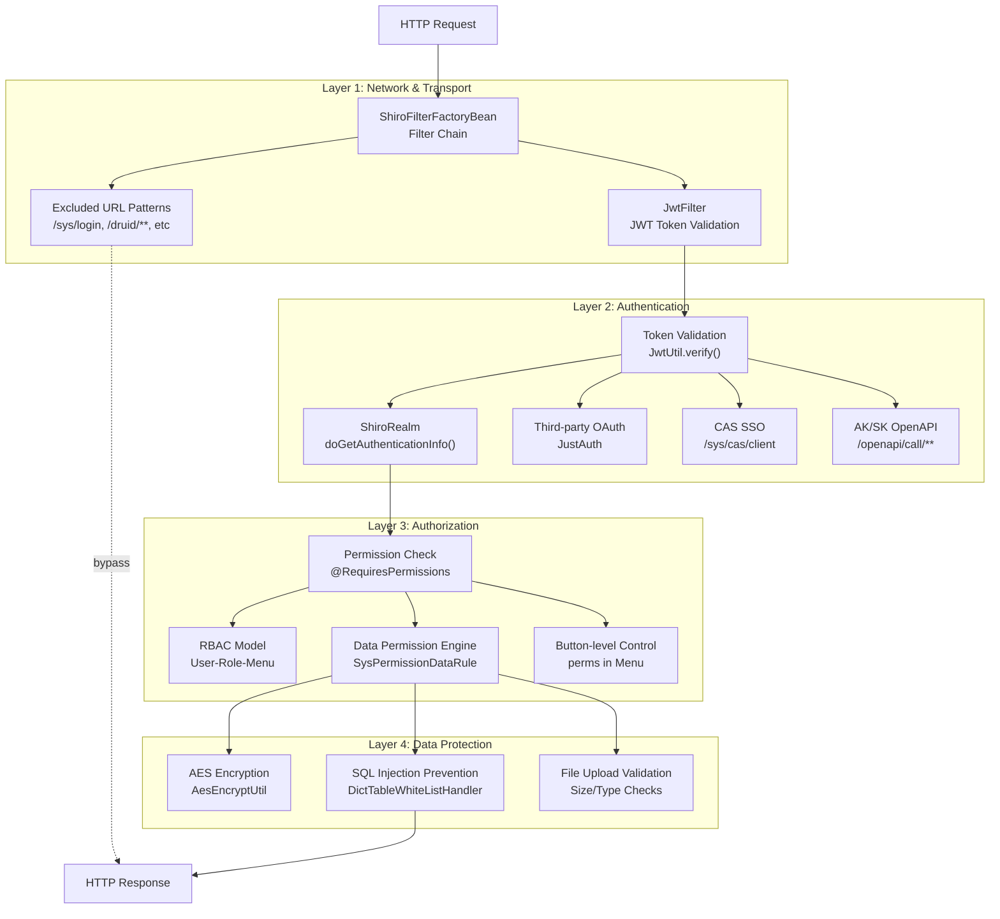
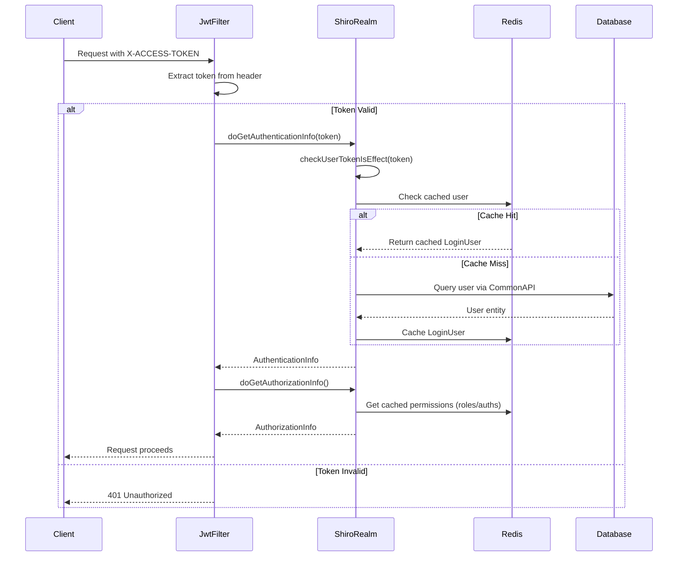
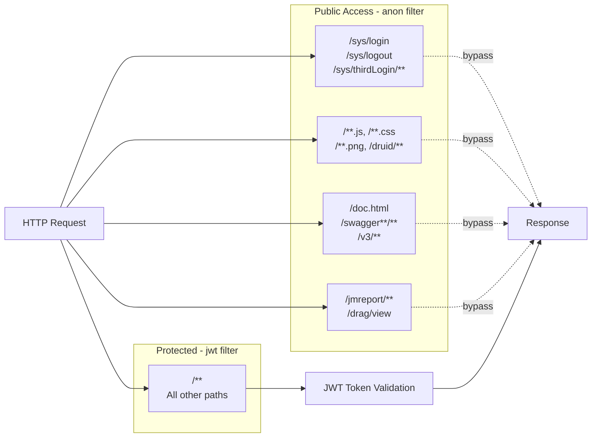
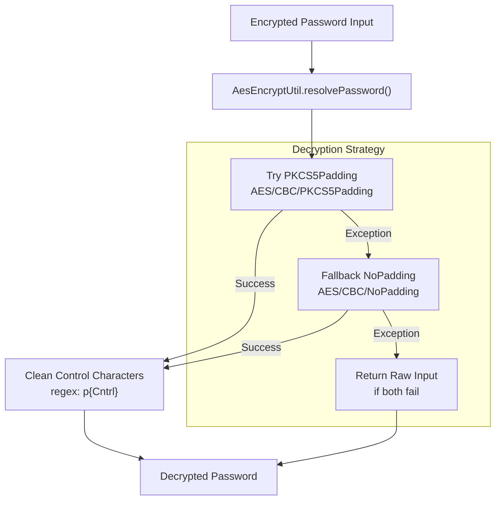

<!-- source: DeepWiki mcp.deepwiki.com · repo jeecgboot/JeecgBoot · page 8 Security · fetched 2026-10-29 -->

# Security

Relevant source files

The following files were used as context for generating this wiki page:

- [jeecg-boot/jeecg-boot-base-core/pom.xml](jeecg-boot/jeecg-boot-base-core/pom.xml)
- [jeecg-boot/jeecg-boot-base-core/src/main/java/org/jeecg/common/util/encryption/AesEncryptUtil.java](jeecg-boot/jeecg-boot-base-core/src/main/java/org/jeecg/common/util/encryption/AesEncryptUtil.java)
- [jeecg-boot/jeecg-boot-base-core/src/main/java/org/jeecg/config/JeecgBaseConfig.java](jeecg-boot/jeecg-boot-base-core/src/main/java/org/jeecg/config/JeecgBaseConfig.java)
- [jeecg-boot/jeecg-boot-base-core/src/main/java/org/jeecg/config/shiro/ShiroConfig.java](jeecg-boot/jeecg-boot-base-core/src/main/java/org/jeecg/config/shiro/ShiroConfig.java)
- [jeecg-boot/jeecg-boot-base-core/src/main/java/org/jeecg/config/shiro/ShiroRealm.java](jeecg-boot/jeecg-boot-base-core/src/main/java/org/jeecg/config/shiro/ShiroRealm.java)
- [jeecg-boot/jeecg-boot-module/jeecg-boot-module-airag/pom.xml](jeecg-boot/jeecg-boot-module/jeecg-boot-module-airag/pom.xml)
- [jeecg-boot/jeecg-module-system/jeecg-system-biz/src/main/java/org/jeecg/config/init/CodeTemplateInitListener.java](jeecg-boot/jeecg-module-system/jeecg-system-biz/src/main/java/org/jeecg/config/init/CodeTemplateInitListener.java)
- [jeecg-boot/jeecg-module-system/jeecg-system-biz/src/main/java/org/jeecg/modules/system/controller/LoginController.java](jeecg-boot/jeecg-module-system/jeecg-system-biz/src/main/java/org/jeecg/modules/system/controller/LoginController.java)
- [jeecg-boot/jeecg-module-system/jeecg-system-biz/src/main/java/org/jeecg/modules/system/controller/SysRoleIndexController.java](jeecg-boot/jeecg-module-system/jeecg-system-biz/src/main/java/org/jeecg/modules/system/controller/SysRoleIndexController.java)
- [jeecg-boot/jeecg-module-system/jeecg-system-biz/src/main/java/org/jeecg/modules/system/entity/SysRoleIndex.java](jeecg-boot/jeecg-module-system/jeecg-system-biz/src/main/java/org/jeecg/modules/system/entity/SysRoleIndex.java)
- [jeecg-boot/pom.xml](jeecg-boot/pom.xml)

## Purpose and Scope

This document describes JeecgBoot's comprehensive multi-layered security architecture, covering authentication mechanisms (JWT, Shiro, OAuth, CAS SSO), authorization models (RBAC with data permissions), and data protection strategies (encryption, SQL injection prevention). For AI-specific security features like MCP authentication, see [AI Platform (AIGC)](#3). For deployment security configurations, see [Production Deployment Best Practices](#9.3).

---

## Overview

JeecgBoot implements a defense-in-depth security model with four primary layers:

**Sources:** [jeecg-boot/jeecg-boot-base-core/src/main/java/org/jeecg/config/shiro/ShiroConfig.java:1-400]()

---

## Authentication System

### JWT and Shiro Integration

JeecgBoot uses **Apache Shiro 3.0.0** [jeecg-boot/pom.xml:76]() with **JWT tokens** for stateless authentication. The integration is configured in `ShiroConfig` [jeecg-boot/jeecg-boot-base-core/src/main/java/org/jeecg/config/shiro/ShiroConfig.java:47]() with Redis-backed caching.

#### Key Components

| Component | Class/File | Purpose |
|-----------|-----------|---------|
| Security Manager | `DefaultWebSecurityManager` | Core security coordinator [jeecg-boot/jeecg-boot-base-core/src/main/java/org/jeecg/config/shiro/ShiroConfig.java:14]() |
| JWT Filter | `JwtFilter` | Validates JWT tokens on each request [jeecg-boot/jeecg-boot-base-core/src/main/java/org/jeecg/config/shiro/filters/JwtFilter.java:1-100]() |
| Shiro Realm | `ShiroRealm` | Authenticates users and loads permissions [jeecg-boot/jeecg-boot-base-core/src/main/java/org/jeecg/config/shiro/ShiroRealm.java:41]() |
| Cache Manager | `RedisCacheManager` | Caches user permissions in Redis [jeecg-boot/jeecg-boot-base-core/src/main/java/org/jeecg/config/shiro/ShiroConfig.java:15]() |

**Token Generation:**
- Login endpoint: `/sys/login` (excluded from authentication) [jeecg-boot/jeecg-module-system/jeecg-system-biz/src/main/java/org/jeecg/modules/system/controller/LoginController.java:84]()
- Token secret: Configured in `EncryptedString.key`
- Token includes: username, timestamp, signature [jeecg-boot/jeecg-boot-base-core/src/main/java/org/jeecg/config/shiro/ShiroRealm.java:126]()

For details, see [Authentication System](#8.1).

**Sources:** 
- [jeecg-boot/jeecg-boot-base-core/src/main/java/org/jeecg/config/shiro/ShiroConfig.java:67-200]()
- [jeecg-boot/jeecg-boot-base-core/src/main/java/org/jeecg/config/shiro/ShiroRealm.java:99-147]()

---

### Shiro Filter Chain Configuration

The `ShiroFilterFactoryBean` defines a comprehensive filter chain with excluded URL patterns for public resources and authentication endpoints [jeecg-boot/jeecg-boot-base-core/src/main/java/org/jeecg/config/shiro/ShiroConfig.java:68]().

#### Excluded URL Patterns

**Sources:** 
- [jeecg-boot/jeecg-boot-base-core/src/main/java/org/jeecg/config/shiro/ShiroConfig.java:85-150]()

---

## Authorization & Permissions

### RBAC Model

JeecgBoot implements a standard **Role-Based Access Control (RBAC)** model. Permissions are verified during `doGetAuthorizationInfo` [jeecg-boot/jeecg-boot-base-core/src/main/java/org/jeecg/config/shiro/ShiroRealm.java:66]().

**Permission Components:**
- **User-Role Hierarchy:** Users are assigned roles [jeecg-boot/jeecg-boot-base-core/src/main/java/org/jeecg/config/shiro/ShiroRealm.java:78]().
- **Role-Menu/Button Permissions:** Roles are granted string-based permissions [jeecg-boot/jeecg-boot-base-core/src/main/java/org/jeecg/config/shiro/ShiroRealm.java:83]().
- **Role-Based Routing:** Users can be assigned dynamic homepages based on roles via `SysRoleIndex` [jeecg-boot/jeecg-module-system/jeecg-system-biz/src/main/java/org/jeecg/modules/system/entity/SysRoleIndex.java:30]().

For details, see [Authorization & Permissions](#8.2).

---

### Data Permissions & Row-Level Security

JeecgBoot provides fine-grained data permissions through dynamic SQL rule injection. Rules are defined in `SysPermissionDataRuleModel` and processed by the `QueryGenerator` to filter result sets based on user context (e.g., department, user ID).

For details, see [Data Permissions & Row-Level Security](#8.3).

---

## Data Protection

### Password Encryption (AES Dual-Mode)

JeecgBoot implements **backward-compatible AES encryption** supporting both legacy `NoPadding` and modern `PKCS5Padding` modes [jeecg-boot/jeecg-boot-base-core/src/main/java/org/jeecg/common/util/encryption/AesEncryptUtil.java:15]().

**Sources:** 
- [jeecg-boot/jeecg-boot-base-core/src/main/java/org/jeecg/common/util/encryption/AesEncryptUtil.java:42-64]()

For details, see [Encryption & Data Protection](#8.4).

---

### SQL Injection Prevention

The system utilizes `DictTableWhiteListHandler` to prevent SQL injection by enforcing a whitelist for dynamic table and field queries. This is especially critical for low-code features where table names are passed as parameters.

For details, see [SQL Injection Prevention](#8.5).

---

### File Upload Security

File uploads are secured through size limits, type restrictions, and configurable storage backends (Local, MinIO, OSS). Upload configurations are managed via `JeecgBaseConfig` [jeecg-boot/jeecg-boot-base-core/src/main/java/org/jeecg/config/JeecgBaseConfig.java:35]().

For details, see [File Upload Security](#8.6).

---

**Page Sources:**
- [jeecg-boot/jeecg-boot-base-core/src/main/java/org/jeecg/config/shiro/ShiroConfig.java:1-400]()
- [jeecg-boot/jeecg-boot-base-core/src/main/java/org/jeecg/config/shiro/ShiroRealm.java:1-180]()
- [jeecg-boot/jeecg-boot-base-core/src/main/java/org/jeecg/common/util/encryption/AesEncryptUtil.java:1-107]()
- [jeecg-boot/jeecg-boot-base-core/src/main/java/org/jeecg/config/JeecgBaseConfig.java:1-205]()
- [jeecg-boot/jeecg-module-system/jeecg-system-biz/src/main/java/org/jeecg/modules/system/controller/LoginController.java:84-135]()
- [jeecg-boot/pom.xml:75-78]()

---

