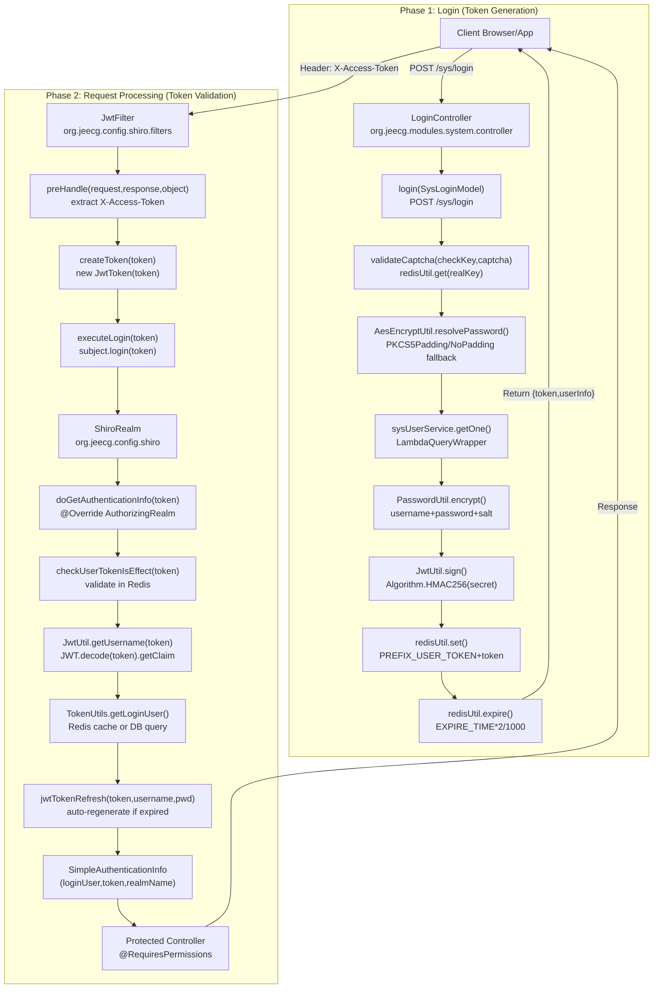
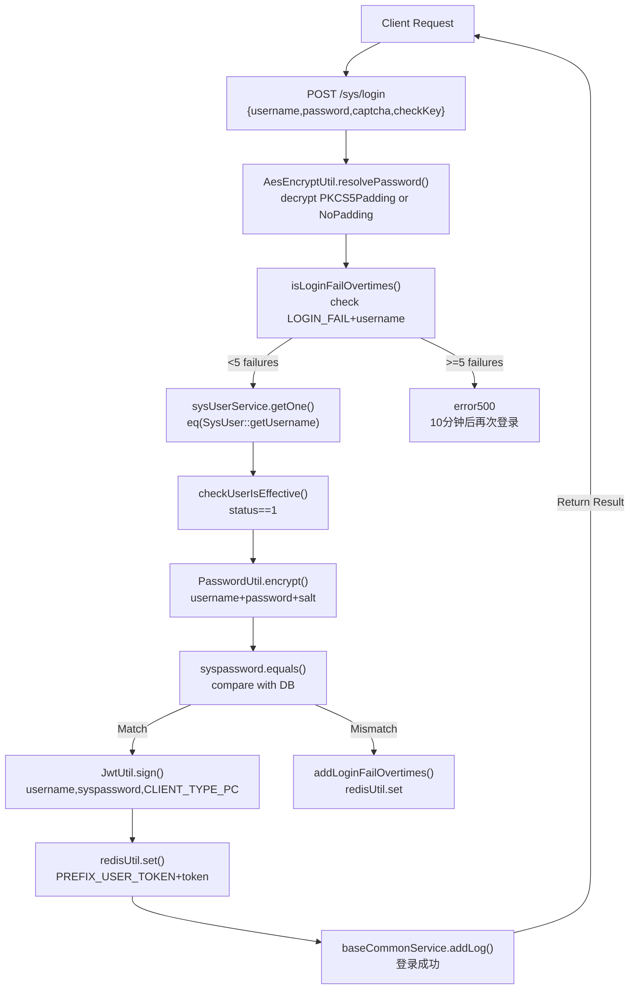
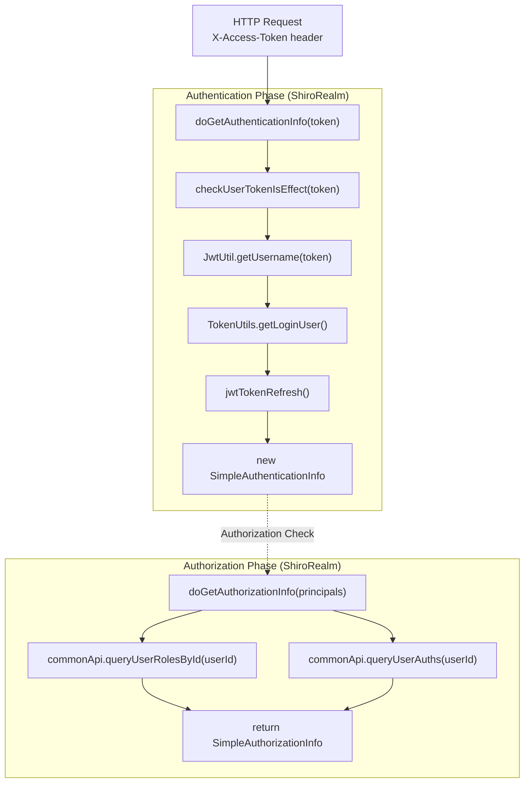

<!-- source: DeepWiki mcp.deepwiki.com · repo jeecgboot/JeecgBoot · page 8.1 Authentication System · fetched 2026-10-29 -->

# Authentication System

Relevant source files

The following files were used as context for generating this wiki page:

- [jeecg-boot/jeecg-boot-base-core/src/main/java/org/jeecg/common/system/util/JwtUtil.java](jeecg-boot/jeecg-boot-base-core/src/main/java/org/jeecg/common/system/util/JwtUtil.java)
- [jeecg-boot/jeecg-boot-base-core/src/main/java/org/jeecg/common/util/oConvertUtils.java](jeecg-boot/jeecg-boot-base-core/src/main/java/org/jeecg/common/util/oConvertUtils.java)
- [jeecg-boot/jeecg-boot-base-core/src/main/java/org/jeecg/config/JeecgBaseConfig.java](jeecg-boot/jeecg-boot-base-core/src/main/java/org/jeecg/config/JeecgBaseConfig.java)
- [jeecg-boot/jeecg-boot-base-core/src/main/java/org/jeecg/config/WebMvcConfiguration.java](jeecg-boot/jeecg-boot-base-core/src/main/java/org/jeecg/config/WebMvcConfiguration.java)
- [jeecg-boot/jeecg-boot-base-core/src/main/java/org/jeecg/config/mybatis/MybatisPlusSaasConfig.java](jeecg-boot/jeecg-boot-base-core/src/main/java/org/jeecg/config/mybatis/MybatisPlusSaasConfig.java)
- [jeecg-boot/jeecg-boot-base-core/src/main/java/org/jeecg/config/oss/MinioConfig.java](jeecg-boot/jeecg-boot-base-core/src/main/java/org/jeecg/config/oss/MinioConfig.java)
- [jeecg-boot/jeecg-boot-base-core/src/main/java/org/jeecg/config/oss/OssConfiguration.java](jeecg-boot/jeecg-boot-base-core/src/main/java/org/jeecg/config/oss/OssConfiguration.java)
- [jeecg-boot/jeecg-boot-base-core/src/main/java/org/jeecg/config/shiro/ShiroRealm.java](jeecg-boot/jeecg-boot-base-core/src/main/java/org/jeecg/config/shiro/ShiroRealm.java)
- [jeecg-boot/jeecg-module-system/jeecg-system-biz/src/main/java/org/jeecg/config/init/CodeTemplateInitListener.java](jeecg-boot/jeecg-module-system/jeecg-system-biz/src/main/java/org/jeecg/config/init/CodeTemplateInitListener.java)
- [jeecg-boot/jeecg-module-system/jeecg-system-biz/src/main/java/org/jeecg/modules/system/controller/LoginController.java](jeecg-boot/jeecg-module-system/jeecg-system-biz/src/main/java/org/jeecg/modules/system/controller/LoginController.java)
- [jeecg-boot/jeecg-module-system/jeecg-system-biz/src/main/java/org/jeecg/modules/system/controller/SysRoleIndexController.java](jeecg-boot/jeecg-module-system/jeecg-system-biz/src/main/java/org/jeecg/modules/system/controller/SysRoleIndexController.java)
- [jeecg-boot/jeecg-module-system/jeecg-system-biz/src/main/java/org/jeecg/modules/system/entity/SysRoleIndex.java](jeecg-boot/jeecg-module-system/jeecg-system-biz/src/main/java/org/jeecg/modules/system/entity/SysRoleIndex.java)
- [jeecg-boot/jeecg-module-system/jeecg-system-start/src/test/java/org/jeecg/modules/system/test/MockControllerTest.java](jeecg-boot/jeecg-module-system/jeecg-system-start/src/test/java/org/jeecg/modules/system/test/MockControllerTest.java)

JeecgBoot implements a stateless authentication system combining **JWT (JSON Web Tokens)** with **Apache Shiro 2.0.4** for access control. The system supports multiple authentication methods: username/password login, phone-based SMS login, third-party OAuth authentication (GitHub, WeChat, DingTalk), and CAS Single Sign-On. All authentication flows generate JWT tokens validated on subsequent requests without server-side session storage.

## Overview: Authentication Flow

The authentication system operates in two phases: **login** (token generation) and **request processing** (token validation). JWT tokens are stored in Redis with automatic refresh capability to maintain user sessions without manual re-login.

**Complete Authentication and Request Processing Flow**

**Key Authentication Components**

| Component | Class | File Path | Key Methods | Purpose |
|-----------|-------|-----------|-------------|---------|
| Login Endpoint | `LoginController` | `jeecg-module-system/jeecg-system-biz/org/jeecg/modules/system/controller/LoginController.java` | `login()` [jeecg-boot/jeecg-module-system/jeecg-system-biz/src/main/java/org/jeecg/modules/system/controller/LoginController.java:82-134](), `logout()` [jeecg-boot/jeecg-module-system/jeecg-system-biz/src/main/java/org/jeecg/modules/system/controller/LoginController.java:182-220]() | Handles POST `/sys/login` and `/sys/logout` endpoints |
| JWT Utilities | `JwtUtil` | `jeecg-boot-base-core/org/jeecg/common/system/util/JwtUtil.java` | `sign()` [jeecg-boot/jeecg-boot-base-core/src/main/java/org/jeecg/common/system/util/JwtUtil.java:156-169](), `verify()` [jeecg-boot/jeecg-boot-base-core/src/main/java/org/jeecg/common/system/util/JwtUtil.java:82-94](), `getUsername()` [jeecg-boot/jeecg-boot-base-core/src/main/java/org/jeecg/common/system/util/JwtUtil.java:101-109]() | Generates JWT with HMAC256, validates signature, extracts payload |
| Authentication Realm | `ShiroRealm` | `jeecg-boot-base-core/org/jeecg/config/shiro/ShiroRealm.java` | `doGetAuthenticationInfo()` [jeecg-boot/jeecg-boot-base-core/src/main/java/org/jeecg/config/shiro/ShiroRealm.java:98-117](), `checkUserTokenIsEffect()` [jeecg-boot/jeecg-boot-base-core/src/main/java/org/jeecg/config/shiro/ShiroRealm.java:124-185]() | Validates JWT against Redis cache, queries user, auto-refreshes tokens |
| AES Decryption | `AesEncryptUtil` | `jeecg-boot-base-core/org/jeecg/common/util/encryption/AesEncryptUtil.java` | `resolvePassword()` | Decrypts frontend AES-encrypted passwords |
| Token Cache | `RedisUtil` | `jeecg-boot-base-core/org/jeecg/common/util/RedisUtil.java` | `set()`, `get()`, `expire()`, `del()` | Stores tokens and login failure counts in Redis |

Sources: [jeecg-boot/jeecg-module-system/jeecg-system-biz/src/main/java/org/jeecg/modules/system/controller/LoginController.java:82-134](), [jeecg-boot/jeecg-boot-base-core/src/main/java/org/jeecg/config/shiro/ShiroRealm.java:98-185](), [jeecg-boot/jeecg-boot-base-core/src/main/java/org/jeecg/common/system/util/JwtUtil.java:42-169]()

## Login Mechanisms

JeecgBoot supports multiple authentication methods to accommodate different use cases:

### Username/Password Login

The primary authentication method uses username/password with captcha verification. The login flow is implemented in `LoginController.login()` at [jeecg-boot/jeecg-module-system/jeecg-system-biz/src/main/java/org/jeecg/modules/system/controller/LoginController.java:82-134]().

**Standard Login Flow with Captcha Verification**

**Login Failure Protection**

Brute-force protection is implemented via Redis counters in `LoginController`:
- **Lockout**: If `isLoginFailOvertimes(username)` returns true, the user is blocked for 10 minutes [jeecg-boot/jeecg-module-system/jeecg-system-biz/src/main/java/org/jeecg/modules/system/controller/LoginController.java:93-95]().
- **Increment**: `addLoginFailOvertimes(username)` increments the counter on password mismatch [jeecg-boot/jeecg-module-system/jeecg-system-biz/src/main/java/org/jeecg/modules/system/controller/LoginController.java:116]().
- **Cleanup**: Successful login deletes the failure counter and captcha key [jeecg-boot/jeecg-module-system/jeecg-system-biz/src/main/java/org/jeecg/modules/system/controller/LoginController.java:127-128]().

**Password Encryption with AES**

Frontend passwords are encrypted via AES before transmission. The backend uses `AesEncryptUtil.resolvePassword()` to handle decryption [jeecg-boot/jeecg-module-system/jeecg-system-biz/src/main/java/org/jeecg/modules/system/controller/LoginController.java:89]().

Sources: [jeecg-boot/jeecg-module-system/jeecg-system-biz/src/main/java/org/jeecg/modules/system/controller/LoginController.java:82-135](), [jeecg-boot/jeecg-boot-base-core/src/main/java/org/jeecg/common/util/encryption/AesEncryptUtil.java:14-107]()

## JWT Token Lifecycle

JeecgBoot implements JWT tokens with automatic refresh capability, allowing users to remain authenticated while actively using the application.

**Token Configuration and Generation**

| Client Type | Expiry Time | Implementation |
|-------------|-------------|----------------|
| PC | 7 Days (84 hours) | `JwtUtil.EXPIRE_TIME` [jeecg-boot/jeecg-boot-base-core/src/main/java/org/jeecg/common/system/util/JwtUtil.java:45]() |
| APP | 30 Days (360 hours) | `JwtUtil.APP_EXPIRE_TIME` [jeecg-boot/jeecg-boot-base-core/src/main/java/org/jeecg/common/system/util/JwtUtil.java:47]() |

**Sign Method Logic** [jeecg-boot/jeecg-boot-base-core/src/main/java/org/jeecg/common/system/util/JwtUtil.java:156-169]():
The `sign` method embeds `username` and `clientType` into the JWT claims and signs it using `Algorithm.HMAC256(secret)`.

**Automatic Token Refresh Mechanism**

The `jwtTokenRefresh()` logic in `ShiroRealm` handles seamless token renewal:
1. **Validation**: Checks if the token is valid and exists in Redis.
2. **Expiry Check**: If the token is expired but the Redis cache entry still exists, a new token is generated.
3. **Cache Update**: The new token is updated in Redis with the same key, effectively extending the session without requiring user interaction.

Sources: [jeecg-boot/jeecg-boot-base-core/src/main/java/org/jeecg/common/system/util/JwtUtil.java:42-169](), [jeecg-boot/jeecg-boot-base-core/src/main/java/org/jeecg/config/shiro/ShiroRealm.java:143-147]()

## Shiro Security Framework Integration

JeecgBoot uses **Apache Shiro** configured for stateless JWT-based authentication. The `ShiroRealm` class at [jeecg-boot/jeecg-boot-base-core/src/main/java/org/jeecg/config/shiro/ShiroRealm.java]() implements the core security logic.

**Realm Method Invocation Flow**

**Authentication (`doGetAuthenticationInfo`)**:
- Extracts token credentials [jeecg-boot/jeecg-boot-base-core/src/main/java/org/jeecg/config/shiro/ShiroRealm.java:101]().
- Validates token effectiveness and user status [jeecg-boot/jeecg-boot-base-core/src/main/java/org/jeecg/config/shiro/ShiroRealm.java:124-147]().

**Authorization (`doGetAuthorizationInfo`)**:
- Retrieves roles via `commonApi.queryUserRolesById(userId)` [jeecg-boot/jeecg-boot-base-core/src/main/java/org/jeecg/config/shiro/ShiroRealm.java:78]().
- Retrieves permissions via `commonApi.queryUserAuths(userId)` [jeecg-boot/jeecg-boot-base-core/src/main/java/org/jeecg/config/shiro/ShiroRealm.java:83]().

Sources: [jeecg-boot/jeecg-boot-base-core/src/main/java/org/jeecg/config/shiro/ShiroRealm.java:41-117](), [jeecg-boot/jeecg-boot-base-core/src/main/java/org/jeecg/config/shiro/ShiroRealm.java:66-88]()

## Multi-Tenant Security

JeecgBoot supports multi-tenant isolation within the authentication system.

**Tenant Isolation in Mybatis-Plus**:
The `MybatisPlusSaasConfig` class defines which tables are subject to tenant isolation via the `TENANT_TABLE` list [jeecg-boot/jeecg-boot-base-core/src/main/java/org/jeecg/config/mybatis/MybatisPlusSaasConfig.java:59-83]().

**Tenant Context Resolution**:
The `getTenantId()` method in the `TenantLineInnerInterceptor` resolves the current tenant ID:
1. It first attempts to retrieve it from `TenantContext.getTenant()` [jeecg-boot/jeecg-boot-base-core/src/main/java/org/jeecg/config/mybatis/MybatisPlusSaasConfig.java:99]().
2. If empty, it falls back to `TokenUtils.getTenantIdByRequest()` [jeecg-boot/jeecg-boot-base-core/src/main/java/org/jeecg/config/mybatis/MybatisPlusSaasConfig.java:103]().

**Shiro Tenant Validation**:
In `ShiroRealm`, the system validates if the logged-in user has access to the requested tenant ID if `OPEN_SYSTEM_TENANT_CONTROL` is enabled [jeecg-boot/jeecg-boot-base-core/src/main/java/org/jeecg/config/shiro/ShiroRealm.java:150-171]().

Sources: [jeecg-boot/jeecg-boot-base-core/src/main/java/org/jeecg/config/mybatis/MybatisPlusSaasConfig.java:54-129](), [jeecg-boot/jeecg-boot-base-core/src/main/java/org/jeecg/config/shiro/ShiroRealm.java:148-171]()

## Logout and Session Cleanup

When a user logs out, the system performs comprehensive cleanup of cached authentication data.

**Logout Implementation** [jeecg-boot/jeecg-module-system/jeecg-system-biz/src/main/java/org/jeecg/modules/system/controller/LoginController.java:182-220]():
1. **Token Retrieval**: Extracts `X-Access-Token` from headers.
2. **Signature Verification**: Validates the token signature to prevent DoS attacks via forged tokens [jeecg-boot/jeecg-module-system/jeecg-system-biz/src/main/java/org/jeecg/modules/system/controller/LoginController.java:193-195]().
3. **Cache Invalidation**: Clears the login token and Shiro cache from Redis using `redisUtil.del()`.
4. **Log Recording**: Records the logout event via `baseCommonService.addLog()`.

Sources: [jeecg-boot/jeecg-module-system/jeecg-system-biz/src/main/java/org/jeecg/modules/system/controller/LoginController.java:182-220](), [jeecg-boot/jeecg-boot-base-core/src/main/java/org/jeecg/common/system/util/JwtUtil.java:189-204]()

---

