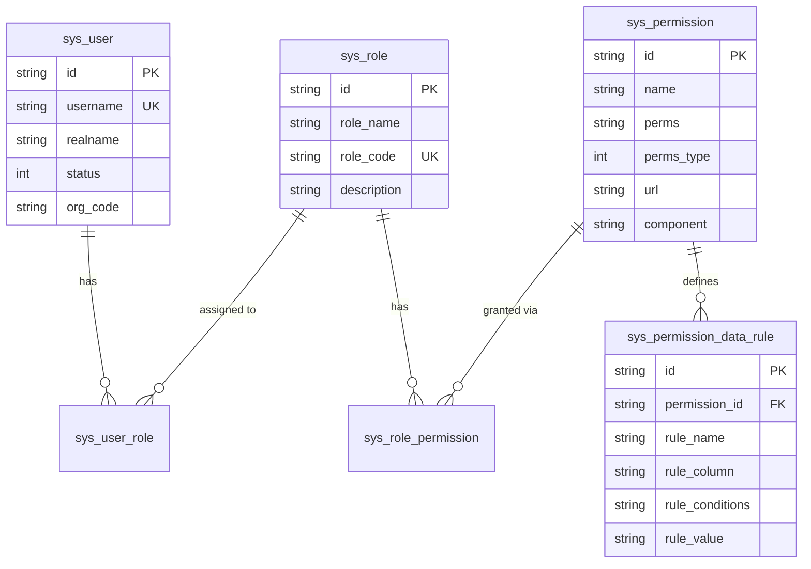
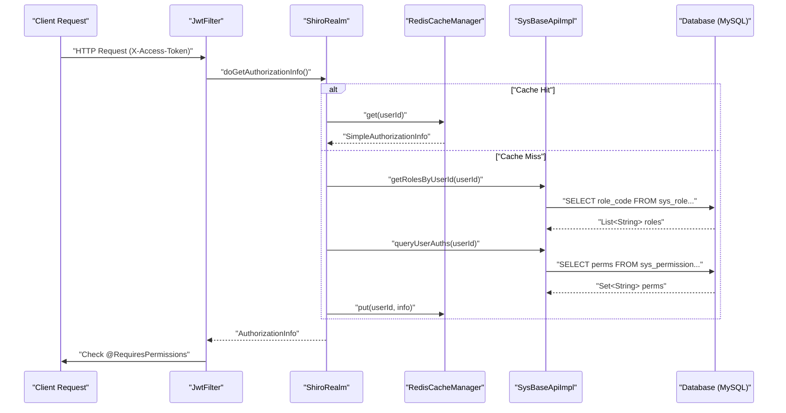
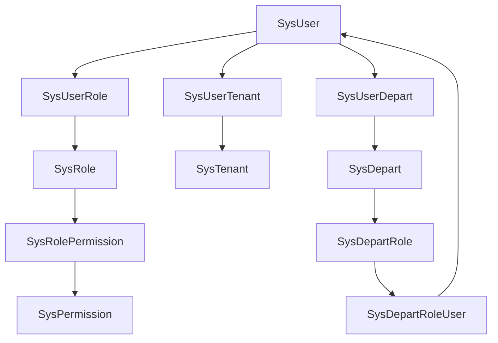

<!-- source: DeepWiki mcp.deepwiki.com · repo jeecgboot/JeecgBoot · page 8.2 Authorization & Permissions · fetched 2026-10-29 -->

# Authorization & Permissions

<details>
<summary>Relevant source files</summary>

The following files were used as context for generating this wiki page:

- [jeecg-boot/jeecg-boot-base-core/src/main/java/org/jeecg/common/constant/enums/DepartCategoryEnum.java](jeecg-boot/jeecg-boot-base-core/src/main/java/org/jeecg/common/constant/enums/DepartCategoryEnum.java)
- [jeecg-boot/jeecg-boot-base-core/src/main/java/org/jeecg/common/constant/enums/PositionLevelEnum.java](jeecg-boot/jeecg-boot-base-core/src/main/java/org/jeecg/common/constant/enums/PositionLevelEnum.java)
- [jeecg-boot/jeecg-boot-base-core/src/main/java/org/jeecg/common/system/vo/LoginUser.java](jeecg-boot/jeecg-boot-base-core/src/main/java/org/jeecg/common/system/vo/LoginUser.java)
- [jeecg-boot/jeecg-module-system/jeecg-system-api/jeecg-system-cloud-api/src/main/java/org/jeecg/common/system/api/ISysBaseAPI.java](jeecg-boot/jeecg-module-system/jeecg-system-api/jeecg-system-cloud-api/src/main/java/org/jeecg/common/system/api/ISysBaseAPI.java)
- [jeecg-boot/jeecg-module-system/jeecg-system-api/jeecg-system-cloud-api/src/main/java/org/jeecg/common/system/api/fallback/SysBaseAPIFallback.java](jeecg-boot/jeecg-module-system/jeecg-system-api/jeecg-system-cloud-api/src/main/java/org/jeecg/common/system/api/fallback/SysBaseAPIFallback.java)
- [jeecg-boot/jeecg-module-system/jeecg-system-api/jeecg-system-local-api/src/main/java/org/jeecg/common/system/api/ISysBaseAPI.java](jeecg-boot/jeecg-module-system/jeecg-system-api/jeecg-system-local-api/src/main/java/org/jeecg/common/system/api/ISysBaseAPI.java)
- [jeecg-boot/jeecg-module-system/jeecg-system-biz/src/main/java/org/jeecg/modules/api/controller/SystemApiController.java](jeecg-boot/jeecg-module-system/jeecg-system-biz/src/main/java/org/jeecg/modules/api/controller/SystemApiController.java)
- [jeecg-boot/jeecg-module-system/jeecg-system-biz/src/main/java/org/jeecg/modules/system/controller/SysDepartRoleController.java](jeecg-boot/jeecg-module-system/jeecg-system-biz/src/main/java/org/jeecg/modules/system/controller/SysDepartRoleController.java)
- [jeecg-boot/jeecg-module-system/jeecg-system-biz/src/main/java/org/jeecg/modules/system/controller/SysUserController.java](jeecg-boot/jeecg-module-system/jeecg-system-biz/src/main/java/org/jeecg/modules/system/controller/SysUserController.java)
- [jeecg-boot/jeecg-module-system/jeecg-system-biz/src/main/java/org/jeecg/modules/system/service/ISysAnnouncementService.java](jeecg-boot/jeecg-module-system/jeecg-system-biz/src/main/java/org/jeecg/modules/system/service/ISysAnnouncementService.java)
- [jeecg-boot/jeecg-module-system/jeecg-system-biz/src/main/java/org/jeecg/modules/system/service/impl/SysBaseApiImpl.java](jeecg-boot/jeecg-module-system/jeecg-system-biz/src/main/java/org/jeecg/modules/system/service/impl/SysBaseApiImpl.java)
- [jeecg-boot/jeecg-module-system/jeecg-system-biz/src/main/java/org/jeecg/modules/system/service/impl/SysUserServiceImpl.java](jeecg-boot/jeecg-module-system/jeecg-system-biz/src/main/java/org/jeecg/modules/system/service/impl/SysUserServiceImpl.java)
- [jeecg-boot/jeecg-module-system/jeecg-system-biz/src/main/java/org/jeecg/modules/system/service/impl/ThirdAppWechatEnterpriseServiceImpl.java](jeecg-boot/jeecg-module-system/jeecg-system-biz/src/main/java/org/jeecg/modules/system/service/impl/ThirdAppWechatEnterpriseServiceImpl.java)

</details>


This page documents the authorization and permissions system in JeecgBoot, covering the RBAC (Role-Based Access Control) model, permission types, authorization flow, and how permissions are checked at runtime.

**Scope**: This page focuses on authorization (what authenticated users can do) and role/permission management. For authentication (verifying user identity), see [8.1 Authentication System](). For data-level permissions and row-level security, see [8.3 Data Permissions & Row-Level Security]().

---

## RBAC Model & Database Schema

JeecgBoot implements a standard RBAC model with Users, Roles, and Permissions. The system supports many-to-many relationships between users and roles, and between roles and permissions.

### Core Tables

| Table | Purpose | Key Fields |
|-------|---------|-----------|
| `sys_user` | User accounts | `id`, `username`, `realname`, `status` |
| `sys_role` | Role definitions | `id`, `role_name`, `role_code` |
| `sys_permission` | Permission resources | `id`, `name`, `perms`, `perms_type` (0=menu, 1=button, 2=other) |
| `sys_user_role` | User-Role mapping | `user_id`, `role_id` |
| `sys_role_permission` | Role-Permission mapping | `role_id`, `permission_id` |
| `sys_permission_data_rule` | Data permission rules | `permission_id`, `rule_name`, `rule_column`, `rule_conditions` |

### RBAC Entity Relationships



**Sources**: [jeecg-boot/jeecg-module-system/jeecg-system-biz/src/main/java/org/jeecg/modules/system/service/impl/SysUserServiceImpl.java:88-142](), [jeecg-boot/jeecg-module-system/jeecg-system-biz/src/main/java/org/jeecg/modules/system/service/impl/SysBaseApiImpl.java:102-160]()

---

## Authorization Flow

When a user accesses a protected resource, Shiro's authorization flow is triggered. The system loads the user's roles and permissions from the database and caches them in memory.

### Authorization Lifecycle



### Key Authorization Implementation

The `SysBaseApiImpl` provides the underlying data retrieval for the authorization engine.

**Method: queryUserAuths(userId)**
[jeecg-boot/jeecg-module-system/jeecg-system-biz/src/main/java/org/jeecg/modules/system/service/impl/SysBaseApiImpl.java:247-253]()

This method retrieves all permission strings associated with a user across all assigned roles.

**Database Queries (implemented in `SysBaseApiImpl`):**
The following SQL patterns are used to populate the security context:

```sql
-- getRolesByUserId(userId)
SELECT sr.role_code 
FROM sys_role sr 
JOIN sys_user_role sur ON sr.id = sur.role_id 
WHERE sur.user_id = ?

-- queryUserAuths(userId)
SELECT sp.perms 
FROM sys_permission sp 
JOIN sys_role_permission srp ON sp.id = srp.permission_id 
JOIN sys_user_role sur ON srp.role_id = sur.role_id 
WHERE sur.user_id = ? AND sp.perms IS NOT NULL
```

**Sources**: [jeecg-boot/jeecg-module-system/jeecg-system-biz/src/main/java/org/jeecg/modules/system/service/impl/SysBaseApiImpl.java:147-158](), [jeecg-boot/jeecg-module-system/jeecg-system-biz/src/main/java/org/jeecg/modules/system/service/impl/SysBaseApiImpl.java:247-253]()

---

## Permission Types

JeecgBoot supports three types of permissions, controlled by the `perms_type` field in the `sys_permission` table:

| Type | Value | Description | Example Use Case |
|------|-------|-------------|------------------|
| **Menu** | 0 | Menu/route access | User can see "User Management" menu |
| **Button** | 1 | Button-level operations | User can click "Delete" button |
| **Other** | 2 | API/resource access | User can call `/api/users/delete` |

### Permission Enforcement

Backend controllers enforce permissions using Shiro annotations:

```java
// Example from SysUserController
@RequiresPermissions("system:user:add")
@RequestMapping(value = "/add", method = RequestMethod.POST)
public Result<SysUser> add(@RequestBody JSONObject jsonObject) { ... }
```

**Sources**: [jeecg-boot/jeecg-module-system/jeecg-system-biz/src/main/java/org/jeecg/modules/system/controller/SysUserController.java:162-164](), [jeecg-boot/jeecg-module-system/jeecg-system-biz/src/main/java/org/jeecg/modules/system/controller/SysUserController.java:154-155]()

---

## Permission Checking Mechanisms

### 1. Annotation-Based Authorization

Controllers use `@RequiresPermissions` and `@RequiresRoles` to protect endpoints.

```java
// SysUserController examples
@RequiresPermissions("system:user:listAll") // [SysUserController.java:154]
@RequiresPermissions("system:user:add")     // [SysUserController.java:162]

// SysDepartRoleController examples
@RequiresPermissions("system:depart:role:add") // [SysDepartRoleController.java:111]
@RequiresPermissions("system:depart:role:edit") // [SysDepartRoleController.java:126]
```

### 2. Multi-Tenant Authorization

JeecgBoot supports SaaS multi-tenancy. Authorization logic often includes tenant isolation checks.

[jeecg-boot/jeecg-module-system/jeecg-system-biz/src/main/java/org/jeecg/modules/system/controller/SysUserController.java:131-140]()

```java
if (MybatisPlusSaasConfig.OPEN_SYSTEM_TENANT_CONTROL) {
    String tenantId = oConvertUtils.getString(TenantContext.getTenant(), "-1");
    List<String> userIds = userTenantService.getUserIdsByTenantId(Integer.valueOf(tenantId));
    if (oConvertUtils.listIsNotEmpty(userIds)) {
        queryWrapper.in("id", userIds);
    }
}
```

### 3. Department-Level Roles

The system allows assigning roles specific to a department via `SysDepartRole`.

[jeecg-boot/jeecg-module-system/jeecg-system-biz/src/main/java/org/jeecg/modules/system/controller/SysDepartRoleController.java:44-58]()

- `SysDepartRole`: Defines a role within a specific department.
- `SysDepartRoleUser`: Maps users to department-specific roles.
- `SysDepartRolePermission`: Maps department roles to permissions.

**Sources**: [jeecg-boot/jeecg-module-system/jeecg-system-biz/src/main/java/org/jeecg/modules/system/controller/SysUserController.java:131-140](), [jeecg-boot/jeecg-module-system/jeecg-system-biz/src/main/java/org/jeecg/modules/system/controller/SysDepartRoleController.java:111-203]()

---

## System API & Service Integration

The `ISysBaseAPI` interface acts as the bridge for authorization data across modules, especially in microservices deployments.

### ISysBaseAPI Authorization Methods

| Method | Source | Description |
|--------|--------|-------------|
| `getRolesByUserId` | [ISysBaseAPI.java:99]() | Returns role codes for a specific user ID |
| `getRolesByUsername` | [ISysBaseAPI.java:91]() | Returns role codes for a username |
| `getUserPermissionSet` | [ISysBaseAPI.java:222]() | Returns all permission strings for a user |
| `queryUserAuths` | [ISysBaseAPI.java:252]() | Implementation of permission set retrieval |

### Remote vs Local Implementation

- **Local**: `SysBaseApiImpl` directly queries the database via Mappers.
- **Cloud**: `SysBaseAPIFallback` and `FeignClient` handle cross-service authorization requests.

**Sources**: [jeecg-boot/jeecg-module-system/jeecg-system-api/jeecg-system-cloud-api/src/main/java/org/jeecg/common/system/api/ISysBaseAPI.java:36-40](), [jeecg-boot/jeecg-module-system/jeecg-system-biz/src/main/java/org/jeecg/modules/system/service/impl/SysBaseApiImpl.java:93-158]()

---

## Third-Party Authorization Integration

JeecgBoot supports synchronization with enterprise platforms like Enterprise WeChat and DingTalk.

### WeChat Enterprise Sync
[jeecg-boot/jeecg-module-system/jeecg-system-biz/src/main/java/org/jeecg/modules/system/service/impl/ThirdAppWechatEnterpriseServiceImpl.java:136-161]()

The system can synchronize local department structures and user permissions to third-party apps:
1. Retrieve `AccessToken` using `JwAccessTokenAPI`.
2. Sync local `SysDepart` tree to WeChat `Department`.
3. Map local users to WeChat accounts via `sys_third_account`.

**Sources**: [jeecg-boot/jeecg-module-system/jeecg-system-biz/src/main/java/org/jeecg/modules/system/service/impl/ThirdAppWechatEnterpriseServiceImpl.java:107-118](), [jeecg-boot/jeecg-module-system/jeecg-system-biz/src/main/java/org/jeecg/modules/system/service/impl/ThirdAppWechatEnterpriseServiceImpl.java:136-161]()

---

## Summary of Permission Hierarchy



**Sources**: [jeecg-boot/jeecg-module-system/jeecg-system-biz/src/main/java/org/jeecg/modules/system/controller/SysUserController.java:75-115](), [jeecg-boot/jeecg-module-system/jeecg-system-biz/src/main/java/org/jeecg/modules/system/controller/SysDepartRoleController.java:44-61]()

---

