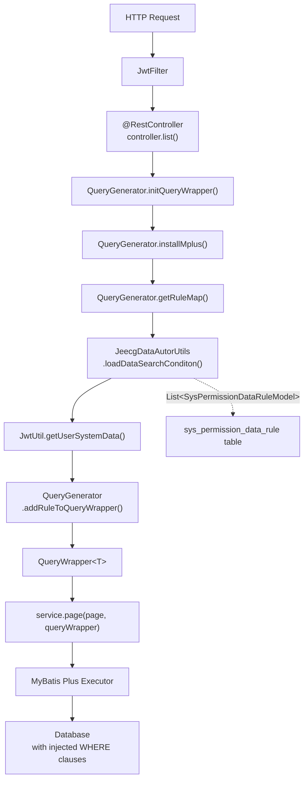
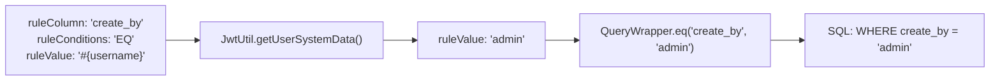
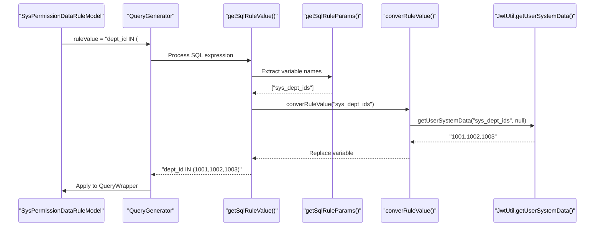

<!-- source: DeepWiki mcp.deepwiki.com · repo jeecgboot/JeecgBoot · page 8.3 Data Permissions & Row-Level Security · fetched 2026-10-29 -->

# Data Permissions & Row-Level Security

<details>
<summary>Relevant source files</summary>

The following files were used as context for generating this wiki page:

- [check_jeecgenv.py](check_jeecgenv.py)
- [jeecg-boot/jeecg-boot-base-core/src/main/java/org/jeecg/common/system/query/QueryGenerator.java](jeecg-boot/jeecg-boot-base-core/src/main/java/org/jeecg/common/system/query/QueryGenerator.java)
- [jeecg-boot/jeecg-boot-base-core/src/main/java/org/jeecg/common/system/util/SqlConcatUtil.java](jeecg-boot/jeecg-boot-base-core/src/main/java/org/jeecg/common/system/util/SqlConcatUtil.java)
- [jeecg-boot/jeecg-module-system/jeecg-system-biz/src/main/java/org/jeecg/modules/system/service/impl/SysBaseApiImpl.java](jeecg-boot/jeecg-module-system/jeecg-system-biz/src/main/java/org/jeecg/modules/system/service/impl/SysBaseApiImpl.java)
- [jeecg-boot/jeecg-module-system/jeecg-system-biz/src/main/java/org/jeecg/modules/system/service/impl/ThirdAppWechatEnterpriseServiceImpl.java](jeecg-boot/jeecg-module-system/jeecg-system-biz/src/main/java/org/jeecg/modules/system/service/impl/ThirdAppWechatEnterpriseServiceImpl.java)

</details>


## Purpose and Scope

This document describes JeecgBoot's data permissions system, which provides row-level security by automatically injecting `WHERE` conditions into database queries based on user roles, departments, and custom rules. This system ensures users only access data they are authorized to see without requiring manual security checks in every query.

For general authentication and authorization concepts, see **Authorization & Permissions (8.2)**. For SQL injection prevention mechanisms, see **SQL Injection Prevention (8.5)**.

---

## System Architecture

The data permissions system operates at the query generation layer, intercepting and modifying MyBatis Plus `QueryWrapper` objects before queries execute. It integrates with Shiro for user context and supports multiple rule types including field-based conditions and custom SQL expressions.

### High-Level Data Permission Flow



**Sources:** [jeecg-boot/jeecg-boot-base-core/src/main/java/org/jeecg/common/system/query/QueryGenerator.java:92-98](), [jeecg-boot/jeecg-boot-base-core/src/main/java/org/jeecg/common/system/query/QueryGenerator.java:124-217](), [jeecg-boot/jeecg-boot-base-core/src/main/java/org/jeecg/common/system/query/QueryGenerator.java:804-826]()

---

## Core Components

### QueryGenerator

The `QueryGenerator` class is the central component for data permissions. It builds MyBatis Plus `QueryWrapper` objects with automatic injection of data permission rules.

**Key Methods:**

| Method | Purpose | Line Reference |
|--------|---------|----------------|
| `initQueryWrapper()` | Entry point for building queries with permissions | [QueryGenerator.java:92-113]() |
| `installMplus()` | Core method that orchestrates permission injection | [QueryGenerator.java:124-217]() |
| `getRuleMap()` | Retrieves data permission rules for current request | [QueryGenerator.java:804-826]() |
| `addRuleToQueryWrapper()` | Applies a single data rule to query | [QueryGenerator.java:828-853]() |
| `converRuleValue()` | Substitutes variables like `#{sys_org_code}` | [QueryGenerator.java:855-858]() |
| `getSqlRuleValue()` | Processes SQL expressions with variable substitution | [QueryGenerator.java:880-894]() |
| `getSqlRuleParams()` | Extracts `#{variable}` names from SQL expressions | [QueryGenerator.java:899-913]() |
| `doIntervalQuery()` | Handles range queries using `_begin` and `_end` suffixes | [QueryGenerator.java:170-170]() |

**Sources:** [jeecg-boot/jeecg-boot-base-core/src/main/java/org/jeecg/common/system/query/QueryGenerator.java:35-915]()

### SysPermissionDataRuleModel

Represents a single data permission rule stored in the `sys_permission_data_rule` database table. Each rule defines row-level access restrictions.

**Structure:**

- `id`: Unique identifier for the rule.
- `ruleColumn`: Database column to filter (e.g., `create_by`, `sys_org_code`).
- `ruleConditions`: Comparison operator: `eq`, `ne`, `gt`, `ge`, `lt`, `le`, `in`, `like`, `SQL_RULES`.
- `ruleValue`: Value or SQL expression with `#{variable}` placeholders.

**Rule Persistence:**
Data rules are configured through the JeecgBoot admin interface and stored in the database. They are loaded at runtime via `JeecgDataAutorUtils.loadDataSearchConditon()`.

**Sources:** [jeecg-boot/jeecg-boot-base-core/src/main/java/org/jeecg/common/system/query/QueryGenerator.java:22](), [jeecg-boot/jeecg-boot-base-core/src/main/java/org/jeecg/common/system/query/QueryGenerator.java:808-812]()

### JeecgDataAutorUtils

Utility class for loading data permission rules from the current request context. This class bridges the web layer (HTTP request) with the query generation layer.

**Key Responsibility:**
- Retrieves `List<SysPermissionDataRuleModel>` from request attributes.
- Rules are populated by Shiro filters or interceptors based on user's role-permission mappings.

**Sources:** [jeecg-boot/jeecg-boot-base-core/src/main/java/org/jeecg/common/system/query/QueryGenerator.java:133](), [jeecg-boot/jeecg-boot-base-core/src/main/java/org/jeecg/common/system/query/QueryGenerator.java:808-812]()

---

## Data Rule Types

JeecgBoot supports two primary types of data permission rules:

### 1. Field-Based Rules

Standard column-level filters that compare field values against user attributes.



**Supported Rule Conditions:**

| Condition | QueryRuleEnum | Example |
|-----------|---------------|---------|
| Equal | `EQ` | `org_code = #{sys_org_code}` |
| In | `IN` | `dept_id IN #{sys_dept_ids}` |
| Like | `LIKE` | `name LIKE #{keyword}` |
| Not Equal | `NE` | `status != #{excluded_status}` |

**Sources:** [jeecg-boot/jeecg-boot-base-core/src/main/java/org/jeecg/common/system/query/QueryGenerator.java:829-852]()

### 2. Custom SQL Rules

For complex conditions that cannot be expressed as simple field comparisons, `SQL_RULES` allows custom SQL expressions.

**Implementation:**
[QueryGenerator.java:136-140]() - SQL_RULES detection and application:
```java
for (String c : ruleMap.keySet()) {
    if(oConvertUtils.isNotEmpty(c) && c.startsWith(SQL_RULES_COLUMN)){
        String sqlRule = getSqlRuleValue(ruleMap.get(c).getRuleValue());
        SqlInjectionUtil.filterContent(sqlRule, null);
        queryWrapper.and(i ->i.apply(sqlRule));
    }
}
```

**Sources:** [jeecg-boot/jeecg-boot-base-core/src/main/java/org/jeecg/common/system/query/QueryGenerator.java:136-140](), [jeecg-boot/jeecg-boot-base-core/src/main/java/org/jeecg/common/system/query/QueryGenerator.java:880-894]()

---

## Variable Substitution System

Data rules support dynamic variable substitution using the `#{variable_name}` syntax. Variables are resolved from JWT token claims and user session data.

### Variable Resolution Process



**Variable Extraction Implementation:**
[QueryGenerator.java:899-913]() - Regex pattern for extracting `#{variable}` placeholders:
```java
public static Set<String> getSqlRuleParams(String sql) {
    if(oConvertUtils.isEmpty(sql)){
        return null;
    }
    Set<String> varParams = new HashSet<>();
    String regex = "#\\{\\[*\\w+]*}";
    Pattern p = Pattern.compile(regex);
    Matcher m = p.matcher(sql);
    while(m.find()){
        String var = m.group();
        varParams.add(var.substring(var.indexOf("{")+1,var.indexOf("}")));
    }
    return varParams;
}
```

**Sources:** [jeecg-boot/jeecg-boot-base-core/src/main/java/org/jeecg/common/system/query/QueryGenerator.java:855-858](), [jeecg-boot/jeecg-boot-base-core/src/main/java/org/jeecg/common/system/query/QueryGenerator.java:899-913]()

---

## SQL Concatenation Utilities

The `SqlConcatUtil` class provides database-agnostic SQL generation for data rules, supporting multiple database types (MySQL, PostgreSQL, Oracle, SQL Server, etc.).

### Database-Specific String Handling

[SqlConcatUtil.java:119-150]() - Database-specific value formatting:
```java
private static String getFieldConditionValue(Object value,boolean isString, String dataBaseType) {
    String str = value.toString().trim();
    // ...
    if(isString) {
        if(DataBaseConstant.DB_TYPE_SQLSERVER.equals(dataBaseType)){
            return " N'"+str+"' ";
        }else{
            return " '"+str+"' ";
        }
    }
    return value.toString();
}
```

**Sources:** [jeecg-boot/jeecg-boot-base-core/src/main/java/org/jeecg/common/system/util/SqlConcatUtil.java:119-150]()

---

## Usage Patterns

### Standard Controller Pattern

```java
@RestController
@RequestMapping("/api/example")
public class ExampleController {
    
    @GetMapping("/list")
    public Result<IPage<Entity>> list(Entity entity, HttpServletRequest req) {
        // QueryGenerator automatically applies data permissions
        QueryWrapper<Entity> queryWrapper = QueryGenerator.initQueryWrapper(entity, req.getParameterMap());
        // ... execute service call
        return Result.OK(pageList);
    }
}
```

**Sources:** [jeecg-boot/jeecg-boot-base-core/src/main/java/org/jeecg/common/system/query/QueryGenerator.java:92-98]()

---

## Security Considerations

### SQL Injection Prevention

The system includes multiple layers of SQL injection protection:

1. **Rule Value Filtering**: Custom SQL rules are passed through `SqlInjectionUtil.filterContent(sqlRule, null)` [jeecg-boot/jeecg-boot-base-core/src/main/java/org/jeecg/common/system/query/QueryGenerator.java:140-140]().
2. **Whitelist Management**: The `IDictTableWhiteListHandler` is used to validate table and field names used in dynamic queries [jeecg-boot/jeecg-module-system/jeecg-system-biz/src/main/java/org/jeecg/modules/system/service/impl/SysBaseApiImpl.java:159-159]().

**Sources:** [jeecg-boot/jeecg-boot-base-core/src/main/java/org/jeecg/common/system/query/QueryGenerator.java:138-142](), [jeecg-boot/jeecg-module-system/jeecg-system-biz/src/main/java/org/jeecg/modules/system/service/impl/SysBaseApiImpl.java:159-159]()

---

