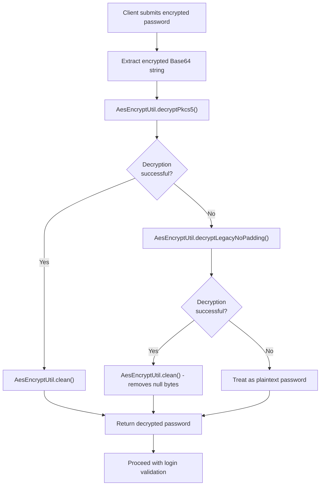
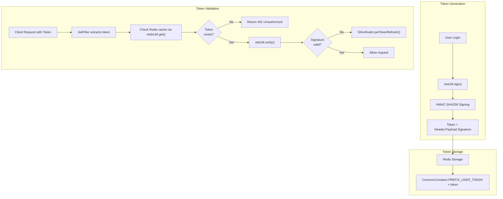
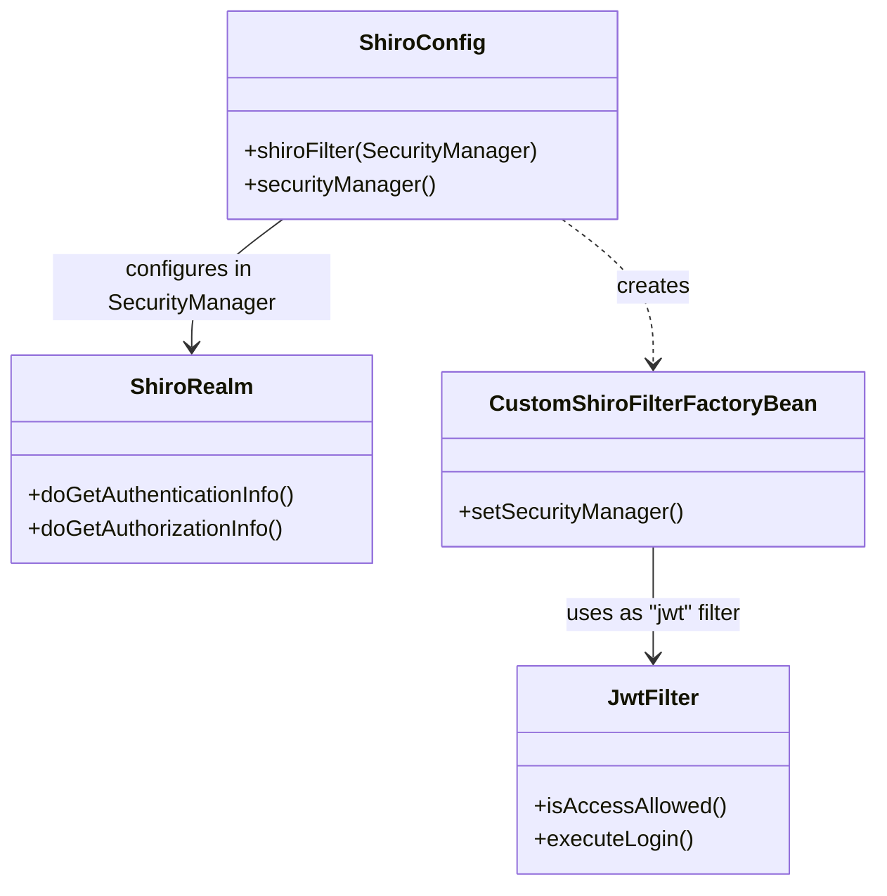

<!-- source: DeepWiki mcp.deepwiki.com · repo jeecgboot/JeecgBoot · page 8.4 Encryption & Data Protection · fetched 2026-10-29 -->

# Encryption & Data Protection

<details>
<summary>Relevant source files</summary>

The following files were used as context for generating this wiki page:

- [jeecg-boot/jeecg-boot-base-core/pom.xml](jeecg-boot/jeecg-boot-base-core/pom.xml)
- [jeecg-boot/jeecg-boot-base-core/src/main/java/org/jeecg/common/util/encryption/AesEncryptUtil.java](jeecg-boot/jeecg-boot-base-core/src/main/java/org/jeecg/common/util/encryption/AesEncryptUtil.java)
- [jeecg-boot/jeecg-boot-base-core/src/main/java/org/jeecg/config/shiro/ShiroConfig.java](jeecg-boot/jeecg-boot-base-core/src/main/java/org/jeecg/config/shiro/ShiroConfig.java)
- [jeecg-boot/jeecg-boot-module/jeecg-boot-module-airag/pom.xml](jeecg-boot/jeecg-boot-module/jeecg-boot-module-airag/pom.xml)
- [jeecg-boot/pom.xml](jeecg-boot/pom.xml)

</details>


## Purpose and Scope

This document describes the encryption and data protection mechanisms used throughout the JeecgBoot platform to secure sensitive data, including passwords, tokens, and API communications. The platform implements a multi-layered security approach combining AES encryption, JWT token signing, and cryptographic signature verification.

**Related Security Documentation:**
- For authentication flow and JWT token validation, see [Authentication System](#8.1)
- For authorization and permission checking, see [Authorization & Permissions](#8.2)
- For SQL injection prevention mechanisms, see [SQL Injection Prevention](#8.5)

---

## AES Encryption System

### Overview

JeecgBoot uses AES (Advanced Encryption Standard) encryption in CBC (Cipher Block Chaining) mode for encrypting sensitive data, primarily user passwords transmitted from the frontend. The system maintains backward compatibility with legacy encryption formats while supporting modern cryptographic standards.

**Key Components:**
- **Encryption Algorithm**: AES-128/192/256 (key size dependent)
- **Cipher Mode**: CBC (Cipher Block Chaining)
- **Padding Schemes**: PKCS5Padding (modern) and NoPadding (legacy fallback)
- **Key/IV Storage**: Static configuration in `EncryptedString` class [jeecg-boot/jeecg-boot-base-core/src/main/java/org/jeecg/common/util/encryption/AesEncryptUtil.java:17-18]()

### AES Password Decryption Flow

The `AesEncryptUtil` class implements a three-tier fallback mechanism to handle encrypted passwords from different client versions:

**Diagram: AES Password Resolution Logic**


**Decryption Algorithm Details:**

| Method | Padding | Frontend Compatibility | Usage |
|--------|---------|----------------------|-------|
| `decryptPkcs5()` | PKCS5Padding | CryptoJS Pkcs7 (Vue3) | Modern encryption (current) |
| `decryptLegacyNoPadding()` | NoPadding (manual 0-padding) | Legacy frontend | Backward compatibility |
| Plaintext fallback | N/A | Unencrypted | Development/testing |

**Sources:** [jeecg-boot/jeecg-boot-base-core/src/main/java/org/jeecg/common/util/encryption/AesEncryptUtil.java:15-64]()

### Encryption Implementation

#### Modern PKCS5Padding Encryption

The modern encryption method uses standard PKCS5Padding, which is compatible with JavaScript's CryptoJS library used in the Vue3 frontend:

```java
private static String decryptPkcs5(String cipherBase64) throws Exception {
    Cipher cipher = Cipher.getInstance("AES/CBC/PKCS5Padding");
    SecretKeySpec ks = new SecretKeySpec(KEY.getBytes(StandardCharsets.UTF_8), "AES");
    IvParameterSpec ivSpec = new IvParameterSpec(IV.getBytes(StandardCharsets.UTF_8));
    cipher.init(Cipher.DECRYPT_MODE, ks, ivSpec);
    byte[] plain = cipher.doFinal(Base64.decode(cipherBase64));
    return new String(plain, StandardCharsets.UTF_8);
}
```

**Sources:** [jeecg-boot/jeecg-boot-base-core/src/main/java/org/jeecg/common/util/encryption/AesEncryptUtil.java:21-28]()

#### Legacy NoPadding Encryption

For backward compatibility with older frontends, the system supports NoPadding mode with manual zero-padding:

```java
private static String decryptLegacyNoPadding(String cipherBase64) throws Exception {
    Cipher cipher = Cipher.getInstance("AES/CBC/NoPadding");
    SecretKeySpec ks = new SecretKeySpec(KEY.getBytes(StandardCharsets.UTF_8), "AES");
    IvParameterSpec ivSpec = new IvParameterSpec(IV.getBytes(StandardCharsets.UTF_8));
    cipher.init(Cipher.DECRYPT_MODE, ks, ivSpec);
    byte[] data = cipher.doFinal(Base64.decode(cipherBase64));
    return new String(data, StandardCharsets.UTF_8)
            .replace("\u0000",""); // Remove manual zero padding
}
```

**Sources:** [jeecg-boot/jeecg-boot-base-core/src/main/java/org/jeecg/common/util/encryption/AesEncryptUtil.java:31-39]()

### Password Resolution Entry Point

The `resolvePassword()` method is the main entry point used during login to decrypt passwords:

```java
public static String resolvePassword(String input){
    if(oConvertUtils.isEmpty(input)){
        return input;
    }
    // 1. Try modern PKCS5Padding first
    try{
        String p = decryptPkcs5(input);
        return clean(p);
    }catch(Exception ignore){}
    
    // 2. Fallback to legacy NoPadding
    try{
        String legacy = decryptLegacyNoPadding(input);
        return clean(legacy);
    }catch(Exception e){
        log.debug("【AES解密】Password not AES cipher, raw used.");
    }
    
    // 3. Treat as plaintext (for development/testing)
    return input;
}
```

**Sources:** [jeecg-boot/jeecg-boot-base-core/src/main/java/org/jeecg/common/util/encryption/AesEncryptUtil.java:42-64]()

---

## JWT Token Security

### Architecture Overview

JeecgBoot uses JSON Web Tokens (JWT) for stateless authentication. The token architecture combines cryptographic signing with Redis-based validation to provide both security and performance.

**Diagram: JWT Lifecycle and Validation**


**Sources:** [jeecg-boot/jeecg-boot-base-core/src/main/java/org/jeecg/config/shiro/ShiroConfig.java:68-150](), [jeecg-boot/jeecg-boot-base-core/pom.xml:199-203]()

### JWT Token Structure

JeecgBoot JWT tokens contain claims including `username` and `clientType`.

**Token Signing:**
- **Algorithm**: HMAC-SHA256
- **Library**: `com.auth0:java-jwt` version 4.5.0 [jeecg-boot/jeecg-boot-base-core/pom.xml:201-203]()
- **Integration**: Managed via Shiro in `ShiroConfig` [jeecg-boot/jeecg-boot-base-core/src/main/java/org/jeecg/config/shiro/ShiroConfig.java:208-232]()

---

## Shiro Security Configuration

The security framework is centered around Apache Shiro, which manages the filter chain and authentication realms.

### Filter Chain Definition

The `ShiroConfig` class defines which URLs are protected and which are public.

| URL Pattern | Filter Type | Purpose |
|-------------|-------------|---------|
| `/sys/login` | `anon` | Authentication entry point |
| `/sys/getEncryptedString` | `anon` | Fetch AES keys for frontend |
| `/doc.html`, `/v3/**` | `anon` | OpenAPI/Swagger documentation |
| `/**/*.js`, `/**/*.css` | `anon` | Static assets |
| `/**` | `jwt` | All other requests require JWT validation |

**Sources:** [jeecg-boot/jeecg-boot-base-core/src/main/java/org/jeecg/config/shiro/ShiroConfig.java:90-140]()

### Shiro Security Components

**Diagram: Shiro Configuration and Code Entities**


**Sources:** [jeecg-boot/jeecg-boot-base-core/src/main/java/org/jeecg/config/shiro/ShiroConfig.java:68-232]()

---

## Data Protection & SQL Injection Prevention

### SQL Injection Exception Handling

The platform includes a global exception handler `JeecgBootExceptionHandler` to catch and log potential SQL injection attempts.

```java
@ExceptionHandler(JeecgSqlInjectionException.class)
public Result<?> handleSQLException(Exception exception) {
    String msg = exception.getMessage().toLowerCase();
    // Detect MySQL specific injection functions
    final String extractvalue = "extractvalue";
    final String updatexml = "updatexml";
    boolean hasSensitiveInformation = msg.indexOf(extractvalue) >= 0 || msg.indexOf(updatexml) >= 0;
    if (msg != null && hasSensitiveInformation) {
        log.error("校验失败，存在SQL注入风险！{}", msg);
        return Result.error("校验失败，存在SQL注入风险！");
    }
    return Result.error("校验失败，存在SQL注入风险！" + msg);
}
```

**Sources:** [jeecg-boot/jeecg-boot-base-core/src/main/java/org/jeecg/common/exception/JeecgBootExceptionHandler.java:206-224]()

### Data Access Protection

The system protects against unauthorized data access via dictionary tables through a whitelist mechanism. If `dataSourceSafe` is enabled, all dynamic dictionary queries are validated against `sys_table_white_list`.

**Sources:** [jeecg-boot/jeecg-boot-base-core/src/main/java/org/jeecg/config/JeecgBaseConfig.java]()

---

## Security Best Practices

### Production Hardening

🔧 **Recommended Settings:**

1. **Firewall Mode**: In production, set `jeecg.firewall.lowCodeMode` to `prod` to prevent automatic whitelist additions.
2. **Exclusion URLs**: Audit `ShiroConfig.java` for unnecessary `anon` filters. [jeecg-boot/jeecg-boot-base-core/src/main/java/org/jeecg/config/shiro/ShiroConfig.java:75-140]()
3. **Max Upload Size**: The platform enforces limits on file uploads. Ensure `MaxUploadSizeExceededException` is properly handled. [jeecg-boot/jeecg-boot-base-core/src/main/java/org/jeecg/common/exception/JeecgBootExceptionHandler.java:232-236]()

### Dependency Management

The security posture is maintained by keeping core libraries updated:
- **Shiro**: 3.0.0 (Jakarta EE support) [jeecg-boot/jeecg-boot-base-core/pom.xml:208-232]()
- **Java JWT**: 4.5.0 [jeecg-boot/jeecg-boot-base-core/pom.xml:201-203]()
- **Spring Boot Starter Validation**: Included for request payload integrity [jeecg-boot/jeecg-boot-base-core/pom.xml:79-80]()

**Sources:** [jeecg-boot/jeecg-boot-base-core/pom.xml:1-265]()

---

