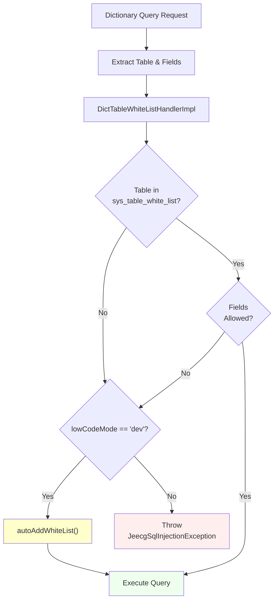
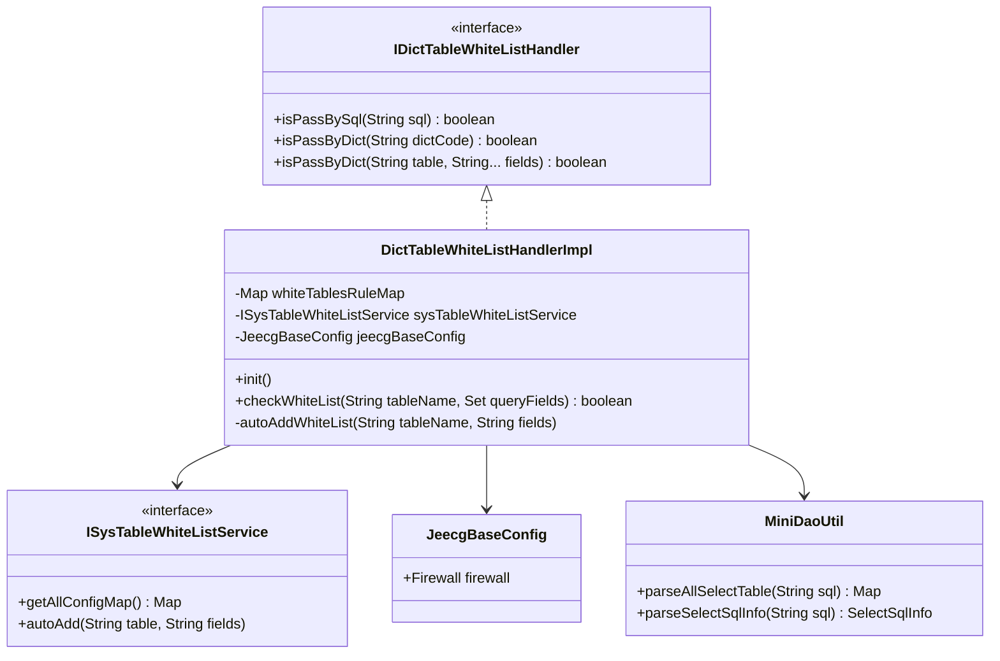
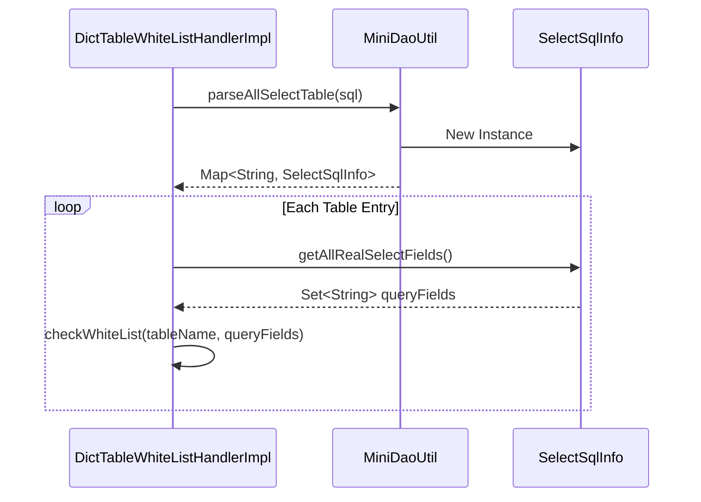

<!-- source: DeepWiki mcp.deepwiki.com · repo jeecgboot/JeecgBoot · page 8.5 SQL Injection Prevention · fetched 2026-10-29 -->

# SQL Injection Prevention

<details>
<summary>Relevant source files</summary>

The following files were used as context for generating this wiki page:

- [jeecg-boot/jeecg-boot-base-core/src/main/java/org/jeecg/common/aspect/AutoLogAspect.java](jeecg-boot/jeecg-boot-base-core/src/main/java/org/jeecg/common/aspect/AutoLogAspect.java)
- [jeecg-boot/jeecg-boot-base-core/src/main/java/org/jeecg/common/util/sqlparse/JSqlParserAllTableManager.java](jeecg-boot/jeecg-boot-base-core/src/main/java/org/jeecg/common/util/sqlparse/JSqlParserAllTableManager.java)
- [jeecg-boot/jeecg-boot-base-core/src/main/java/org/jeecg/common/util/sqlparse/JSqlParserUtils.java](jeecg-boot/jeecg-boot-base-core/src/main/java/org/jeecg/common/util/sqlparse/JSqlParserUtils.java)
- [jeecg-boot/jeecg-boot-base-core/src/main/java/org/jeecg/common/util/sqlparse/vo/SelectSqlInfo.java](jeecg-boot/jeecg-boot-base-core/src/main/java/org/jeecg/common/util/sqlparse/vo/SelectSqlInfo.java)
- [jeecg-boot/jeecg-module-system/jeecg-system-biz/src/main/java/org/jeecg/config/firewall/SqlInjection/impl/DictTableWhiteListHandlerImpl.java](jeecg-boot/jeecg-module-system/jeecg-system-biz/src/main/java/org/jeecg/config/firewall/SqlInjection/impl/DictTableWhiteListHandlerImpl.java)

</details>


## Purpose and Scope

This document describes JeecgBoot's SQL injection prevention mechanisms, specifically focusing on the **Dictionary Table Whitelist System** managed by `DictTableWhiteListHandlerImpl`. This security layer protects dynamic dictionary queries and low-code data lookups from SQL injection attacks by enforcing strict validation of table and field access.

For general security architecture including authentication and authorization, see [Authentication System](#8.1). For data-level permissions, see [Data Permissions & Row-Level Security](#8.3).

## Overview of SQL Injection Prevention Strategy

JeecgBoot implements a **whitelist-based approach** to prevent SQL injection in dictionary table queries. Instead of traditional blacklist filtering, the system only allows explicitly approved tables and fields to be queried.

The system operates in two modes controlled by `jeecg.firewall.lowCodeMode`:
- **Dev Mode**: Automatically adds queried tables/fields to the whitelist for rapid development.
- **Prod Mode**: Strictly enforces the whitelist, blocking any unauthorized queries with a `JeecgSqlInjectionException`.

### SQL Injection Validation Flow

The following diagram illustrates how a dictionary query request is validated against the whitelist system.



Sources: [jeecg-boot/jeecg-module-system/jeecg-system-biz/src/main/java/org/jeecg/config/firewall/SqlInjection/impl/DictTableWhiteListHandlerImpl.java:64-92](), [jeecg-boot/jeecg-module-system/jeecg-system-biz/src/main/java/org/jeecg/config/firewall/SqlInjection/impl/DictTableWhiteListHandlerImpl.java:146-197]()

## Dictionary Table Whitelist System

### Core Components and Entities

The system relies on a handler that bridges configuration, database services, and SQL parsing utilities.



Sources: [jeecg-boot/jeecg-module-system/jeecg-system-biz/src/main/java/org/jeecg/config/firewall/SqlInjection/impl/DictTableWhiteListHandlerImpl.java:25-45](), [jeecg-boot/jeecg-module-system/jeecg-system-biz/src/main/java/org/jeecg/config/firewall/SqlInjection/impl/DictTableWhiteListHandlerImpl.java:119-137]()

### Whitelist Configuration Table

The whitelist is stored in the `sys_table_white_list` table. Entries are cached in memory within `DictTableWhiteListHandlerImpl.whiteTablesRuleMap`.

| Field | Type | Description |
| :--- | :--- | :--- |
| `table_name` | String | The database table name (stored in lowercase). |
| `field_name` | String | Comma-separated allowed fields, or `*` for all fields. |

**Example configuration**:
*   `whiteTablesRuleMap.put("sys_user", "*")`: Allows all fields in `sys_user`.
*   `whiteTablesRuleMap.put("sys_user", "username,realname")`: Only allows `username` and `realname`.

Sources: [jeecg-boot/jeecg-module-system/jeecg-system-biz/src/main/java/org/jeecg/config/firewall/SqlInjection/impl/DictTableWhiteListHandlerImpl.java:28-35]()

### Validation Methods

The `DictTableWhiteListHandlerImpl` provides three primary entry points for validation:

1.  **`isPassBySql(String sql)`**: Parses a complete SQL string using `MiniDaoUtil.parseAllSelectTable(sql)` to extract all referenced tables and fields, then validates them against the whitelist. [jeecg-boot/jeecg-module-system/jeecg-system-biz/src/main/java/org/jeecg/config/firewall/SqlInjection/impl/DictTableWhiteListHandlerImpl.java:64-92]()
2.  **`isPassByDict(String dictCodeString)`**: Decodes and splits standard Jeecg dictionary codes (e.g., `table,text,code`). It extracts the table name and fields, then delegates to SQL-based validation. [jeecg-boot/jeecg-module-system/jeecg-system-biz/src/main/java/org/jeecg/config/firewall/SqlInjection/impl/DictTableWhiteListHandlerImpl.java:94-116]()
3.  **`isPassByDict(String tableName, String... fields)`**: Constructs a dummy `SELECT` statement and uses the SQL parser to ensure the combination is safe before checking the whitelist. [jeecg-boot/jeecg-module-system/jeecg-system-biz/src/main/java/org/jeecg/config/firewall/SqlInjection/impl/DictTableWhiteListHandlerImpl.java:119-137]()

## SQL Parsing and Security Analysis

JeecgBoot uses the `MiniDaoUtil` (and internally JSQLParser logic) to break down SQL statements. This is critical because it allows the security layer to see the "real" intent of the SQL regardless of aliases or complex subqueries.



**Handling Wildcards**:
If a `SelectSqlInfo` indicates `isSelectAll()` is true, the system currently logs a warning and allows the fields to pass, provided the table itself is whitelisted. [jeecg-boot/jeecg-module-system/jeecg-system-biz/src/main/java/org/jeecg/config/firewall/SqlInjection/impl/DictTableWhiteListHandlerImpl.java:80-83]()

Sources: [jeecg-boot/jeecg-module-system/jeecg-system-biz/src/main/java/org/jeecg/config/firewall/SqlInjection/impl/DictTableWhiteListHandlerImpl.java:64-92](), [jeecg-boot/jeecg-boot-base-core/src/main/java/org/jeecg/common/util/sqlparse/vo/SelectSqlInfo.java:70-75]()

## Configuration and Mode Management

### Dev vs Prod Mode Behavior

The `isDev()` method checks `jeecg.firewall.lowCodeMode`. [jeecg-boot/jeecg-module-system/jeecg-system-biz/src/main/java/org/jeecg/config/firewall/SqlInjection/impl/DictTableWhiteListHandlerImpl.java:218-230]()

*   **Dev Mode (`dev`)**:
    *   The cache `whiteTablesRuleMap` is cleared on every `init()` call to allow for immediate database updates. [jeecg-boot/jeecg-module-system/jeecg-system-biz/src/main/java/org/jeecg/config/firewall/SqlInjection/impl/DictTableWhiteListHandlerImpl.java:53-55]()
    *   If a table or field is missing from the whitelist, `autoAddWhiteList` is called to automatically persist the new requirement. [jeecg-boot/jeecg-module-system/jeecg-system-biz/src/main/java/org/jeecg/config/firewall/SqlInjection/impl/DictTableWhiteListHandlerImpl.java:159-161]()
*   **Prod Mode (`prod`)**:
    *   The whitelist is loaded once and cached.
    *   Any missing table or field triggers a `JeecgSqlInjectionException` via `throwException()`. [jeecg-boot/jeecg-module-system/jeecg-system-biz/src/main/java/org/jeecg/config/firewall/SqlInjection/impl/DictTableWhiteListHandlerImpl.java:164-166]()

### Table Name Sanitization

To prevent bypasses using aliases, schemas, or special characters, `getTableName(String str)` performs rigorous cleaning:
1.  Splits at the `WHERE` clause.
2.  Removes schema prefixes (e.g., `public.sys_user` becomes `sys_user`).
3.  Removes table aliases (e.g., `sys_user u` becomes `sys_user`).
4.  Strips backticks, parentheses, and whitespace.

Sources: [jeecg-boot/jeecg-module-system/jeecg-system-biz/src/main/java/org/jeecg/config/firewall/SqlInjection/impl/DictTableWhiteListHandlerImpl.java:239-260]()

## Exception Handling

When validation fails in production mode, a `JeecgSqlInjectionException` is thrown. This is caught by the `JeecgBootExceptionHandler`.

```java
@ExceptionHandler(JeecgSqlInjectionException.class)
public Result<?> handleSQLException(Exception exception) {
    String msg = exception.getMessage().toLowerCase();
    // Check for specific dangerous SQL functions often used in injection
    final String extractvalue = "extractvalue";
    final String updatexml = "updatexml";
    if (msg != null && (msg.indexOf(extractvalue) >= 0 || msg.indexOf(updatexml) >= 0)) {
        log.error("校验失败，存在SQL注入风险！{}", msg);
        return Result.error("校验失败，存在SQL注入风险！");
    }
    addSysLog(exception);
    return Result.error("校验失败，存在SQL注入风险！" + msg);
}
```

The handler performs an additional check for high-risk functions like `extractvalue` and `updatexml` to prevent blind SQL injection via error messages.

Sources: [jeecg-boot/jeecg-boot-base-core/src/main/java/org/jeecg/common/exception/JeecgBootExceptionHandler.java:206-224]()

---

