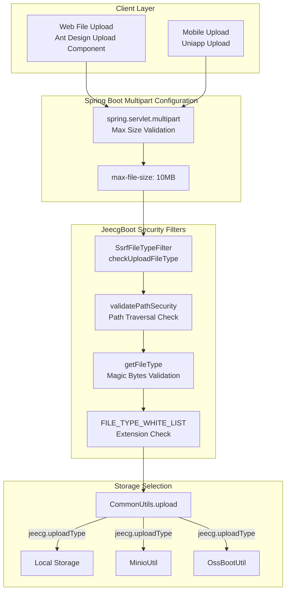
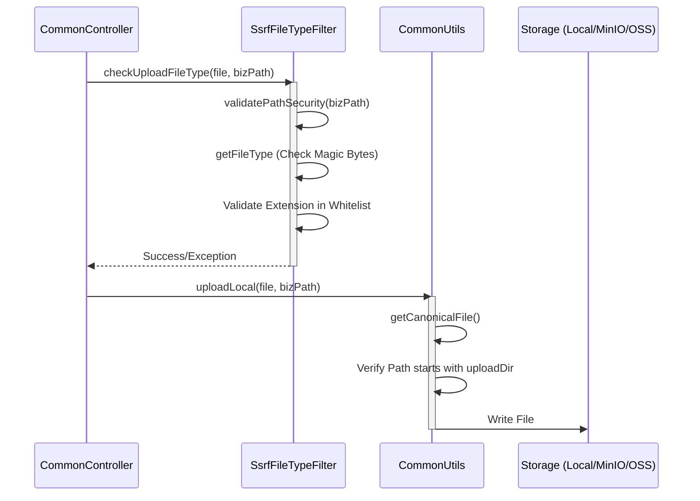

<!-- source: DeepWiki mcp.deepwiki.com · repo jeecgboot/JeecgBoot · page 8.6 File Upload Security · fetched 2026-10-29 -->

# File Upload Security

Relevant source files

The following files were used as context for generating this wiki page:

- [jeecg-boot/jeecg-boot-base-core/src/main/java/org/jeecg/common/exception/JeecgBootExceptionHandler.java](jeecg-boot/jeecg-boot-base-core/src/main/java/org/jeecg/common/exception/JeecgBootExceptionHandler.java)
- [jeecg-boot/jeecg-boot-base-core/src/main/java/org/jeecg/common/util/CommonUtils.java](jeecg-boot/jeecg-boot-base-core/src/main/java/org/jeecg/common/util/CommonUtils.java)
- [jeecg-boot/jeecg-boot-base-core/src/main/java/org/jeecg/common/util/MinioUtil.java](jeecg-boot/jeecg-boot-base-core/src/main/java/org/jeecg/common/util/MinioUtil.java)
- [jeecg-boot/jeecg-boot-base-core/src/main/java/org/jeecg/common/util/filter/SsrfFileTypeFilter.java](jeecg-boot/jeecg-boot-base-core/src/main/java/org/jeecg/common/util/filter/SsrfFileTypeFilter.java)
- [jeecg-boot/jeecg-boot-base-core/src/main/java/org/jeecg/common/util/oss/OssBootUtil.java](jeecg-boot/jeecg-boot-base-core/src/main/java/org/jeecg/common/util/oss/OssBootUtil.java)
- [jeecg-boot/jeecg-module-system/jeecg-system-biz/src/main/java/org/jeecg/modules/system/controller/CommonController.java](jeecg-boot/jeecg-module-system/jeecg-system-biz/src/main/java/org/jeecg/modules/system/controller/CommonController.java)
- [jeecg-boot/jeecg-module-system/jeecg-system-biz/src/main/java/org/jeecg/modules/system/controller/SysAnnouncementController.java](jeecg-boot/jeecg-module-system/jeecg-system-biz/src/main/java/org/jeecg/modules/system/controller/SysAnnouncementController.java)
- [jeecg-boot/jeecg-module-system/jeecg-system-biz/src/main/java/org/jeecg/modules/system/controller/SysUploadController.java](jeecg-boot/jeecg-module-system/jeecg-system-biz/src/main/java/org/jeecg/modules/system/controller/SysUploadController.java)
- [jeecg-boot/jeecg-module-system/jeecg-system-biz/src/main/java/org/jeecg/modules/system/service/impl/SysAnnouncementServiceImpl.java](jeecg-boot/jeecg-module-system/jeecg-system-biz/src/main/java/org/jeecg/modules/system/service/impl/SysAnnouncementServiceImpl.java)
- [jeecg-boot/jeecg-module-system/jeecg-system-biz/src/main/java/org/jeecg/modules/system/service/impl/SysCommentServiceImpl.java](jeecg-boot/jeecg-module-system/jeecg-system-biz/src/main/java/org/jeecg/modules/system/service/impl/SysCommentServiceImpl.java)

This document describes the file upload security mechanisms in JeecgBoot, including configuration options, validation strategies, storage backends, and security best practices for protecting uploaded files.

## Overview

JeecgBoot implements a comprehensive file upload security system that provides:

- **Size and type restrictions** to prevent malicious file uploads.
- **Path Traversal Protection** to prevent unauthorized access to the filesystem.
- **Multiple storage backends** supporting local filesystem, MinIO, and Alibaba OSS.
- **Security Filters** that validate file headers (Magic Bytes) against extensions.

## Upload Configuration Architecture

The following diagram illustrates the flow from a client upload request through security filters to the storage backends.

**File Upload Security Flow**

Sources: [jeecg-boot/jeecg-boot-base-core/src/main/java/org/jeecg/common/util/filter/SsrfFileTypeFilter.java:170-190](), [jeecg-boot/jeecg-boot-base-core/src/main/java/org/jeecg/common/util/CommonUtils.java:149-162]()

## Size Limits and Exception Handling

JeecgBoot enforces file upload size limits through Spring Boot's multipart configuration, typically set to 10MB.

### Multipart Configuration
The system captures `MaxUploadSizeExceededException` to provide user-friendly error messages when a file exceeds the configured limit.

| Class | Method | Purpose |
|-------|--------|---------|
| `JeecgBootExceptionHandler` | `handleMaxUploadSizeExceededException` | Catches `MaxUploadSizeExceededException` and returns a 10MB limit error message [jeecg-boot/jeecg-boot-base-core/src/main/java/org/jeecg/common/exception/JeecgBootExceptionHandler.java:180-185](). |
| `JeecgBootExceptionHandler` | `handleMaxUploadSizeExceededException` (Multipart) | Handles `MultipartException` in JDK 17+ for large image failures [jeecg-boot/jeecg-boot-base-core/src/main/java/org/jeecg/common/exception/JeecgBootExceptionHandler.java:196-206](). |

Sources: [jeecg-boot/jeecg-boot-base-core/src/main/java/org/jeecg/common/exception/JeecgBootExceptionHandler.java:180-206]()

## File Type and Content Validation

The core security logic resides in `SsrfFileTypeFilter`, which performs multi-layered validation.

### Extension Whitelist
The system maintains a comprehensive `FILE_TYPE_WHITE_LIST` including:
- **Images**: jpg, jpeg, png, gif, bmp, svg, ico, heic [jeecg-boot/jeecg-boot-base-core/src/main/java/org/jeecg/common/util/filter/SsrfFileTypeFilter.java:35-42]().
- **Documents**: txt, doc, docx, pdf, csv, md [jeecg-boot/jeecg-boot-base-core/src/main/java/org/jeecg/common/util/filter/SsrfFileTypeFilter.java:46-51]().
- **Multimedia**: mp4, avi, mov, wmv, mp3, wav [jeecg-boot/jeecg-boot-base-core/src/main/java/org/jeecg/common/util/filter/SsrfFileTypeFilter.java:54-59]().
- **Archives**: zip, rar, 7z, tar [jeecg-boot/jeecg-boot-base-core/src/main/java/org/jeecg/common/util/filter/SsrfFileTypeFilter.java:66-69]().

### File Header (Magic Bytes) Validation
To prevent extension spoofing, the system checks the file's internal header bytes.
- **Prohibited Headers**: The `FILE_TYPE_MAP` identifies malicious file types like `jsp`, `php`, `class`, and `sql` by their hex signatures [jeecg-boot/jeecg-boot-base-core/src/main/java/org/jeecg/common/util/filter/SsrfFileTypeFilter.java:80-83]().
- **Validation Logic**: `getFileType(MultipartFile file, String customPath)` reads the first few bytes of the file and matches them against known signatures [jeecg-boot/jeecg-boot-base-core/src/main/java/org/jeecg/common/util/filter/SsrfFileTypeFilter.java:193-210]().

Sources: [jeecg-boot/jeecg-boot-base-core/src/main/java/org/jeecg/common/util/filter/SsrfFileTypeFilter.java:27-137]()

## Path Traversal Prevention

JeecgBoot strictly validates paths to prevent attackers from writing files to sensitive system directories (CWE-22).

### Implementation Details
- **`validatePathSecurity`**: Checks if the `bizPath` contains ".." sequences [jeecg-boot/jeecg-boot-base-core/src/main/java/org/jeecg/common/util/filter/SsrfFileTypeFilter.java:243-252]().
- **Canonical Path Verification**: In `CommonUtils.uploadLocal`, the system resolves the canonical path of the target file and ensures it starts with the configured `uploadpath` [jeecg-boot/jeecg-boot-base-core/src/main/java/org/jeecg/common/util/CommonUtils.java:177-181]().
- **Batch Validation**: `checkPathTraversalBatch` is used for multi-file fields (e.g., in announcements) to ensure no malicious paths are passed [jeecg-boot/jeecg-module-system/jeecg-system-biz/src/main/java/org/jeecg/modules/system/controller/SysAnnouncementController.java:153-154]().

Sources: [jeecg-boot/jeecg-boot-base-core/src/main/java/org/jeecg/common/util/CommonUtils.java:175-181](), [jeecg-boot/jeecg-boot-base-core/src/main/java/org/jeecg/common/util/filter/SsrfFileTypeFilter.java:243-264]()

## Storage Backend Security

### MinIO Storage
`MinioUtil` integrates security checks before processing uploads:
- **Input Filtering**: Uses `StrAttackFilter.filter(bizPath)` to sanitize business paths [jeecg-boot/jeecg-boot-base-core/src/main/java/org/jeecg/common/util/MinioUtil.java:59]().
- **Pre-signed URLs**: Provides `getObjectUrl` with expiration times to securely share private files [jeecg-boot/jeecg-boot-base-core/src/main/java/org/jeecg/common/util/MinioUtil.java:163-176]().

### Alibaba OSS Storage
`OssBootUtil` ensures that:
- **Bucket Existence**: Automatically checks and creates buckets if missing [jeecg-boot/jeecg-boot-base-core/src/main/java/org/jeecg/common/util/oss/OssBootUtil.java:112-114]().
- **Path Sanitization**: Filters folder names using `StrAttackFilter.filter(fileDir)` [jeecg-boot/jeecg-boot-base-core/src/main/java/org/jeecg/common/util/oss/OssBootUtil.java:128]().

Sources: [jeecg-boot/jeecg-boot-base-core/src/main/java/org/jeecg/common/util/MinioUtil.java:56-62](), [jeecg-boot/jeecg-boot-base-core/src/main/java/org/jeecg/common/util/oss/OssBootUtil.java:100-128]()

## Secure File Processing Flow

**Sequence: Upload Request Validation**

Sources: [jeecg-boot/jeecg-module-system/jeecg-system-biz/src/main/java/org/jeecg/modules/system/controller/CommonController.java:67-84](), [jeecg-boot/jeecg-boot-base-core/src/main/java/org/jeecg/common/util/CommonUtils.java:169-181]()

## Key Security Classes and Functions

| Class | Function | Security Role |
|-------|----------|---------------|
| `CommonUtils` | `getFileName` | Sanitizes filenames by removing special characters like `=`, `,`, `&`, `#`, and spaces [jeecg-boot/jeecg-boot-base-core/src/main/java/org/jeecg/common/util/CommonUtils.java:105-126](). |
| `CommonUtils` | `uploadLocal` | Implements canonical path checks to prevent Directory Traversal [jeecg-boot/jeecg-boot-base-core/src/main/java/org/jeecg/common/util/CommonUtils.java:175-181](). |
| `SsrfFileTypeFilter` | `checkUploadFileType` | Primary entry point for file security validation [jeecg-boot/jeecg-boot-base-core/src/main/java/org/jeecg/common/util/filter/SsrfFileTypeFilter.java:179-190](). |
| `XssUtils` | `richTextXss` | Sanitizes HTML content in announcements to prevent stored XSS [jeecg-boot/jeecg-module-system/jeecg-system-biz/src/main/java/org/jeecg/modules/system/controller/SysAnnouncementController.java:150-151](). |

Sources: [jeecg-boot/jeecg-boot-base-core/src/main/java/org/jeecg/common/util/CommonUtils.java:105-181](), [jeecg-boot/jeecg-boot-base-core/src/main/java/org/jeecg/common/util/filter/SsrfFileTypeFilter.java:179-190]()

---

