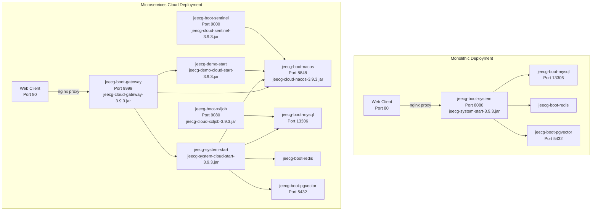
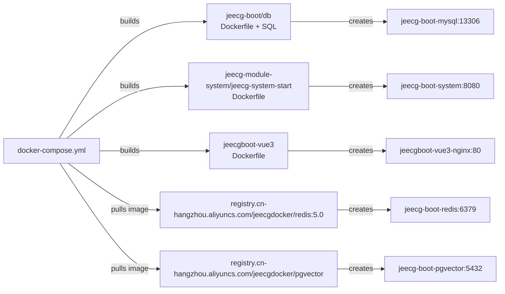
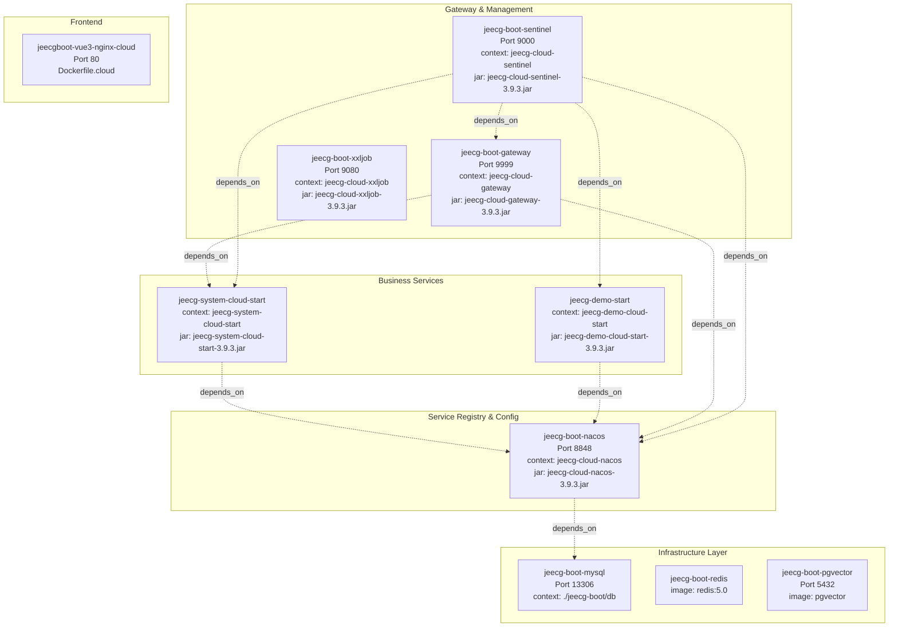

<!-- source: DeepWiki mcp.deepwiki.com · repo jeecgboot/JeecgBoot · page 9 Deployment · fetched 2026-10-29 -->

# Deployment

<details>
<summary>Relevant source files</summary>

The following files were used as context for generating this wiki page:

- [docker-compose-cloud.yml](docker-compose-cloud.yml)
- [docker-compose.yml](docker-compose.yml)
- [jeecg-boot/docker-compose.yml](jeecg-boot/docker-compose.yml)
- [jeecg-boot/jeecg-module-system/jeecg-system-start/Dockerfile](jeecg-boot/jeecg-module-system/jeecg-system-start/Dockerfile)
- [jeecg-boot/jeecg-server-cloud/docker-compose.yml](jeecg-boot/jeecg-server-cloud/docker-compose.yml)
- [jeecg-boot/jeecg-server-cloud/jeecg-cloud-gateway/Dockerfile](jeecg-boot/jeecg-server-cloud/jeecg-cloud-gateway/Dockerfile)
- [jeecg-boot/jeecg-server-cloud/jeecg-cloud-nacos/Dockerfile](jeecg-boot/jeecg-server-cloud/jeecg-cloud-nacos/Dockerfile)
- [jeecg-boot/jeecg-server-cloud/jeecg-demo-cloud-start/Dockerfile](jeecg-boot/jeecg-server-cloud/jeecg-demo-cloud-start/Dockerfile)
- [jeecg-boot/jeecg-server-cloud/jeecg-system-cloud-start/Dockerfile](jeecg-boot/jeecg-server-cloud/jeecg-system-cloud-start/Dockerfile)
- [jeecg-boot/jeecg-server-cloud/jeecg-visual/jeecg-cloud-sentinel/Dockerfile](jeecg-boot/jeecg-server-cloud/jeecg-visual/jeecg-cloud-sentinel/Dockerfile)
- [jeecg-boot/jeecg-server-cloud/jeecg-visual/jeecg-cloud-sentinel/pom.xml](jeecg-boot/jeecg-server-cloud/jeecg-visual/jeecg-cloud-sentinel/pom.xml)
- [jeecg-boot/jeecg-server-cloud/jeecg-visual/jeecg-cloud-xxljob/Dockerfile](jeecg-boot/jeecg-server-cloud/jeecg-visual/jeecg-cloud-xxljob/Dockerfile)
- [jeecgboot-vue3/.env.docker](jeecgboot-vue3/.env.docker)
- [jeecgboot-vue3/.env.dockercloud](jeecgboot-vue3/.env.dockercloud)
- [jeecgboot-vue3/Dockerfile.cloud](jeecgboot-vue3/Dockerfile.cloud)

</details>


## Purpose and Scope

This page documents the deployment strategies and configurations for JeecgBoot applications. It covers Docker-based deployment for both monolithic and microservices architectures, container configuration, environment setup, and production deployment best practices.

For information about the microservices architecture itself, see [Microservices Architecture](#2.4). For security hardening in production environments, see [Production Deployment Best Practices](#9.3). For initial environment setup during development, see [System Requirements & Environment Setup](#1.3).

---

## Deployment Architecture Overview

JeecgBoot supports two primary deployment modes:

| Deployment Mode | Use Case | Complexity | Components |
|----------------|----------|------------|------------|
| **Monolithic** | Development, small-scale production | Low | Single backend JAR, MySQL, Redis, pgvector, Nginx |
| **Microservices Cloud** | Production, distributed systems | High | Nacos, Gateway, System Service, Demo Service, Sentinel, XXL-Job, MySQL, Redis, pgvector, Nginx |



**Sources:** [docker-compose.yml:1-77](), [docker-compose-cloud.yml:1-171]()

---

## Docker Deployment

### Monolithic Deployment

The monolithic deployment uses `docker-compose.yml` to orchestrate a single backend service with supporting infrastructure.



#### Container Definitions

**1. jeecg-boot-mysql**

Configuration for the MySQL database container:

| Parameter | Value | Purpose |
|-----------|-------|---------|
| `container_name` | `jeecg-boot-mysql` | Container identifier |
| `image` | `jeecg-boot-mysql` | Custom built image |
| `build.context` | `./jeecg-boot/db` | Database initialization scripts [docker-compose.yml:4-5]() |
| `ports` | `13306:3306` | External port 13306 maps to internal 3306 [docker-compose.yml:21]() |
| `environment.MYSQL_ROOT_PASSWORD` | `root` | Root user password [docker-compose.yml:7]() |
| `character-set-server` | `utf8mb4` | Character encoding [docker-compose.yml:14]() |
| `max_allowed_packet` | `128M` | Maximum packet size [docker-compose.yml:18]() |

**2. jeecg-boot-redis**

Redis 5.0 container for caching and session management:

| Parameter | Value |
|-----------|-------|
| `container_name` | `jeecg-boot-redis` |
| `image` | `registry.cn-hangzhou.aliyuncs.com/jeecgdocker/redis:5.0` [docker-compose.yml:26]() |
| `hostname` | `jeecg-boot-redis` |

**3. jeecg-boot-pgvector**

PostgreSQL with pgvector extension for AI embeddings:

| Parameter | Value | Purpose |
|-----------|-------|---------|
| `container_name` | `jeecg-boot-pgvector` | Container identifier |
| `image` | `registry.cn-hangzhou.aliyuncs.com/jeecgdocker/pgvector` [docker-compose.yml:62]() |
| `environment.POSTGRES_DB` | `vector_db` | Default database name [docker-compose.yml:67]() |
| `environment.POSTGRES_USER` | `postgres` | Database user |
| `environment.POSTGRES_PASSWORD` | `postgres` | Database password |

**4. jeecg-boot-system**

Main application backend container:

| Parameter | Value | Purpose |
|-----------|-------|---------|
| `container_name` | `jeecg-boot-system` | Container identifier |
| `build.context` | `./jeecg-boot/jeecg-module-system/jeecg-system-start` [docker-compose.yml:37]() | Application build context |
| `ports` | `8080:8080` | Backend API port [docker-compose.yml:46]() |
| `depends_on` | `jeecg-boot-mysql`, `jeecg-boot-redis` [docker-compose.yml:39-41]() | Startup order dependencies |

The Dockerfile at [jeecg-boot/jeecg-module-system/jeecg-system-start/Dockerfile:1-29]() uses Java 17-anolis and includes a 60-second startup delay to ensure dependencies are ready:

```dockerfile
CMD sleep 60 && exec java -Djava.security.egd=file:/dev/./urandom -jar jeecg-system-start-3.9.3.jar
```

**5. jeecg-vue**

Frontend Nginx container:

| Parameter | Value | Purpose |
|-----------|-------|---------|
| `container_name` | `jeecgboot-vue3-nginx` | Container identifier |
| `build.context` | `./jeecgboot-vue3` [docker-compose.yml:51]() | Frontend build context |
| `ports` | `80:80` | Web server port [docker-compose.yml:59]() |
| `depends_on` | `jeecg-boot-system` | Ensures backend is running |

**Sources:** [docker-compose.yml:1-77](), [jeecg-boot/jeecg-module-system/jeecg-system-start/Dockerfile:1-29]()

---

### Microservices Cloud Deployment

The microservices deployment uses `docker-compose-cloud.yml` to orchestrate a distributed system with service discovery, API gateway, and monitoring.



#### Service Startup Sequence and Dependencies

The `depends_on` directives and custom `command` scripts in [docker-compose-cloud.yml:1-171]() define the following startup logic:

1. **Infrastructure**:
   - `jeecg-boot-mysql`
   - `jeecg-boot-redis`
   - `jeecg-boot-pgvector`

2. **Service Registry**:
   - `jeecg-boot-nacos`: Builds from `./jeecg-boot/jeecg-server-cloud/jeecg-cloud-nacos` [docker-compose-cloud.yml:48](). Waits for MySQL [docker-compose-cloud.yml:53-54]().

3. **Business Services**:
   - `jeecg-boot-system`: Depends on Nacos [docker-compose-cloud.yml:60-61](). Waits 60s via [jeecg-boot/jeecg-server-cloud/jeecg-system-cloud-start/Dockerfile:25]().
   - `jeecg-boot-demo`: Depends on Nacos [docker-compose-cloud.yml:74-75](). Waits 60s via [jeecg-boot/jeecg-server-cloud/jeecg-demo-cloud-start/Dockerfile:25]().

4. **Gateway Layer**:
   - `jeecg-boot-gateway`: Actively polls Nacos until `jeecg-system` is healthy before starting the Java process [docker-compose-cloud.yml:100-109]().

5. **Monitoring Services**:
   - `jeecg-boot-xxljob`: Distributed task scheduler on port 9080 [docker-compose-cloud.yml:35-43]().
   - `jeecg-boot-sentinel`: (Optional/Commented) Dashboard for flow control [docker-compose-cloud.yml:125-140]().

#### Container Configuration Details

**Nacos Service Registry**
Uses Java 21-anolis [jeecg-boot/jeecg-server-cloud/jeecg-cloud-nacos/Dockerfile:1](). Includes a 30s delay [jeecg-boot/jeecg-server-cloud/jeecg-cloud-nacos/Dockerfile:25]().

**Gateway Service**
Implements a health check loop in the container `command` to ensure it only starts after the System module is registered in Nacos [docker-compose-cloud.yml:105-107]().

**Sentinel Dashboard**
The Maven project at [jeecg-boot/jeecg-server-cloud/jeecg-visual/jeecg-cloud-sentinel/pom.xml:1-127]() includes Sentinel Dashboard v1.8.10 and Nacos data source integration [jeecg-boot/jeecg-server-cloud/jeecg-visual/jeecg-cloud-sentinel/pom.xml:22-32]().

**Sources:** [docker-compose-cloud.yml:1-171](), [jeecg-boot/jeecg-server-cloud/jeecg-cloud-nacos/Dockerfile:1-25](), [jeecg-boot/jeecg-server-cloud/jeecg-cloud-gateway/Dockerfile:1-25](), [jeecg-boot/jeecg-server-cloud/jeecg-visual/jeecg-cloud-sentinel/pom.xml:1-127]()

---

## Frontend Container Configuration

### Monolithic Mode Frontend
Uses `Dockerfile` with backend proxy to `jeecg-boot-system:8080`. Environment variables are sourced from `.env.docker`.

### Microservices Mode Frontend
Uses `Dockerfile.cloud` [docker-compose-cloud.yml:145]() and environment variables from `.env.dockercloud`.

**Nginx Proxy Configuration (Cloud)**:
The gateway acts as the single entry point for all API calls. The frontend container maps port 80 [docker-compose-cloud.yml:153]() and routes traffic to `jeecg-boot-gateway:9999`.

**Sources:** [docker-compose-cloud.yml:142-154](), [jeecgboot-vue3/Dockerfile.cloud:1-25]()

---

## Environment-Specific Build Profiles

Microservices utilize Maven profiles to manage environment-specific configurations. Example from Sentinel [jeecg-boot/jeecg-server-cloud/jeecg-visual/jeecg-cloud-sentinel/pom.xml:77-125]():

| Profile ID | Nacos Server | Namespace |
|------------|--------------|-----------|
| `dev` | `jeecg-boot-nacos:8848` | (Empty) |
| `test` | `jeecg-boot-nacos:8848` | (Empty) |
| `docker` | `jeecg-boot-nacos:8848` | (Empty) |
| `prod` | `jeecg-boot-nacos:8848` | (Empty) |

These profiles define `${config.server-addr}` and other properties used during the build process to target specific environments.

**Sources:** [jeecg-boot/jeecg-server-cloud/jeecg-visual/jeecg-cloud-sentinel/pom.xml:77-125]()

---

## Service Ports Reference

### Microservices Cloud Mode

| Service | Container Name | Port | Build Context |
|---------|----------------|------|---------------|
| Nacos | `jeecg-boot-nacos` | 8848, 18080 | `jeecg-cloud-nacos` |
| Gateway | `jeecg-boot-gateway` | 9999 | `jeecg-cloud-gateway` |
| System | `jeecg-system-cloud-start` | 7001 | `jeecg-system-cloud-start` |
| Demo | `jeecg-demo-start` | 7002 | `jeecg-demo-cloud-start` |
| XXL-Job | `jeecg-boot-xxljob` | 9080 | `jeecg-cloud-xxljob` |
| MySQL | `jeecg-boot-mysql` | 13306 | `../db` |
| Frontend | `jeecgboot-vue3-nginx-cloud`| 80 | `jeecgboot-vue3` |

**Sources:** [docker-compose-cloud.yml:1-171](), [jeecg-boot/jeecg-server-cloud/docker-compose.yml:1-150]()

---

## Production Deployment Considerations

For production deployments, see the following child pages for detailed technical instructions:

- [Docker Deployment](#9.1) — Detailed orchestration for both architectures.
- [Environment Configuration](#9.2) — Managing `application.yml` and Nacos profiles.
- [Production Deployment Best Practices](#9.3) — Security hardening and Swagger protection.
- [Server Configuration](#9.4) — Tuning the Undertow server and JVM parameters.

---

