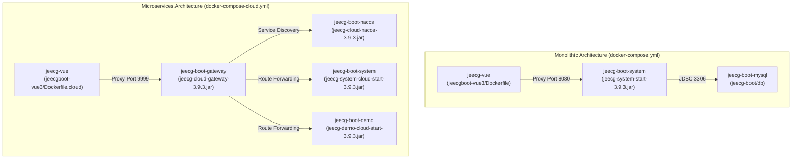
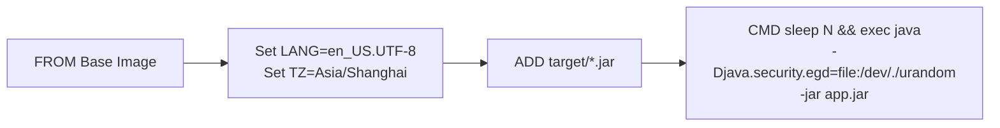

<!-- source: DeepWiki mcp.deepwiki.com · repo jeecgboot/JeecgBoot · page 9.1 Docker Deployment · fetched 2026-10-29 -->

# Docker Deployment

<details>
<summary>Relevant source files</summary>

The following files were used as context for generating this wiki page:

- [docker-compose-cloud.yml](docker-compose-cloud.yml)
- [docker-compose.yml](docker-compose.yml)
- [jeecg-boot/docker-compose.yml](jeecg-boot/docker-compose.yml)
- [jeecg-boot/jeecg-module-system/jeecg-system-start/Dockerfile](jeecg-boot/jeecg-module-system/jeecg-system-start/Dockerfile)
- [jeecg-boot/jeecg-server-cloud/docker-compose.yml](jeecg-boot/jeecg-server-cloud/docker-compose.yml)
- [jeecg-boot/jeecg-server-cloud/jeecg-cloud-gateway/Dockerfile](jeecg-boot/jeecg-server-cloud/jeecg-cloud-gateway/Dockerfile)
- [jeecg-boot/jeecg-server-cloud/jeecg-cloud-nacos/Dockerfile](jeecg-boot/jeecg-server-cloud/jeecg-cloud-nacos/Dockerfile)
- [jeecg-boot/jeecg-server-cloud/jeecg-demo-cloud-start/Dockerfile](jeecg-boot/jeecg-server-cloud/jeecg-demo-cloud-start/Dockerfile)
- [jeecg-boot/jeecg-server-cloud/jeecg-system-cloud-start/Dockerfile](jeecg-boot/jeecg-server-cloud/jeecg-system-cloud-start/Dockerfile)
- [jeecg-boot/jeecg-server-cloud/jeecg-visual/jeecg-cloud-sentinel/Dockerfile](jeecg-boot/jeecg-server-cloud/jeecg-visual/jeecg-cloud-sentinel/Dockerfile)
- [jeecg-boot/jeecg-server-cloud/jeecg-visual/jeecg-cloud-sentinel/pom.xml](jeecg-boot/jeecg-server-cloud/jeecg-visual/jeecg-cloud-sentinel/pom.xml)
- [jeecg-boot/jeecg-server-cloud/jeecg-visual/jeecg-cloud-xxljob/Dockerfile](jeecg-boot/jeecg-server-cloud/jeecg-visual/jeecg-cloud-xxljob/Dockerfile)
- [jeecgboot-vue3/.env.docker](jeecgboot-vue3/.env.docker)
- [jeecgboot-vue3/.env.dockercloud](jeecgboot-vue3/.env.dockercloud)
- [jeecgboot-vue3/Dockerfile.cloud](jeecgboot-vue3/Dockerfile.cloud)
- [start-docker-compose-cloud.bat](start-docker-compose-cloud.bat)
- [start-docker-compose-cloud.sh](start-docker-compose-cloud.sh)
- [start-docker-compose.bat](start-docker-compose.bat)
- [start-docker-compose.sh](start-docker-compose.sh)

</details>


## Purpose and Scope

This document describes the Docker containerization and deployment architecture for JeecgBoot. It covers the container structure, Docker Compose orchestration, build system, and networking configuration common to both deployment modes. JeecgBoot provides standardized Docker configurations to ensure environment consistency across development, testing, and production.

For specific deployment instructions:
- **Monolithic deployment**: See [Single Instance Deployment](#9.1.1) for running the platform with a single backend service using [docker-compose.yml:1-83]().
- **Microservices deployment**: See [Microservices Cloud Deployment](#9.1.2) for the full distributed architecture with Gateway, Nacos, and multiple services using [docker-compose-cloud.yml:1-171]().

For environment-specific configuration details, see [Environment Configuration](#9.2). For production hardening and optimization, see [Production Deployment Best Practices](#9.3).

---

## Container Architecture Overview

JeecgBoot provides two Docker Compose configurations that orchestrate different sets of containers based on the chosen architecture. The root-level `docker-compose.yml` deploys the monolithic architecture while `docker-compose-cloud.yml` (and the variant in `jeecg-server-cloud`) deploys the microservices stack.

### Monolithic vs Microservices Container Topology

Monolithic deployment focuses on simplicity, bundling all business logic into a single `jeecg-boot-system` container [docker-compose.yml:35-48](). In contrast, the microservices architecture decomposes the system into specialized services like `jeecg-boot-gateway` [docker-compose-cloud.yml:86-112](), `jeecg-boot-nacos` [docker-compose-cloud.yml:45-58](), and various business modules.

**System to Code Entity Mapping:**



**Sources:** [docker-compose.yml:1-83](), [docker-compose-cloud.yml:1-171](), [jeecg-boot/jeecg-server-cloud/docker-compose.yml:1-150]()

---

## Image Build System

### Base Images and JDK Versions

JeecgBoot utilizes specialized base images from Alibaba Cloud's mirror to ensure performance and locale compatibility. While most services utilize JDK 17, the Nacos service is built on JDK 21.

| Service Type | Base Image | JDK Version | Dockerfile Path |
|-------------|------------|-------------|-----------------|
| System (Mono) | `java:17-anolis` | 17 | [jeecg-boot/jeecg-module-system/jeecg-system-start/Dockerfile:1]() |
| System (Cloud) | `java:17-anolis` | 17 | [jeecg-boot/jeecg-server-cloud/jeecg-system-cloud-start/Dockerfile:1]() |
| Gateway | `java:17-anolis` | 17 | [jeecg-boot/jeecg-server-cloud/jeecg-cloud-gateway/Dockerfile:1]() |
| Nacos | `java:21-anolis` | 21 | [jeecg-boot/jeecg-server-cloud/jeecg-cloud-nacos/Dockerfile:1]() |
| XXL-Job | `java:17-anolis` | 17 | [jeecg-boot/jeecg-server-cloud/jeecg-visual/jeecg-cloud-xxljob/Dockerfile:1]() |

### Standardized Dockerfile Pattern

All backend services follow a strict initialization pattern to ensure UTF-8 support and correct timezones [jeecg-boot/jeecg-module-system/jeecg-system-start/Dockerfile:5-15]().



**Key JVM Optimizations:**
- **Entropy Source**: `-Djava.security.egd=file:/dev/./urandom` is used across all services to prevent startup delays caused by insufficient entropy [jeecg-boot/jeecg-server-cloud/jeecg-cloud-gateway/Dockerfile:24]().
- **Startup Sequencing**: Services implement varying `sleep` durations (30s to 100s) to allow infrastructure services (MySQL, Nacos) to initialize before application startup [jeecg-boot/jeecg-server-cloud/jeecg-cloud-nacos/Dockerfile:25](), [jeecg-boot/jeecg-server-cloud/jeecg-cloud-gateway/Dockerfile:24]().

**Sources:** [jeecg-boot/jeecg-module-system/jeecg-system-start/Dockerfile:1-29](), [jeecg-boot/jeecg-server-cloud/jeecg-cloud-nacos/Dockerfile:1-25](), [jeecg-boot/jeecg-server-cloud/jeecg-cloud-gateway/Dockerfile:1-24]()

---

## Infrastructure and Data Layer

Both deployment modes share a common set of infrastructure containers. These are defined to provide a consistent data layer regardless of the backend architecture.

| Service | Role | Port Mapping | Configuration Detail |
|---------|------|--------------|----------------------|
| `jeecg-boot-mysql` | Primary RDBMS | `13306:3306` | Configured with `utf8mb4` and `lower_case_table_names=1` [docker-compose.yml:13-17]() |
| `jeecg-boot-redis` | Caching & Sessions | Internal | Uses version 5.0 mirror [docker-compose.yml:26]() |
| `jeecg-boot-pgvector`| AI Vector Store | Internal | Specifically for RAG/Knowledge base features [docker-compose.yml:61-72]() |

**Sources:** [docker-compose.yml:3-34](), [docker-compose-cloud.yml:3-34](), [docker-compose-cloud.yml:155-167]()

---

## Networking and Service Discovery

### Custom Bridge Network
All JeecgBoot containers communicate over a dedicated bridge network named `jeecg_boot` [docker-compose.yml:75-77](). This provides internal DNS resolution using service names as hostnames.

### Gateway Startup Logic (Microservices)
The `jeecg-boot-gateway` includes a critical health check script in its `command` definition. It polls the Nacos v3 Admin API to ensure `jeecg-system` is healthy before attempting to load routes, preventing empty route tables at startup [docker-compose-cloud.yml:100-109]().

```yaml
# docker-compose-cloud.yml:105-107
until curl -s 'http://jeecg-boot-nacos:8848/nacos/v3/admin/ns/instance/list?serviceName=jeecg-system&groupName=DEFAULT_GROUP' | grep -q '"healthy":true'; do
  sleep 5;
done;
```

**Sources:** [docker-compose-cloud.yml:100-111](), [docker-compose.yml:75-77]()

---

## Configuration Management

Deployment configurations are managed through three primary mechanisms:

1.  **Environment Variables**: Used for database credentials and timezone settings in `docker-compose.yml` [docker-compose.yml:6-9]().
2.  **Volume Mounts**: In monolithic mode, the `/jeecg-boot/config` directory is mapped to the host for easy log and config access [jeecg-boot/docker-compose.yml:77-78]().
3.  **Maven Profiles**: The `docker` profile in `pom.xml` files configures Nacos addresses for container environments [jeecg-boot/jeecg-server-cloud/jeecg-visual/jeecg-cloud-sentinel/pom.xml:104-113]().

For details on service-specific configuration, see [Single Instance Deployment](#9.1.1) and [Microservices Cloud Deployment](#9.1.2).

**Sources:** [jeecg-boot/docker-compose.yml:77-78](), [jeecg-boot/jeecg-server-cloud/jeecg-visual/jeecg-cloud-sentinel/pom.xml:104-113]()

---

