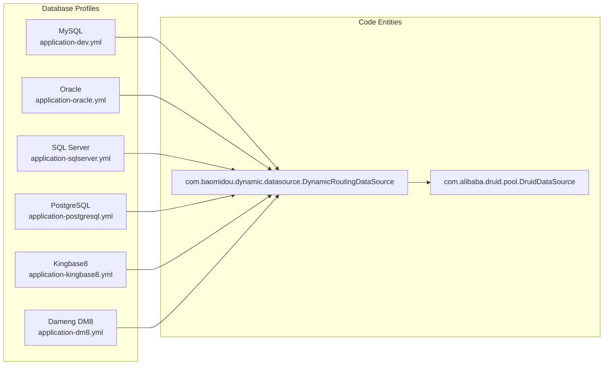
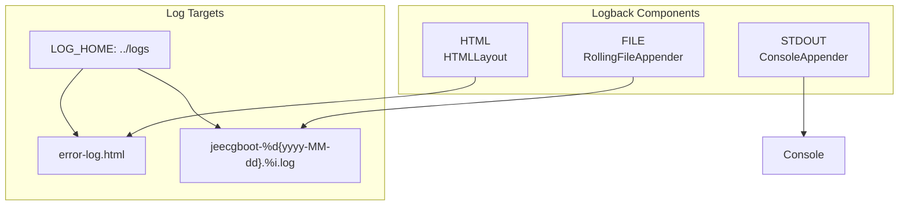

<!-- source: DeepWiki mcp.deepwiki.com · repo jeecgboot/JeecgBoot · page 9.2 Environment Configuration · fetched 2026-10-29 -->

# Environment Configuration

<details>
<summary>Relevant source files</summary>

The following files were used as context for generating this wiki page:

- [jeecg-boot/jeecg-boot-base-core/src/main/resources/config/default-spring-doc.properties](jeecg-boot/jeecg-boot-base-core/src/main/resources/config/default-spring-doc.properties)
- [jeecg-boot/jeecg-module-system/jeecg-system-start/src/main/resources/application-dev.yml](jeecg-boot/jeecg-module-system/jeecg-system-start/src/main/resources/application-dev.yml)
- [jeecg-boot/jeecg-module-system/jeecg-system-start/src/main/resources/application-dm8.yml](jeecg-boot/jeecg-module-system/jeecg-system-start/src/main/resources/application-dm8.yml)
- [jeecg-boot/jeecg-module-system/jeecg-system-start/src/main/resources/application-docker.yml](jeecg-boot/jeecg-module-system/jeecg-system-start/src/main/resources/application-docker.yml)
- [jeecg-boot/jeecg-module-system/jeecg-system-start/src/main/resources/application-kingbase8.yml](jeecg-boot/jeecg-module-system/jeecg-system-start/src/main/resources/application-kingbase8.yml)
- [jeecg-boot/jeecg-module-system/jeecg-system-start/src/main/resources/application-oracle.yml](jeecg-boot/jeecg-module-system/jeecg-system-start/src/main/resources/application-oracle.yml)
- [jeecg-boot/jeecg-module-system/jeecg-system-start/src/main/resources/application-postgresql.yml](jeecg-boot/jeecg-module-system/jeecg-system-start/src/main/resources/application-postgresql.yml)
- [jeecg-boot/jeecg-module-system/jeecg-system-start/src/main/resources/application-prod.yml](jeecg-boot/jeecg-module-system/jeecg-system-start/src/main/resources/application-prod.yml)
- [jeecg-boot/jeecg-module-system/jeecg-system-start/src/main/resources/application-sqlserver.yml](jeecg-boot/jeecg-module-system/jeecg-system-start/src/main/resources/application-sqlserver.yml)
- [jeecg-boot/jeecg-module-system/jeecg-system-start/src/main/resources/application-test.yml](jeecg-boot/jeecg-module-system/jeecg-system-start/src/main/resources/application-test.yml)
- [jeecg-boot/jeecg-module-system/jeecg-system-start/src/main/resources/logback-spring.xml](jeecg-boot/jeecg-module-system/jeecg-system-start/src/main/resources/logback-spring.xml)

</details>


## Purpose and Scope

This document describes the environment-specific configuration system in JeecgBoot. It covers profile-based configuration files, environment-specific settings, database-specific configurations, and how to manage different deployment scenarios. For Docker deployment specifics, see [Docker Deployment](#9.1). For production hardening and security configurations, see [Production Deployment Best Practices](#9.3).

---

## Configuration Profile System

JeecgBoot uses Spring Boot's profile mechanism to manage environment-specific configurations. The system provides multiple configuration files located in [jeecg-boot/jeecg-module-system/jeecg-system-start/src/main/resources]():

```mermaid
graph TB
    subgraph "Configuration Files"
        BaseConfig["application.yml<br/>(Base Configuration)"]
        DevConfig["application-dev.yml<br/>(Development)"]
        TestConfig["application-test.yml<br/>(Testing)"]
        ProdConfig["application-prod.yml<br/>(Production)"]
        DockerConfig["application-docker.yml<br/>(Docker)"]
    end
    
    subgraph "Database-Specific Profiles"
        MySQLConfig["application-dev.yml<br/>(Default MySQL)"]
        OracleConfig["application-oracle.yml"]
        SQLServerConfig["application-sqlserver.yml"]
        PostgreSQLConfig["application-postgresql.yml"]
        KingbaseConfig["application-kingbase8.yml"]
        DM8Config["application-dm8.yml"]
    end
    
    subgraph "Application Startup"
        SpringProfile["spring.profiles.active"]
        RuntimeConfig["Activated Configuration"]
    end
    
    BaseConfig --> RuntimeConfig
    DevConfig --> RuntimeConfig
    TestConfig --> RuntimeConfig
    ProdConfig --> RuntimeConfig
    DockerConfig --> RuntimeConfig
    
    MySQLConfig -.database variant.-> RuntimeConfig
    OracleConfig -.database variant.-> RuntimeConfig
    SQLServerConfig -.database variant.-> RuntimeConfig
    PostgreSQLConfig -.database variant.-> RuntimeConfig
    KingbaseConfig -.database variant.-> RuntimeConfig
    DM8Config -.database variant.-> RuntimeConfig
    
    SpringProfile --> RuntimeConfig
```



**Sources:** [jeecg-boot/jeecg-module-system/jeecg-system-start/src/main/resources/application-dev.yml](), [jeecg-boot/jeecg-module-system/jeecg-system-start/src/main/resources/application-test.yml](), [jeecg-boot/jeecg-module-system/jeecg-system-start/src/main/resources/application-prod.yml](), [jeecg-boot/jeecg-module-system/jeecg-system-start/src/main/resources/application-docker.yml]()

---

## Environment Profiles

### Profile Activation

Environment profiles are activated using the `spring.profiles.active` property, which can be set via:
- JVM parameter: `-Dspring.profiles.active=dev`
- Environment variable: `SPRING_PROFILES_ACTIVE=dev`
- Application properties file

### Development Profile (dev)

The development profile is optimized for local development with debugging features enabled.

| Configuration Category | Setting | Value | Purpose |
|------------------------|---------|-------|---------|
| **Server** | `server.port` | 8080 | Default port [application-dev.yml:2]() |
| | `server.servlet.context-path` | /jeecg-boot | Application context [application-dev.yml:7]() |
| **Database** | `spring.datasource.dynamic.datasource.master.url` | localhost:3306 | Local MySQL [application-dev.yml:150]() |
| | `spring.datasource.dynamic.druid.maxActive` | 1000 | High connection pool [application-dev.yml:125]() |
| **Redis** | `spring.data.redis.host` | 127.0.0.1 | Local Redis [application-dev.yml:162]() |
| | `spring.data.redis.port` | 6379 | Default port [application-dev.yml:163]() |
| **Flyway** | `spring.flyway.enabled` | false | Disabled for faster startup [application-dev.yml:25]() |
| **JeecgBoot** | `jeecg.firewall.lowCodeMode` | dev | Full development features [application-dev.yml:282]() |
| | `jeecg.uploadType` | local | Local file storage [application-dev.yml:288]() |
| | `jeecg.path.upload` | /opt/upFiles | Upload directory [application-dev.yml:295]() |

**Sources:** [jeecg-boot/jeecg-module-system/jeecg-system-start/src/main/resources/application-dev.yml:1-354]()

### Test Profile (test)

The test profile enables additional validation and logging features.

| Configuration Category | Setting | Value | Difference from Dev |
|------------------------|---------|-------|---------------------|
| **Flyway** | `spring.flyway.enabled` | true | Database migrations enabled [application-test.yml:22]() |
| **MyBatis-Plus** | `mybatis-plus.configuration.log-impl` | StdOutImpl | SQL logging enabled [application-test.yml:174]() |
| **Email** | `spring.mail.properties.mail.debug` | true | Email debugging [application-test.yml:40]() |
| **Swagger** | `knife4j.basic.enable` | true | Basic authentication enabled [application-test.yml:303]() |
| **AI RAG** | `jeecg.ai-rag.allow-sensitive-nodes` | sql,stdio | Sensitive node permissions [application-test.yml:237]() |

**Sources:** [jeecg-boot/jeecg-module-system/jeecg-system-start/src/main/resources/application-test.yml:1-350]()

### Production Profile (prod)

The production profile prioritizes security and performance.

| Configuration Category | Setting | Value | Production Rationale |
|------------------------|---------|-------|----------------------|
| **Flyway** | `spring.flyway.clean-disabled` | true | Prevents accidental data loss [application-prod.yml:24]() |
| **Database** | `spring.datasource.dynamic.druid.stat.merge-sql` | true | Performance optimization [application-prod.yml:139]() |
| **Swagger** | `knife4j.production` | true | API docs hidden from public [application-prod.yml:302]() |
| **JeecgBoot** | `jeecg.firewall.lowCodeMode` | prod | Disables online development [application-prod.yml:281]() |
| **AI RAG** | `jeecg.ai-rag.allow-sensitive-nodes` | sql,stdio | Restricts sensitive nodes [application-prod.yml:236]() |

**Sources:** [jeecg-boot/jeecg-module-system/jeecg-system-start/src/main/resources/application-prod.yml:1-350]()

### Docker Profile (docker)

The docker profile uses service names for container networking.

| Configuration Category | Setting | Value | Docker-Specific Reason |
|------------------------|---------|-------|------------------------|
| **Database** | `spring.datasource.dynamic.datasource.master.url` | jeecg-boot-mysql:3306 | Container hostname [application-docker.yml:144]() |
| **Redis** | `spring.data.redis.host` | jeecg-boot-redis | Container hostname [application-docker.yml:158]() |
| **AI RAG** | `jeecg.ai-rag.embed-store.host` | jeecg-boot-pgvector | Container hostname [application-docker.yml:239]() |

**Sources:** [jeecg-boot/jeecg-module-system/jeecg-system-start/src/main/resources/application-docker.yml:1-331]()

---

## Database-Specific Configurations

JeecgBoot supports multiple database types through dedicated configuration profiles. The system uses `DynamicDataSource` for flexible routing.



**Sources:** [jeecg-boot/jeecg-module-system/jeecg-system-start/src/main/resources/application-dev.yml:149-153](), [jeecg-boot/jeecg-module-system/jeecg-system-start/src/main/resources/application-oracle.yml:136-140](), [jeecg-boot/jeecg-module-system/jeecg-system-start/src/main/resources/application-kingbase8.yml:145-149]()

### Database Driver and URL Matrix

| Database | Driver Class Name | URL Template |
|----------|-------------------|--------------|
| **MySQL** | `com.mysql.cj.jdbc.Driver` | `jdbc:mysql://127.0.0.1:3306/jeecg-boot` [application-dev.yml:150-153]() |
| **Oracle** | `oracle.jdbc.OracleDriver` | `jdbc:oracle:thin:@127.0.0.1:1521:helowin` [application-oracle.yml:137-140]() |
| **SQL Server** | `com.microsoft.sqlserver.jdbc.SQLServerDriver` | `jdbc:sqlserver://127.0.0.1:1433;DatabaseName=jeecgboot` [application-sqlserver.yml:138-139]() |
| **PostgreSQL** | `org.postgresql.Driver` | `jdbc:postgresql://127.0.0.1:5432/postgres` [application-postgresql.yml:150-153]() |
| **Kingbase8** | `com.kingbase8.Driver` | `jdbc:kingbase8://127.0.0.1:4321/test` [application-kingbase8.yml:146-149]() |
| **Dameng DM8** | `dm.jdbc.driver.DmDriver` | `jdbc:dm://127.0.0.1:30236?compatibleMode=oracle` [application-dm8.yml:129-132]() |

---

## AI and RAG Configuration

JeecgBoot integrates comprehensive AI capabilities, configured via the `jeecg.ai-chat` and `jeecg.ai-rag` properties.

### AI Integration Details

| Feature | Property Path | Example Value |
|---------|---------------|---------------|
| **Chat Model** | `jeecg.ai-chat.model` | `deepseek-v4-pro` [application-dev.yml:190]() |
| **Embed Model** | `jeecg.ai-model-embed.model` | `text-embedding-v1` [application-dev.yml:236]() |
| **Draw Provider** | `jeecg.ai-model-draw.provider` | `QWEN` [application-dev.yml:199]() |
| **Vector Host** | `jeecg.ai-rag.embed-store.host` | `127.0.0.1` [application-dev.yml:245]() |
| **Sensitive Nodes**| `jeecg.ai-rag.allow-sensitive-nodes` | `sql,stdio,code` [application-dev.yml:243]() |

**Sources:** [jeecg-boot/jeecg-module-system/jeecg-system-start/src/main/resources/application-dev.yml:188-250]()

---

## Logging Configuration

Logging is managed via `logback-spring.xml` in [jeecg-boot/jeecg-module-system/jeecg-system-start/src/main/resources]().



**Key Configuration Details:**
- **Log Retention:** Files are kept for 30 days [logback-spring.xml:22]().
- **File Size:** Maximum file size is 10MB before rolling [logback-spring.xml:23]().
- **SQL Logging:** MyBatis and SQL statements are set to TRACE/DEBUG for troubleshooting [logback-spring.xml:64-67]().
- **Root Level:** Default root logging level is INFO [logback-spring.xml:70]().

**Sources:** [jeecg-boot/jeecg-module-system/jeecg-system-start/src/main/resources/logback-spring.xml:1-79]()

---

## Security and Firewall Configuration

The system implements a configuration-based firewall for both the platform and the JimuReport component.

| Property | Default (Dev) | Purpose |
|----------|---------------|---------|
| `jeecg.firewall.dataSourceSafe` | false | Requires explicit Online report data sources [application-kingbase8.yml:251]() |
| `jeecg.firewall.lowCodeMode` | dev | Controls online dev capabilities [application-kingbase8.yml:253]() |
| `jeecg.signatureSecret` | (hash string) | Secret for frontend-backend signature [application-kingbase8.yml:255]() |
| `jeecg.shiro.excludeUrls` | (path list) | URLs bypassed by Shiro security [application-dm8.yml:250]() |

**Sources:** [jeecg-boot/jeecg-module-system/jeecg-system-start/src/main/resources/application-kingbase8.yml:249-257](), [jeecg-boot/jeecg-module-system/jeecg-system-start/src/main/resources/application-dm8.yml:249-251]()

---

## Configuration Management Best Practices

### Flyway Migration Control

```yaml
spring.flyway:
  enabled: false           # Environment-specific
  clean-disabled: true     # ALWAYS true in production [application-prod.yml:24]
  locations: classpath:flyway/sql/mysql
```

**Critical:** The `clean-disabled: true` property is essential in production profiles to prevent accidental data loss via the Flyway clean command [application-dev.yml:29]().

### Swagger/Knife4j Security

In production, the API documentation should be restricted:
- Set `knife4j.production: true` to hide documentation [application-prod.yml:302]().
- Enable `knife4j.basic.enable: true` for password protection in non-production environments [application-test.yml:303]().

**Sources:** [jeecg-boot/jeecg-module-system/jeecg-system-start/src/main/resources/application-prod.yml:302](), [jeecg-boot/jeecg-module-system/jeecg-system-start/src/main/resources/application-test.yml:303]()

---

