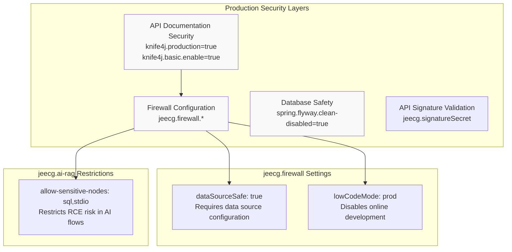
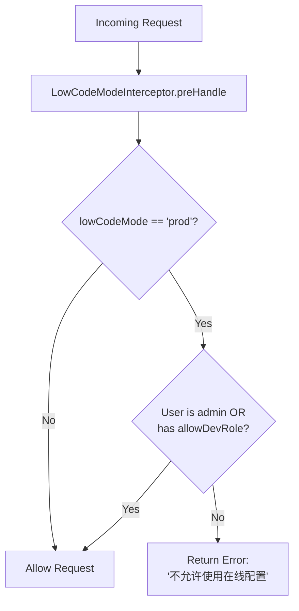
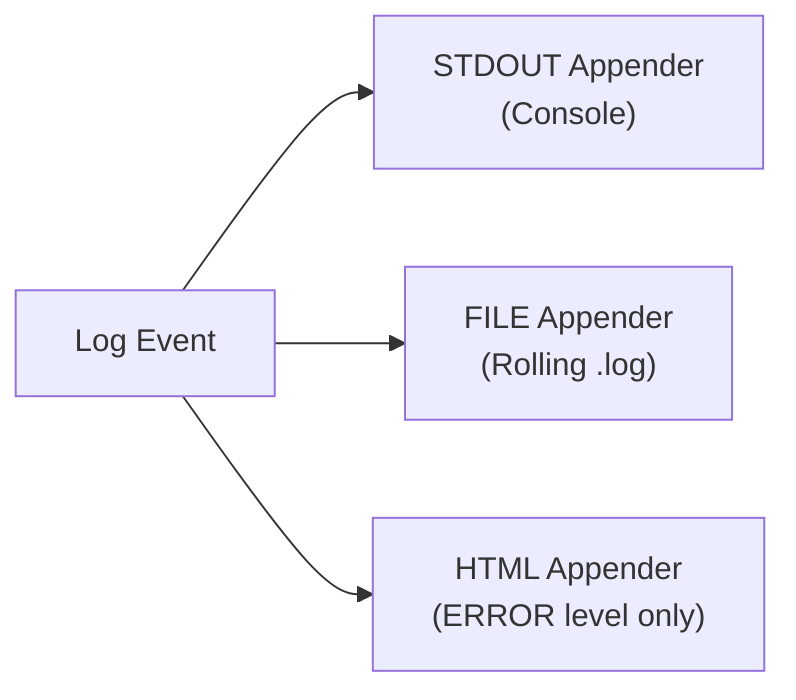

<!-- source: DeepWiki mcp.deepwiki.com · repo jeecgboot/JeecgBoot · page 9.3 Production Deployment Best Practices · fetched 2026-10-29 -->

# Production Deployment Best Practices

<details>
<summary>Relevant source files</summary>

The following files were used as context for generating this wiki page:

- [jeecg-boot/jeecg-boot-base-core/src/main/java/org/jeecg/config/firewall/interceptor/LowCodeModeConfiguration.java](jeecg-boot/jeecg-boot-base-core/src/main/java/org/jeecg/config/firewall/interceptor/LowCodeModeConfiguration.java)
- [jeecg-boot/jeecg-boot-base-core/src/main/java/org/jeecg/config/firewall/interceptor/LowCodeModeInterceptor.java](jeecg-boot/jeecg-boot-base-core/src/main/java/org/jeecg/config/firewall/interceptor/LowCodeModeInterceptor.java)
- [jeecg-boot/jeecg-boot-base-core/src/main/resources/config/default-spring-doc.properties](jeecg-boot/jeecg-boot-base-core/src/main/resources/config/default-spring-doc.properties)
- [jeecg-boot/jeecg-module-system/jeecg-system-start/src/main/resources/application-dev.yml](jeecg-boot/jeecg-module-system/jeecg-system-start/src/main/resources/application-dev.yml)
- [jeecg-boot/jeecg-module-system/jeecg-system-start/src/main/resources/application-dm8.yml](jeecg-boot/jeecg-module-system/jeecg-system-start/src/main/resources/application-dm8.yml)
- [jeecg-boot/jeecg-module-system/jeecg-system-start/src/main/resources/application-docker.yml](jeecg-boot/jeecg-module-system/jeecg-system-start/src/main/resources/application-docker.yml)
- [jeecg-boot/jeecg-module-system/jeecg-system-start/src/main/resources/application-kingbase8.yml](jeecg-boot/jeecg-module-system/jeecg-system-start/src/main/resources/application-kingbase8.yml)
- [jeecg-boot/jeecg-module-system/jeecg-system-start/src/main/resources/application-oracle.yml](jeecg-boot/jeecg-module-system/jeecg-system-start/src/main/resources/application-oracle.yml)
- [jeecg-boot/jeecg-module-system/jeecg-system-start/src/main/resources/application-postgresql.yml](jeecg-boot/jeecg-module-system/jeecg-system-start/src/main/resources/application-postgresql.yml)
- [jeecg-boot/jeecg-module-system/jeecg-system-start/src/main/resources/application-prod.yml](jeecg-boot/jeecg-module-system/jeecg-system-start/src/main/resources/application-prod.yml)
- [jeecg-boot/jeecg-module-system/jeecg-system-start/src/main/resources/application-sqlserver.yml](jeecg-boot/jeecg-module-system/jeecg-system-start/src/main/resources/application-sqlserver.yml)
- [jeecg-boot/jeecg-module-system/jeecg-system-start/src/main/resources/application-test.yml](jeecg-boot/jeecg-module-system/jeecg-system-start/src/main/resources/application-test.yml)
- [jeecg-boot/jeecg-module-system/jeecg-system-start/src/main/resources/logback-spring.xml](jeecg-boot/jeecg-module-system/jeecg-system-start/src/main/resources/logback-spring.xml)

</details>


## Purpose and Scope

This page documents critical configuration changes and security hardening measures required when deploying JeecgBoot to production environments. It covers security configurations, performance tuning, and operational best practices that differ from development settings. 

The JeecgBoot platform provides specialized configuration profiles (`application-prod.yml`, `application-docker.yml`) to facilitate these transitions. Key focus areas include disabling development-time tools, securing API documentation, and hardening database and storage configurations.

---

## Security Configuration Overview

Production deployments require specific security hardening to prevent unauthorized access to development features and sensitive data.



**Production Security Configuration Flow**

Sources: [jeecg-boot/jeecg-module-system/jeecg-system-start/src/main/resources/application-prod.yml:203-248](), [jeecg-boot/jeecg-module-system/jeecg-system-start/src/main/resources/application-dev.yml:208-250]()

---

## API Documentation Security

### Swagger/Knife4j Configuration

In production, API documentation must be protected to prevent exposure of internal APIs.

**Production Settings:**

| Configuration Key | Development Value | Production Value | Purpose |
|------------------|-------------------|------------------|---------|
| `knife4j.production` | `false` | `true` | Completely disables Swagger UI in production |
| `knife4j.basic.enable` | `false` | `true` | Enables HTTP Basic Authentication |
| `knife4j.basic.username` | `jeecg` | Custom value | Username for API docs access |
| `knife4j.basic.password` | `jeecg1314` | Strong password | Password for API docs access |

Sources: [jeecg-boot/jeecg-module-system/jeecg-system-start/src/main/resources/application-prod.yml:316-324]()

---

## Low-Code and AI Security

### Firewall Configuration

JeecgBoot includes a firewall configuration to restrict low-code development features in production via the `LowCodeModeInterceptor`.

**Main Firewall Settings (`jeecg.firewall`):**

| Setting | Development | Production | Impact |
|---------|-------------|------------|--------|
| `dataSourceSafe` | `false` | `true` | Forces data source configuration in Online forms/reports |
| `lowCodeMode` | `dev` | `prod` | Disables all online development tools via `LowCodeModeInterceptor` |

**AI Safety (`jeecg.ai-rag`):**
In production, sensitive nodes in AI flows (like `sql`, `stdio`, or `code`) should be strictly audited or limited to prevent Remote Code Execution (RCE) risks.

Sources: [jeecg-boot/jeecg-module-system/jeecg-system-start/src/main/resources/application-prod.yml:235-247](), [jeecg-boot/jeecg-boot-base-core/src/main/java/org/jeecg/config/firewall/interceptor/LowCodeModeInterceptor.java:42-47]()

### Low-Code Mode Interceptor Logic

The `LowCodeModeInterceptor` checks the `jeecg.firewall.lowCodeMode` property. If set to `prod`, it blocks requests to online configuration modules unless the user has the `admin` role or a role defined in `CommonConstant.allowDevRoles`.



**Low-Code Access Control Flow**

Sources: [jeecg-boot/jeecg-boot-base-core/src/main/java/org/jeecg/config/firewall/interceptor/LowCodeModeInterceptor.java:68-94]()

---

## Database Configuration

### Flyway Safety Settings

**CRITICAL:** The `spring.flyway.clean-disabled` setting prevents accidental database deletion. This is set to `true` across all production-ready profiles (MySQL, Oracle, PostgreSQL, etc.).

```yaml
spring:
  flyway:
    enabled: false # Typically false in prod to prevent auto-upgrades without audit
    clean-disabled: true # CRITICAL: Prevents 'flyway clean' from dropping tables
```

Sources: [jeecg-boot/jeecg-module-system/jeecg-system-start/src/main/resources/application-prod.yml:20-24](), [jeecg-boot/jeecg-module-system/jeecg-system-start/src/main/resources/application-postgresql.yml:20-24](), [jeecg-boot/jeecg-module-system/jeecg-system-start/src/main/resources/application-oracle.yml:20-24]()

### Connection Pool Optimization

Production environments should tune Druid connection pool settings for high concurrency.

**Druid Connection Pool (application-prod.yml):**

| Setting | Production Value | Purpose |
|---------|------------------|---------|
| `initial-size` | 5 | Initial connections |
| `maxActive` | 1000 | Maximum concurrent connections |
| `maxWait` | 60000 | Timeout for obtaining a connection |
| `validationQuery` | `SELECT 1 FROM DUAL` | Heartbeat check for MySQL/Oracle |
| `filters` | `stat,slf4j` | Monitoring and logging filters |

Sources: [jeecg-boot/jeecg-module-system/jeecg-system-start/src/main/resources/application-prod.yml:113-140]()

---

## Logging and Monitoring

### Logback Configuration

The `logback-spring.xml` defines different appenders for production. In a production environment, file-based logging should be enabled with retention policies.



**Production Logging Architecture**

Sources: [jeecg-boot/jeecg-module-system/jeecg-system-start/src/main/resources/logback-spring.xml:17-43]()

**Retention Policy:**
- **MaxHistory**: 30 days.
- **MaxFileSize**: 10MB per log file.
- **Log Home**: Defaulted to `../logs`.

Sources: [jeecg-boot/jeecg-module-system/jeecg-system-start/src/main/resources/logback-spring.xml:4-24]()

### Management Endpoints

Actuator endpoints are configured for monitoring but should be restricted in production via security filters.

```yaml
management:
  endpoints:
    web:
      exposure:
        include: metrics,httpexchanges,jeecghttptrace
```

Sources: [jeecg-boot/jeecg-module-system/jeecg-system-start/src/main/resources/application-prod.yml:13-17]()

---

## Summary Checklist

| Category | Item | Production Recommendation | File Reference |
| :--- | :--- | :--- | :--- |
| **Security** | `lowCodeMode` | `prod` | [application-prod.yml:273]() |
| **Security** | `knife4j.production` | `true` | [application-prod.yml:318]() |
| **Security** | `signatureSecret` | Change from default | [application-prod.yml:211]() |
| **Database** | `clean-disabled` | `true` | [application-prod.yml:24]() |
| **Database** | `maxActive` | 1000 (or as needed) | [application-prod.yml:118]() |
| **AI** | `allow-sensitive-nodes` | `sql,stdio` (audited) | [application-prod.yml:236]() |
| **Storage** | `uploadType` | `alioss` or `minio` | [application-prod.yml:216]() |

Sources: [jeecg-boot/jeecg-module-system/jeecg-system-start/src/main/resources/application-prod.yml:1-350]()

---

