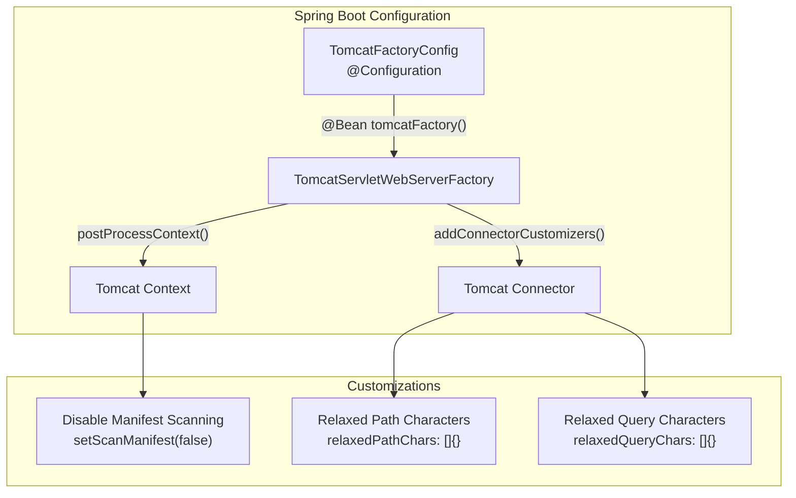
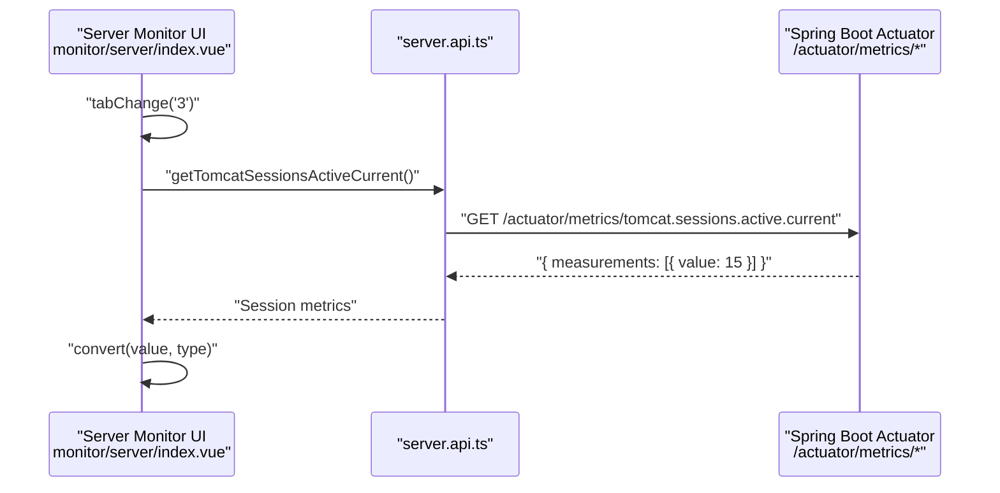
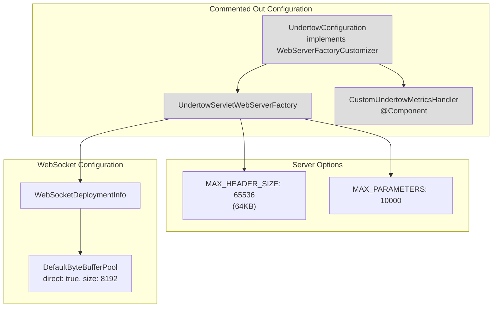
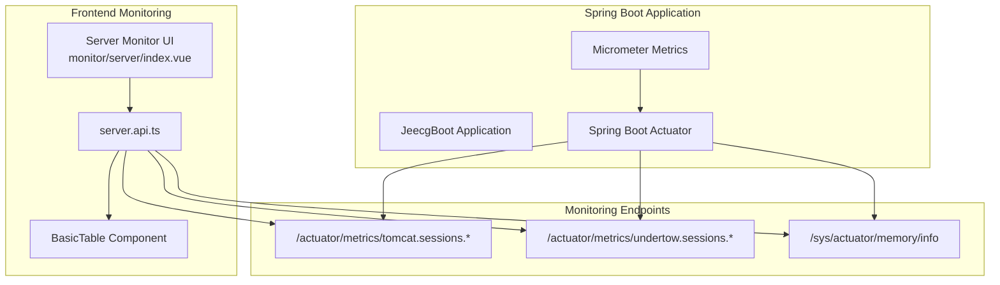

<!-- source: DeepWiki mcp.deepwiki.com · repo jeecgboot/JeecgBoot · page 9.4 Server Configuration · fetched 2026-10-29 -->

# Server Configuration

<details>
<summary>Relevant source files</summary>

The following files were used as context for generating this wiki page:

- [jeecg-boot/jeecg-module-system/jeecg-system-biz/src/main/java/org/jeecg/config/init/ShiroCacheClearRunner.java](jeecg-boot/jeecg-module-system/jeecg-system-biz/src/main/java/org/jeecg/config/init/ShiroCacheClearRunner.java)
- [jeecg-boot/jeecg-module-system/jeecg-system-biz/src/main/java/org/jeecg/config/init/UndertowConfiguration.java](jeecg-boot/jeecg-module-system/jeecg-system-biz/src/main/java/org/jeecg/config/init/UndertowConfiguration.java)
- [jeecg-boot/jeecg-module-system/jeecg-system-biz/src/main/java/org/jeecg/modules/monitor/actuator/undertow/CustomUndertowMetricsHandler.java](jeecg-boot/jeecg-module-system/jeecg-system-biz/src/main/java/org/jeecg/modules/monitor/actuator/undertow/CustomUndertowMetricsHandler.java)
- [jeecg-boot/jeecg-module-system/jeecg-system-biz/src/main/resources/jeecg/code-template-online/common/sql/menu_insert.ftl](jeecg-boot/jeecg-module-system/jeecg-system-biz/src/main/resources/jeecg/code-template-online/common/sql/menu_insert.ftl)
- [jeecgboot-vue3/src/views/monitor/server/index.vue](jeecgboot-vue3/src/views/monitor/server/index.vue)
- [jeecgboot-vue3/src/views/monitor/server/server.api.ts](jeecgboot-vue3/src/views/monitor/server/server.api.ts)

</details>


This page documents embedded web server customization in JeecgBoot, focusing on performance tuning, connection parameters, session management, and metrics collection. The platform supports both **Apache Tomcat** (current default) and **Undertow** (alternative/historical configuration).

For general deployment configuration, see [Environment Configuration](#9.2). For production hardening and optimization strategies, see [Production Deployment Best Practices](#9.3).

---

## Overview

JeecgBoot uses Spring Boot's embedded web server architecture, enabling standalone JAR deployment with a built-in HTTP server. The platform provides customized server configurations optimized for enterprise workloads, with support for both **Apache Tomcat** (current production default) and **Undertow** (high-performance alternative with historical usage in the codebase).

### Server Implementation Status

| Server | Status | Configuration Class | Key Customizations |
|--------|--------|-------------------|-------------------|
| **Tomcat** | ✅ Active (Default) | `TomcatFactoryConfig` | Connector tuning, JAR scanning optimization, relaxed URL characters |
| **Undertow** | ⚠️ Disabled | `UndertowConfiguration` | WebSocket buffer pools, header size limits, custom metrics |

**Current Architecture**: Tomcat was selected as the production default to resolve specific compatibility issues (tracked under QQYUN-11902). The Undertow configuration remains in the codebase as a commented-out alternative implementation that can be re-enabled for specific performance requirements.

**Sources:** [jeecg-boot/jeecg-module-system/jeecg-system-biz/src/main/java/org/jeecg/config/init/UndertowConfiguration.java:13-26](), [jeecg-boot/jeecg-module-system/jeecg-system-biz/src/main/java/org/jeecg/modules/monitor/actuator/undertow/CustomUndertowMetricsHandler.java:13-16]()

---

## Tomcat Configuration

### Configuration Class Structure



### Tomcat Metrics Collection

JeecgBoot monitors Tomcat server health through Spring Boot Actuator endpoints. The frontend `server.api.ts` defines several endpoints for fetching these metrics:

| Metric Constant | Actuator Endpoint | Description |
|----------------|-------------------|-------------|
| `tomcatSessionsCreated` | `/actuator/metrics/tomcat.sessions.created` | Total sessions created since startup |
| `tomcatSessionsExpired` | `/actuator/metrics/tomcat.sessions.expired` | Total sessions expired |
| `tomcatSessionsActiveCurrent` | `/actuator/metrics/tomcat.sessions.active.current` | Currently active sessions |
| `tomcatSessionsActiveMax` | `/actuator/metrics/tomcat.sessions.active.max` | Peak active sessions |
| `tomcatSessionsRejected` | `/actuator/metrics/tomcat.sessions.rejected` | Sessions rejected due to max limit |

**Sources:** [jeecgboot-vue3/src/views/monitor/server/server.api.ts:26-30](), [jeecgboot-vue3/src/views/monitor/server/server.api.ts:183-213]()

### Frontend Monitoring Integration

The frontend monitoring UI provides a dedicated "Tomcat信息" tab that displays real-time metrics fetched from actuator endpoints.



**Sources:** [jeecgboot-vue3/src/views/monitor/server/index.vue:7-7](), [jeecgboot-vue3/src/views/monitor/server/index.vue:62-73](), [jeecgboot-vue3/src/views/monitor/server/index.vue:103-112]()

---

## Undertow Configuration (Historical)

### Background

The Undertow configuration was disabled as part of issue QQYUN-11902. The configuration classes remain in the codebase as a reference for high-performance deployments.

### UndertowConfiguration Structure



**Sources:** [jeecg-boot/jeecg-module-system/jeecg-system-biz/src/main/java/org/jeecg/config/init/UndertowConfiguration.java:18-47]()

### Key Configuration Elements

#### 1. Server Options
The Undertow configuration sets two primary server options to handle large enterprise requests:
- **`UndertowOptions.MAX_HEADER_SIZE`**: 65536 bytes (64KB).
- **`UndertowOptions.MAX_PARAMETERS`**: 10000.

**Sources:** [jeecg-boot/jeecg-module-system/jeecg-system-biz/src/main/java/org/jeecg/config/init/UndertowConfiguration.java:32-33]()

#### 2. WebSocket Buffer Pool
To resolve the warning `UT026010: Buffer pool was not set on WebSocketDeploymentInfo`, the configuration explicitly sets a buffer pool using `DefaultByteBufferPool(true, 8192)`.

**Sources:** [jeecg-boot/jeecg-module-system/jeecg-system-biz/src/main/java/org/jeecg/config/init/UndertowConfiguration.java:37-42]()

#### 3. Custom Metrics Handler
The `CustomUndertowMetricsHandler` component tracks session lifecycle metrics using `Micrometer`'s `MeterRegistry`. It registers gauges for:
- `undertow.sessions.created`
- `undertow.sessions.expired`
- `undertow.sessions.active.current`
- `undertow.sessions.active.max`

**Sources:** [jeecg-boot/jeecg-module-system/jeecg-system-biz/src/main/java/org/jeecg/modules/monitor/actuator/undertow/CustomUndertowMetricsHandler.java:45-51]()

---

## Server Monitoring Architecture

### Metrics Collection Flow



**Sources:** [jeecgboot-vue3/src/views/monitor/server/server.api.ts:3-38](), [jeecgboot-vue3/src/views/monitor/server/index.vue:69-96]()

### Monitoring UI Tabs

The server monitoring interface in `jeecgboot-vue3/src/views/monitor/server/index.vue` provides multiple tabs for different monitoring aspects:

| Tab Key | Label | Data Source |
|---------|-------|-------------|
| `1` | 服务器信息 | `cpuCount`, `cpuUsage`, `processUptime` |
| `2` | JVM信息 | `jvmMemoryUsed`, `jvmThreadsLive`, `jvmGcPause` |
| `3` | Tomcat信息 | `tomcatSessionsActiveCurrent`, etc. |
| `4` | 磁盘监控 | `DiskInfo.vue` component |
| `5` | 内存信息 | `memoryInfo` (custom Jeecg endpoint) |

**Sources:** [jeecgboot-vue3/src/views/monitor/server/index.vue:4-13](), [jeecgboot-vue3/src/views/monitor/server/server.api.ts:4-32]()

---

## Startup Lifecycle Integration

### Shiro Cache Clearing

At application startup, the `ShiroCacheClearRunner` (implementing `ApplicationRunner`) executes to clear Shiro authorization caches stored in Redis. This ensures that after a server restart, user permissions are refreshed, preventing stale authorization data from affecting the UI (e.g., button permissions not updating).

```java
// From ShiroCacheClearRunner.java
@Override
public void run(ApplicationArguments args) {
    log.info("——— Service restart, clearing all user shiro authorization cache ——— ");
    redisUtil.removeAll(CommonConstant.PREFIX_USER_SHIRO_CACHE);
}
```

**Sources:** [jeecg-boot/jeecg-module-system/jeecg-system-biz/src/main/java/org/jeecg/config/init/ShiroCacheClearRunner.java:18-29]()

### Switching to Undertow

To re-enable Undertow, developers must:
1. Uncomment the `UndertowConfiguration` and `CustomUndertowMetricsHandler` classes.
2. Uncomment the Undertow info tab in the frontend monitor view.
3. Adjust the Maven dependencies to exclude `spring-boot-starter-tomcat` and include `spring-boot-starter-undertow`.

**Sources:** [jeecg-boot/jeecg-module-system/jeecg-system-biz/src/main/java/org/jeecg/config/init/UndertowConfiguration.java:1-48](), [jeecgboot-vue3/src/views/monitor/server/index.vue:8-8]()

---

