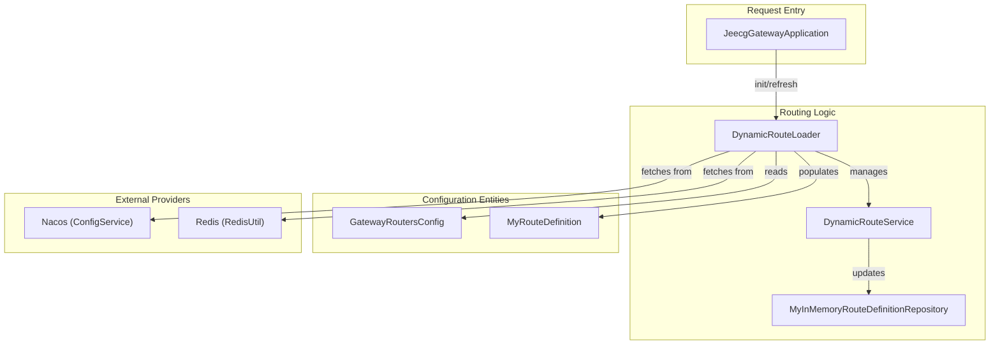
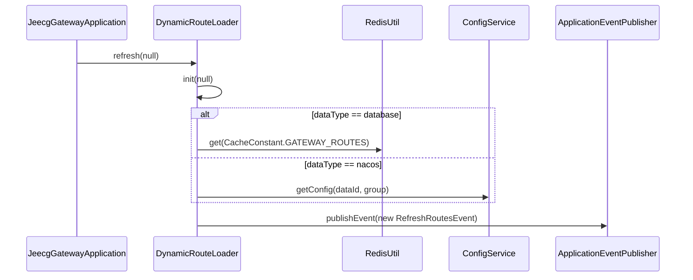

<!-- source: DeepWiki mcp.deepwiki.com · repo jeecgboot/JeecgBoot · extra page API Gateway & Routing · fetched 2026-10-29 -->

# API Gateway & Routing

Relevant source files

The following files were used as context for generating this wiki page:

- [jeecg-boot/db/tables_nacos.sql](jeecg-boot/db/tables_nacos.sql)
- [jeecg-boot/jeecg-module-system/jeecg-system-biz/src/main/resources/jeecg/code-template-online/common/blob.ftl](jeecg-boot/jeecg-module-system/jeecg-system-biz/src/main/resources/jeecg/code-template-online/common/blob.ftl)
- [jeecg-boot/jeecg-module-system/jeecg-system-biz/src/main/resources/jeecg/code-template-online/inner-table/onetomany/java/${bussiPackage}/${entityPackage}/vo/${entityName}Page.javai](jeecg-boot/jeecg-module-system/jeecg-system-biz/src/main/resources/jeecg/code-template-online/inner-table/onetomany/java/${bussiPackage}/${entityPackage}/vo/${entityName}Page.javai)
- [jeecg-boot/jeecg-server-cloud/jeecg-cloud-gateway/src/main/java/org/jeecg/JeecgGatewayApplication.java](jeecg-boot/jeecg-server-cloud/jeecg-cloud-gateway/src/main/java/org/jeecg/JeecgGatewayApplication.java)
- [jeecg-boot/jeecg-server-cloud/jeecg-cloud-gateway/src/main/java/org/jeecg/loader/DynamicRouteLoader.java](jeecg-boot/jeecg-server-cloud/jeecg-cloud-gateway/src/main/java/org/jeecg/loader/DynamicRouteLoader.java)
- [jeecg-boot/jeecg-server-cloud/jeecg-cloud-gateway/src/main/resources/application.yml](jeecg-boot/jeecg-server-cloud/jeecg-cloud-gateway/src/main/resources/application.yml)
- [jeecg-boot/jeecg-server-cloud/jeecg-cloud-nacos/docs/DEFAULT_GROUP/jeecg-dev-satoken.yaml](jeecg-boot/jeecg-server-cloud/jeecg-cloud-nacos/docs/DEFAULT_GROUP/jeecg-dev-satoken.yaml)
- [jeecg-boot/jeecg-server-cloud/jeecg-cloud-nacos/docs/DEFAULT_GROUP/jeecg-dev.yaml](jeecg-boot/jeecg-server-cloud/jeecg-cloud-nacos/docs/DEFAULT_GROUP/jeecg-dev.yaml)
- [jeecg-boot/jeecg-server-cloud/jeecg-cloud-nacos/docs/DEFAULT_GROUP/jeecg-gateway-router.json](jeecg-boot/jeecg-server-cloud/jeecg-cloud-nacos/docs/DEFAULT_GROUP/jeecg-gateway-router.json)
- [jeecg-boot/jeecg-server-cloud/jeecg-cloud-nacos/docs/DEFAULT_GROUP/jeecg-gateway.yaml](jeecg-boot/jeecg-server-cloud/jeecg-cloud-nacos/docs/DEFAULT_GROUP/jeecg-gateway.yaml)
- [jeecg-boot/jeecg-server-cloud/jeecg-cloud-nacos/docs/DEFAULT_GROUP/jeecg.yaml](jeecg-boot/jeecg-server-cloud/jeecg-cloud-nacos/docs/DEFAULT_GROUP/jeecg.yaml)
- [jeecg-boot/jeecg-server-cloud/jeecg-cloud-nacos/docs/DEFAULT_GROUP/sharding.yaml](jeecg-boot/jeecg-server-cloud/jeecg-cloud-nacos/docs/DEFAULT_GROUP/sharding.yaml)
- [jeecg-boot/jeecg-server-cloud/jeecg-cloud-nacos/pom.xml](jeecg-boot/jeecg-server-cloud/jeecg-cloud-nacos/pom.xml)
- [jeecg-boot/jeecg-server-cloud/jeecg-cloud-nacos/src/main/java/com/alibaba/nacos/JeecgNacosApplication.java](jeecg-boot/jeecg-server-cloud/jeecg-cloud-nacos/src/main/java/com/alibaba/nacos/JeecgNacosApplication.java)
- [jeecg-boot/jeecg-server-cloud/jeecg-visual/jeecg-cloud-test/jeecg-cloud-test-rocketmq/src/main/java/org/jeecg/modules/test/rocketmq/controller/JeecgMqTestController.java](jeecg-boot/jeecg-server-cloud/jeecg-visual/jeecg-cloud-test/jeecg-cloud-test-rocketmq/src/main/java/org/jeecg/modules/test/rocketmq/controller/JeecgMqTestController.java)

This document covers the Spring Cloud Gateway implementation in JeecgBoot's microservices architecture, including dynamic routing configuration, rate limiting with Redis, and Sentinel integration. The gateway serves as the unified entry point for all client requests, routing them to appropriate backend microservices.

## Overview

The API Gateway is implemented using Spring Cloud Gateway running on port 9999 [jeecg-boot/jeecg-server-cloud/jeecg-cloud-gateway/src/main/resources/application.yml:2](). It provides:

- **Dynamic Routing**: Route configuration stored in Nacos or Redis, supporting hot-reload without restart [jeecg-boot/jeecg-server-cloud/jeecg-cloud-gateway/src/main/java/org/jeecg/loader/DynamicRouteLoader.java:82-91]().
- **Load Balancing**: Client-side load balancing via Nacos service discovery to registered instances.
- **Rate Limiting**: Redis-based rate limiting to protect backend services [jeecg-boot/jeecg-server-cloud/jeecg-cloud-nacos/docs/DEFAULT_GROUP/jeecg-gateway.yaml:8-13]().
- **Circuit Breaking**: Sentinel integration for flow control and fault tolerance [jeecg-boot/jeecg-server-cloud/jeecg-cloud-gateway/src/main/resources/application.yml:46-117]().
- **API Documentation**: Aggregated Swagger documentation via Knife4j [jeecg-boot/jeecg-server-cloud/jeecg-cloud-gateway/src/main/resources/application.yml:4-6]().

**Sources:** [jeecg-boot/jeecg-server-cloud/jeecg-cloud-gateway/src/main/resources/application.yml:1-117](), [jeecg-boot/jeecg-server-cloud/jeecg-cloud-gateway/src/main/java/org/jeecg/loader/DynamicRouteLoader.java:49-52]()

## Gateway Architecture & Code Mapping

The following diagram maps high-level gateway functions to specific implementation classes and configuration entities within the codebase.

**Sources:** [jeecg-boot/jeecg-server-cloud/jeecg-cloud-gateway/src/main/java/org/jeecg/JeecgGatewayApplication.java:28-30](), [jeecg-boot/jeecg-server-cloud/jeecg-cloud-gateway/src/main/java/org/jeecg/loader/DynamicRouteLoader.java:52-61](), [jeecg-boot/jeecg-server-cloud/jeecg-cloud-gateway/src/main/java/org/jeecg/loader/repository/DynamicRouteService.java:1-30]()

## Dynamic Routing Implementation

JeecgBoot supports dynamic routing where routes can be modified at runtime without restarting the gateway. This is managed by the `DynamicRouteLoader` [jeecg-boot/jeecg-server-cloud/jeecg-cloud-gateway/src/main/java/org/jeecg/loader/DynamicRouteLoader.java:52]().

### Routing Data Sources
The source of routing data is defined by the `jeecg.route.config.data-type` property [jeecg-boot/jeecg-server-cloud/jeecg-cloud-nacos/docs/DEFAULT_GROUP/jeecg-gateway.yaml:5]():

| Data Type | Implementation Function | Description |
|-----------|-------------------------|-------------|
| `nacos` | `loadRoutesByNacos()` | Reads JSON route definitions from Nacos config [jeecg-boot/jeecg-server-cloud/jeecg-cloud-gateway/src/main/java/org/jeecg/loader/DynamicRouteLoader.java:111-137](). |
| `database` | `loadRoutesByRedis()` | Reads route definitions cached in Redis (usually synchronized from DB by the system module) [jeecg-boot/jeecg-server-cloud/jeecg-cloud-gateway/src/main/java/org/jeecg/loader/DynamicRouteLoader.java:145-180](). |
| `yml` | N/A | Standard static configuration in `application.yml`. |

### Route Initialization Flow
The gateway initializes routes upon startup via the `CommandLineRunner` implementation in `JeecgGatewayApplication` [jeecg-boot/jeecg-server-cloud/jeecg-cloud-gateway/src/main/java/org/jeecg/JeecgGatewayApplication.java:28-45]().

**Sources:** [jeecg-boot/jeecg-server-cloud/jeecg-cloud-gateway/src/main/java/org/jeecg/JeecgGatewayApplication.java:42-45](), [jeecg-boot/jeecg-server-cloud/jeecg-cloud-gateway/src/main/java/org/jeecg/loader/DynamicRouteLoader.java:82-91]()

## Sentinel Integration

The gateway integrates with Alibaba Sentinel for flow control, circuit breaking, and system protection. Configuration is centralized in Nacos and synchronized to the gateway [jeecg-boot/jeecg-server-cloud/jeecg-cloud-gateway/src/main/resources/application.yml:47-117]().

### Sentinel Rule Sources
Rules are loaded from Nacos using specific `dataId` patterns under the `SENTINEL_GROUP` [jeecg-boot/jeecg-server-cloud/jeecg-cloud-gateway/src/main/resources/application.yml:65]():

| Rule Type | Nacos Data ID | Rule Class |
|-----------|---------------|------------|
| Flow Control | `jeecg-gateway-flow-rules` | `flow` [jeecg-boot/jeecg-server-cloud/jeecg-cloud-gateway/src/main/resources/application.yml:63-67]() |
| Degrade | `jeecg-gateway-degrade-rules` | `degrade` [jeecg-boot/jeecg-server-cloud/jeecg-cloud-gateway/src/main/resources/application.yml:74-76]() |
| System | `jeecg-gateway-system-rules` | `system` [jeecg-boot/jeecg-server-cloud/jeecg-cloud-gateway/src/main/resources/application.yml:82-84]() |
| Gateway Flow | `jeecg-gateway-flow-rules` | `gw-flow` [jeecg-boot/jeecg-server-cloud/jeecg-cloud-gateway/src/main/resources/application.yml:106-108]() |
| API Group | `jeecg-gateway-api-rules` | `gw-api-group` [jeecg-boot/jeecg-server-cloud/jeecg-cloud-gateway/src/main/resources/application.yml:114-116]() |

**Sources:** [jeecg-boot/jeecg-server-cloud/jeecg-cloud-gateway/src/main/resources/application.yml:56-117]()

## Rate Limiting with Redis

JeecgBoot uses Redis to maintain counters for request rate limiting. This is configured in the gateway's Nacos profile [jeecg-boot/jeecg-server-cloud/jeecg-cloud-nacos/docs/DEFAULT_GROUP/jeecg-gateway.yaml:8-13]().

### Key Resolver
The system typically uses an IP-based or User-based `KeyResolver` to identify the bucket for rate limiting.
- **Redis Connection**: Configured via `spring.data.redis` in the gateway profile [jeecg-boot/jeecg-server-cloud/jeecg-cloud-nacos/docs/DEFAULT_GROUP/jeecg-gateway.yaml:8-13]().
- **Route Filter**: Routes in `jeecg-gateway-router.json` can include the `RequestRateLimiter` filter.

**Sources:** [jeecg-boot/jeecg-server-cloud/jeecg-cloud-nacos/docs/DEFAULT_GROUP/jeecg-gateway.yaml:8-13](), [jeecg-boot/jeecg-server-cloud/jeecg-cloud-gateway/src/main/java/org/jeecg/loader/DynamicRouteLoader.java:69-74]()

## Nacos Configuration & Three-Phase Startup

The `jeecg-cloud-nacos` module utilizes a specialized startup sequence to ensure the management console and API server are correctly initialized [jeecg-boot/jeecg-server-cloud/jeecg-cloud-nacos/src/main/java/com/alibaba/nacos/JeecgNacosApplication.java:21-57]().

### Startup Phases
1. **Core Phase**: Initializes basic Nacos environment [jeecg-boot/jeecg-server-cloud/jeecg-cloud-nacos/src/main/java/com/alibaba/nacos/JeecgNacosApplication.java:32]().
2. **Console Phase**: Starts the Nacos management UI on port 18080 [jeecg-boot/jeecg-server-cloud/jeecg-cloud-nacos/src/main/java/com/alibaba/nacos/JeecgNacosApplication.java:39-42]().
3. **Web Phase**: Starts the Nacos API server on port 8848 [jeecg-boot/jeecg-server-cloud/jeecg-cloud-nacos/src/main/java/com/alibaba/nacos/JeecgNacosApplication.java:45-48]().

### Nacos Database Schema
The configuration data (including gateway routes) is stored in the `config_info` table [jeecg-boot/db/tables_nacos.sql:85-108]().

| Column | Description |
|--------|-------------|
| `data_id` | Unique ID for the config (e.g., `jeecg-gateway.yaml`) [jeecg-boot/db/tables_nacos.sql:90]() |
| `group_id` | Grouping for the config (e.g., `DEFAULT_GROUP`) [jeecg-boot/db/tables_nacos.sql:91]() |
| `content` | The actual YAML or JSON configuration [jeecg-boot/db/tables_nacos.sql:92]() |
| `tenant_id` | Namespace/Tenant isolation [jeecg-boot/db/tables_nacos.sql:99]() |

**Sources:** [jeecg-boot/jeecg-server-cloud/jeecg-cloud-nacos/src/main/java/com/alibaba/nacos/JeecgNacosApplication.java:21-57](), [jeecg-boot/db/tables_nacos.sql:85-108]()

---

