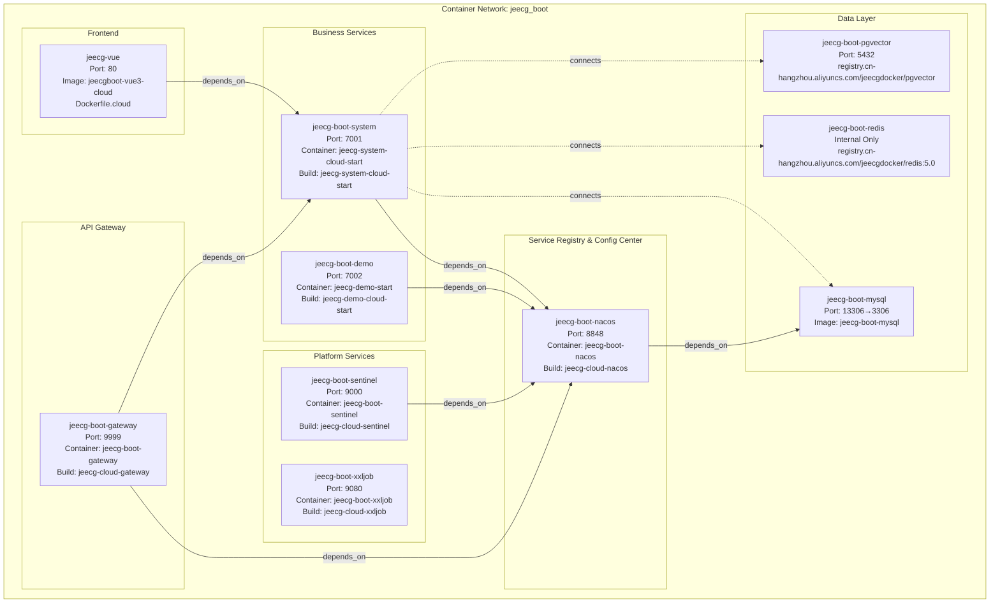
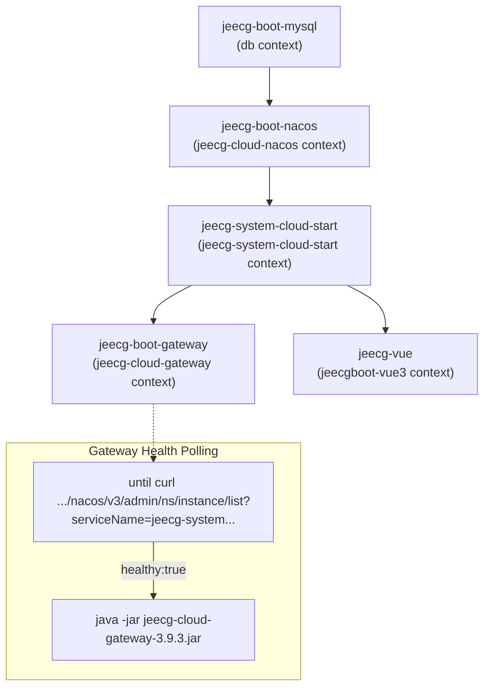

<!-- source: DeepWiki mcp.deepwiki.com · repo jeecgboot/JeecgBoot · extra page Microservices Cloud Deployment · fetched 2026-10-29 -->

# Microservices Cloud Deployment

Relevant source files

The following files were used as context for generating this wiki page:

- [docker-compose-cloud.yml](docker-compose-cloud.yml)
- [docker-compose.yml](docker-compose.yml)
- [jeecg-boot/docker-compose.yml](jeecg-boot/docker-compose.yml)
- [jeecg-boot/jeecg-module-system/jeecg-system-start/Dockerfile](jeecg-boot/jeecg-module-system/jeecg-system-start/Dockerfile)
- [jeecg-boot/jeecg-server-cloud/docker-compose.yml](jeecg-boot/jeecg-server-cloud/docker-compose.yml)
- [jeecg-boot/jeecg-server-cloud/jeecg-cloud-gateway/Dockerfile](jeecg-boot/jeecg-server-cloud/jeecg-cloud-gateway/Dockerfile)
- [jeecg-boot/jeecg-server-cloud/jeecg-cloud-nacos/Dockerfile](jeecg-boot/jeecg-server-cloud/jeecg-cloud-nacos/Dockerfile)
- [jeecg-boot/jeecg-server-cloud/jeecg-demo-cloud-start/Dockerfile](jeecg-boot/jeecg-server-cloud/jeecg-demo-cloud-start/Dockerfile)
- [jeecg-boot/jeecg-server-cloud/jeecg-system-cloud-start/Dockerfile](jeecg-boot/jeecg-server-cloud/jeecg-system-cloud-start/Dockerfile)
- [jeecg-boot/jeecg-server-cloud/jeecg-visual/jeecg-cloud-sentinel/Dockerfile](jeecg-boot/jeecg-server-cloud/jeecg-visual/jeecg-cloud-sentinel/Dockerfile)
- [jeecg-boot/jeecg-server-cloud/jeecg-visual/jeecg-cloud-sentinel/pom.xml](jeecg-boot/jeecg-server-cloud/jeecg-visual/jeecg-cloud-sentinel/pom.xml)
- [jeecg-boot/jeecg-server-cloud/jeecg-visual/jeecg-cloud-xxljob/Dockerfile](jeecg-boot/jeecg-server-cloud/jeecg-visual/jeecg-cloud-xxljob/Dockerfile)
- [jeecgboot-vue3/.env.docker](jeecgboot-vue3/.env.docker)
- [jeecgboot-vue3/.env.dockercloud](jeecgboot-vue3/.env.dockercloud)
- [jeecgboot-vue3/Dockerfile.cloud](jeecgboot-vue3/Dockerfile.cloud)

## Purpose and Scope

This document covers the deployment of JeecgBoot in distributed microservices mode using Docker Compose. This deployment pattern orchestrates multiple independent services including Nacos service registry, Spring Cloud Gateway, business service clusters, and platform services (Sentinel, XXL-Job). This approach is designed for production environments requiring high availability, independent scaling, and service isolation.

For single instance deployment suitable for development environments, see [Single Instance Deployment](#9.1.1). For general Docker deployment concepts, see [Environment Configuration](#9.2).

---

## Cloud Deployment Architecture

The cloud deployment architecture consists of three layers: infrastructure services, business services, and frontend proxy.

### Infrastructure and Service Architecture

**Sources:** [docker-compose-cloud.yml:1-171]()

---

## Service Definitions

### Infrastructure Services

#### jeecg-boot-mysql
MySQL database service providing persistent storage for all business data and Nacos configuration.

| Property | Value |
|----------|-------|
| Container Name | `jeecg-boot-mysql` |
| Build Context | `./jeecg-boot/db` |
| Image | `jeecg-boot-mysql` |
| Port Mapping | `13306:3306` |
| Root Password | `root` |
| Character Set | `utf8mb4` |
| Collation | `utf8mb4_general_ci` |
| Max Packet Size | `128M` |
| Authentication Plugin | `caching_sha2_password` |

**Sources:** [docker-compose-cloud.yml:3-23]()

#### jeecg-boot-redis
Redis cache service for session management, distributed locks, and data caching.

| Property | Value |
|----------|-------|
| Container Name | `jeecg-boot-redis` |
| Image | `registry.cn-hangzhou.aliyuncs.com/jeecgdocker/redis:5.0` |
| Port Mapping | Internal only (no external port) |
| Hostname | `jeecg-boot-redis` |

**Sources:** [docker-compose-cloud.yml:25-33]()

#### jeecg-boot-pgvector
PostgreSQL with pgvector extension for AI embeddings and semantic search.

| Property | Value |
|----------|-------|
| Container Name | `jeecg-boot-pgvector` |
| Image | `registry.cn-hangzhou.aliyuncs.com/jeecgdocker/pgvector` |
| Database | `vector_db` |
| Username | `postgres` |
| Password | `postgres` |

**Sources:** [docker-compose-cloud.yml:155-167]()

---

### Service Registry and Configuration

#### jeecg-boot-nacos
Nacos server providing service discovery, configuration management, and dynamic routing.

| Property | Value |
|----------|-------|
| Container Name | `jeecg-boot-nacos` |
| Build Context | `./jeecg-boot/jeecg-server-cloud/jeecg-cloud-nacos` |
| Port Mapping | `8848:8848`, `18080:18080` |
| Hostname | `jeecg-boot-nacos` |
| Dependencies | `jeecg-boot-mysql` |

**Sources:** [docker-compose-cloud.yml:45-57](), [jeecg-boot/jeecg-server-cloud/jeecg-cloud-nacos/Dockerfile:1-25]()

---

### Business Services

#### jeecg-boot-system
Core system service providing user management and business logic in cloud mode.

| Property | Value |
|----------|-------|
| Container Name | `jeecg-system-cloud-start` |
| Hostname | `jeecg-boot-system` |
| Build Context | `./jeecg-boot/jeecg-server-cloud/jeecg-system-cloud-start` |
| Image | `jeecg-boot-system-cloud` |
| Dependencies | `jeecg-boot-nacos` |

**Sources:** [docker-compose-cloud.yml:59-71](), [jeecg-boot/jeecg-server-cloud/jeecg-system-cloud-start/Dockerfile:1-25]()

#### jeecg-boot-demo
Demo service providing example microservice implementation.

| Property | Value |
|----------|-------|
| Container Name | `jeecg-demo-start` |
| Hostname | `jeecg-boot-demo` |
| Build Context | `./jeecg-boot/jeecg-server-cloud/jeecg-demo-cloud-start` |
| Dependencies | `jeecg-boot-nacos` |

**Sources:** [docker-compose-cloud.yml:73-84](), [jeecg-boot/jeecg-server-cloud/jeecg-demo-cloud-start/Dockerfile:1-25]()

---

### API Gateway

#### jeecg-boot-gateway
Spring Cloud Gateway providing unified API entry point and load balancing.

| Property | Value |
|----------|-------|
| Container Name | `jeecg-boot-gateway` |
| Hostname | `jeecg-boot-gateway` |
| Build Context | `./jeecg-boot/jeecg-server-cloud/jeecg-cloud-gateway` |
| Port Mapping | `9999:9999` |
| Dependencies | `jeecg-boot-nacos`, `jeecg-boot-system` |

**Wait Strategy:** The gateway uses a shell command to poll the Nacos V3 Admin API until `jeecg-system` is registered as a healthy instance: `curl -s 'http://jeecg-boot-nacos:8848/nacos/v3/admin/ns/instance/list?serviceName=jeecg-system&groupName=DEFAULT_GROUP' | grep -q '"healthy":true'`.

**Sources:** [docker-compose-cloud.yml:86-111](), [jeecg-boot/jeecg-server-cloud/jeecg-cloud-gateway/Dockerfile:1-25]()

---

### Platform Services

#### jeecg-boot-xxljob
XXL-Job admin console for distributed task scheduling.

| Property | Value |
|----------|-------|
| Container Name | `jeecg-boot-xxljob` |
| Hostname | `jeecg-boot-xxljob` |
| Build Context | `./jeecg-boot/jeecg-server-cloud/jeecg-visual/jeecg-cloud-xxljob` |
| Port Mapping | `9080:9080` |

**Sources:** [docker-compose-cloud.yml:35-43](), [jeecg-boot/jeecg-server-cloud/jeecg-visual/jeecg-cloud-xxljob/Dockerfile:1-25]()

#### jeecg-boot-sentinel
Sentinel dashboard for flow control and circuit breaking.

| Property | Value |
|----------|-------|
| Container Name | `jeecg-boot-sentinel` |
| Build Context | `./jeecg-boot/jeecg-server-cloud/jeecg-visual/jeecg-cloud-sentinel` |
| Port Mapping | `9000:9000` |

**Sources:** [docker-compose-cloud.yml:125-140](), [jeecg-boot/jeecg-server-cloud/jeecg-visual/jeecg-cloud-sentinel/pom.xml:1-127]()

---

## Service Startup Sequence and Dependencies

The startup sequence is managed through `depends_on` and explicit `command` polling in the gateway.

**Startup Delay Summary:**
- **Nacos**: `sleep 30` [jeecg-boot/jeecg-server-cloud/jeecg-cloud-nacos/Dockerfile:25]()
- **System**: `sleep 60` [jeecg-boot/jeecg-server-cloud/jeecg-system-cloud-start/Dockerfile:25]()
- **Gateway**: `sleep 100` [jeecg-boot/jeecg-server-cloud/jeecg-cloud-gateway/Dockerfile:25]() + Active polling of `jeecg-system` health [docker-compose-cloud.yml:104-107]()

---

## Port Mappings

| Service | Container Port | Host Port |
|---------|---------------|-----------|
| Vue Frontend | 80 | 80 |
| API Gateway | 9999 | 9999 |
| Nacos Console | 8848 | 8848 |
| Nacos GRPC | 18080 | 18080 |
| Sentinel | 9000 | 9000 |
| XXL-Job | 9080 | 9080 |
| MySQL | 3306 | 13306 |
| PostgreSQL | 5432 | Internal |

**Sources:** [docker-compose-cloud.yml:21, 39, 50, 51, 91, 130, 153]()

---

## Maven Profile Configuration (Sentinel)

The `jeecg-cloud-sentinel` module defines profiles for different environments, primarily controlling the Nacos server address.

| Profile | `config.server-addr` | `config.group` |
|---------|----------------------|----------------|
| `dev` | `jeecg-boot-nacos:8848` | `DEFAULT_GROUP` |
| `test` | `jeecg-boot-nacos:8848` | `DEFAULT_GROUP` |
| `docker` | `jeecg-boot-nacos:8848` | `DEFAULT_GROUP` |
| `prod` | `jeecg-boot-nacos:8848` | `DEFAULT_GROUP` |

**Sources:** [jeecg-boot/jeecg-server-cloud/jeecg-visual/jeecg-cloud-sentinel/pom.xml:77-125]()

---

## Deployment Differences: Monolithic vs Cloud

| Feature | `docker-compose.yml` (Monolithic) | `docker-compose-cloud.yml` (Cloud) |
|---------|-----------------------------------|-----------------------------------|
| System Context | `./jeecg-boot/jeecg-module-system/jeecg-system-start` | `./jeecg-boot/jeecg-server-cloud/jeecg-system-cloud-start` |
| System Port | `8080` (Exposed) | `7001` (Internal) |
| API Entry | Direct to System | Via Gateway (`9999`) |
| Service Registry | None | Nacos (`8848`) |
| Scheduling | Internal | XXL-Job (`9080`) |
| Flow Control | None | Sentinel (`9000`) |

**Sources:** [docker-compose.yml:35-48](), [docker-compose-cloud.yml:59-111]()

---

