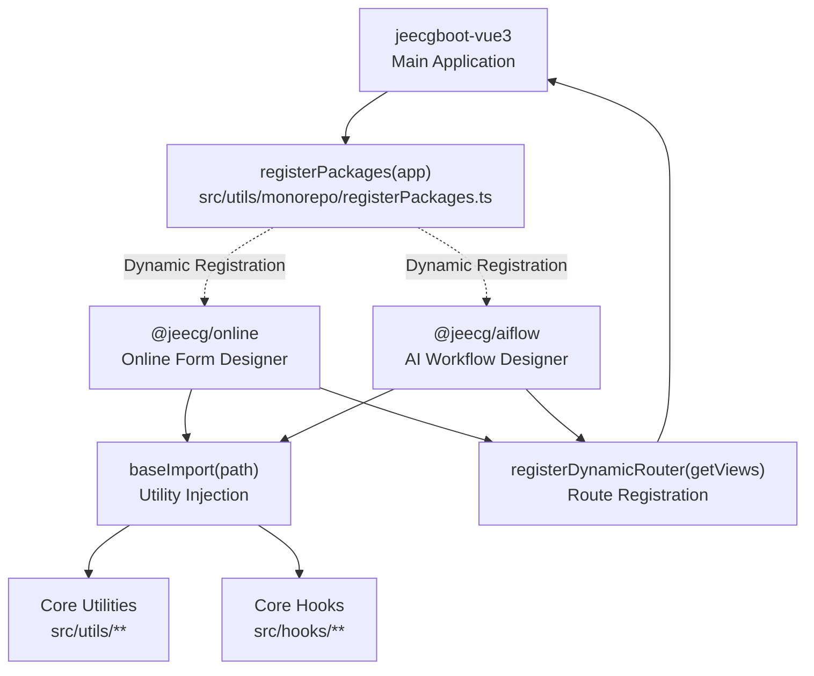
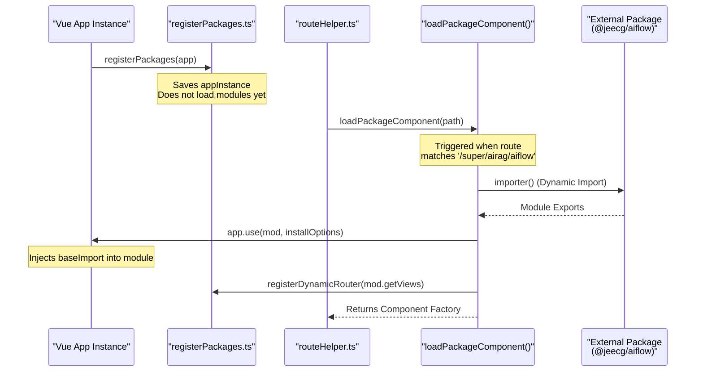
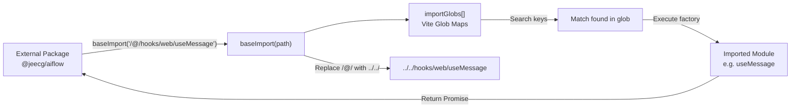

<!-- source: DeepWiki mcp.deepwiki.com · repo jeecgboot/JeecgBoot · extra page Module Integration & Monorepo · fetched 2026-10-29 -->

# Module Integration & Monorepo

Relevant source files

The following files were used as context for generating this wiki page:

- [jeecgboot-vue3/build/vite/plugin/index.ts](jeecgboot-vue3/build/vite/plugin/index.ts)
- [jeecgboot-vue3/src/components/Form/index.ts](jeecgboot-vue3/src/components/Form/index.ts)
- [jeecgboot-vue3/src/components/Form/src/componentMap.ts](jeecgboot-vue3/src/components/Form/src/componentMap.ts)
- [jeecgboot-vue3/src/components/Form/src/hooks/useForm.ts](jeecgboot-vue3/src/components/Form/src/hooks/useForm.ts)
- [jeecgboot-vue3/src/components/Form/src/hooks/useFormEvents.ts](jeecgboot-vue3/src/components/Form/src/hooks/useFormEvents.ts)
- [jeecgboot-vue3/src/components/Icon/src/Icon.vue](jeecgboot-vue3/src/components/Icon/src/Icon.vue)
- [jeecgboot-vue3/src/components/jeecg/JVxeTable/index.ts](jeecgboot-vue3/src/components/jeecg/JVxeTable/index.ts)
- [jeecgboot-vue3/src/components/jeecg/JVxeTable/useVxeTableRegister.ts](jeecgboot-vue3/src/components/jeecg/JVxeTable/useVxeTableRegister.ts)
- [jeecgboot-vue3/src/components/registerGlobComp.ts](jeecgboot-vue3/src/components/registerGlobComp.ts)
- [jeecgboot-vue3/src/router/helper/routeHelper.ts](jeecgboot-vue3/src/router/helper/routeHelper.ts)
- [jeecgboot-vue3/src/utils/dynamicPages.ts](jeecgboot-vue3/src/utils/dynamicPages.ts)
- [jeecgboot-vue3/src/utils/index.ts](jeecgboot-vue3/src/utils/index.ts)
- [jeecgboot-vue3/src/utils/monorepo/registerPackages.ts](jeecgboot-vue3/src/utils/monorepo/registerPackages.ts)

## Purpose and Scope

This document describes JeecgBoot's frontend module integration system, which enables external npm packages (specifically `@jeecg/online` and `@jeecg/aiflow`) to be dynamically registered with the main Vue3 application. The system provides a plugin-style architecture where external modules can access core utilities via the `baseImport` mechanism, register routes on-demand, and extend functionality without modifying the base codebase.

For information about the overall frontend architecture, see [Frontend Architecture](#2.3).

---

## Architecture Overview

JeecgBoot's frontend uses a **hybrid monorepo-style architecture** where feature-rich modules are distributed as separate npm packages but integrated seamlessly at runtime. This approach provides modularity while maintaining a single deployable application.

### Package Architecture Diagram

**Sources:** [jeecgboot-vue3/src/utils/monorepo/registerPackages.ts:1-28](), [jeecgboot-vue3/src/utils/monorepo/registerPackages.ts:115-140]()

---

## Package Registration System

### Registration and Lazy Loading Flow

The package registration system uses a Vue plugin pattern. Unlike standard plugins that load immediately, JeecgBoot implements a lazy-loading mechanism that initializes modules only when relevant routes are accessed.

**Sources:** [jeecgboot-vue3/src/utils/monorepo/registerPackages.ts:17-28](), [jeecgboot-vue3/src/utils/monorepo/registerPackages.ts:38-57](), [jeecgboot-vue3/src/router/helper/routeHelper.ts:130-136]()

### Package Configuration

The system maintains a list of `lazyPackages` which maps package names to their dynamic import functions.

| Package Name | Importer | Purpose |
|--------------|----------|---------|
| `@jeecg/aiflow` | `() => import('@jeecg/aiflow')` | AI workflow orchestration visual designer |
| `@jeecg/online` | (Commented in source) | Zero-code online form designer |

**Sources:** [jeecgboot-vue3/src/utils/monorepo/registerPackages.ts:6-8]()

### Runtime Component Resolution

When the application encounters a route component path that is not found in the local `views` directory, it attempts to resolve it from the external packages via `loadPackageComponent`.

1. **Precise Matching**: `getMatchedPackage` extracts keywords from the package name (e.g., `aiflow`) and checks if the component path contains it [jeecgboot-vue3/src/utils/monorepo/registerPackages.ts:62-72]().
2. **Package Loading**: `ensurePackageLoaded` checks a `loadedPackages` cache. If missing, it executes the importer and registers the package as a Vue plugin using `appInstance.use(mod, installOptions)` [jeecgboot-vue3/src/utils/monorepo/registerPackages.ts:38-57]().
3. **View Extraction**: `findComponentInPackage` calls `mod.getViews()` to retrieve the component map and searches for the requested path [jeecgboot-vue3/src/utils/monorepo/registerPackages.ts:77-95]().

**Sources:** [jeecgboot-vue3/src/utils/monorepo/registerPackages.ts:38-113]()

---

## BaseImport Mechanism

### Utility Injection Architecture

The `baseImport` mechanism allows external packages to dynamically import utilities and hooks from the main application without creating hard build-time dependencies.

**Sources:** [jeecgboot-vue3/src/utils/monorepo/registerPackages.ts:115-140]()

### Import Path Resolution

The `baseImport` function performs path resolution and module lookup using Vite's `import.meta.glob`:

*   **Path Transformation**: It replaces the alias `/@/` with relative path `../../` to align with the directory structure of the `registerPackages.ts` file [jeecgboot-vue3/src/utils/monorepo/registerPackages.ts:129-129]().
*   **Extension Handling**: It attempts to match the path exactly, or with `.ts` / `.tsx` suffixes [jeecgboot-vue3/src/utils/monorepo/registerPackages.ts:132-132]().
*   **Scope**: Currently supports importing from `src/utils/**` and `src/hooks/**` [jeecgboot-vue3/src/utils/monorepo/registerPackages.ts:116-116]().

**Sources:** [jeecgboot-vue3/src/utils/monorepo/registerPackages.ts:116-140]()

---

## Dynamic Router Integration

### Route Merging

The system merges views from external packages into the main application's route module registry.

1.  **View Registry**: The `dynamicViewsModules` in `routeHelper.ts` is populated by merging `dynamicPages` (local views) with `packageViews` (views from external packages) [jeecgboot-vue3/src/router/helper/routeHelper.ts:31-37]().
2.  **Route Transformation**: During `asyncImportRoute`, the system uses `dynamicImport` to match component strings to these modules [jeecgboot-vue3/src/router/helper/routeHelper.ts:108-136]().
3.  **Fallback Loader**: If a component path starts with `/super/airag/aiflow` and isn't found locally, it triggers `loadPackageComponent` to fetch it from the external module on-demand [jeecgboot-vue3/src/router/helper/routeHelper.ts:131-135]().

**Sources:** [jeecgboot-vue3/src/router/helper/routeHelper.ts:31-37](), [jeecgboot-vue3/src/router/helper/routeHelper.ts:108-136]()

---

## Form Component Integration

External modules often contribute to the `BasicForm` ecosystem. While core components are registered in `componentMap.ts`, the system supports dynamic registration of specialized components.

### Global Component Registration
The `registerGlobComp` function ensures that shared UI elements like `Icon`, `AIcon`, and `JUploadButton` are available to all modules, including those dynamically registered [jeecgboot-vue3/src/components/registerGlobComp.ts:17-39]().

### VxeTable Registration
For advanced data grids, `useVxeTableRegister` checks the global `JAppRootInstance` to see if `VxeTable` is already registered. If not, it dynamically imports and registers `JVxeTable` and `JVxeCustom` components [jeecgboot-vue3/src/components/jeecg/JVxeTable/useVxeTableRegister.ts:2-12]().

**Sources:** [jeecgboot-vue3/src/components/registerGlobComp.ts:11-39](), [jeecgboot-vue3/src/components/jeecg/JVxeTable/useVxeTableRegister.ts:2-12]()

---

## Technical Integration Summary

| Mechanism | Code Entity | File Path |
|-----------|-------------|-----------|
| **Lazy Package Definition** | `lazyPackages` | [src/utils/monorepo/registerPackages.ts:6-8]() |
| **Plugin Options Injection** | `installOptions` | [src/utils/monorepo/registerPackages.ts:13-15]() |
| **Dynamic Component Loader** | `loadPackageComponent` | [src/utils/monorepo/registerPackages.ts:101-113]() |
| **Base Import Logic** | `baseImport` | [src/utils/monorepo/registerPackages.ts:126-140]() |
| **Route Integration** | `asyncImportRoute` | [src/router/helper/routeHelper.ts:30-106]() |
| **Component Mapping** | `componentMap` | [src/components/Form/src/componentMap.ts:11-100]() |

**Sources:** [jeecgboot-vue3/src/utils/monorepo/registerPackages.ts:1-140](), [jeecgboot-vue3/src/router/helper/routeHelper.ts:30-136]()

---

