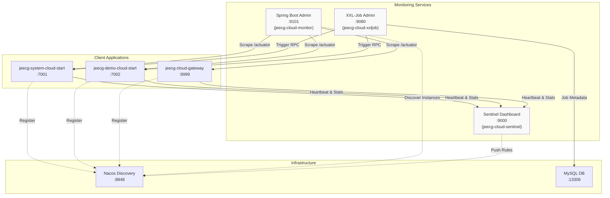
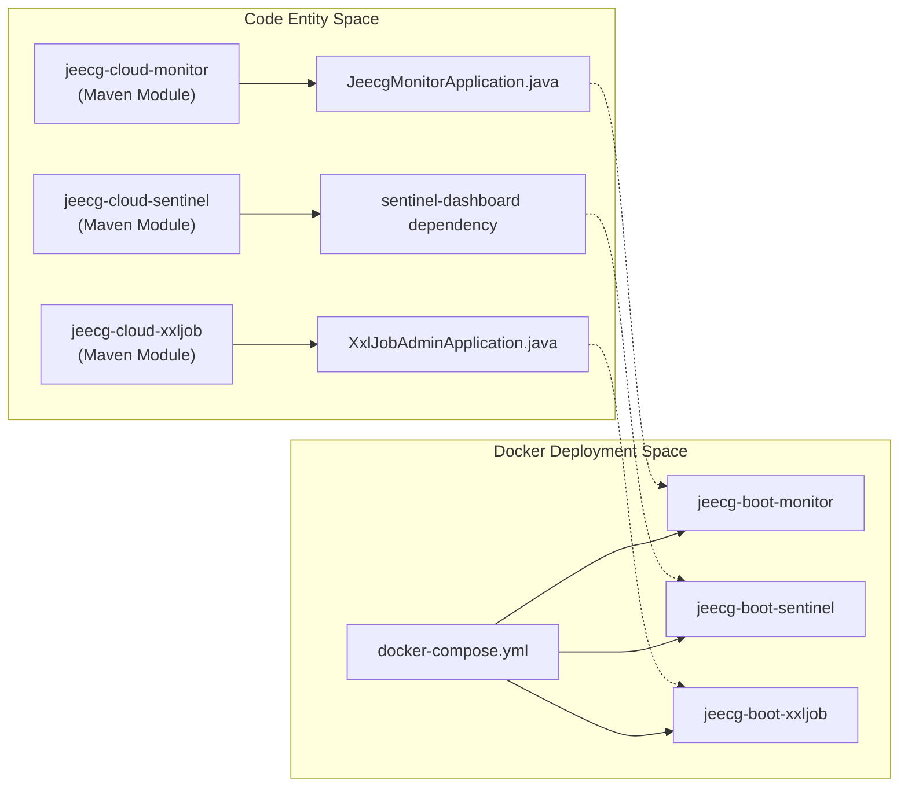

<!-- source: DeepWiki mcp.deepwiki.com · repo jeecgboot/JeecgBoot · extra page Monitoring & Resilience Services · fetched 2026-10-29 -->

# Monitoring & Resilience Services

Relevant source files

The following files were used as context for generating this wiki page:

- [jeecg-boot/jeecg-module-system/jeecg-system-start/Dockerfile](jeecg-boot/jeecg-module-system/jeecg-system-start/Dockerfile)
- [jeecg-boot/jeecg-server-cloud/docker-compose.yml](jeecg-boot/jeecg-server-cloud/docker-compose.yml)
- [jeecg-boot/jeecg-server-cloud/jeecg-cloud-gateway/Dockerfile](jeecg-boot/jeecg-server-cloud/jeecg-cloud-gateway/Dockerfile)
- [jeecg-boot/jeecg-server-cloud/jeecg-cloud-nacos/Dockerfile](jeecg-boot/jeecg-server-cloud/jeecg-cloud-nacos/Dockerfile)
- [jeecg-boot/jeecg-server-cloud/jeecg-demo-cloud-start/Dockerfile](jeecg-boot/jeecg-server-cloud/jeecg-demo-cloud-start/Dockerfile)
- [jeecg-boot/jeecg-server-cloud/jeecg-system-cloud-start/Dockerfile](jeecg-boot/jeecg-server-cloud/jeecg-system-cloud-start/Dockerfile)
- [jeecg-boot/jeecg-server-cloud/jeecg-visual/jeecg-cloud-monitor/pom.xml](jeecg-boot/jeecg-server-cloud/jeecg-visual/jeecg-cloud-monitor/pom.xml)
- [jeecg-boot/jeecg-server-cloud/jeecg-visual/jeecg-cloud-monitor/src/main/java/org/jeecg/monitor/JeecgMonitorApplication.java](jeecg-boot/jeecg-server-cloud/jeecg-visual/jeecg-cloud-monitor/src/main/java/org/jeecg/monitor/JeecgMonitorApplication.java)
- [jeecg-boot/jeecg-server-cloud/jeecg-visual/jeecg-cloud-monitor/src/main/java/org/jeecg/monitor/config/SecuritySecureConfig.java](jeecg-boot/jeecg-server-cloud/jeecg-visual/jeecg-cloud-monitor/src/main/java/org/jeecg/monitor/config/SecuritySecureConfig.java)
- [jeecg-boot/jeecg-server-cloud/jeecg-visual/jeecg-cloud-sentinel/Dockerfile](jeecg-boot/jeecg-server-cloud/jeecg-visual/jeecg-cloud-sentinel/Dockerfile)
- [jeecg-boot/jeecg-server-cloud/jeecg-visual/jeecg-cloud-sentinel/pom.xml](jeecg-boot/jeecg-server-cloud/jeecg-visual/jeecg-cloud-sentinel/pom.xml)
- [jeecg-boot/jeecg-server-cloud/jeecg-visual/jeecg-cloud-xxljob/Dockerfile](jeecg-boot/jeecg-server-cloud/jeecg-visual/jeecg-cloud-xxljob/Dockerfile)
- [jeecg-boot/jeecg-server-cloud/jeecg-visual/jeecg-cloud-xxljob/pom.xml](jeecg-boot/jeecg-server-cloud/jeecg-visual/jeecg-cloud-xxljob/pom.xml)

## Purpose and Scope

This document covers the monitoring, metrics collection, and resilience services available in JeecgBoot's microservices architecture. These services provide visibility into system health, performance metrics, distributed tracing, task scheduling, and flow control capabilities. 

The monitoring stack is primarily active in **microservices mode** (deployed via `docker-compose.yml` in the cloud server module). In monolithic mode, basic Spring Boot Actuator endpoints are used for health checks and internal metrics visualization.

---

## Monitoring Architecture Overview

JeecgBoot's microservices deployment includes a comprehensive monitoring and resilience stack consisting of:

1.  **Spring Boot Admin** - Centralized management and monitoring of Spring Boot applications.
2.  **Sentinel Dashboard** - Real-time flow control, circuit breaking, and system protection.
3.  **XXL-Job Admin** - Distributed task scheduling and job management.
4.  **Spring Boot Actuator** - JVM, server, and application metrics provider.

### System Monitoring Flow

**Sources**: [jeecg-boot/jeecg-server-cloud/docker-compose.yml:60-150](), [jeecg-boot/jeecg-server-cloud/jeecg-visual/jeecg-cloud-monitor/pom.xml:13-27]()

---

## Spring Boot Admin (jeecg-cloud-monitor)

The `jeecg-cloud-monitor` module implements the **Spring Boot Admin Server**. It provides a web interface to manage and monitor Spring Boot applications by aggregating data from Actuator endpoints.

### Implementation Details
- **Main Class**: `org.jeecg.monitor.JeecgMonitorApplication` [jeecg-boot/jeecg-server-cloud/jeecg-visual/jeecg-cloud-monitor/pom.xml:63-63]()
- **Service Discovery**: It uses `spring-cloud-starter-alibaba-nacos-discovery` to automatically detect registered microservices [jeecg-boot/jeecg-server-cloud/jeecg-visual/jeecg-cloud-monitor/pom.xml:25-28]().
- **Security**: Secured via `SecuritySecureConfig` which defines access rules for the dashboard, login pages, and actuator health endpoints [jeecg-boot/jeecg-server-cloud/jeecg-visual/jeecg-cloud-monitor/src/main/java/org/jeecg/monitor/config/SecuritySecureConfig.java:29-48]().

### Security Configuration
The admin server is protected by Spring Security. It permits public access to static assets and login pages while requiring authentication for all other exchanges [jeecg-boot/jeecg-server-cloud/jeecg-visual/jeecg-cloud-monitor/src/main/java/org/jeecg/monitor/config/SecuritySecureConfig.java:31-36](). CSRF protection is disabled to facilitate communication with client actuators [jeecg-boot/jeecg-server-cloud/jeecg-visual/jeecg-cloud-monitor/src/main/java/org/jeecg/monitor/config/SecuritySecureConfig.java:46-46]().

**Sources**: [jeecg-boot/jeecg-server-cloud/jeecg-visual/jeecg-cloud-monitor/pom.xml:1-74](), [jeecg-boot/jeecg-server-cloud/jeecg-visual/jeecg-cloud-monitor/src/main/java/org/jeecg/monitor/config/SecuritySecureConfig.java:1-61]()

---

## Sentinel - Flow Control & Circuit Breaking

Sentinel is the core resilience component, providing flow control, concurrency limiting, and circuit breaking.

### Sentinel Dashboard Deployment
The `jeecg-cloud-sentinel` module acts as the dashboard. It is a customized version of Sentinel Dashboard (v1.8.10) [jeecg-boot/jeecg-server-cloud/jeecg-visual/jeecg-cloud-sentinel/pom.xml:22-26]().

### Rule Persistence with Nacos
To prevent rule loss on restart, JeecgBoot integrates Sentinel with Nacos as the data source [jeecg-boot/jeecg-server-cloud/jeecg-visual/jeecg-cloud-sentinel/pom.xml:28-32]().
- **Data Flow**: Sentinel Dashboard -> Nacos (Config Store) -> Microservices (Pull rules).
- **Profiles**: Supports `dev`, `test`, `docker`, and `prod` profiles to point to the correct Nacos server address [jeecg-boot/jeecg-server-cloud/jeecg-visual/jeecg-cloud-sentinel/pom.xml:77-125]().

### Deployment Configuration
In the Docker environment, the Sentinel container starts after a short delay to ensure Nacos availability [jeecg-boot/jeecg-server-cloud/jeecg-visual/jeecg-cloud-sentinel/Dockerfile:25-25]().

**Sources**: [jeecg-boot/jeecg-server-cloud/jeecg-visual/jeecg-cloud-sentinel/pom.xml:1-127](), [jeecg-boot/jeecg-server-cloud/jeecg-visual/jeecg-cloud-sentinel/Dockerfile:1-26]()

---

## XXL-Job Distributed Scheduling

`jeecg-cloud-xxljob` provides the administrative console for distributed task scheduling.

### Key Components
- **Admin Server**: Based on `XxlJobAdminApplication` [jeecg-boot/jeecg-server-cloud/jeecg-visual/jeecg-cloud-xxljob/pom.xml:91-91]().
- **Database**: Uses MySQL for job persistence, execution logs, and registry information [jeecg-boot/jeecg-server-cloud/jeecg-visual/jeecg-cloud-xxljob/pom.xml:54-58]().
- **Core Engine**: Integrates `xxl-job-core` v2.5.0 [jeecg-boot/jeecg-server-cloud/jeecg-visual/jeecg-cloud-xxljob/pom.xml:60-65]().

### Deployment
The XXL-Job admin runs on port **9080** [jeecg-boot/jeecg-server-cloud/jeecg-visual/jeecg-cloud-xxljob/Dockerfile:21-21](). It is packaged as an executable JAR using the `spring-boot-maven-plugin` [jeecg-boot/jeecg-server-cloud/jeecg-visual/jeecg-cloud-xxljob/pom.xml:79-93]().

**Sources**: [jeecg-boot/jeecg-server-cloud/jeecg-visual/jeecg-cloud-xxljob/pom.xml:1-111](), [jeecg-boot/jeecg-server-cloud/jeecg-visual/jeecg-cloud-xxljob/Dockerfile:1-27]()

---

## Microservices Resilience Stack

The following diagram maps the infrastructure services to their corresponding code modules and Docker configurations.

**Sources**: [jeecg-boot/jeecg-server-cloud/docker-compose.yml:129-150](), [jeecg-boot/jeecg-server-cloud/jeecg-visual/jeecg-cloud-monitor/pom.xml:63-63](), [jeecg-boot/jeecg-server-cloud/jeecg-visual/jeecg-cloud-xxljob/pom.xml:91-91]()

---

## Service Startup & Health Sequence

In a containerized environment, JeecgBoot uses specific wait sequences to ensure monitoring services connect to a ready infrastructure.

| Service | Dependency | Startup Mechanism |
| :--- | :--- | :--- |
| **Nacos** | MySQL | Sleeps 30s before execution [jeecg-boot/jeecg-server-cloud/jeecg-cloud-nacos/Dockerfile:25-25]() |
| **System** | Nacos | Sleeps 60s before execution [jeecg-boot/jeecg-server-cloud/jeecg-system-cloud-start/Dockerfile:24-24]() |
| **Gateway** | System | Actively polls Nacos V3 API until `jeecg-system` is "healthy" [jeecg-boot/jeecg-server-cloud/docker-compose.yml:116-120]() |
| **Sentinel** | Nacos | Sleeps 5s before execution [jeecg-boot/jeecg-server-cloud/jeecg-visual/jeecg-cloud-sentinel/Dockerfile:25-25]() |

**Sources**: [jeecg-boot/jeecg-server-cloud/docker-compose.yml:112-121](), [jeecg-boot/jeecg-server-cloud/jeecg-cloud-nacos/Dockerfile:25-25](), [jeecg-boot/jeecg-server-cloud/jeecg-system-cloud-start/Dockerfile:24-24]()

---

