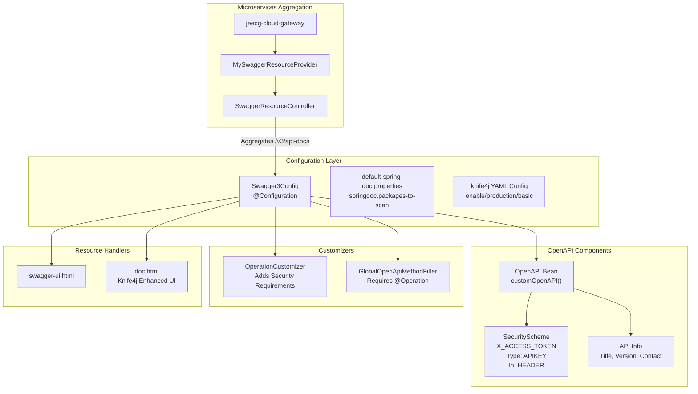
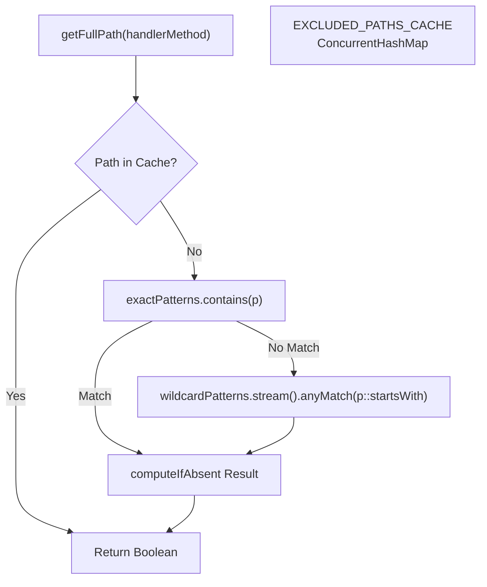

<!-- source: DeepWiki mcp.deepwiki.com · repo jeecgboot/JeecgBoot · extra page OpenAPI/Swagger Configuration · fetched 2026-10-29 -->

# OpenAPI/Swagger Configuration

Relevant source files

The following files were used as context for generating this wiki page:

- [jeecg-boot/jeecg-boot-base-core/src/main/java/org/jeecg/config/Swagger3Config.java](jeecg-boot/jeecg-boot-base-core/src/main/java/org/jeecg/config/Swagger3Config.java)
- [jeecg-boot/jeecg-server-cloud/jeecg-cloud-gateway/src/main/java/org/jeecg/handler/swagger/MySwaggerResourceProvider.java](jeecg-boot/jeecg-server-cloud/jeecg-cloud-gateway/src/main/java/org/jeecg/handler/swagger/MySwaggerResourceProvider.java)
- [jeecg-boot/jeecg-server-cloud/jeecg-cloud-gateway/src/main/java/org/jeecg/handler/swagger/SwaggerResourceController.java](jeecg-boot/jeecg-server-cloud/jeecg-cloud-gateway/src/main/java/org/jeecg/handler/swagger/SwaggerResourceController.java)
- [jeecg-boot/jeecg-server-cloud/jeecg-system-cloud-start/src/main/resources/application.yml](jeecg-boot/jeecg-server-cloud/jeecg-system-cloud-start/src/main/resources/application.yml)

This document describes the OpenAPI 3.0/Swagger configuration in JeecgBoot, including the integration with Knife4j (an enhanced Swagger UI), security settings, and microservices aggregation. The system uses SpringDoc OpenAPI 3 for automatic API documentation generation and Knife4j for an improved documentation interface.

## Configuration Architecture

JeecgBoot's OpenAPI configuration is implemented through the `Swagger3Config` class and complemented by environment-specific YAML properties. In microservices mode, the Gateway aggregates documentation from various services.

**Sources:** [jeecg-boot/jeecg-boot-base-core/src/main/java/org/jeecg/config/Swagger3Config.java:1-152](), [jeecg-boot/jeecg-server-cloud/jeecg-cloud-gateway/src/main/java/org/jeecg/handler/swagger/MySwaggerResourceProvider.java:27-158]()

## Core Configuration Class

The `Swagger3Config` class serves as the central configuration point. It is conditionally loaded based on the `knife4j.production` property.

| Configuration Element | Implementation | Purpose |
|----------------------|----------------|---------|
| **Class Annotation** | `@ConditionalOnProperty(prefix = "knife4j", name = "production", havingValue = "false", matchIfMissing = true)` | Only loads when `knife4j.production` is `false` or missing [jeecg-boot/jeecg-boot-base-core/src/main/java/org/jeecg/config/Swagger3Config.java:35-35]() |
| **Property Source** | `@PropertySource("classpath:config/default-spring-doc.properties")` | Loads SpringDoc base configuration [jeecg-boot/jeecg-boot-base-core/src/main/java/org/jeecg/config/Swagger3Config.java:36-36]() |
| **Security Scheme** | `X-ACCESS-TOKEN` in HEADER | JWT token-based authentication [jeecg-boot/jeecg-boot-base-core/src/main/java/org/jeecg/config/Swagger3Config.java:145-150]() |

### OpenAPI Bean Definition

The `customOpenAPI()` method creates the main OpenAPI specification object with API metadata:

- **Title**: "JeecgBoot 后台服务API接口文档" [jeecg-boot/jeecg-boot-base-core/src/main/java/org/jeecg/config/Swagger3Config.java:138-138]()
- **Version**: "3.9.3" [jeecg-boot/jeecg-boot-base-core/src/main/java/org/jeecg/config/Swagger3Config.java:139-139]()
- **Security**: Adds `X_ACCESS_TOKEN` as a global security requirement [jeecg-boot/jeecg-boot-base-core/src/main/java/org/jeecg/config/Swagger3Config.java:144-144]().

## Security Configuration

The security configuration ensures that API endpoints require the `X-ACCESS-TOKEN` header unless explicitly excluded. This is implemented through a custom `OperationCustomizer`.

### Excluded Paths

The following paths are excluded from security requirements in the documentation:

| Path Pattern | Purpose |
|--------------|---------|
| `/sys/randomImage/**` | Captcha image generation |
| `/sys/login` | User login endpoint |
| `/sys/phoneLogin` | Phone-based login |
| `/sys/cas/client/validateLogin` | CAS SSO validation |
| `/sys/thirdLogin/**` | Third-party OAuth login |
| `/sys/user/register` | User registration |

**Sources:** [jeecg-boot/jeecg-boot-base-core/src/main/java/org/jeecg/config/Swagger3Config.java:42-52]()

### Path Matching Logic

The `isExcludedPath()` method uses a cached, optimized pattern matching approach:

The implementation splits patterns into `exactPatterns` and `wildcardPatterns` during static initialization to improve efficiency [jeecg-boot/jeecg-boot-base-core/src/main/java/org/jeecg/config/Swagger3Config.java:56-65]().

## Microservices Documentation Aggregation

In a Spring Cloud environment, the Gateway aggregates the documentation of all downstream services using `MySwaggerResourceProvider`.

### Resource Provider Logic

`MySwaggerResourceProvider` implements `SwaggerResourcesProvider` to fetch routes and check for healthy instances in Nacos:

1. **Route Filtering**: It filters routes that have a host and are not the gateway itself [jeecg-boot/jeecg-server-cloud/jeecg-cloud-gateway/src/main/java/org/jeecg/handler/swagger/MySwaggerResourceProvider.java:92-93]().
2. **Instance Health Check**: It uses Nacos `NamingService.selectInstances()` to verify that a service has healthy instances before adding it to the documentation list [jeecg-boot/jeecg-server-cloud/jeecg-cloud-gateway/src/main/java/org/jeecg/handler/swagger/MySwaggerResourceProvider.java:149-152]().
3. **Exclusion List**: Certain services like `jeecg-cloud-monitor` are excluded from the documentation [jeecg-boot/jeecg-server-cloud/jeecg-cloud-gateway/src/main/java/org/jeecg/handler/swagger/MySwaggerResourceProvider.java:73-73]().

**Sources:** [jeecg-boot/jeecg-server-cloud/jeecg-cloud-gateway/src/main/java/org/jeecg/handler/swagger/MySwaggerResourceProvider.java:88-121]()

### Aggregation Controller

The `SwaggerResourceController` provides the endpoints required by Knife4j to display the aggregated documentation:

- `/swagger-resources/configuration/security` [jeecg-boot/jeecg-server-cloud/jeecg-cloud-gateway/src/main/java/org/jeecg/handler/swagger/SwaggerResourceController.java:32-35]()
- `/swagger-resources/configuration/ui` [jeecg-boot/jeecg-server-cloud/jeecg-cloud-gateway/src/main/java/org/jeecg/handler/swagger/SwaggerResourceController.java:37-40]()
- `/swagger-resources` (The main list of services) [jeecg-boot/jeecg-server-cloud/jeecg-cloud-gateway/src/main/java/org/jeecg/handler/swagger/SwaggerResourceController.java:42-48]()

## Resource Handler Configuration

The `addResourceHandlers()` method registers static resource locations for Swagger UI and Knife4j:

| URL Pattern | Resource Location | Purpose |
|-------------|------------------|---------|
| `swagger-ui.html` | `classpath:/META-INF/resources/` | Original Swagger UI |
| `doc.html` | `classpath:/META-INF/resources/` | Knife4j enhanced UI |
| `/webjars/**` | `classpath:/META-INF/resources/webjars/` | JS/CSS dependencies |

**Sources:** [jeecg-boot/jeecg-boot-base-core/src/main/java/org/jeecg/config/Swagger3Config.java:73-78]()

## Performance Optimizations

The configuration includes several performance optimizations:

### Path Matching Cache
The `EXCLUDED_PATHS_CACHE` is a `ConcurrentHashMap` that avoids repeating expensive string prefix matching for every API call in the documentation generation process [jeecg-boot/jeecg-boot-base-core/src/main/java/org/jeecg/config/Swagger3Config.java:40-40]().

### Method Filtering
The `globalOpenApiMethodFilter()` bean ensures that only methods explicitly annotated with `@Operation` are processed, reducing the overhead of scanning every controller method [jeecg-boot/jeecg-boot-base-core/src/main/java/org/jeecg/config/Swagger3Config.java:81-84]().

## Accessing API Documentation

### Standalone Mode
1. **Swagger UI**: `http://localhost:8080/jeecg-boot/swagger-ui.html`
2. **Knife4j UI**: `http://localhost:8080/jeecg-boot/doc.html`

### Cloud Mode
Documentation is accessed via the Gateway (default port 7001):
- **Aggregated UI**: `http://localhost:7001/doc.html`

**Sources:** [jeecg-boot/jeecg-server-cloud/jeecg-system-cloud-start/src/main/resources/application.yml:1-6](), [jeecg-boot/jeecg-server-cloud/jeecg-cloud-gateway/src/main/java/org/jeecg/handler/swagger/SwaggerResourceController.java:20-20]()

---

