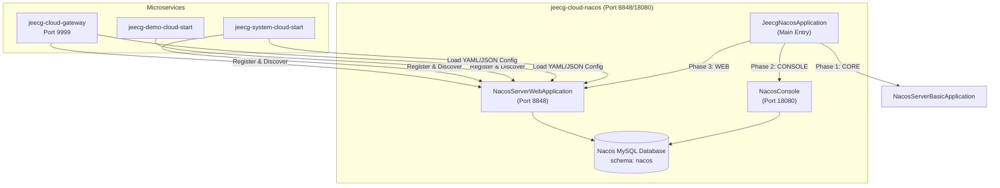
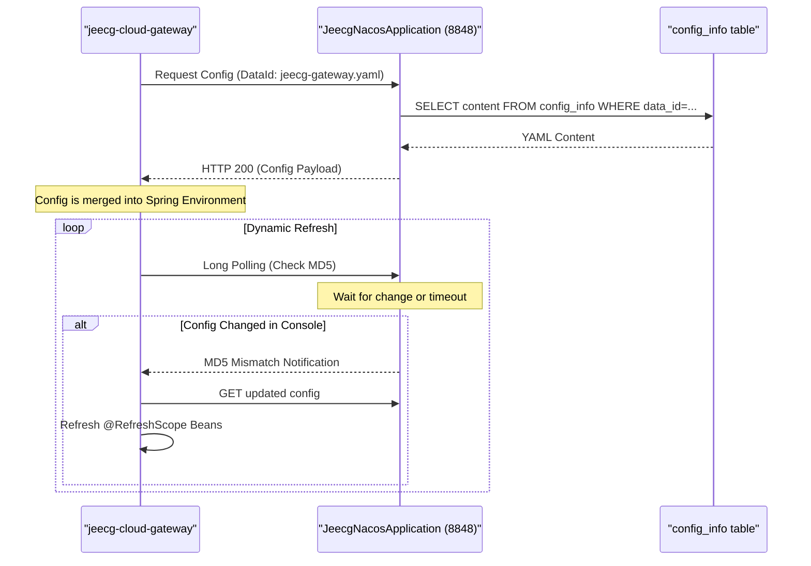
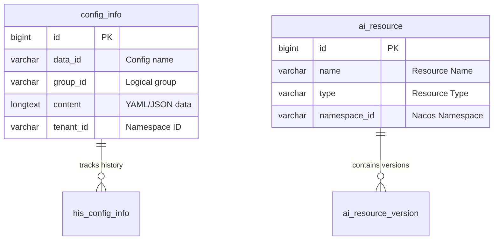

<!-- source: DeepWiki mcp.deepwiki.com · repo jeecgboot/JeecgBoot · extra page Service Discovery & Configuration (Nacos) · fetched 2026-10-29 -->

# Service Discovery & Configuration (Nacos)

<details>
<summary>Relevant source files</summary>

The following files were used as context for generating this wiki page:

- [jeecg-boot/db/tables_nacos.sql](jeecg-boot/db/tables_nacos.sql)
- [jeecg-boot/jeecg-server-cloud/jeecg-cloud-gateway/src/main/resources/application.yml](jeecg-boot/jeecg-server-cloud/jeecg-cloud-gateway/src/main/resources/application.yml)
- [jeecg-boot/jeecg-server-cloud/jeecg-cloud-nacos/docs/DEFAULT_GROUP/jeecg-dev-satoken.yaml](jeecg-boot/jeecg-server-cloud/jeecg-cloud-nacos/docs/DEFAULT_GROUP/jeecg-dev-satoken.yaml)
- [jeecg-boot/jeecg-server-cloud/jeecg-cloud-nacos/docs/DEFAULT_GROUP/jeecg-dev.yaml](jeecg-boot/jeecg-server-cloud/jeecg-cloud-nacos/docs/DEFAULT_GROUP/jeecg-dev.yaml)
- [jeecg-boot/jeecg-server-cloud/jeecg-cloud-nacos/docs/DEFAULT_GROUP/jeecg-gateway-router.json](jeecg-boot/jeecg-server-cloud/jeecg-cloud-nacos/docs/DEFAULT_GROUP/jeecg-gateway-router.json)
- [jeecg-boot/jeecg-server-cloud/jeecg-cloud-nacos/docs/DEFAULT_GROUP/jeecg-gateway.yaml](jeecg-boot/jeecg-server-cloud/jeecg-cloud-nacos/docs/DEFAULT_GROUP/jeecg-gateway.yaml)
- [jeecg-boot/jeecg-server-cloud/jeecg-cloud-nacos/docs/DEFAULT_GROUP/jeecg.yaml](jeecg-boot/jeecg-server-cloud/jeecg-cloud-nacos/docs/DEFAULT_GROUP/jeecg.yaml)
- [jeecg-boot/jeecg-server-cloud/jeecg-cloud-nacos/docs/DEFAULT_GROUP/sharding.yaml](jeecg-boot/jeecg-server-cloud/jeecg-cloud-nacos/docs/DEFAULT_GROUP/sharding.yaml)
- [jeecg-boot/jeecg-server-cloud/jeecg-cloud-nacos/pom.xml](jeecg-boot/jeecg-server-cloud/jeecg-cloud-nacos/pom.xml)
- [jeecg-boot/jeecg-server-cloud/jeecg-cloud-nacos/src/main/java/com/alibaba/nacos/JeecgNacosApplication.java](jeecg-boot/jeecg-server-cloud/jeecg-cloud-nacos/src/main/java/com/alibaba/nacos/JeecgNacosApplication.java)
- [jeecg-boot/jeecg-server-cloud/jeecg-cloud-nacos/src/main/resources/application.properties](jeecg-boot/jeecg-server-cloud/jeecg-cloud-nacos/src/main/resources/application.properties)

</details>


## Purpose and Scope

This document describes how JeecgBoot uses Nacos (Dynamic Naming and Configuration Service) as both a service registry for microservices discovery and a centralized configuration management system. Nacos serves as the central nervous system for the distributed architecture, enabling services to find each other dynamically and manage configuration across environments without code changes.

JeecgBoot utilizes Nacos 3.x for enhanced performance and compatibility with Spring Boot 3 and Java 17 [jeecg-boot/jeecg-server-cloud/jeecg-cloud-nacos/pom.xml:1-18]().

---

## Nacos Overview

Nacos is Alibaba's open-source platform for dynamic service discovery, configuration management, and service management. In JeecgBoot's microservices deployment, Nacos provides two critical capabilities:

| Capability | Purpose | Port |
|------------|---------|------|
| **Service Registry** | Services register themselves and discover other services | 8848 |
| **Configuration Center** | Centralized storage and dynamic management of configuration files | 8848 |
| **Console Interface** | Web-based management UI | 18080 |

JeecgBoot provides a custom Nacos startup module `jeecg-cloud-nacos` which integrates Nacos 3.2.2 with a three-phase startup sequence [jeecg-boot/jeecg-server-cloud/jeecg-cloud-nacos/src/main/java/com/alibaba/nacos/JeecgNacosApplication.java:23-57]().

---

## Nacos Deployment Architecture

The following diagram shows how Nacos integrates with JeecgBoot microservices. In the JeecgBoot implementation, Nacos runs in a "merged" deployment mode where core, console, and server contexts are started within a single JVM but initialized in separate phases [jeecg-boot/jeecg-server-cloud/jeecg-cloud-nacos/src/main/java/com/alibaba/nacos/JeecgNacosApplication.java:31-48]().



**Diagram: Nacos Integration in JeecgBoot Microservices Architecture**

**Sources:** [jeecg-boot/jeecg-server-cloud/jeecg-cloud-nacos/src/main/java/com/alibaba/nacos/JeecgNacosApplication.java:21-57](), [jeecg-boot/jeecg-server-cloud/jeecg-cloud-nacos/src/main/resources/application.properties:1-10]()

---

## Configuration Management

### Configuration Storage Structure

Nacos organizes configuration using a hierarchy of Namespace, Group, and Data ID. JeecgBoot leverages this for environment isolation and service-specific settings.

| Level | Code Entity / Property | Example |
|-------|-------------|---------|
| **Namespace** | `spring.cloud.nacos.config.namespace` | `springboot3`, `0937...` |
| **Group** | `spring.cloud.nacos.config.group` | `DEFAULT_GROUP`, `SENTINEL_GROUP` |
| **Data ID** | `${spring.application.name}.yaml` | `jeecg-gateway.yaml`, `jeecg-dev.yaml` |

### Configuration Loading Flow

Microservices like the Gateway use `spring.config.import` to pull configurations from Nacos during the bootstrap phase [jeecg-boot/jeecg-server-cloud/jeecg-cloud-gateway/src/main/resources/application.yml:13-29]().



**Diagram: Configuration Loading and Dynamic Refresh**

**Sources:** [jeecg-boot/jeecg-server-cloud/jeecg-cloud-gateway/src/main/resources/application.yml:13-29](), [jeecg-boot/db/tables_nacos.sql:85-108]()

---

## Nacos Database Schema

Nacos persists all configuration and service metadata in a MySQL database. The schema includes standard Nacos tables and custom AI resource tables for Jeecg's extended features.

### Key Tables

| Table Name | Purpose | Data Entity |
|------------|---------|-------------|
| `config_info` | Primary configuration storage | [jeecg-boot/db/tables_nacos.sql:87-108]() |
| `his_config_info` | Version history for rollbacks | [jeecg-boot/db/tables_nacos.sql:194-216]() |
| `ai_resource` | Metadata for AI-related assets | [jeecg-boot/db/tables_nacos.sql:26-49]() |
| `ai_resource_version` | Versioning for AI resources | [jeecg-boot/db/tables_nacos.sql:58-78]() |

### Schema Relationships



**Sources:** [jeecg-boot/db/tables_nacos.sql:26-216]()

---

## Key Configuration Files in Nacos

JeecgBoot pre-configures several critical files in Nacos (stored in `jeecg-boot/jeecg-server-cloud/jeecg-cloud-nacos/docs/DEFAULT_GROUP/` for initialization).

### 1. Global Application Config (`jeecg.yaml`)
Contains common settings for all services, such as Tomcat limits, Jackson formatting, and MyBatis-Plus configurations [jeecg-boot/jeecg-server-cloud/jeecg-cloud-nacos/docs/DEFAULT_GROUP/jeecg.yaml:1-98]().

### 2. Development Profile (`jeecg-dev.yaml`)
Defines infrastructure connections:
* **MySQL**: `spring.datasource.dynamic.datasource.master` [jeecg-boot/jeecg-server-cloud/jeecg-cloud-nacos/docs/DEFAULT_GROUP/jeecg-dev.yaml:32-36]()
* **Redis**: `spring.data.redis.host` [jeecg-boot/jeecg-server-cloud/jeecg-cloud-nacos/docs/DEFAULT_GROUP/jeecg-dev.yaml:41-45]()
* **RabbitMQ**: `spring.rabbitmq.host` [jeecg-boot/jeecg-server-cloud/jeecg-cloud-nacos/docs/DEFAULT_GROUP/jeecg-dev.yaml:46-50]()

### 3. Gateway Routing (`jeecg-gateway-router.json`)
Defines dynamic routes for the `jeecg-cloud-gateway`. It maps paths like `/sys/**` to the `lb://jeecg-system` service using Nacos discovery [jeecg-boot/jeecg-server-cloud/jeecg-cloud-nacos/docs/DEFAULT_GROUP/jeecg-gateway-router.json:1-17]().

---

## Service Registration Mechanism

When a service starts, it registers with Nacos using the `spring-cloud-starter-alibaba-nacos-discovery` dependency.

### Gateway Discovery Configuration
The gateway is configured to automatically locate services via Nacos [jeecg-boot/jeecg-server-cloud/jeecg-cloud-gateway/src/main/resources/application.yml:30-35]():
```yaml
spring:
  cloud:
    gateway:
      discovery:
        locator:
          enabled: true # Enables discovery-based routing
```

### Sentinel Rules via Nacos
Sentinel flow control and degradation rules are also managed through Nacos Data IDs, allowing real-time traffic management without restarting services [jeecg-boot/jeecg-server-cloud/jeecg-cloud-gateway/src/main/resources/application.yml:56-117]().

| Rule Type | Nacos Data ID | Group |
|-----------|---------------|-------|
| Flow Rules | `${spring.application.name}-flow-rules` | `SENTINEL_GROUP` |
| Degrade Rules | `${spring.application.name}-degrade-rules` | `SENTINEL_GROUP` |

---

## Nacos Startup and Setup

### Three-Phase Startup Implementation
The `JeecgNacosApplication` class implements a specific startup order to ensure the console is available for management while the server handles API requests [jeecg-boot/jeecg-server-cloud/jeecg-cloud-nacos/src/main/java/com/alibaba/nacos/JeecgNacosApplication.java:31-48]():

1.  **Core Phase**: Initializes basic environment and `NacosServerBasicApplication`.
2.  **Console Phase**: Starts `NacosConsole` on port `18080`.
3.  **Web Phase**: Starts `NacosServerWebApplication` on port `8848`.

### Database Initialization
The `application.properties` file directs Nacos to use the MySQL platform and the `nacos` database [jeecg-boot/jeecg-server-cloud/jeecg-cloud-nacos/src/main/resources/application.properties:6-10]():
```properties
spring.sql.init.platform=mysql
db.url.0=jdbc:mysql://jeecg-boot-mysql:3306/nacos?...
db.user=root
db.password=root
```

**Sources:** [jeecg-boot/jeecg-server-cloud/jeecg-cloud-nacos/src/main/java/com/alibaba/nacos/JeecgNacosApplication.java:1-60](), [jeecg-boot/jeecg-server-cloud/jeecg-cloud-nacos/src/main/resources/application.properties:1-59]()

---

