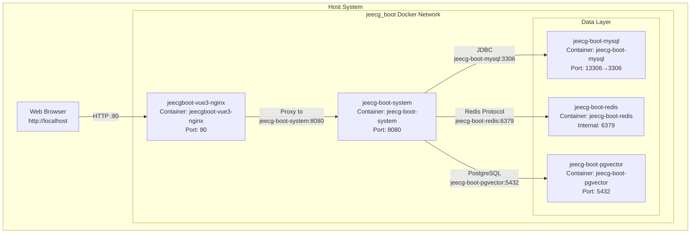
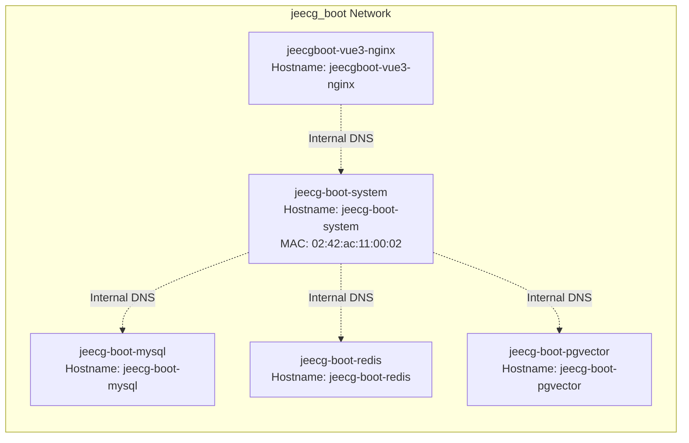
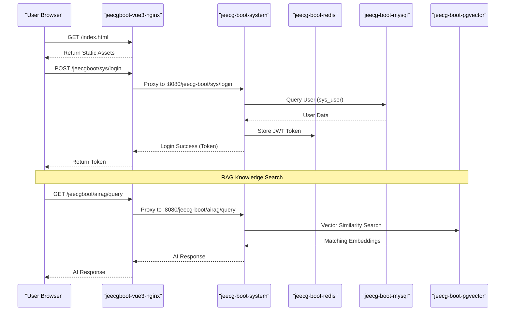

<!-- source: DeepWiki mcp.deepwiki.com · repo jeecgboot/JeecgBoot · extra page Single Instance Deployment · fetched 2026-10-29 -->

# Single Instance Deployment

<details>
<summary>Relevant source files</summary>

The following files were used as context for generating this wiki page:

- [docker-compose-cloud.yml](docker-compose-cloud.yml)
- [docker-compose.yml](docker-compose.yml)
- [jeecg-boot/docker-compose.yml](jeecg-boot/docker-compose.yml)
- [jeecgboot-vue3/.env.docker](jeecgboot-vue3/.env.docker)
- [jeecgboot-vue3/.env.dockercloud](jeecgboot-vue3/.env.dockercloud)
- [jeecgboot-vue3/Dockerfile](jeecgboot-vue3/Dockerfile)
- [jeecgboot-vue3/Dockerfile.cloud](jeecgboot-vue3/Dockerfile.cloud)

</details>


## Purpose and Scope

This document describes the single-instance Docker deployment mode for JeecgBoot, which runs the entire platform as a monolithic application. This deployment mode is suitable for development environments, proof-of-concept deployments, and small to medium-scale production systems. It consolidates business logic into a single backend service, reducing infrastructure overhead compared to the microservices architecture.

For microservices cloud deployment with Spring Cloud components (Gateway, Nacos, Sentinel), see [Microservices Cloud Deployment](9.1.2). For environment-specific configuration details, see [Environment Configuration](9.2).

## Deployment Architecture

Single instance deployment uses a monolithic architecture where the frontend connects directly to a single backend service without requiring a service registry or API gateway.

### System Component Diagram



**Sources**: [docker-compose.yml:1-77](), [jeecg-boot/docker-compose.yml:1-82]()

### Service Component Table

| Service | Container Name | Image | Exposed Port | Internal Port | Purpose |
|---------|---------------|-------|--------------|---------------|---------|
| `jeecg-boot-mysql` | jeecg-boot-mysql | jeecg-boot-mysql | 13306 | 3306 | Primary business database (MySQL 8) |
| `jeecg-boot-redis` | jeecg-boot-redis | redis:5.0 | None | 6379 | Session cache and data caching |
| `jeecg-boot-pgvector` | jeecg-boot-pgvector | pgvector | 5432 | 5432 | Vector database for AI/RAG features |
| `jeecg-boot-system` | jeecg-boot-system | jeecg-boot-system | 8080 | 8080 | Spring Boot monolithic backend |
| `jeecg-vue` | jeecgboot-vue3-nginx | jeecgboot-vue3 | 80 | 80 | Nginx serving Vue3 frontend |

**Sources**: [docker-compose.yml:3-73](), [jeecg-boot/docker-compose.yml:3-76]()

## Docker Compose Configuration

The single instance deployment is orchestrated by the root-level `docker-compose.yml` file, which defines five services connected through a custom bridge network named `jeecg_boot`.

### Network Configuration



The custom network `jeecg_boot` enables service discovery through Docker's internal DNS. Services communicate using container hostnames (e.g., `jeecg-boot-mysql`, `jeecg-boot-redis`) rather than IP addresses.

**Sources**: [docker-compose.yml:75-76](), [jeecg-boot/docker-compose.yml:66](), [jeecg-boot/docker-compose.yml:72]()

## Service Definitions

### MySQL Database Service

The MySQL service is built from a custom Dockerfile in `./jeecg-boot/db` that includes database initialization scripts.

**Key configurations**:
- **Character Set**: UTF-8 (`utf8mb4`) for full Unicode support [docker-compose.yml:14-15]().
- **Case Sensitivity**: `lower_case_table_names=1` for case-insensitive table names [docker-compose.yml:17]().
- **Max Packet Size**: 128MB to support large data imports [docker-compose.yml:18]().
- **Authentication**: `caching_sha2_password` (MySQL 8 default) [docker-compose.yml:19]().
- **Root Access**: Enabled from any host (`%`) [docker-compose.yml:8]().
- **Port Mapping**: Host port 13306 maps to container port 3306 [docker-compose.yml:21]().

**Sources**: [docker-compose.yml:3-23](), [jeecg-boot/docker-compose.yml:3-23]()

### Redis Cache Service

The Redis service uses Redis 5.0. Port 6379 is not exposed to the host by default in monolithic mode, making it accessible only within the Docker network for security.

**Service Usage**:
- JWT authentication tokens.
- Shiro permission cache.
- Application data cache.
- Session information.

**Sources**: [docker-compose.yml:25-33](), [jeecg-boot/docker-compose.yml:25-33]()

### PostgreSQL Vector Database Service

```yaml
jeecg-boot-pgvector:
  image: registry.cn-hangzhou.aliyuncs.com/jeecgdocker/pgvector
  container_name: jeecg-boot-pgvector
  environment:
    POSTGRES_USER: postgres
    POSTGRES_PASSWORD: postgres
    POSTGRES_DB: vector_db
  restart: always
  networks:
    - jeecg-boot
```

The `pgvector` service provides PostgreSQL with vector similarity search capabilities, which is critical for the JeecgBoot AI platform's RAG (Retrieval-Augmented Generation) features. It initializes a database named `vector_db`.

**Sources**: [docker-compose.yml:61-72](), [jeecg-boot/docker-compose.yml:35-46]()

### Spring Boot Backend Service

The backend service is built from the `jeecg-system-start` module.

**Key aspects**:
- **Build Context**: `./jeecg-boot/jeecg-module-system/jeecg-system-start` [docker-compose.yml:37]().
- **Volumes**: `./config:/jeecg-boot/config` mounts the host `config` directory for externalized configuration files [jeecg-boot/docker-compose.yml:78]().
- **Dependencies**: Explicitly waits for `jeecg-boot-mysql` and `jeecg-boot-redis` [docker-compose.yml:39-41]().
- **MAC Address**: Fixed MAC address `02:42:ac:11:00:02` is used in some configurations for license stability [jeecg-boot/docker-compose.yml:66]().

**Sources**: [docker-compose.yml:35-48](), [jeecg-boot/docker-compose.yml:62-79]()

### Vue3 Frontend Service

The frontend service builds from the `jeecgboot-vue3` directory. It uses Nginx to serve static assets and proxy API requests.

**Nginx Proxy Logic**:
The `Dockerfile` for the frontend configures Nginx to proxy requests starting with `/jeecgboot/` to the backend container `jeecg-boot-system` at port 8080.

```nginx
location /jeecgboot/ {
    set $jeecg_system jeecg-boot-system;
    rewrite ^/jeecgboot/?(.*)$ /jeecg-boot/$1 break;
    proxy_pass http://$jeecg_system:8080;
    ...
}
```

**Sources**: [jeecgboot-vue3/Dockerfile:9-17](), [docker-compose.yml:49-59]()

## Environment Configuration Mapping

The frontend behavior is controlled by `.env.docker` during the build process.

| Environment Variable | Value | Description |
|----------------------|-------|-------------|
| `VITE_GLOB_API_URL` | `/jeecgboot` | The base path for API calls in the browser [jeecgboot-vue3/.env.docker:16](). |
| `VITE_GLOB_DOMAIN_URL` | `http://jeecg-boot-system:8080/jeecg-boot` | The internal target for the backend service [jeecgboot-vue3/.env.docker:19](). |

**Sources**: [jeecgboot-vue3/.env.docker:1-35]()

## Component Interaction Sequence

The following diagram illustrates the interaction between components during a user request in a single-instance deployment.



**Sources**: [jeecgboot-vue3/Dockerfile:9-12](), [jeecgboot-vue3/.env.docker:16-19](), [docker-compose.yml:1-77]()

## Service Startup Sequence

The startup sequence ensures proper initialization order:
1. **Infrastructure**: MySQL, Redis, and PGVector start first.
2. **Backend**: `jeecg-boot-system` starts, depending on MySQL and Redis [docker-compose.yml:39-41]().
3. **Frontend**: `jeecg-vue` starts, depending on the backend service [docker-compose.yml:54-55]().

Backend service uses `restart: on-failure` to handle cases where the database takes longer to initialize than the application startup [docker-compose.yml:38]().

**Sources**: [docker-compose.yml:1-77](), [jeecg-boot/docker-compose.yml:67-69]()

## Differences Between Monolithic and Cloud Docker Configs

| Feature | Monolithic (`docker-compose.yml`) | Cloud (`docker-compose-cloud.yml`) |
|---------|-----------------------------------|-----------------------------------|
| **API Target** | `jeecg-boot-system:8080` [jeecgboot-vue3/Dockerfile:12]() | `jeecg-boot-gateway:9999` [jeecgboot-vue3/Dockerfile.cloud:12]() |
| **Backend Service** | `jeecg-system-start` [docker-compose.yml:37]() | `jeecg-system-cloud-start` [docker-compose-cloud.yml:63]() |
| **Service Discovery** | None (Direct Hostname) | Nacos [docker-compose-cloud.yml:45]() |
| **Gateway** | None (Nginx Proxies to System) | Spring Cloud Gateway [docker-compose-cloud.yml:86]() |
| **Frontend Env** | `.env.docker` [jeecgboot-vue3/.env.docker:19]() | `.env.dockercloud` [jeecgboot-vue3/.env.dockercloud:19]() |

**Sources**: [docker-compose.yml:1-77](), [docker-compose-cloud.yml:1-171](), [jeecgboot-vue3/Dockerfile:1-35](), [jeecgboot-vue3/Dockerfile.cloud:1-35]()

---

