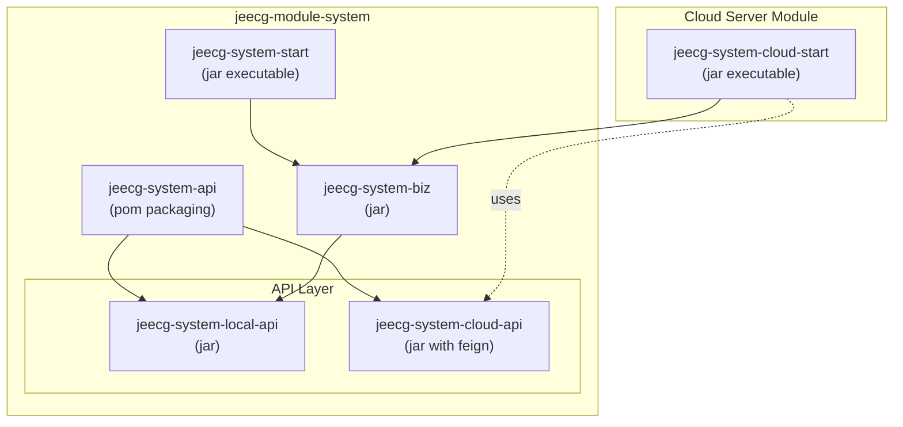
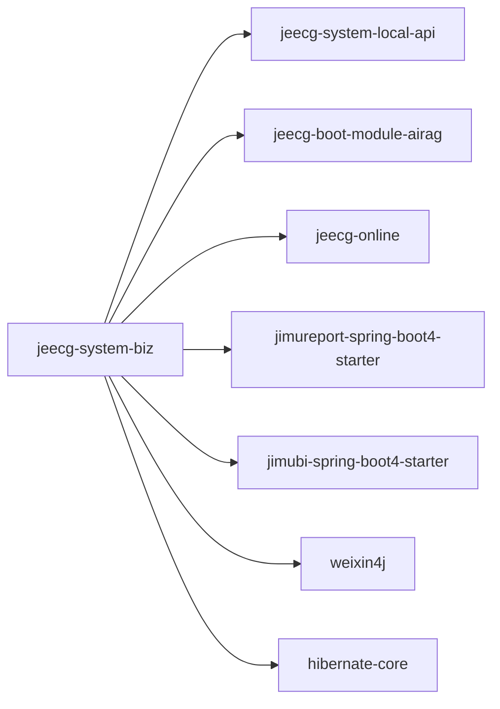
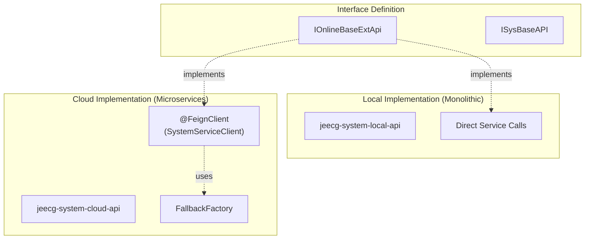

<!-- source: DeepWiki mcp.deepwiki.com · repo jeecgboot/JeecgBoot · extra page System Module Organization · fetched 2026-10-29 -->

# System Module Organization

Relevant source files

The following files were used as context for generating this wiki page:

- [jeecg-boot/jeecg-boot-base-core/src/main/java/org/jeecg/common/constant/enums/DepartCategoryEnum.java](jeecg-boot/jeecg-boot-base-core/src/main/java/org/jeecg/common/constant/enums/DepartCategoryEnum.java)
- [jeecg-boot/jeecg-boot-base-core/src/main/java/org/jeecg/common/constant/enums/PositionLevelEnum.java](jeecg-boot/jeecg-boot-base-core/src/main/java/org/jeecg/common/constant/enums/PositionLevelEnum.java)
- [jeecg-boot/jeecg-boot-base-core/src/main/java/org/jeecg/common/system/vo/LoginUser.java](jeecg-boot/jeecg-boot-base-core/src/main/java/org/jeecg/common/system/vo/LoginUser.java)
- [jeecg-boot/jeecg-module-system/jeecg-system-api/jeecg-system-cloud-api/src/main/java/org/jeecg/common/online/api/IOnlineBaseExtApi.java](jeecg-boot/jeecg-module-system/jeecg-system-api/jeecg-system-cloud-api/src/main/java/org/jeecg/common/online/api/IOnlineBaseExtApi.java)
- [jeecg-boot/jeecg-module-system/jeecg-system-api/jeecg-system-cloud-api/src/main/java/org/jeecg/common/online/api/factory/OnlineBaseExtApiFallbackFactory.java](jeecg-boot/jeecg-module-system/jeecg-system-api/jeecg-system-cloud-api/src/main/java/org/jeecg/common/online/api/factory/OnlineBaseExtApiFallbackFactory.java)
- [jeecg-boot/jeecg-module-system/jeecg-system-api/jeecg-system-cloud-api/src/main/java/org/jeecg/common/online/api/fallback/OnlineBaseExtApiFallback.java](jeecg-boot/jeecg-module-system/jeecg-system-api/jeecg-system-cloud-api/src/main/java/org/jeecg/common/online/api/fallback/OnlineBaseExtApiFallback.java)
- [jeecg-boot/jeecg-module-system/jeecg-system-api/jeecg-system-cloud-api/src/main/java/org/jeecg/common/system/api/ISysBaseAPI.java](jeecg-boot/jeecg-module-system/jeecg-system-api/jeecg-system-cloud-api/src/main/java/org/jeecg/common/system/api/ISysBaseAPI.java)
- [jeecg-boot/jeecg-module-system/jeecg-system-api/jeecg-system-cloud-api/src/main/java/org/jeecg/common/system/api/fallback/SysBaseAPIFallback.java](jeecg-boot/jeecg-module-system/jeecg-system-api/jeecg-system-cloud-api/src/main/java/org/jeecg/common/system/api/fallback/SysBaseAPIFallback.java)
- [jeecg-boot/jeecg-module-system/jeecg-system-api/jeecg-system-local-api/src/main/java/org/jeecg/common/online/api/IOnlineBaseExtApi.java](jeecg-boot/jeecg-module-system/jeecg-system-api/jeecg-system-local-api/src/main/java/org/jeecg/common/online/api/IOnlineBaseExtApi.java)
- [jeecg-boot/jeecg-module-system/jeecg-system-api/jeecg-system-local-api/src/main/java/org/jeecg/common/system/api/ISysBaseAPI.java](jeecg-boot/jeecg-module-system/jeecg-system-api/jeecg-system-local-api/src/main/java/org/jeecg/common/system/api/ISysBaseAPI.java)
- [jeecg-boot/jeecg-module-system/jeecg-system-biz/pom.xml](jeecg-boot/jeecg-module-system/jeecg-system-biz/pom.xml)
- [jeecg-boot/jeecg-module-system/jeecg-system-biz/src/main/java/org/jeecg/config/jimureport/JimuDragExternalServiceImpl.java](jeecg-boot/jeecg-module-system/jeecg-system-biz/src/main/java/org/jeecg/config/jimureport/JimuDragExternalServiceImpl.java)
- [jeecg-boot/jeecg-module-system/jeecg-system-biz/src/main/java/org/jeecg/config/jimureport/JimuReportTokenService.java](jeecg-boot/jeecg-module-system/jeecg-system-biz/src/main/java/org/jeecg/config/jimureport/JimuReportTokenService.java)
- [jeecg-boot/jeecg-module-system/jeecg-system-biz/src/main/java/org/jeecg/modules/api/controller/SystemApiController.java](jeecg-boot/jeecg-module-system/jeecg-system-biz/src/main/java/org/jeecg/modules/api/controller/SystemApiController.java)
- [jeecg-boot/jeecg-module-system/jeecg-system-biz/src/main/java/org/jeecg/modules/system/controller/SysDepartRoleController.java](jeecg-boot/jeecg-module-system/jeecg-system-biz/src/main/java/org/jeecg/modules/system/controller/SysDepartRoleController.java)
- [jeecg-boot/jeecg-module-system/jeecg-system-biz/src/main/java/org/jeecg/modules/system/controller/SysUserController.java](jeecg-boot/jeecg-module-system/jeecg-system-biz/src/main/java/org/jeecg/modules/system/controller/SysUserController.java)
- [jeecg-boot/jeecg-module-system/jeecg-system-biz/src/main/java/org/jeecg/modules/system/service/ISysAnnouncementService.java](jeecg-boot/jeecg-module-system/jeecg-system-biz/src/main/java/org/jeecg/modules/system/service/ISysAnnouncementService.java)
- [jeecg-boot/jeecg-module-system/jeecg-system-biz/src/main/java/org/jeecg/modules/system/service/impl/SysUserServiceImpl.java](jeecg-boot/jeecg-module-system/jeecg-system-biz/src/main/java/org/jeecg/modules/system/service/impl/SysUserServiceImpl.java)
- [jeecg-boot/jeecg-module-system/jeecg-system-start/pom.xml](jeecg-boot/jeecg-module-system/jeecg-system-start/pom.xml)
- [jeecg-boot/jeecg-module-system/jeecg-system-start/src/test/java/org/jeecg/modules/system/test/SysUserApiTest.java](jeecg-boot/jeecg-module-system/jeecg-system-start/src/test/java/org/jeecg/modules/system/test/SysUserApiTest.java)
- [jeecg-boot/jeecg-server-cloud/jeecg-visual/jeecg-cloud-test/jeecg-cloud-test-more/pom.xml](jeecg-boot/jeecg-server-cloud/jeecg-visual/jeecg-cloud-test/jeecg-cloud-test-more/pom.xml)

## Purpose and Scope

This document describes the internal structure of the `jeecg-module-system` module, which provides core system management functionality including user management, role-based access control (RBAC), menu management, organization structures, data dictionaries, and system configuration. The module is architected to support **dual deployment modes** (monolithic and microservices) through a carefully designed module hierarchy and API abstraction layer.

For information about the base-core utilities that system modules depend on, see [Core Framework & Base Components](#2.2.1). For microservices-specific infrastructure, see [Microservices Architecture](#2.4).

---

## Module Hierarchy

The `jeecg-module-system` follows a layered architecture with sub-modules that enable seamless switching between monolithic and microservices deployment.

**Maven Module Structure Diagram**

**Module Location in POM:**
- Parent modules defined in [jeecg-boot/jeecg-module-system/pom.xml:1-20]()
- Business logic artifact: `jeecg-system-biz` [jeecg-boot/jeecg-module-system/jeecg-system-biz/pom.xml:11]()
- Executable artifact: `jeecg-system-start` [jeecg-boot/jeecg-module-system/jeecg-system-start/pom.xml:12]()

**Sources:** [jeecg-boot/jeecg-module-system/pom.xml:1-20](), [jeecg-boot/jeecg-module-system/jeecg-system-biz/pom.xml:1-12](), [jeecg-boot/jeecg-module-system/jeecg-system-start/pom.xml:1-12]()

---

## Core Business Module: jeecg-system-biz

The `jeecg-system-biz` module contains all business logic for system management. It is deployment-mode agnostic and used by both monolithic and microservice startup modules.

### Module Responsibilities

| Responsibility | Implementation |
|----------------|----------------|
| **User Management** | User CRUD, authentication, and multi-tenant isolation [jeecg-boot/jeecg-module-system/jeecg-system-biz/src/main/java/org/jeecg/modules/system/controller/SysUserController.java:74-143]() |
| **RBAC Authorization** | Role management and permission assignment [jeecg-boot/jeecg-module-system/jeecg-system-biz/src/main/java/org/jeecg/modules/system/controller/SysDepartRoleController.java:44-215]() |
| **Organization Structure** | Department hierarchy and department-specific roles [jeecg-boot/jeecg-module-system/jeecg-system-biz/src/main/java/org/jeecg/modules/system/controller/SysDepartRoleController.java:183-190]() |
| **AI Integration** | AI model management and RAG capabilities via `jeecg-boot-module-airag` [jeecg-boot/jeecg-module-system/jeecg-system-biz/pom.xml:53-58]() |
| **Low-Code Integration** | Online form engine and code generation support [jeecg-boot/jeecg-module-system/jeecg-system-biz/pom.xml:23-25]() |
| **Report Integration** | JimuReport and JimuBI integration [jeecg-boot/jeecg-module-system/jeecg-system-biz/pom.xml:33-52]() |

### Key Dependencies

**jeecg-system-biz Dependency Diagram**

**Dependency Declarations:**
- `jeecg-system-local-api`: [jeecg-boot/jeecg-module-system/jeecg-system-biz/pom.xml:14-17]()
- `jeecg-online`: [jeecg-boot/jeecg-module-system/jeecg-system-biz/pom.xml:23-25]()
- `jimureport-spring-boot4-starter`: [jeecg-boot/jeecg-module-system/jeecg-system-biz/pom.xml:33-37]()
- `jeecg-boot-module-airag`: [jeecg-boot/jeecg-module-system/jeecg-system-biz/pom.xml:53-58]()

**Sources:** [jeecg-boot/jeecg-module-system/jeecg-system-biz/pom.xml:13-59]()

---

## API Layer Organization

The system module employs an abstraction layer to decouple the business logic from the communication protocol (Local vs. Feign).

### Dual API Interface Strategy

JeecgBoot uses the `IOnlineBaseExtApi` and `ISysBaseAPI` interfaces to provide system services to other modules.

**API Implementation Diagram**

**Key API Entities:**
- **Local API Interface:** [jeecg-boot/jeecg-module-system/jeecg-system-api/jeecg-system-local-api/src/main/java/org/jeecg/common/online/api/IOnlineBaseExtApi.java:14]()
- **Cloud Feign Interface:** [jeecg-boot/jeecg-module-system/jeecg-system-api/jeecg-system-cloud-api/src/main/java/org/jeecg/common/online/api/IOnlineBaseExtApi.java:25]()
- **Feign Fallback:** [jeecg-boot/jeecg-module-system/jeecg-system-api/jeecg-system-cloud-api/src/main/java/org/jeecg/common/online/api/fallback/OnlineBaseExtApiFallback.java:17]()
- **Fallback Factory:** [jeecg-boot/jeecg-module-system/jeecg-system-api/jeecg-system-cloud-api/src/main/java/org/jeecg/common/online/api/factory/OnlineBaseExtApiFallbackFactory.java:13]()

**Sources:** [jeecg-boot/jeecg-module-system/jeecg-system-api/jeecg-system-local-api/src/main/java/org/jeecg/common/online/api/IOnlineBaseExtApi.java:1-72](), [jeecg-boot/jeecg-module-system/jeecg-system-api/jeecg-system-cloud-api/src/main/java/org/jeecg/common/online/api/IOnlineBaseExtApi.java:1-89]()

---

## Startup Module: jeecg-system-start

The `jeecg-system-start` module is the entry point for the monolithic deployment.

### Module Configuration
- **Main Class:** `org.jeecg.JeecgSystemApplication` [jeecg-boot/jeecg-module-system/jeecg-system-start/pom.xml:65]()
- **Primary Dependency:** `jeecg-system-biz` [jeecg-boot/jeecg-module-system/jeecg-system-start/pom.xml:16-20]()
- **Database Migration:** Includes `flyway-core` for automated schema management [jeecg-boot/jeecg-module-system/jeecg-system-start/pom.xml:29-33]()

### Integration Testing
The startup module contains comprehensive integration tests for core system controllers like `SysUserController` using `MockMvc`.

**Key Test Class:** `SysUserApiTest` [jeecg-boot/jeecg-module-system/jeecg-system-start/src/test/java/org/jeecg/modules/system/test/SysUserApiTest.java:34]()
- **Test Methods:** `testQuery` [86-105](), `testAdd` [111-128](), `testEdit` [135-158](), `testDelete` [165-173]()

**Sources:** [jeecg-boot/jeecg-module-system/jeecg-system-start/pom.xml:1-71](), [jeecg-boot/jeecg-module-system/jeecg-system-start/src/test/java/org/jeecg/modules/system/test/SysUserApiTest.java:1-174]()

---

## External System Integration

The system module provides bridge services to integrate with third-party components like JimuReport.

### JimuReport Integration
- **Token Service:** `JimuReportTokenService` implements `JmReportTokenServiceI` to provide JWT-based authentication to the report engine [jeecg-boot/jeecg-module-system/jeecg-system-biz/src/main/java/org/jeecg/config/jimureport/JimuReportTokenService.java:32]().
- **Dictionary & Logging Bridge:** `JimuDragExternalServiceImpl` implements `IOnlDragExternalService` to allow the dashboard designer to access system dictionaries and logs [jeecg-boot/jeecg-module-system/jeecg-system-biz/src/main/java/org/jeecg/config/jimureport/JimuDragExternalServiceImpl.java:32]().

**Sources:** [jeecg-boot/jeecg-module-system/jeecg-system-biz/src/main/java/org/jeecg/config/jimureport/JimuReportTokenService.java:1-130](), [jeecg-boot/jeecg-module-system/jeecg-system-biz/src/main/java/org/jeecg/config/jimureport/JimuDragExternalServiceImpl.java:1-124]()

---

