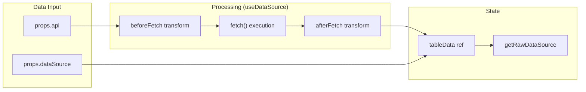

<!-- source: DeepWiki mcp.deepwiki.com · repo jeecgboot/JeecgBoot · extra page Table Components · fetched 2026-10-29 -->

# Table Components

<details>
<summary>Relevant source files</summary>

The following files were used as context for generating this wiki page:

- [jeecgboot-vue3/src/components/Form/src/components/ApiSelect.vue](jeecgboot-vue3/src/components/Form/src/components/ApiSelect.vue)
- [jeecgboot-vue3/src/components/Form/src/components/FormItem.vue](jeecgboot-vue3/src/components/Form/src/components/FormItem.vue)
- [jeecgboot-vue3/src/components/Form/src/jeecg/components/modal/UserSelectModal.vue](jeecgboot-vue3/src/components/Form/src/jeecg/components/modal/UserSelectModal.vue)
- [jeecgboot-vue3/src/components/Table/src/BasicTable.vue](jeecgboot-vue3/src/components/Table/src/BasicTable.vue)
- [jeecgboot-vue3/src/components/Table/src/hooks/useCustomSelection.tsx](jeecgboot-vue3/src/components/Table/src/hooks/useCustomSelection.tsx)
- [jeecgboot-vue3/src/components/Table/src/hooks/useDataSource.ts](jeecgboot-vue3/src/components/Table/src/hooks/useDataSource.ts)
- [jeecgboot-vue3/src/components/Table/src/hooks/useTableScroll.ts](jeecgboot-vue3/src/components/Table/src/hooks/useTableScroll.ts)
- [jeecgboot-vue3/src/components/Table/src/types/table.ts](jeecgboot-vue3/src/components/Table/src/types/table.ts)
- [jeecgboot-vue3/src/components/jeecg/JVxeTable/src/JVxeTable.ts](jeecgboot-vue3/src/components/jeecg/JVxeTable/src/JVxeTable.ts)
- [jeecgboot-vue3/src/components/jeecg/JVxeTable/src/hooks/useColumns.ts](jeecgboot-vue3/src/components/jeecg/JVxeTable/src/hooks/useColumns.ts)
- [jeecgboot-vue3/src/components/jeecg/JVxeTable/src/hooks/useData.ts](jeecgboot-vue3/src/components/jeecg/JVxeTable/src/hooks/useData.ts)
- [jeecgboot-vue3/src/components/jeecg/JVxeTable/src/hooks/useDataSource.ts](jeecgboot-vue3/src/components/jeecg/JVxeTable/src/hooks/useDataSource.ts)
- [jeecgboot-vue3/src/components/jeecg/JVxeTable/src/hooks/useDragSort.ts](jeecgboot-vue3/src/components/jeecg/JVxeTable/src/hooks/useDragSort.ts)
- [jeecgboot-vue3/src/components/jeecg/JVxeTable/src/hooks/useFinallyProps.ts](jeecgboot-vue3/src/components/jeecg/JVxeTable/src/hooks/useFinallyProps.ts)
- [jeecgboot-vue3/src/components/jeecg/JVxeTable/src/hooks/useMethods.ts](jeecgboot-vue3/src/components/jeecg/JVxeTable/src/hooks/useMethods.ts)
- [jeecgboot-vue3/src/components/jeecg/JVxeTable/src/install.ts](jeecgboot-vue3/src/components/jeecg/JVxeTable/src/install.ts)
- [jeecgboot-vue3/src/layouts/default/header/components/user-dropdown/DropMenuItem.vue](jeecgboot-vue3/src/layouts/default/header/components/user-dropdown/DropMenuItem.vue)
- [jeecgboot-vue3/src/layouts/default/header/components/user-dropdown/index.vue](jeecgboot-vue3/src/layouts/default/header/components/user-dropdown/index.vue)
- [jeecgboot-vue3/src/views/monitor/mynews/DetailModal.vue](jeecgboot-vue3/src/views/monitor/mynews/DetailModal.vue)
- [jeecgboot-vue3/src/views/system/appconfig/ThirdApp.api.ts](jeecgboot-vue3/src/views/system/appconfig/ThirdApp.api.ts)
- [jeecgboot-vue3/src/views/system/examples/demo/index.vue](jeecgboot-vue3/src/views/system/examples/demo/index.vue)
- [jeecgboot-vue3/src/views/system/notice/DetailModal.vue](jeecgboot-vue3/src/views/system/notice/DetailModal.vue)
- [jeecgboot-vue3/src/views/system/notice/NoticeModal.vue](jeecgboot-vue3/src/views/system/notice/NoticeModal.vue)
- [jeecgboot-vue3/src/views/system/notice/index.vue](jeecgboot-vue3/src/views/system/notice/index.vue)

</details>


Table components in JeecgBoot provide high-performance data grids for displaying, searching, and editing structured data. The framework primarily utilizes two specialized table implementations: **BasicTable** (based on Ant Design Vue) and **JVxeTable** (based on VXE Table).

## BasicTable Component

The `BasicTable` component is a comprehensive wrapper built on Ant Design Vue's Table component, providing enhanced functionality for data display, search, pagination, and dynamic column management.

### Component Architecture

`BasicTable` is structured as a multi-layered system with integrated search forms and a robust hook system.

```mermaid
graph TB
    subgraph "Main Component"
        BasicTable["BasicTable.vue"]
    end
    
    subgraph "Presentation Layer"
        AntTable["Table (Ant Design Vue)"]
        BasicForm["BasicForm (Search Area)"]
        HeaderCell["HeaderCell.vue"]
        TableSummary["TableSummary.ts"]
        CustomSelectHeader["CustomSelectHeader.vue"]
    end
    
    subgraph "Hook System"
        useDataSource["useDataSource.ts"]
        usePagination["usePagination.ts"]
        useColumns["useColumns.ts"]
        useCustomSelection["useCustomSelection.tsx"]
        useTableScroll["useTableScroll.ts"]
        useTableForm["useTableForm.ts"]
    end
    
    subgraph "Context & API"
        TableAction["TableActionType (Interface)"]
        TableContext["useTableContext.ts"]
    end
    
    BasicTable --> BasicForm
    BasicTable --> AntTable
    BasicTable --> useDataSource
    BasicTable --> usePagination
    BasicTable --> useColumns
    BasicTable --> useCustomSelection
    BasicTable --> useTableScroll
    BasicTable --> useTableForm
    BasicTable --> TableAction
    BasicTable --> TableContext
```



**Sources:** [jeecgboot-vue3/src/components/Table/src/BasicTable.vue:1-98](), [jeecgboot-vue3/src/components/Table/src/BasicTable.vue:119-255]()

### Data Flow & Source Management

The `useDataSource` hook manages the lifecycle of table data, including remote fetching via the `api` prop and local CRUD operations.



**Sources:** [jeecgboot-vue3/src/components/Table/src/BasicTable.vue:172-187](), [jeecgboot-vue3/src/components/Table/src/types/table.ts:176-187]()

### Automatic Height Calculation

The `useTableScroll` hook dynamically calculates the table's vertical scroll height (`y`) to ensure it fits within the viewport or parent container, especially when embedded in modals.

*   **Logic:** It subtracts the heights of the header, pagination, footer, and a custom `resizeHeightOffset` from the viewport offset of the table head [jeecgboot-vue3/src/components/Table/src/hooks/useTableScroll.ts:131-136]().
*   **Modal Integration:** If the table is inside an `.ant-modal-root`, it further subtracts the modal footer height to prevent overflow [jeecgboot-vue3/src/components/Table/src/hooks/useTableScroll.ts:140-148]().

**Sources:** [jeecgboot-vue3/src/components/Table/src/hooks/useTableScroll.ts:60-182]()

### Custom Selection System

To resolve performance issues with large datasets in Ant Design Vue, JeecgBoot implements `useCustomSelection`.

*   **Optimization:** It uses a custom checkbox column (`CustomSelectHeader`) instead of the standard row selection to reduce re-render overhead [jeecgboot-vue3/src/components/Table/src/BasicTable.vue:34-38]().
*   **Flattening:** It computes `flattedData` for tree tables to ensure selection logic correctly handles children nodes [jeecgboot-vue3/src/components/Table/src/hooks/useCustomSelection.tsx:49-65]().

**Sources:** [jeecgboot-vue3/src/components/Table/src/hooks/useCustomSelection.tsx:15-130]()

## JVxeTable (Editable Table)

`JVxeTable` is a high-performance editable table component based on `vxe-table`. It is designed for complex data entry scenarios, sub-tables, and large-scale data rendering using virtual scrolling.

### Implementation Overview

`JVxeTable` utilizes a composition of hooks to manage its internal state and configuration.

| Hook | Purpose |
| :--- | :--- |
| `useData` | Initializes basic state like `vxeDataSource`, `selectedRows`, and `statistics` [jeecgboot-vue3/src/components/jeecg/JVxeTable/src/hooks/useData.ts:7-99](). |
| `useFinallyProps` | Merges props, events, and edit rules into the final configuration passed to the `vxe-grid` [jeecgboot-vue3/src/components/jeecg/JVxeTable/src/hooks/useFinallyProps.ts:8-132](). |
| `useMethods` | Defines core methods for row manipulation (`addRows`, `removeRows`), validation, and event handling [jeecgboot-vue3/src/components/jeecg/JVxeTable/src/hooks/useMethods.ts:16-210](). |
| `useColumns` | Processes column definitions, including authorization checks and component type mapping [jeecgboot-vue3/src/components/jeecg/JVxeTable/src/hooks/useColumns.ts:26-118](). |

**Sources:** [jeecgboot-vue3/src/components/jeecg/JVxeTable/src/hooks/useData.ts](), [jeecgboot-vue3/src/components/jeecg/JVxeTable/src/hooks/useFinallyProps.ts]()

### Editable Configuration

The table supports cell-level editing with specific keyboard behaviors.

*   **Virtual Scrolling:** Automatically enabled for Y-axis when rows exceed 30 [jeecgboot-vue3/src/components/jeecg/JVxeTable/src/hooks/useData.ts:45-47]().
*   **Keyboard Support:** Includes `isTab`, `isArrow`, `isEnter`, and `isEdit` (any key enters edit mode) [jeecgboot-vue3/src/components/jeecg/JVxeTable/src/hooks/useData.ts:69-84]().
*   **Validation:** Supports `editRules` merged from component props and internal state [jeecgboot-vue3/src/components/jeecg/JVxeTable/src/hooks/useFinallyProps.ts:13]().

**Sources:** [jeecgboot-vue3/src/components/jeecg/JVxeTable/src/hooks/useData.ts:33-85](), [jeecgboot-vue3/src/components/jeecg/JVxeTable/src/hooks/useFinallyProps.ts:92-111]()

## Key Interfaces & Types

### TableActionType

The `TableActionType` interface defines the methods exposed by `BasicTable` via the `register` event.

```typescript
export interface TableActionType {
  reload: (opt?: FetchParams) => Promise<void>;
  getSelectRows: <T = Recordable>() => T[];
  setPagination: (info: Partial<PaginationProps>) => void;
  setTableData: <T = Recordable>(values: T[]) => void;
  updateTableDataRecord: (rowKey: string | number, record: Recordable) => Recordable | void;
  getColumns: (opt?: GetColumnsParams) => BasicColumn[];
  setProps: (props: Partial<BasicTableProps>) => void;
}
```

**Sources:** [jeecgboot-vue3/src/components/Table/src/types/table.ts:91-124]()

## Practical Example: BasicTable Integration

A typical implementation in a view (e.g., `demo/index.vue`) uses the `useTable` hook to register the component and define its API source and columns.

```typescript
const [registerTable, { reload, setProps }] = useTable({
  title: 'Example Table',
  api: getDemoList,
  columns: columns,
  useSearchForm: true,
  formConfig: {
    schemas: searchFormSchema,
  },
  rowKey: 'id',
  actionColumn: {
    width: 180,
    title: 'Action',
    dataIndex: 'action',
    slots: { customRender: 'action' },
  },
});
```

**Sources:** [jeecgboot-vue3/src/views/system/examples/demo/index.vue:112-153]()

---

