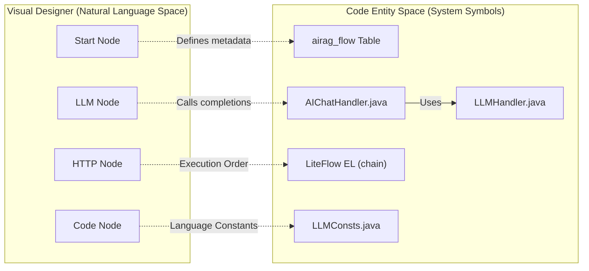
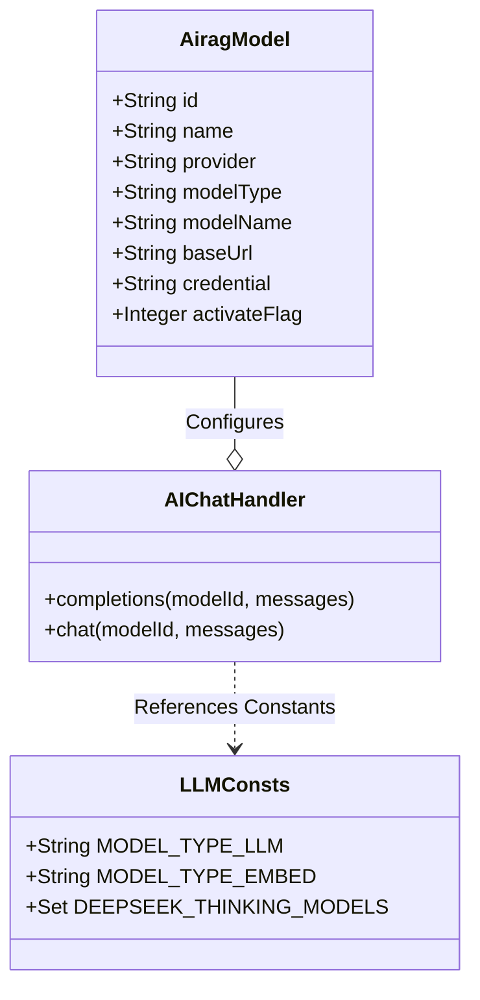

<!-- source: DeepWiki mcp.deepwiki.com · repo jeecgboot/JeecgBoot · extra page Workflow Node Types · fetched 2026-10-29 -->

# Workflow Node Types

Relevant source files

The following files were used as context for generating this wiki page:

- [jeecg-boot/UPGRADE-3.9.3.md](jeecg-boot/UPGRADE-3.9.3.md)
- [jeecg-boot/db/Dockerfile](jeecg-boot/db/Dockerfile)
- [jeecg-boot/db/jeecgboot-mysql-5.7.sql](jeecg-boot/db/jeecgboot-mysql-5.7.sql)
- [jeecg-boot/db/tables_xxl_job.sql](jeecg-boot/db/tables_xxl_job.sql)
- [jeecg-boot/jeecg-boot-module/jeecg-boot-module-airag/src/main/java/org/jeecg/modules/airag/app/controller/AiragChatController.java](jeecg-boot/jeecg-boot-module/jeecg-boot-module-airag/src/main/java/org/jeecg/modules/airag/app/controller/AiragChatController.java)
- [jeecg-boot/jeecg-boot-module/jeecg-boot-module-airag/src/main/java/org/jeecg/modules/airag/app/service/IAiragChatService.java](jeecg-boot/jeecg-boot-module/jeecg-boot-module-airag/src/main/java/org/jeecg/modules/airag/app/service/IAiragChatService.java)
- [jeecg-boot/jeecg-boot-module/jeecg-boot-module-airag/src/main/java/org/jeecg/modules/airag/llm/consts/LLMConsts.java](jeecg-boot/jeecg-boot-module/jeecg-boot-module-airag/src/main/java/org/jeecg/modules/airag/llm/consts/LLMConsts.java)
- [jeecg-boot/jeecg-boot-module/jeecg-boot-module-airag/src/main/java/org/jeecg/modules/airag/llm/controller/AiragModelController.java](jeecg-boot/jeecg-boot-module/jeecg-boot-module-airag/src/main/java/org/jeecg/modules/airag/llm/controller/AiragModelController.java)
- [jeecg-boot/jeecg-boot-module/jeecg-boot-module-airag/src/main/java/org/jeecg/modules/airag/llm/entity/AiragModel.java](jeecg-boot/jeecg-boot-module/jeecg-boot-module-airag/src/main/java/org/jeecg/modules/airag/llm/entity/AiragModel.java)
- [jeecg-boot/jeecg-boot-module/jeecg-boot-module-airag/src/main/java/org/jeecg/modules/airag/llm/handler/AIChatHandler.java](jeecg-boot/jeecg-boot-module/jeecg-boot-module-airag/src/main/java/org/jeecg/modules/airag/llm/handler/AIChatHandler.java)
- [jeecg-boot/jeecg-boot-module/jeecg-boot-module-airag/src/main/java/org/jeecg/modules/airag/llm/handler/JeecgToolsProvider.java](jeecg-boot/jeecg-boot-module/jeecg-boot-module-airag/src/main/java/org/jeecg/modules/airag/llm/handler/JeecgToolsProvider.java)
- [jeecg-boot/jeecg-module-system/jeecg-system-start/src/main/resources/flyway/sql/mysql/V3.9.0_0__all_upgrade.sql](jeecg-boot/jeecg-module-system/jeecg-system-start/src/main/resources/flyway/sql/mysql/V3.9.0_0__all_upgrade.sql)
- [jeecg-boot/jeecg-module-system/jeecg-system-start/src/main/resources/flyway/sql/mysql/V3.9.1_0__all_upgrade.sql](jeecg-boot/jeecg-module-system/jeecg-system-start/src/main/resources/flyway/sql/mysql/V3.9.1_0__all_upgrade.sql)
- [jeecg-boot/jeecg-server-cloud/jeecg-visual/jeecg-cloud-xxljob/doc/db/tables_xxl_job.sql](jeecg-boot/jeecg-server-cloud/jeecg-visual/jeecg-cloud-xxljob/doc/db/tables_xxl_job.sql)
- [jeecgboot-vue3/src/views/super/airag/aimodel/components/model.json](jeecgboot-vue3/src/views/super/airag/aimodel/components/model.json)

This document provides a comprehensive reference for all node types available in the JeecgBoot AI Flow orchestration system. Each node type serves a specific function in building AI-powered workflows that process user queries, interact with language models, retrieve knowledge, execute business logic, and integrate with external systems.

For information about the flow execution engine and event system, see [Flow Execution & Event System](#3.4.2). For the overall AI Flow architecture, see [AI Flow Orchestration](#3.4).

---

## Node Type Overview

The AI Flow system provides 11 distinct node types that can be combined to create sophisticated AI applications. Nodes are connected in a directed graph structure using LiteFlow's chain syntax, with each node performing a specific task and passing data to subsequent nodes.

### Natural Language to Code Entity Mapping

The following diagram bridges the gap between the visual flow designer concepts and the underlying Java classes and database structures.

**Sources:** [jeecg-boot/jeecg-boot-module/jeecg-boot-module-airag/src/main/java/org/jeecg/modules/airag/llm/handler/AIChatHandler.java:50-65](), [jeecg-boot/db/jeecgboot-mysql-5.7.sql:66-96]()

---

## Core Flow Control Nodes

### Start Node
The Start Node is the mandatory entry point for every workflow. It defines the input parameters that the flow accepts and initializes the execution context.

**Node Type:** `start-node` (reserved identifier)

**Configuration Structure:**
| Property | Type | Description |
|----------|------|-------------|
| `inputParams` | Array | List of input parameter definitions |
| `inputParams[].field` | String | Parameter field name |
| `inputParams[].name` | String | Display name |
| `inputParams[].type` | String | Data type: `string`, `string[]`, `picture`, etc. |
| `inputParams[].required` | Boolean | Whether parameter is mandatory |

**Sources:** [jeecg-boot/db/jeecgboot-mysql-5.7.sql:88-96]()

### End Node
The End Node terminates workflow execution and defines the output returned to the caller. Multiple end nodes can exist in a single flow to handle different execution paths.

**Node Type:** `end`

**Sources:** [jeecg-boot/db/jeecgboot-mysql-5.7.sql:89-96]()

### Switch Node
The Switch Node implements conditional branching logic, routing execution to different paths based on field comparisons and logical operators.

**Node Type:** `switch`

**Sources:** [jeecg-boot/db/jeecgboot-mysql-5.7.sql:88-96]()

---

## AI & LLM Nodes

### LLM Node
The LLM Node executes language model inference using configured messages and model parameters. It supports multiple LLM providers and streaming responses.

**Node Type:** `llm`

**Configuration Structure:**
| Property | Type | Description |
|----------|------|-------------|
| `model.modeId` | String | Model ID from `airag_model` table |
| `model.params.model` | String | Model name/provider |
| `model.params.temperature` | Number | Sampling temperature (0-1) |
| `history` | Integer | Number of conversation history messages |
| `messages` | Array | Message template array |

**DeepSeek Specific Logic:**
For DeepSeek models (e.g., `deepseek-reasoner`, `deepseek-v4-flash`), the system handles reasoning content via `injectThinkingPlaceholderIfNeeded` to ensure `reasoning_content` is passed back in multi-turn tool calls [jeecg-boot/jeecg-boot-module/jeecg-boot-module-airag/src/main/java/org/jeecg/modules/airag/llm/handler/AIChatHandler.java:122-124]().

**Sources:** [jeecg-boot/jeecg-boot-module/jeecg-boot-module-airag/src/main/java/org/jeecg/modules/airag/llm/handler/AIChatHandler.java:120-143](), [jeecg-boot/jeecg-boot-module/jeecg-boot-module-airag/src/main/java/org/jeecg/modules/airag/llm/consts/LLMConsts.java:108-112]()

### Knowledge Node
The Knowledge Node performs RAG (Retrieval Augmented Generation) by querying knowledge bases and returning relevant document chunks.

**Node Type:** `knowledge`

**Implementation Detail:**
Uses `EmbeddingHandler` to generate vectors for the query and searches the configured knowledge bases [jeecg-boot/jeecg-boot-module/jeecg-boot-module-airag/src/main/java/org/jeecg/modules/airag/llm/handler/AIChatHandler.java:59-62]().

**Sources:** [jeecg-boot/jeecg-boot-module/jeecg-boot-module-airag/src/main/java/org/jeecg/modules/airag/llm/consts/LLMConsts.java:138-145](), [jeecg-boot/db/jeecgboot-mysql-5.7.sql:91]()

### Classifier Node
The Classifier Node uses AI to categorize user input into predefined categories, routing execution based on classification results.

**Node Type:** `classifier`

**Sources:** [jeecg-boot/db/jeecgboot-mysql-5.7.sql:90]()

---

## Integration & Execution Nodes

### HTTP Node
The HTTP Node makes HTTP/HTTPS requests to external services, supporting all standard HTTP methods and authentication schemes.

**Node Type:** `http`

**Sources:** [jeecg-boot/db/jeecgboot-mysql-5.7.sql:97]()

### Code Node
The Code Node executes custom scripts in multiple programming languages within the workflow.

**Supported Languages (LLMConsts):**
The system supports `javascript`, `groovy`, `python`, `aviator`, and `kotlin` [jeecg-boot/db/jeecgboot-mysql-5.7.sql:92, 95]().

**Sources:** [jeecg-boot/db/jeecgboot-mysql-5.7.sql:92]()

### Java Enhancement Node
The Java Enhancement Node invokes Spring-managed service beans, enabling direct integration with the application's business logic layer.

**Node Type:** `enhanceJava`

**Sources:** [jeecg-boot/db/jeecgboot-mysql-5.7.sql:93]()

### Subflow Node
The Subflow Node executes another complete workflow as a nested component, enabling modular and reusable flow design.

**Node Type:** `subflow`

**Sources:** [jeecg-boot/db/jeecgboot-mysql-5.7.sql:94]()

---

## Communication Nodes

### Reply Node
The Reply Node sends an immediate response to the user without terminating the workflow, enabling progressive responses and long-running processes.

**Node Type:** `reply`

**Sources:** [jeecg-boot/db/jeecgboot-mysql-5.7.sql:96]()

---

## Data Model & Model Configuration

The workflow nodes rely on the model configurations defined in the `airag_model` table and the available providers.

### Model Entity Mapping

**Sources:** [jeecg-boot/jeecg-boot-module/jeecg-boot-module-airag/src/main/java/org/jeecg/modules/airag/llm/entity/AiragModel.java:35-131](), [jeecg-boot/jeecg-boot-module/jeecg-boot-module-airag/src/main/java/org/jeecg/modules/airag/llm/handler/AIChatHandler.java:50-65](), [jeecg-boot/jeecg-boot-module/jeecg-boot-module-airag/src/main/java/org/jeecg/modules/airag/llm/consts/LLMConsts.java:34-44]()

### Supported Providers & Models
Configuration for LLM and Embedding models is maintained in `model.json`. Key providers include:
- **Anthropic:** `claude-3-5-sonnet`, `claude-3-opus` [jeecgboot-vue3/src/views/super/airag/aimodel/components/model.json:4-15]()
- **DeepSeek:** `deepseek-v4-pro`, `deepseek-v4-flash` [jeecgboot-vue3/src/views/super/airag/aimodel/components/model.json:21-31]()
- **OpenAI:** `gpt-4o`, `gpt-4-turbo`, `text-embedding-3-large` [jeecgboot-vue3/src/views/super/airag/aimodel/components/model.json:72-93]()
- **Ollama:** Local models like `llama3`, `qwen2.5`, `nomic-embed-text` [jeecgboot-vue3/src/views/super/airag/aimodel/components/model.json:34-65]()

**Sources:** [jeecgboot-vue3/src/views/super/airag/aimodel/components/model.json:1-100]()

---

## Node Configuration Patterns

### Variable Interpolation
All text-based configuration fields support variable interpolation using `{{variableName}}` syntax. These variables reference input parameters from the `start-node` or output fields from previous nodes.

### LiteFlow Chain Syntax
Workflows are orchestrated using LiteFlow EL stored in `airag_flow.chain`.
- **Sequential:** `THEN(node1, node2)`
- **Conditional:** `SWITCH(classifier).to(nodeA, nodeB)`
- **Tagging:** Each node is identified by a tag, e.g., `llm.tag('node-id')`

**Sources:** [jeecg-boot/db/jeecgboot-mysql-5.7.sql:78]()

---

