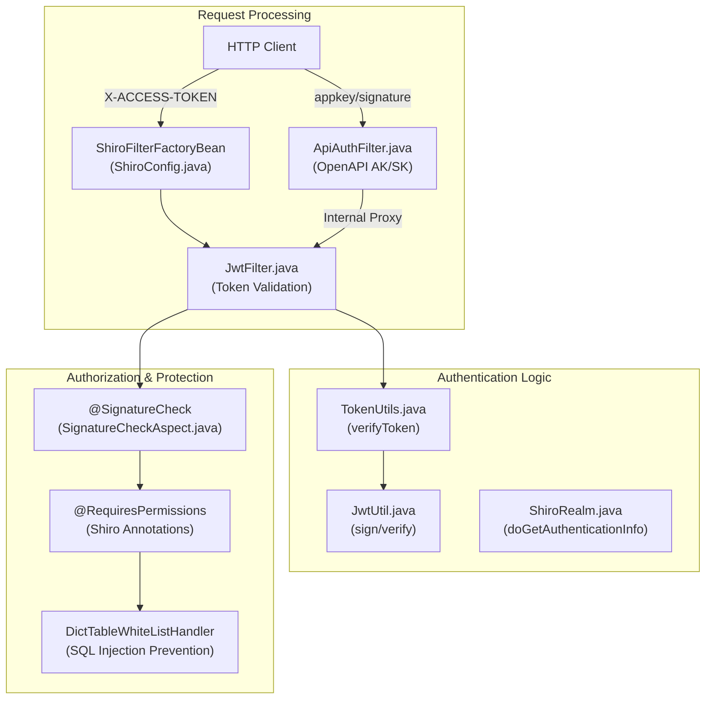
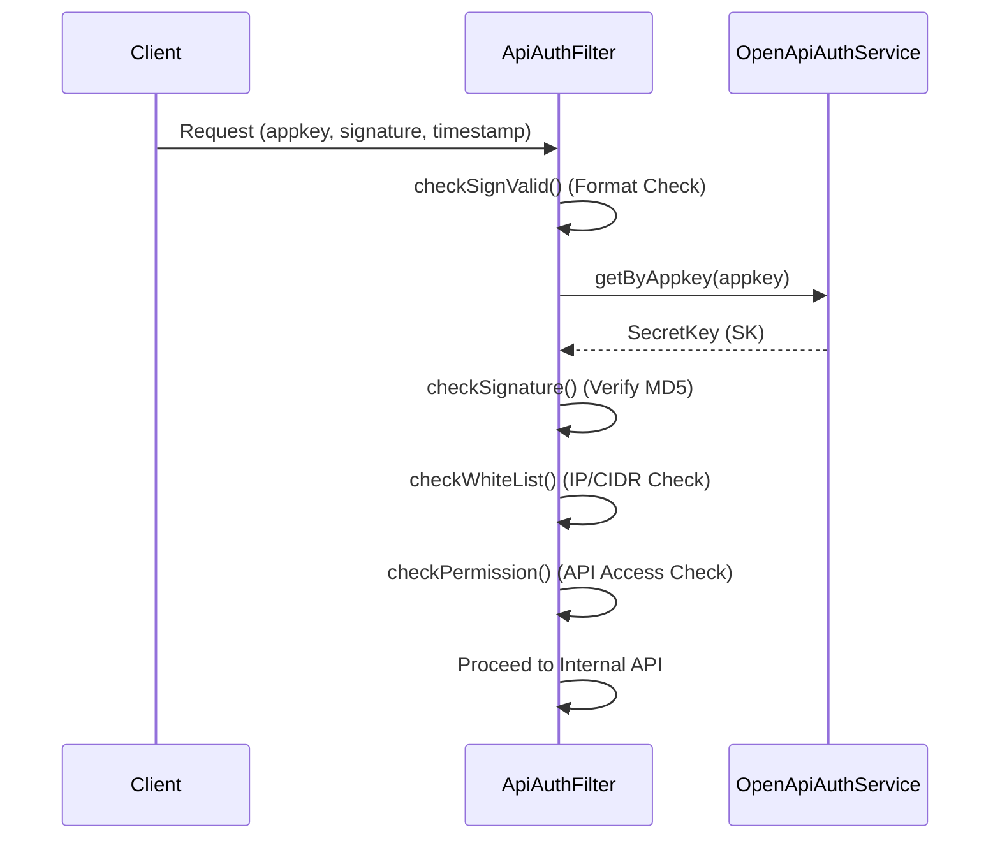

<!-- source: DeepWiki mcp.deepwiki.com · repo jeecgboot/JeecgBoot · extra page API Security & Authorization · fetched 2026-10-29 -->

# API Security & Authorization

Relevant source files

The following files were used as context for generating this wiki page:

- [jeecg-boot/jeecg-boot-base-core/src/main/java/org/jeecg/config/sign/annotation/SignatureCheck.java](jeecg-boot/jeecg-boot-base-core/src/main/java/org/jeecg/config/sign/annotation/SignatureCheck.java)
- [jeecg-boot/jeecg-boot-base-core/src/main/java/org/jeecg/config/sign/aspect/SignatureCheckAspect.java](jeecg-boot/jeecg-boot-base-core/src/main/java/org/jeecg/config/sign/aspect/SignatureCheckAspect.java)
- [jeecg-boot/jeecg-boot-base-core/src/main/java/org/jeecg/config/sign/interceptor/SignAuthInterceptor.java](jeecg-boot/jeecg-boot-base-core/src/main/java/org/jeecg/config/sign/interceptor/SignAuthInterceptor.java)
- [jeecg-boot/jeecg-module-system/jeecg-system-biz/src/main/java/org/jeecg/modules/openapi/controller/OpenApiPermissionController.java](jeecg-boot/jeecg-module-system/jeecg-system-biz/src/main/java/org/jeecg/modules/openapi/controller/OpenApiPermissionController.java)
- [jeecg-boot/jeecg-module-system/jeecg-system-biz/src/main/java/org/jeecg/modules/openapi/entity/OpenApi.java](jeecg-boot/jeecg-module-system/jeecg-system-biz/src/main/java/org/jeecg/modules/openapi/entity/OpenApi.java)
- [jeecg-boot/jeecg-module-system/jeecg-system-biz/src/main/java/org/jeecg/modules/openapi/entity/OpenApiHeader.java](jeecg-boot/jeecg-module-system/jeecg-system-biz/src/main/java/org/jeecg/modules/openapi/entity/OpenApiHeader.java)
- [jeecg-boot/jeecg-module-system/jeecg-system-biz/src/main/java/org/jeecg/modules/openapi/entity/OpenApiParam.java](jeecg-boot/jeecg-module-system/jeecg-system-biz/src/main/java/org/jeecg/modules/openapi/entity/OpenApiParam.java)
- [jeecg-boot/jeecg-module-system/jeecg-system-biz/src/main/java/org/jeecg/modules/openapi/filter/ApiAuthFilter.java](jeecg-boot/jeecg-module-system/jeecg-system-biz/src/main/java/org/jeecg/modules/openapi/filter/ApiAuthFilter.java)
- [jeecg-boot/jeecg-module-system/jeecg-system-biz/src/main/java/org/jeecg/modules/openapi/service/OpenApiPermissionService.java](jeecg-boot/jeecg-module-system/jeecg-system-biz/src/main/java/org/jeecg/modules/openapi/service/OpenApiPermissionService.java)
- [jeecg-boot/jeecg-module-system/jeecg-system-biz/src/main/java/org/jeecg/modules/openapi/service/impl/OpenApiPermissionServiceImpl.java](jeecg-boot/jeecg-module-system/jeecg-system-biz/src/main/java/org/jeecg/modules/openapi/service/impl/OpenApiPermissionServiceImpl.java)
- [jeecg-boot/jeecg-module-system/jeecg-system-biz/src/main/java/org/jeecg/modules/system/controller/SysTenantController.java](jeecg-boot/jeecg-module-system/jeecg-system-biz/src/main/java/org/jeecg/modules/system/controller/SysTenantController.java)

## Overview

This document describes JeecgBoot's comprehensive API security architecture, covering JWT token-based authentication, Shiro filter chain configuration, authorization mechanisms, and signature validation for both internal and external API access. The security system protects REST APIs through multiple layers including token validation, permission checks, and configurable access control.

JeecgBoot uses **Apache Shiro 2.0** with **JWT tokens** as the primary authentication mechanism. All API requests (except explicitly excluded paths) must include a valid `X-ACCESS-TOKEN` header. The system also supports signature-based authentication for OpenAPI external access via AK/SK credentials and method-level signature verification for high-security endpoints.

**Sources:** [jeecg-boot/jeecg-boot-base-core/src/main/java/org/jeecg/config/shiro/ShiroConfig.java:1-400](), [jeecg-boot/jeecg-boot-base-core/src/main/java/org/jeecg/config/shiro/filters/JwtFilter.java:1-200]()

---

## API Security Architecture

JeecgBoot implements a multi-layered security architecture with Shiro as the core security framework, JWT for stateless authentication, and fine-grained authorization controls.

### Security Component Interaction
The following diagram maps high-level security concepts to specific code entities within the JeecgBoot framework.

**Sources:** [jeecg-boot/jeecg-boot-base-core/src/main/java/org/jeecg/config/shiro/ShiroConfig.java:44-205](), [jeecg-boot/jeecg-boot-base-core/src/main/java/org/jeecg/config/shiro/filters/JwtFilter.java:1-150](), [jeecg-boot/jeecg-module-system/jeecg-system-biz/src/main/java/org/jeecg/modules/openapi/filter/ApiAuthFilter.java:30-73]()

---

## JWT Token Authentication

JeecgBoot uses JWT (JSON Web Token) as the primary authentication mechanism. The `JwtFilter` intercepts requests to validate the token provided in the `X-ACCESS-TOKEN` header.

### Token Validation Flow
1. **Extraction**: `JwtFilter.getRequestToken()` extracts the token from the header `X-ACCESS-TOKEN`, query parameter `token`, or request parameter `token` [jeecg-boot/jeecg-boot-base-core/src/main/java/org/jeecg/config/shiro/filters/JwtFilter.java:82-95]().
2. **Verification**: `TokenUtils.verifyToken()` calls `JwtUtil.verify()` to check the cryptographic signature and expiration [jeecg-boot/jeecg-boot-base-core/src/main/java/org/jeecg/common/util/TokenUtils.java:20-65]().
3. **Redis Check**: The filter verifies if the token exists in Redis to support token invalidation (e.g., on logout) [jeecg-boot/jeecg-boot-base-core/src/main/java/org/jeecg/common/util/TokenUtils.java:55-60]().

**Sources:** [jeecg-boot/jeecg-boot-base-core/src/main/java/org/jeecg/common/system/util/JwtUtil.java:1-150](), [jeecg-boot/jeecg-boot-base-core/src/main/java/org/jeecg/config/shiro/filters/JwtFilter.java:35-120]()

---

## Signature-Based Validation

JeecgBoot provides two distinct signature validation mechanisms: one for external OpenAPI calls and one for method-level security using AOP.

### 1. Method-Level Signature Verification (@SignatureCheck)
For high-security internal APIs, the `@SignatureCheck` annotation can be applied to controller methods [jeecg-boot/jeecg-boot-base-core/src/main/java/org/jeecg/config/sign/annotation/SignatureCheck.java:16-18]().

- **Aspect Implementation**: `SignatureCheckAspect` intercepts methods marked with the annotation [jeecg-boot/jeecg-boot-base-core/src/main/java/org/jeecg/config/sign/aspect/SignatureCheckAspect.java:42-50]().
- **Logic**: It delegates to `SignAuthInterceptor.validateSignature()`, which checks the `X-SIGN` and `X-TIMESTAMP` headers [jeecg-boot/jeecg-boot-base-core/src/main/java/org/jeecg/config/sign/aspect/SignatureCheckAspect.java:89-91]().
- **Replay Protection**: The system enforces a 5-minute validity window for the timestamp [jeecg-boot/jeecg-boot-base-core/src/main/java/org/jeecg/config/sign/interceptor/SignAuthInterceptor.java:32-32]().

### 2. OpenAPI External Authentication (AK/SK)
External clients access APIs via `/openapi/call/**` using an `appkey` and a calculated `signature` [jeecg-boot/jeecg-module-system/jeecg-system-biz/src/main/java/org/jeecg/modules/openapi/filter/ApiAuthFilter.java:45-47]().

**IP White-listing**: The `ApiAuthFilter` supports advanced IP matching, including exact IPs, CIDR blocks (e.g., `192.168.1.0/24`), and wildcards (e.g., `10.2.3.*`) [jeecg-boot/jeecg-module-system/jeecg-system-biz/src/main/java/org/jeecg/modules/openapi/filter/ApiAuthFilter.java:109-126]().

**Sources:** [jeecg-boot/jeecg-boot-base-core/src/main/java/org/jeecg/config/sign/interceptor/SignAuthInterceptor.java:70-134](), [jeecg-boot/jeecg-module-system/jeecg-system-biz/src/main/java/org/jeecg/modules/openapi/filter/ApiAuthFilter.java:38-73]()

---

## Excluded Paths Configuration

Not all endpoints require authentication. The `ShiroConfig` defines an "anonymous" (`anon`) list for public resources.

| Path Pattern | Purpose |
|:---|:---|
| `/sys/login`, `/sys/logout` | Authentication endpoints |
| `/sys/randomImage/**` | Captcha image generation |
| `/sys/checkCaptcha` | Captcha verification |
| `/sys/common/static/**` | Static file access |
| `/doc.html`, `/swagger-ui/**` | API Documentation (Swagger/Knife4j) |
| `/**/*.js`, `/**/*.css` | Static frontend assets |

**Sources:** [jeecg-boot/jeecg-boot-base-core/src/main/java/org/jeecg/config/shiro/ShiroConfig.java:89-130]()

---

## SQL Injection Prevention

To prevent SQL injection in dynamic queries (like dictionary lookups), JeecgBoot uses a table and field whitelist.

- **Handler**: `DictTableWhiteListHandlerImpl` validates table and field names against the `sys_table_white_list` table [jeecg-boot/jeecg-module-system/jeecg-system-biz/src/main/java/org/jeecg/config/firewall/SqlInjection/impl/DictTableWhiteListHandlerImpl.java:145-197]().
- **Modes**: 
    - `dev`: Automatically adds new tables/fields to the whitelist for easier development.
    - `prod`: Strictly rejects any query not explicitly whitelisted.

**Sources:** [jeecg-boot/jeecg-module-system/jeecg-system-biz/src/main/java/org/jeecg/config/firewall/SqlInjection/impl/DictTableWhiteListHandlerImpl.java:1-200]()

---

## Security Exception Handling

Security violations are caught by the `JeecgBootExceptionHandler` to provide standardized error responses.

- **401 Unauthorized**: Handled for `JeecgBoot401Exception` when tokens are invalid or expired [jeecg-boot/jeecg-boot-base-core/src/main/java/org/jeecg/common/exception/JeecgBootExceptionHandler.java:93-100]().
- **403 Forbidden**: Handled for Shiro's `UnauthorizedException` and `AuthorizationException` when a user lacks specific permissions [jeecg-boot/jeecg-boot-base-core/src/main/java/org/jeecg/common/exception/JeecgBootExceptionHandler.java:112-119]().

**Sources:** [jeecg-boot/jeecg-boot-base-core/src/main/java/org/jeecg/common/exception/JeecgBootExceptionHandler.java:90-120]()

---

