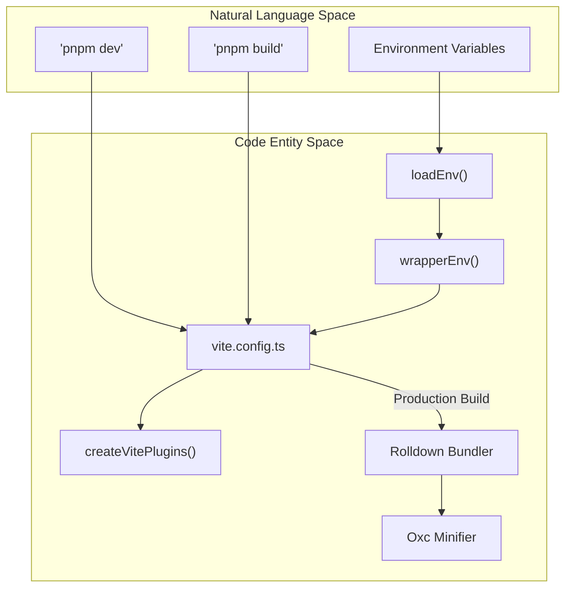
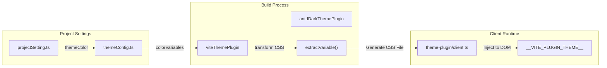

<!-- source: DeepWiki mcp.deepwiki.com · repo jeecgboot/JeecgBoot · extra page Build System & PWA Configuration · fetched 2026-10-29 -->

# Build System & PWA Configuration

Relevant source files

The following files were used as context for generating this wiki page:

- [jeecgboot-vue3/build/config/themeConfig.ts](jeecgboot-vue3/build/config/themeConfig.ts)
- [jeecgboot-vue3/build/vite/plugin/theme-plugin/antdDarkThemePlugin.ts](jeecgboot-vue3/build/vite/plugin/theme-plugin/antdDarkThemePlugin.ts)
- [jeecgboot-vue3/build/vite/plugin/theme-plugin/client/client.ts](jeecgboot-vue3/build/vite/plugin/theme-plugin/client/client.ts)
- [jeecgboot-vue3/build/vite/plugin/theme-plugin/client/colorUtils.ts](jeecgboot-vue3/build/vite/plugin/theme-plugin/client/colorUtils.ts)
- [jeecgboot-vue3/build/vite/plugin/theme-plugin/constants.ts](jeecgboot-vue3/build/vite/plugin/theme-plugin/constants.ts)
- [jeecgboot-vue3/build/vite/plugin/theme-plugin/index.ts](jeecgboot-vue3/build/vite/plugin/theme-plugin/index.ts)
- [jeecgboot-vue3/build/vite/plugin/theme-plugin/injectClientPlugin.ts](jeecgboot-vue3/build/vite/plugin/theme-plugin/injectClientPlugin.ts)
- [jeecgboot-vue3/build/vite/plugin/theme-plugin/preprocessor/less/index.ts](jeecgboot-vue3/build/vite/plugin/theme-plugin/preprocessor/less/index.ts)
- [jeecgboot-vue3/build/vite/plugin/theme-plugin/utils.ts](jeecgboot-vue3/build/vite/plugin/theme-plugin/utils.ts)
- [jeecgboot-vue3/build/vite/plugin/theme.ts](jeecgboot-vue3/build/vite/plugin/theme.ts)
- [jeecgboot-vue3/src/settings/projectSetting.ts](jeecgboot-vue3/src/settings/projectSetting.ts)
- [jeecgboot-vue3/src/utils/getConfigByMenuType.ts](jeecgboot-vue3/src/utils/getConfigByMenuType.ts)
- [jeecgboot-vue3/src/views/super/online/cgform/auto/comp/superquery/SuperQuery.vue](jeecgboot-vue3/src/views/super/online/cgform/auto/comp/superquery/SuperQuery.vue)
- [jeecgboot-vue3/types/config.d.ts](jeecgboot-vue3/types/config.d.ts)
- [jeecgboot-vue3/vite.config.ts](jeecgboot-vue3/vite.config.ts)

This document describes the Vite-based build system and Progressive Web App (PWA) implementation for the JeecgBoot Vue3 frontend. It covers build configuration, plugin architecture, code splitting strategies, and dynamic theme extraction.

---

## Build System Overview

JeecgBoot uses **Vite 6.x** as its build tool, leveraging the **Rolldown** bundler (via Vite 8 compatibility layers) and **Oxc** minifier for optimized production builds. The system is designed to support standard web deployments, Electron desktop wrappers, and Qiankun micro-frontend architectures.

### Configuration Entry Point

The main configuration is defined in [jeecgboot-vue3/vite.config.ts:22-192](). It uses a functional configuration pattern to handle environment-specific variables and build commands.

Sources: [jeecgboot-vue3/vite.config.ts:22-32](), [jeecgboot-vue3/vite.config.ts:165-172]()

---

## Build Configuration Details

### Code Splitting Strategy
JeecgBoot implements a functional `manualChunks` strategy to optimize vendor caching. This ensures that large libraries like Vue and Vue Router are bundled separately from application logic.

| Chunk Name | Included Packages | Source |
| :--- | :--- | :--- |
| `vue-vendor` | `vue`, `vue-router` | [jeecgboot-vue3/vite.config.ts:130-131]() |
| `emoji-mart-vue-fast` | `emoji-mart-vue-fast` | [jeecgboot-vue3/vite.config.ts:132]() |

### Path Aliases
The system uses standardized aliases to simplify imports and maintain directory independence.

| Alias | Target Directory | File Mapping |
| :--- | :--- | :--- |
| `/@/` | `src/` | [jeecgboot-vue3/vite.config.ts:71-72]() |
| `@/` | `src/` | [jeecgboot-vue3/vite.config.ts:80-81]() |
| `/#/` | `types/` | [jeecgboot-vue3/vite.config.ts:76-77]() |
| `#/` | `types/` | [jeecgboot-vue3/vite.config.ts:85-86]() |

### Optimization & Pre-bundling
Vite is configured to warm up critical files and explicitly include certain dependencies to prevent runtime "missing export" errors, especially when integrating with `@jeecg/aiflow`.

- **Warmup Files**: Includes `src/main.ts`, `src/App.vue`, and layout components to speed up initial dev server access [jeecgboot-vue3/vite.config.ts:99-106]().
- **Dependency Include**: Forces pre-bundling of `clipboard`, `@iconify/iconify`, and various `dayjs` plugins [jeecgboot-vue3/vite.config.ts:174-192]().

Sources: [jeecgboot-vue3/vite.config.ts:47-108](), [jeecgboot-vue3/vite.config.ts:165-192]()

---

## Dynamic Theme System

The build system includes a custom theme plugin architecture [jeecgboot-vue3/build/vite/plugin/theme.ts]() that extracts color variables and generates dynamic stylesheets for runtime theme switching.

### Theme Data Flow

### Key Components
1. **Theme Configuration**: Reads defaults from `projectSetting.ts` and generates color palettes using `@ant-design/colors` [jeecgboot-vue3/build/config/themeConfig.ts:1-24]().
2. **Variable Extraction**: The `extractVariable` function parses CSS blocks to find color matches and isolates them for dynamic replacement [jeecgboot-vue3/build/vite/plugin/theme-plugin/utils.ts:74-129]().
3. **Dark Mode Support**: `antdDarkThemePlugin` handles the transformation of Less variables into a dark-themed CSS bundle, typically targeting `[data-theme="dark"]` [jeecgboot-vue3/build/vite/plugin/theme-plugin/antdDarkThemePlugin.ts:45-47]().
4. **Client-side Replacement**: `replaceStyleVariables` fetches the extracted CSS and performs regex-based color replacement in the browser [jeecgboot-vue3/build/vite/plugin/theme-plugin/client/client.ts:58-83]().

Sources: [jeecgboot-vue3/build/vite/plugin/theme.ts:12-45](), [jeecgboot-vue3/build/vite/plugin/theme-plugin/index.ts:28-70](), [jeecgboot-vue3/build/vite/plugin/theme-plugin/client/client.ts:7-32]()

---

## PWA Implementation

The PWA configuration is managed via `vite-plugin-pwa` (referenced as `configPwaPlugin` in the build pipeline).

### Service Worker Strategy
JeecgBoot utilizes a Service Worker to provide offline capabilities and asset caching. The implementation focuses on:
- **Pre-caching**: Critical assets (HTML, JS, CSS) required for the initial shell.
- **Runtime Caching**: Dynamic resources and API responses.
- **Service Worker Registration**: Managed through `virtual:pwa-register/vue` types [jeecgboot-vue3/types/module.d.ts:18-34]().

### Client-side Interaction
The frontend interacts with the PWA lifecycle using the `useRegisterSW` hook, allowing the application to prompt users for updates or notify them when the app is ready for offline use [jeecgboot-vue3/types/module.d.ts:28-33]().

Sources: [jeecgboot-vue3/vite.config.ts:163](), [jeecgboot-vue3/types/module.d.ts:18-34]()

---

## Build Constants & Environment

The build system exposes metadata to the application via `__APP_INFO__`, which includes dependency versions and the timestamp of the last build [jeecgboot-vue3/vite.config.ts:17-20]().

| Variable | Description | Source |
| :--- | :--- | :--- |
| `__APP_INFO__` | JSON string containing `pkg` info and `lastBuildTime` | [jeecgboot-vue3/vite.config.ts:151]() |
| `OUTPUT_DIR` | The directory where build artifacts are placed | [jeecgboot-vue3/vite.config.ts:115]() |
| `VITE_PROXY` | Proxy configuration for the dev server | [jeecgboot-vue3/vite.config.ts:96]() |

Sources: [jeecgboot-vue3/vite.config.ts:1-20](), [jeecgboot-vue3/vite.config.ts:147-152]()

---

