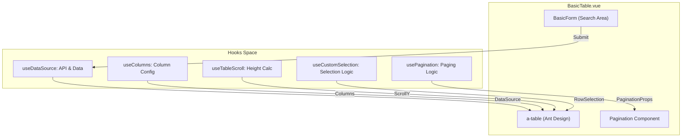
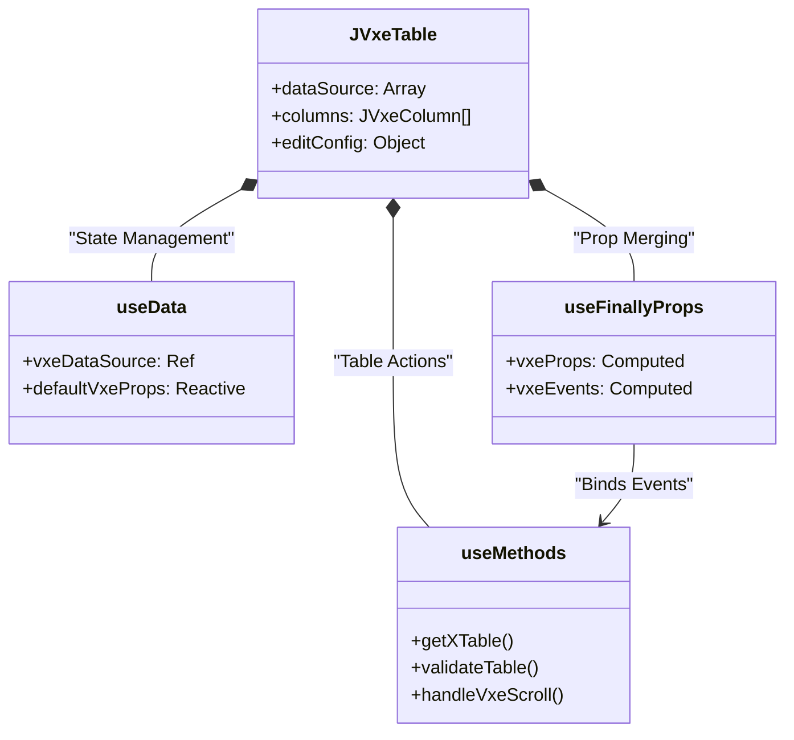

<!-- source: DeepWiki mcp.deepwiki.com · repo jeecgboot/JeecgBoot · extra page Component Library & UI Framework · fetched 2026-10-29 -->

# Component Library & UI Framework

<details>
<summary>Relevant source files</summary>

The following files were used as context for generating this wiki page:

- [jeecgboot-vue3/src/components/Form/src/components/ApiSelect.vue](jeecgboot-vue3/src/components/Form/src/components/ApiSelect.vue)
- [jeecgboot-vue3/src/components/Form/src/components/FormItem.vue](jeecgboot-vue3/src/components/Form/src/components/FormItem.vue)
- [jeecgboot-vue3/src/components/Form/src/jeecg/components/modal/UserSelectModal.vue](jeecgboot-vue3/src/components/Form/src/jeecg/components/modal/UserSelectModal.vue)
- [jeecgboot-vue3/src/components/Table/src/BasicTable.vue](jeecgboot-vue3/src/components/Table/src/BasicTable.vue)
- [jeecgboot-vue3/src/components/Table/src/hooks/useCustomSelection.tsx](jeecgboot-vue3/src/components/Table/src/hooks/useCustomSelection.tsx)
- [jeecgboot-vue3/src/components/Table/src/hooks/useDataSource.ts](jeecgboot-vue3/src/components/Table/src/hooks/useDataSource.ts)
- [jeecgboot-vue3/src/components/Table/src/hooks/useTableScroll.ts](jeecgboot-vue3/src/components/Table/src/hooks/useTableScroll.ts)
- [jeecgboot-vue3/src/components/Table/src/types/table.ts](jeecgboot-vue3/src/components/Table/src/types/table.ts)
- [jeecgboot-vue3/src/components/jeecg/JVxeTable/src/JVxeTable.ts](jeecgboot-vue3/src/components/jeecg/JVxeTable/src/JVxeTable.ts)
- [jeecgboot-vue3/src/components/jeecg/JVxeTable/src/hooks/useColumns.ts](jeecgboot-vue3/src/components/jeecg/JVxeTable/src/hooks/useColumns.ts)
- [jeecgboot-vue3/src/components/jeecg/JVxeTable/src/hooks/useData.ts](jeecgboot-vue3/src/components/jeecg/JVxeTable/src/hooks/useData.ts)
- [jeecgboot-vue3/src/components/jeecg/JVxeTable/src/hooks/useDataSource.ts](jeecgboot-vue3/src/components/jeecg/JVxeTable/src/hooks/useDataSource.ts)
- [jeecgboot-vue3/src/components/jeecg/JVxeTable/src/hooks/useDragSort.ts](jeecgboot-vue3/src/components/jeecg/JVxeTable/src/hooks/useDragSort.ts)
- [jeecgboot-vue3/src/components/jeecg/JVxeTable/src/hooks/useFinallyProps.ts](jeecgboot-vue3/src/components/jeecg/JVxeTable/src/hooks/useFinallyProps.ts)
- [jeecgboot-vue3/src/components/jeecg/JVxeTable/src/hooks/useMethods.ts](jeecgboot-vue3/src/components/jeecg/JVxeTable/src/hooks/useMethods.ts)
- [jeecgboot-vue3/src/components/jeecg/JVxeTable/src/install.ts](jeecgboot-vue3/src/components/jeecg/JVxeTable/src/install.ts)
- [jeecgboot-vue3/src/layouts/default/header/components/user-dropdown/DropMenuItem.vue](jeecgboot-vue3/src/layouts/default/header/components/user-dropdown/DropMenuItem.vue)
- [jeecgboot-vue3/src/layouts/default/header/components/user-dropdown/index.vue](jeecgboot-vue3/src/layouts/default/header/components/user-dropdown/index.vue)
- [jeecgboot-vue3/src/views/monitor/mynews/DetailModal.vue](jeecgboot-vue3/src/views/monitor/mynews/DetailModal.vue)
- [jeecgboot-vue3/src/views/system/appconfig/ThirdApp.api.ts](jeecgboot-vue3/src/views/system/appconfig/ThirdApp.api.ts)
- [jeecgboot-vue3/src/views/system/examples/demo/index.vue](jeecgboot-vue3/src/views/system/examples/demo/index.vue)
- [jeecgboot-vue3/src/views/system/notice/DetailModal.vue](jeecgboot-vue3/src/views/system/notice/DetailModal.vue)
- [jeecgboot-vue3/src/views/system/notice/NoticeModal.vue](jeecgboot-vue3/src/views/system/notice/NoticeModal.vue)
- [jeecgboot-vue3/src/views/system/notice/index.vue](jeecgboot-vue3/src/views/system/notice/index.vue)

</details>


This document describes the frontend component library and UI framework architecture in JeecgBoot. It covers the primary UI framework (Ant Design Vue 4), specialized table systems (BasicTable and VXE Table), and custom component development patterns.

---

## Overview

JeecgBoot's frontend uses a layered component architecture built on Vue 3, TypeScript, and Vite. It extends the base Ant Design Vue 4 library with high-level business components designed for rapid enterprise development.

**Key Layers**:
1.  **Base UI Framework**: Ant Design Vue 4 provides the fundamental building blocks (Buttons, Modals, Forms) [jeecgboot-vue3/package.json:32-38]().
2.  **Specialized Data Grids**: 
    *   `BasicTable`: A wrapper around Ant Design Table with integrated search forms and pagination [jeecgboot-vue3/src/components/Table/src/BasicTable.vue:1-56]().
    *   `JVxeTable`: Based on VXE Table for high-performance editable grids and virtual scrolling [jeecgboot-vue3/src/components/jeecg/JVxeTable/src/hooks/useData.ts:44-52]().
3.  **Form System**: `BasicForm` provides schema-driven form generation and `ApiSelect` for remote data binding [jeecgboot-vue3/src/components/Form/src/components/ApiSelect.vue:1-25]().
4.  **Monorepo Packages**: Domain-specific modules like `@jeecg/online` (Online coding) and `@jeecg/aiflow` (AI workflows) [jeecgboot-vue3/src/utils/monorepo/registerPackages.ts:1-50]().

---

## Core Component: BasicTable

The `BasicTable` is the primary data display component in JeecgBoot. It encapsulates complex logic for data fetching, pagination, and row selection.

### Architecture & Data Flow



**Key Implementation Details**:
*   **Auto-Height Calculation**: The `useTableScroll` hook dynamically calculates the table body height based on the viewport offset, subtracting headers, footers, and pagination height to ensure the table fits the screen [jeecgboot-vue3/src/components/Table/src/hooks/useTableScroll.ts:60-153]().
*   **Search Integration**: `BasicTable` optionally renders a `BasicForm` as a search area. Submitting this form triggers the `handleSearchInfoChange` function, which reloads the table data [jeecgboot-vue3/src/components/Table/src/BasicTable.vue:3-17]().
*   **Custom Selection**: To solve performance issues with large datasets, JeecgBoot implements `useCustomSelection`, which manages row keys and provides a custom header checkbox for "Select All" functionality [jeecgboot-vue3/src/components/Table/src/hooks/useCustomSelection.tsx:119-130]().

**Sources**: [jeecgboot-vue3/src/components/Table/src/BasicTable.vue:58-85](), [jeecgboot-vue3/src/components/Table/src/hooks/useTableScroll.ts:136-153](), [jeecgboot-vue3/src/components/Table/src/hooks/useCustomSelection.tsx:49-65]().

---

## Specialized Grid: JVxeTable

`JVxeTable` is used for scenarios requiring complex cell editing, massive data rendering (virtual scrolling), and keyboard navigation.

### System Entity Mapping



### Technical Features
*   **Virtual Scrolling**: Configured via `scrollY.gt` (default 30 rows), allowing the table to render thousands of rows smoothly [jeecgboot-vue3/src/components/jeecg/JVxeTable/src/hooks/useData.ts:44-47]().
*   **Prop Merging**: `useFinallyProps` merges user-provided props with default Jeecg settings (like `editConfig` and `keyboardConfig`) and event handlers [jeecgboot-vue3/src/components/jeecg/JVxeTable/src/hooks/useFinallyProps.ts:44-112]().
*   **Keyboard Support**: Supports `Esc` to close editing, `Tab` for navigation, and `Enter` to confirm changes [jeecgboot-vue3/src/components/jeecg/JVxeTable/src/hooks/useData.ts:69-84]().
*   **Validation**: Implements `validateTable` and `fullValidateTable` to check cell data against `editRules` [jeecgboot-vue3/src/components/jeecg/JVxeTable/src/hooks/useMethods.ts:48-49]().

**Sources**: [jeecgboot-vue3/src/components/jeecg/JVxeTable/src/hooks/useData.ts:16-85](), [jeecgboot-vue3/src/components/jeecg/JVxeTable/src/hooks/useFinallyProps.ts:8-41](), [jeecgboot-vue3/src/components/jeecg/JVxeTable/src/hooks/useMethods.ts:28-55]().

---

## Form Components & Remote Data

### ApiSelect Component
The `ApiSelect` component is a high-level wrapper around the Ant Design `Select`. It fetches its options directly from a backend API.

*   **Remote Fetching**: Accepts an `api` function (typically from a `.api.ts` file) and `params` [jeecgboot-vue3/src/components/Form/src/components/ApiSelect.vue:50-58]().
*   **Pagination Support**: Can handle paged dropdown data via `pageConfig`, allowing it to load more data as the user scrolls the popup [jeecgboot-vue3/src/components/Form/src/components/ApiSelect.vue:165-180]().
*   **Reactive Loading**: Uses `watchEffect` to trigger a fetch whenever the bound `value` or `params` change [jeecgboot-vue3/src/components/Form/src/components/ApiSelect.vue:135-153]().

**Sources**: [jeecgboot-vue3/src/components/Form/src/components/ApiSelect.vue:26-69](), [jeecgboot-vue3/src/components/Form/src/components/ApiSelect.vue:78-86]().

---

## Custom Component Development

### Global Registration Helper
JeecgBoot utilizes the `withInstall` utility to standardize component registration as Vue plugins.

```typescript
// src/utils/index.ts
export const withInstall = <T>(component: T, alias?: string) => {
  const comp = component as any;
  comp.install = (app: App) => {
    app.component(comp.name || comp.displayName, component);
    if (alias) {
      app.config.globalProperties[alias] = component;
    }
  };
  return component as T & Plugin;
};
```
**Sources**: [jeecgboot-vue3/src/utils/index.ts:186-198]().

### Development Workflow Example
A typical view (e.g., `system/examples/demo/index.vue`) demonstrates the integration of these components:

1.  **Table Registration**: Uses the `useTable` hook to configure `BasicTable` with an API, columns, and search form schemas [jeecgboot-vue3/src/views/system/examples/demo/index.vue:112-153]().
2.  **Modal Management**: Uses the `useModal` hook to register and control visibility of detail/edit modals [jeecgboot-vue3/src/views/system/examples/demo/index.vue:105-106]().
3.  **Action Columns**: Implements `TableAction` within the table's `#action` slot to provide row-level buttons (Edit, Delete) [jeecgboot-vue3/src/views/system/examples/demo/index.vue:80-82]().

**Sources**: [jeecgboot-vue3/src/views/system/examples/demo/index.vue:88-153]().

---

## Build Optimization

The UI framework is optimized via Vite's `manualChunks` to prevent monolithic bundles:
*   **Ant Design**: Grouped into `antd-vue-vendor` [jeecgboot-vue3/vite.config.ts:105]().
*   **VXE Table**: Grouped into `vxe-table-vendor` [jeecgboot-vue3/vite.config.ts:106]().
*   **Large Data**: `china-area-data` is isolated to its own chunk to avoid slowing down the main application load [jeecgboot-vue3/vite.config.ts:108]().

**Sources**: [jeecgboot-vue3/vite.config.ts:90-116]().

---

