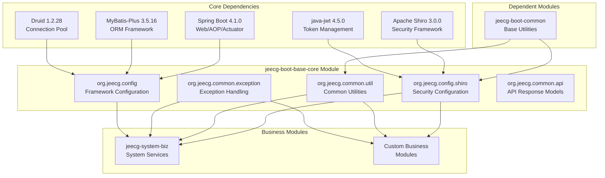
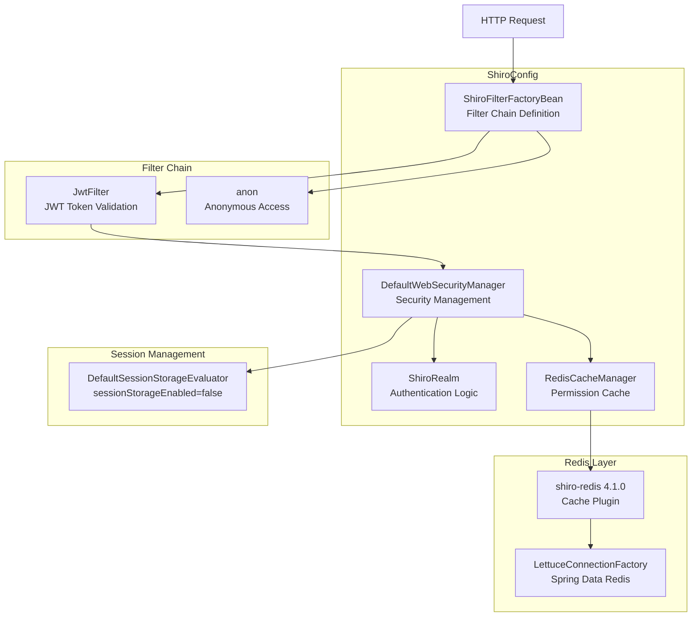
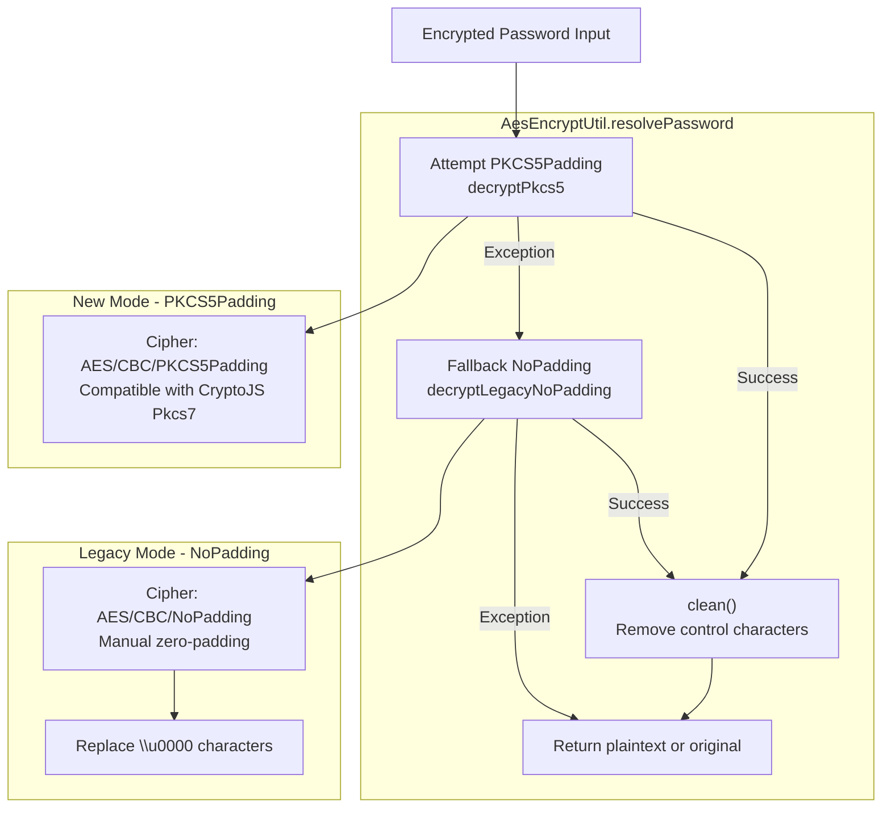

<!-- source: DeepWiki mcp.deepwiki.com · repo jeecgboot/JeecgBoot · extra page Core Framework & Base Components · fetched 2026-10-29 -->

# Core Framework & Base Components

Relevant source files

The following files were used as context for generating this wiki page:

- [jeecg-boot/jeecg-boot-base-core/pom.xml](jeecg-boot/jeecg-boot-base-core/pom.xml)
- [jeecg-boot/jeecg-boot-base-core/src/main/java/org/jeecg/common/system/util/JwtUtil.java](jeecg-boot/jeecg-boot-base-core/src/main/java/org/jeecg/common/system/util/JwtUtil.java)
- [jeecg-boot/jeecg-boot-base-core/src/main/java/org/jeecg/common/util/encryption/AesEncryptUtil.java](jeecg-boot/jeecg-boot-base-core/src/main/java/org/jeecg/common/util/encryption/AesEncryptUtil.java)
- [jeecg-boot/jeecg-boot-base-core/src/main/java/org/jeecg/common/util/oConvertUtils.java](jeecg-boot/jeecg-boot-base-core/src/main/java/org/jeecg/common/util/oConvertUtils.java)
- [jeecg-boot/jeecg-boot-base-core/src/main/java/org/jeecg/config/JeecgBaseConfig.java](jeecg-boot/jeecg-boot-base-core/src/main/java/org/jeecg/config/JeecgBaseConfig.java)
- [jeecg-boot/jeecg-boot-base-core/src/main/java/org/jeecg/config/WebMvcConfiguration.java](jeecg-boot/jeecg-boot-base-core/src/main/java/org/jeecg/config/WebMvcConfiguration.java)
- [jeecg-boot/jeecg-boot-base-core/src/main/java/org/jeecg/config/mybatis/MybatisPlusSaasConfig.java](jeecg-boot/jeecg-boot-base-core/src/main/java/org/jeecg/config/mybatis/MybatisPlusSaasConfig.java)
- [jeecg-boot/jeecg-boot-base-core/src/main/java/org/jeecg/config/oss/MinioConfig.java](jeecg-boot/jeecg-boot-base-core/src/main/java/org/jeecg/config/oss/MinioConfig.java)
- [jeecg-boot/jeecg-boot-base-core/src/main/java/org/jeecg/config/oss/OssConfiguration.java](jeecg-boot/jeecg-boot-base-core/src/main/java/org/jeecg/config/oss/OssConfiguration.java)
- [jeecg-boot/jeecg-boot-base-core/src/main/java/org/jeecg/config/shiro/ShiroConfig.java](jeecg-boot/jeecg-boot-base-core/src/main/java/org/jeecg/config/shiro/ShiroConfig.java)
- [jeecg-boot/jeecg-boot-base-core/src/main/java/org/jeecg/config/shiro/ShiroRealm.java](jeecg-boot/jeecg-boot-base-core/src/main/java/org/jeecg/config/shiro/ShiroRealm.java)
- [jeecg-boot/jeecg-boot-module/jeecg-boot-module-airag/pom.xml](jeecg-boot/jeecg-boot-module/jeecg-boot-module-airag/pom.xml)
- [jeecg-boot/jeecg-module-system/jeecg-system-biz/src/main/java/org/jeecg/config/init/CodeTemplateInitListener.java](jeecg-boot/jeecg-module-system/jeecg-system-biz/src/main/java/org/jeecg/config/init/CodeTemplateInitListener.java)
- [jeecg-boot/jeecg-module-system/jeecg-system-biz/src/main/java/org/jeecg/modules/system/controller/LoginController.java](jeecg-boot/jeecg-module-system/jeecg-system-biz/src/main/java/org/jeecg/modules/system/controller/LoginController.java)
- [jeecg-boot/jeecg-module-system/jeecg-system-biz/src/main/java/org/jeecg/modules/system/controller/SysRoleIndexController.java](jeecg-boot/jeecg-module-system/jeecg-system-biz/src/main/java/org/jeecg/modules/system/controller/SysRoleIndexController.java)
- [jeecg-boot/jeecg-module-system/jeecg-system-biz/src/main/java/org/jeecg/modules/system/entity/SysRoleIndex.java](jeecg-boot/jeecg-module-system/jeecg-system-biz/src/main/java/org/jeecg/modules/system/entity/SysRoleIndex.java)
- [jeecg-boot/jeecg-module-system/jeecg-system-start/src/test/java/org/jeecg/modules/system/test/MockControllerTest.java](jeecg-boot/jeecg-module-system/jeecg-system-start/src/test/java/org/jeecg/modules/system/test/MockControllerTest.java)
- [jeecg-boot/pom.xml](jeecg-boot/pom.xml)

## Purpose and Scope

The `jeecg-boot-base-core` module serves as the foundational layer of the JeecgBoot backend architecture, providing core infrastructure components, security frameworks, data access capabilities, and common utilities shared across all business modules. This module encapsulates reusable technical components that enable rapid application development while maintaining enterprise-grade security and reliability.

For information about business module organization and system-level services, see [System Module Organization](#2.2.2). For parent-level Maven configuration and dependency management, see [Backend Module Structure](#2.2).

---

## Module Architecture Overview

The `jeecg-boot-base-core` module is structured into several key functional areas that provide comprehensive technical capabilities:

**Sources:** [jeecg-boot/jeecg-boot-base-core/pom.xml:1-240](), [jeecg-boot/pom.xml:23-86]()

---

## Core Dependencies and Technologies

The `jeecg-boot-base-core` module integrates a comprehensive set of enterprise-grade technologies:

| Category | Technology | Version | Purpose |
|----------|-----------|---------|---------|
| **Web Framework** | spring-boot-starter-web | 4.1.0 | REST API and MVC support |
| **Security** | Apache Shiro (jakarta) | 3.0.0 | Authentication & Authorization |
| **Token Management** | java-jwt | 4.5.0 | JWT token generation/validation |
| **ORM** | MyBatis-Plus | 3.5.16 | Database persistence layer |
| **Connection Pool** | Druid | 1.2.28 | High-performance connection pooling |
| **Multi-DataSource** | dynamic-datasource | 4.5.0 | Dynamic datasource switching |
| **Report Engine** | MiniDao | 1.10.22 | Lightweight SQL executor |
| **Task Scheduling** | spring-boot-starter-quartz | 4.1.0 | Scheduled job management |
| **API Documentation** | Knife4j | 4.5.0 | Enhanced Swagger UI |
| **Excel Processing** | AutoPoi | 2.0.5 | Excel import/export |
| **File Storage** | MinIO | 9.0.3 | Object storage integration |
| **Third-party Auth** | JustAuth | 1.4.0 | OAuth/SSO integration |
| **Utilities** | Hutool | 5.8.25 | Java utility toolkit |

**Database Driver Support:**
- MySQL 8.0.27 [jeecg-boot/pom.xml:52]()
- PostgreSQL 42.2.25 [jeecg-boot/pom.xml:49]()
- Oracle 11.2.0.3 [jeecg-boot/pom.xml:50]()
- SQL Server 12.6.1 [jeecg-boot/pom.xml:51]()
- Kingbase8 9.0.0 (国产) [jeecg-boot/pom.xml:55]()
- Dameng8 8.1.3.140 (国产) [jeecg-boot/pom.xml:56]()

**Sources:** [jeecg-boot/pom.xml:23-86](), [jeecg-boot/jeecg-boot-base-core/pom.xml:42-240]()

---

## Security Framework Architecture

### Shiro and JWT Integration

The security layer combines Apache Shiro 3.0.0 (supporting Jakarta EE) for authorization with JWT for stateless authentication.

**Sources:** [jeecg-boot/jeecg-boot-base-core/src/main/java/org/jeecg/config/shiro/ShiroConfig.java:67-70](), [jeecg-boot/jeecg-boot-base-core/src/main/java/org/jeecg/config/shiro/ShiroRealm.java:41-117](), [jeecg-boot/jeecg-boot-base-core/pom.xml:206-235]()

### Filter Chain Configuration

The `ShiroConfig` class defines comprehensive filter chains for different access patterns. It supports dynamic exclusions via `jeecg.shiro.excludeUrls` in `application.yml`.

**Anonymous Access Patterns** (configured in `shiroFilter` method):
- `/sys/login`, `/sys/logout` - Authentication endpoints [jeecg-boot/jeecg-boot-base-core/src/main/java/org/jeecg/config/shiro/ShiroConfig.java:90-92]()
- `/sys/randomImage/**`, `/sys/checkCaptcha` - CAPTCHA services [jeecg-boot/jeecg-boot-base-core/src/main/java/org/jeecg/config/shiro/ShiroConfig.java:87-88]()
- `/sys/thirdLogin/**` - Third-party OAuth login [jeecg-boot/jeecg-boot-base-core/src/main/java/org/jeecg/config/shiro/ShiroConfig.java:93]()
- `/jmreport/**`, `/drag/view` - JimuReport and dashboard access [jeecg-boot/jeecg-boot-base-core/src/main/java/org/jeecg/config/shiro/ShiroConfig.java:142-147]()
- Static resources (`.js`, `.css`, `.html`, `.png`, etc.) [jeecg-boot/jeecg-boot-base-core/src/main/java/org/jeecg/config/shiro/ShiroConfig.java:117-128]()
- Swagger/Knife4j documentation paths (`/doc.html`, `/v3/**`) [jeecg-boot/jeecg-boot-base-core/src/main/java/org/jeecg/config/shiro/ShiroConfig.java:116-137]()

**JWT Protected Paths:**
All other paths require JWT authentication via the `jwt` filter.

**Sources:** [jeecg-boot/jeecg-boot-base-core/src/main/java/org/jeecg/config/shiro/ShiroConfig.java:67-150]()

---

## Encryption and Data Protection

### AES Encryption Utility

The `AesEncryptUtil` class provides dual-mode AES encryption for backward compatibility with legacy systems.

**Key Features:**
- **Dual-mode Support:** Attempts `PKCS5Padding` first (compatible with CryptoJS), falls back to `NoPadding` (legacy) [jeecg-boot/jeecg-boot-base-core/src/main/java/org/jeecg/common/util/encryption/AesEncryptUtil.java:42-64]().
- **Control Character Cleanup:** Removes trailing control characters and whitespace using regex `[\\p{Cntrl}]+` [jeecg-boot/jeecg-boot-base-core/src/main/java/org/jeecg/common/util/encryption/AesEncryptUtil.java:67-71]().
- **Plaintext Fallback:** If decryption fails on both modes, treats input as plaintext [jeecg-boot/jeecg-boot-base-core/src/main/java/org/jeecg/common/util/encryption/AesEncryptUtil.java:63]().

**Sources:** [jeecg-boot/jeecg-boot-base-core/src/main/java/org/jeecg/common/util/encryption/AesEncryptUtil.java:1-107]()

---

## Data Access Layer

### MyBatis-Plus SaaS Configuration

The `MybatisPlusSaasConfig` manages multi-tenancy and dynamic table names.

**Multi-Tenancy Implementation:**
- **Tenant ID Injection:** Uses `TenantLineInnerInterceptor` to automatically append `tenant_id` to SQL queries [jeecg-boot/jeecg-boot-base-core/src/main/java/org/jeecg/config/mybatis/MybatisPlusSaasConfig.java:96-112]().
- **Configurable Tables:** Tables like `airag_app`, `sys_depart`, and `jimu_report` are explicitly marked for tenant isolation [jeecg-boot/jeecg-boot-base-core/src/main/java/org/jeecg/config/mybatis/MybatisPlusSaasConfig.java:67-83]().
- **Dynamic Table Names:** Adapts table names for Vue3 compatibility (e.g., `sys_role_index_v3`) via `DynamicTableNameInnerInterceptor` [jeecg-boot/jeecg-boot-base-core/src/main/java/org/jeecg/config/mybatis/MybatisPlusSaasConfig.java:159-174]().

**Sources:** [jeecg-boot/jeecg-boot-base-core/src/main/java/org/jeecg/config/mybatis/MybatisPlusSaasConfig.java:40-174]()

### Multi-Database Support

JeecgBoot supports 8 database types with runtime driver selection. All drivers are configured with `<scope>runtime</scope>` in the parent POM.

| Database | Driver | Version |
|----------|--------|---------|
| MySQL | `mysql-connector-java` | 8.0.27 |
| PostgreSQL | `postgresql` | 42.2.25 |
| Oracle | `ojdbc6` | 11.2.0.3 |
| SQL Server | `mssql-jdbc` | 12.6.1.jre8 |
| Kingbase8 | `kingbase8` | 9.0.0 |
| Dameng | `DmJdbcDriver18` | 8.1.3.140 |

**Sources:** [jeecg-boot/pom.xml:49-56](), [jeecg-boot/jeecg-boot-base-core/pom.xml:145-181]()

---

## Web Configuration

### WebMvcConfiguration

Centralized Spring MVC configuration for static resources, CORS, and JSON serialization.

- **Static Resources:** Maps file paths from `jeecg.path.upload` and `jeecg.path.webapp` to the web context with a 30-day cache control [jeecg-boot/jeecg-boot-base-core/src/main/java/org/jeecg/config/WebMvcConfiguration.java:71-82]().
- **CORS Filter:** Permissive CORS configuration allowing all origins, headers, and methods when `CorsFilterCondition` is met [jeecg-boot/jeecg-boot-base-core/src/main/java/org/jeecg/config/WebMvcConfiguration.java:93-108]().
- **ObjectMapper Customization:** Configures standard date formats (`yyyy-MM-dd HH:mm:ss`) and `JavaTimeModule` for `LocalDateTime` serialization [jeecg-boot/jeecg-boot-base-core/src/main/java/org/jeecg/config/WebMvcConfiguration.java:121-144]().

**Sources:** [jeecg-boot/jeecg-boot-base-core/src/main/java/org/jeecg/config/WebMvcConfiguration.java:49-144]()

---

## Core Framework Configuration

### JeecgBaseConfig

A central configuration bean that maps properties prefixed with `jeecg` from `application.yml`.

- **Security:** `signatureSecret`, `signUrls`, and `firewall` settings [jeecg-boot/jeecg-boot-base-core/src/main/java/org/jeecg/config/JeecgBaseConfig.java:25-43]().
- **Storage:** `uploadType` (local, minio, alioss) and specific configurations for `minio` and `oss` [jeecg-boot/jeecg-boot-base-core/src/main/java/org/jeecg/config/JeecgBaseConfig.java:38-93]().
- **External APIs:** Settings for `baiduApi` and `weiXinPay` [jeecg-boot/jeecg-boot-base-core/src/main/java/org/jeecg/config/JeecgBaseConfig.java:74-79]().

**Sources:** [jeecg-boot/jeecg-boot-base-core/src/main/java/org/jeecg/config/JeecgBaseConfig.java:17-205]()

---

## Common Utilities

The `jeecg-boot-base-core` module provides essential utilities:

- **JwtUtil:** Handles token generation with client-type specific expiration (7 days for PC, 30 days for APP) and verification [jeecg-boot/jeecg-common/system/util/JwtUtil.java:42-169]().
- **oConvertUtils:** Robust type conversion and null-checking (e.g., `isEmpty`, `getInt`, `getString`) [jeecg-boot/jeecg-boot-base-core/src/main/java/org/jeecg/common/util/oConvertUtils.java:39-258]().
- **TokenUtils:** Higher-level utility for retrieving `LoginUser` objects from Redis or database based on the request token [jeecg-boot/jeecg-boot-base-core/src/main/java/org/jeecg/config/shiro/ShiroRealm.java:133]().

**Sources:** [jeecg-boot/jeecg-boot-base-core/src/main/java/org/jeecg/common/system/util/JwtUtil.java:1-239](), [jeecg-boot/jeecg-boot-base-core/src/main/java/org/jeecg/common/util/oConvertUtils.java:1-300]()

---

