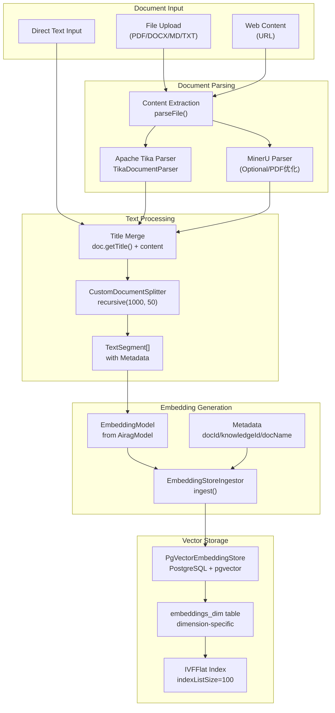
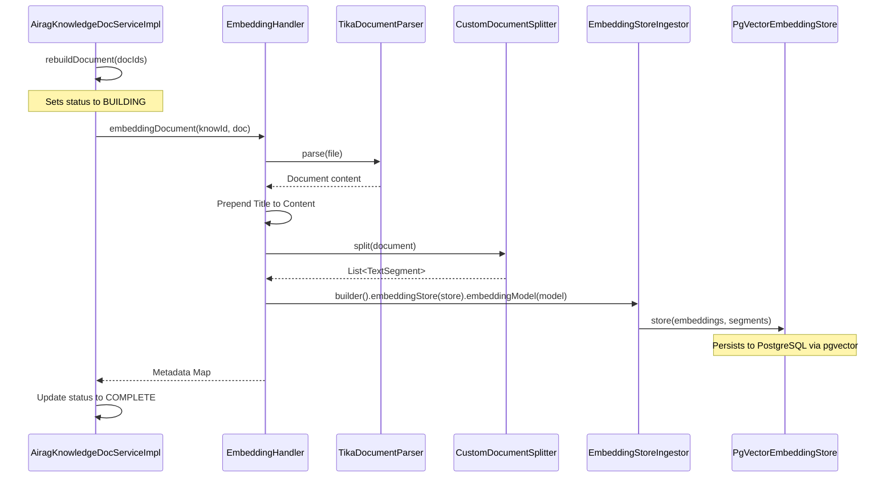

<!-- source: DeepWiki mcp.deepwiki.com · repo jeecgboot/JeecgBoot · extra page Document Processing & Embeddings · fetched 2026-10-29 -->

# Document Processing & Embeddings

Relevant source files

The following files were used as context for generating this wiki page:

- [jeecg-boot/jeecg-boot-module/jeecg-boot-module-airag/src/main/java/org/jeecg/modules/airag/llm/document/TikaDocumentParser.java](jeecg-boot/jeecg-boot-module/jeecg-boot-module-airag/src/main/java/org/jeecg/modules/airag/llm/document/TikaDocumentParser.java)
- [jeecg-boot/jeecg-boot-module/jeecg-boot-module-airag/src/main/java/org/jeecg/modules/airag/llm/handler/EmbeddingHandler.java](jeecg-boot/jeecg-boot-module/jeecg-boot-module-airag/src/main/java/org/jeecg/modules/airag/llm/handler/EmbeddingHandler.java)
- [jeecg-boot/jeecg-boot-module/jeecg-boot-module-airag/src/main/java/org/jeecg/modules/airag/llm/service/impl/AiragKnowledgeDocServiceImpl.java](jeecg-boot/jeecg-boot-module/jeecg-boot-module-airag/src/main/java/org/jeecg/modules/airag/llm/service/impl/AiragKnowledgeDocServiceImpl.java)

## Purpose and Scope

This document describes the document processing and embedding generation system within JeecgBoot's AI platform. It covers the end-to-end pipeline for transforming documents (PDF, DOCX, TXT, MD, etc.) into vector embeddings stored in pgvector for semantic search and retrieval-augmented generation (RAG).

The system leverages `langchain4j` for orchestration, Apache Tika for universal parsing, and optional high-performance parsers like MinerU for complex PDF layouts.

---

## Document Processing Architecture

The document processing system converts various document formats into searchable vector embeddings through a multi-stage pipeline: upload → parsing → splitting → embedding → storage.

### Overall Processing Flow

**Sources:** [jeecg-boot/jeecg-boot-module/jeecg-boot-module-airag/src/main/java/org/jeecg/modules/airag/llm/handler/EmbeddingHandler.java:168-191](), [jeecg-boot/jeecg-boot-module/jeecg-boot-module-airag/src/main/java/org/jeecg/modules/airag/llm/service/impl/AiragKnowledgeDocServiceImpl.java:127-182]()

---

## Core Components

### EmbeddingHandler Class

The `EmbeddingHandler` class ([EmbeddingHandler.java:76]()) is the central component responsible for all embedding operations. It implements `IEmbeddingHandler` and manages the lifecycle of `EmbeddingStore` instances.

**Key Responsibilities:**
- Document content extraction and parsing using `TikaDocumentParser`.
- Text segmentation using `CustomDocumentSplitter`.
- Integration with `AiModelFactory` to obtain `EmbeddingModel` instances.
- Vector storage management in `PgVectorEmbeddingStore`.

**Key Constants:**

| Constant | Value | Description |
|----------|-------|-------------|
| `DEFAULT_SEGMENT_SIZE` | 1000 | Default characters per text chunk [EmbeddingHandler.java:103]() |
| `DEFAULT_OVERLAP_SIZE` | 50 | Overlap between consecutive chunks [EmbeddingHandler.java:108]() |
| `EMBED_STORE_METADATA_KNOWLEDGEID` | "knowledgeId" | Knowledge base ID in metadata [EmbeddingHandler.java:118]() |
| `EMBED_STORE_METADATA_DOCID` | "docId" | Document ID in metadata [EmbeddingHandler.java:128]() |

**Sources:** [jeecg-boot/jeecg-boot-module/jeecg-boot-module-airag/src/main/java/org/jeecg/modules/airag/llm/handler/EmbeddingHandler.java:76-143]()

### Document Parsing

#### TikaDocumentParser Implementation

JeecgBoot provides a custom `TikaDocumentParser` ([TikaDocumentParser.java:46]()) because the standard `langchain4j` implementation requires POI 5.x, while JeecgBoot maintains compatibility with older POI versions.

**Parsing Logic:**
- **Text/MD/PDF**: Uses `extractByTika` with `AutoDetectParser` [TikaDocumentParser.java:78-86]().
- **Office (Doc/Excel/PPT)**: Uses `ApachePoiDocumentParser` to handle legacy binary and XML formats [TikaDocumentParser.java:88-90]().

**Sources:** [jeecg-boot/jeecg-boot-module/jeecg-boot-module-airag/src/main/java/org/jeecg/modules/airag/llm/document/TikaDocumentParser.java:46-115]()

#### MinerU Enhanced Parser (Optional)

For high-quality PDF extraction, JeecgBoot optionally integrates MinerU. If `knowConfigBean.isEnableMinerU()` is true, the system attempts to parse files using the `magic-pdf` command-line tool [EmbeddingHandler.java:180-182]().

---

## Text Splitting and Chunking

### CustomDocumentSplitter

JeecgBoot utilizes a `CustomDocumentSplitter` which extends the standard recursive splitting logic. It specifically handles edge cases like HTML tables and Markdown images to prevent them from being truncated across segments.

**Regex Protections:**
- `PATTERN_HTML_TABLE`: Matches complete `<table>` blocks to prevent truncation [EmbeddingHandler.java:156]().
- `PATTERN_MD_IMAGE`: Matches Markdown image syntax `` [EmbeddingHandler.java:150]().

### Title Integration

Document titles are prepended to the content before chunking [EmbeddingHandler.java:193-196](). This ensures that the semantic context of the title is present in the vector representation of the first few chunks.

**Sources:** [jeecg-boot/jeecg-boot-module/jeecg-boot-module-airag/src/main/java/org/jeecg/modules/airag/llm/handler/EmbeddingHandler.java:147-196]()

---

## Vector Storage (pgvector)

### PgVectorEmbeddingStore Configuration

The `getEmbedStore` method ([EmbeddingHandler.java:373]()) dynamically configures the vector store based on the embedding model's dimensions.

**Table Naming Convention:**
Tables are suffixed with the dimension to prevent vector size mismatches:
`#{base_table_name}_#{dimension}` (e.g., `embeddings_1536`) [EmbeddingHandler.java:393]().

**Index Configuration:**
JeecgBoot configures an `IVFFlat` index by default with an `indexListSize` of 100 for optimized retrieval speed [EmbeddingHandler.java:409-419]().

**Sources:** [jeecg-boot/jeecg-boot-module/jeecg-boot-module-airag/src/main/java/org/jeecg/modules/airag/llm/handler/EmbeddingHandler.java:373-422]()

---

## Document Embedding Workflow

### Embedding Execution Flow

The following diagram maps the logical processing of a document to the specific Java entities involved in the `AiragKnowledgeDocServiceImpl` and `EmbeddingHandler`.

**Sources:** [jeecg-boot/jeecg-boot-module/jeecg-boot-module-airag/src/main/java/org/jeecg/modules/airag/llm/service/impl/AiragKnowledgeDocServiceImpl.java:167-185](), [jeecg-boot/jeecg-boot-module/jeecg-boot-module-airag/src/main/java/org/jeecg/modules/airag/llm/handler/EmbeddingHandler.java:168-278]()

---

## Knowledge Retrieval Integration

### Content Retriever Construction

The `EmbeddingHandler` provides the `getQueryRouter` method ([EmbeddingHandler.java:282]()) to facilitate retrieval. It constructs an `EmbeddingStoreContentRetriever` for each knowledge base.

**Retrieval Parameters:**
- `maxResults`: Determined by `topNumber` in model configuration [EmbeddingHandler.java:302]().
- `minScore`: Determined by `similarity` threshold [EmbeddingHandler.java:303]().
- `Filter`: Metadata filters are applied to ensure segments only belong to the requested `knowledgeId` [EmbeddingHandler.java:304]().

**Sources:** [jeecg-boot/jeecg-boot-module/jeecg-boot-module-airag/src/main/java/org/jeecg/modules/airag/llm/handler/EmbeddingHandler.java:282-313]()

---

## Performance and Concurrency

### Thread Pool Management
The `AiragKnowledgeDocServiceImpl` utilizes a fixed thread pool for background embedding tasks to prevent resource exhaustion during bulk imports [AiragKnowledgeDocServiceImpl.java:84]().

- **Pool Size**: 10 threads.
- **Async Execution**: `CompletableFuture.runAsync()` is used to process documents without blocking the main thread [AiragKnowledgeDocServiceImpl.java:168]().

### Connection Caching
`EmbeddingStore` instances are cached in a `ConcurrentHashMap` named `EMBED_STORE_CACHE` [EmbeddingHandler.java:143](). This avoids the overhead of re-establishing database connections and re-verifying table schemas for every document.

**Sources:** [jeecg-boot/jeecg-boot-module/jeecg-boot-module-airag/src/main/java/org/jeecg/modules/airag/llm/service/impl/AiragKnowledgeDocServiceImpl.java:79-84](), [jeecg-boot/jeecg-boot-module/jeecg-boot-module-airag/src/main/java/org/jeecg/modules/airag/llm/handler/EmbeddingHandler.java:143, 376-381]()

---

