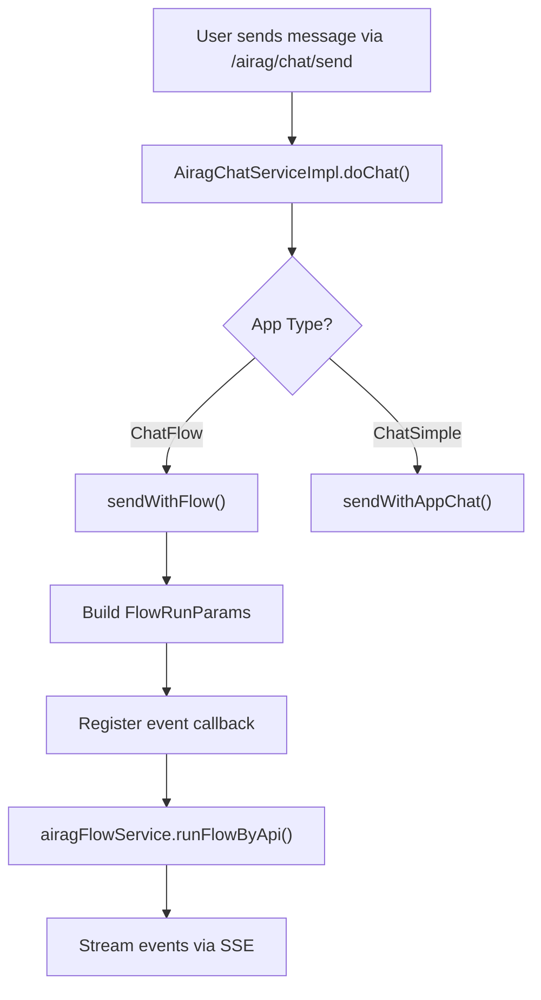
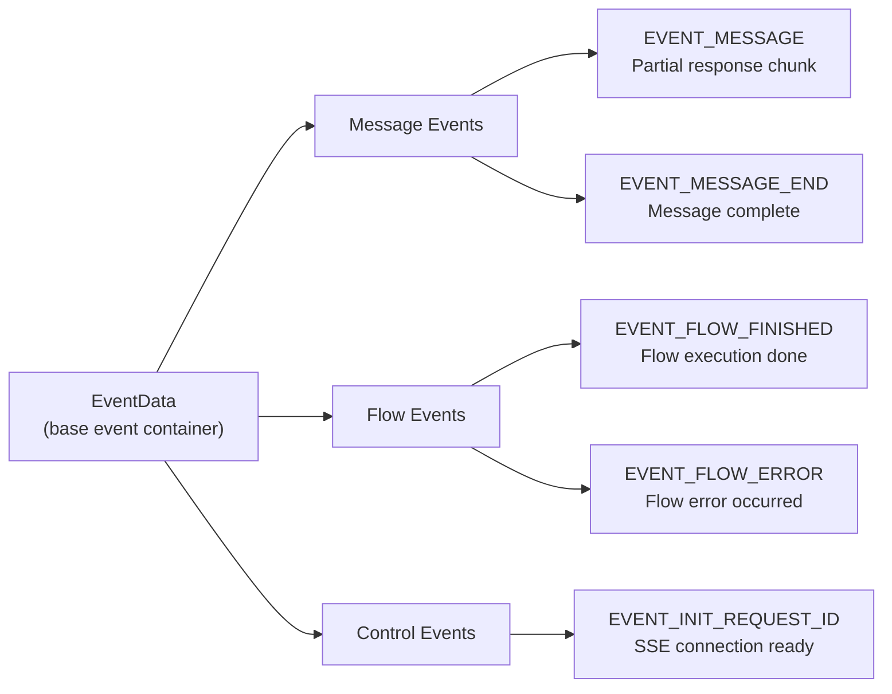
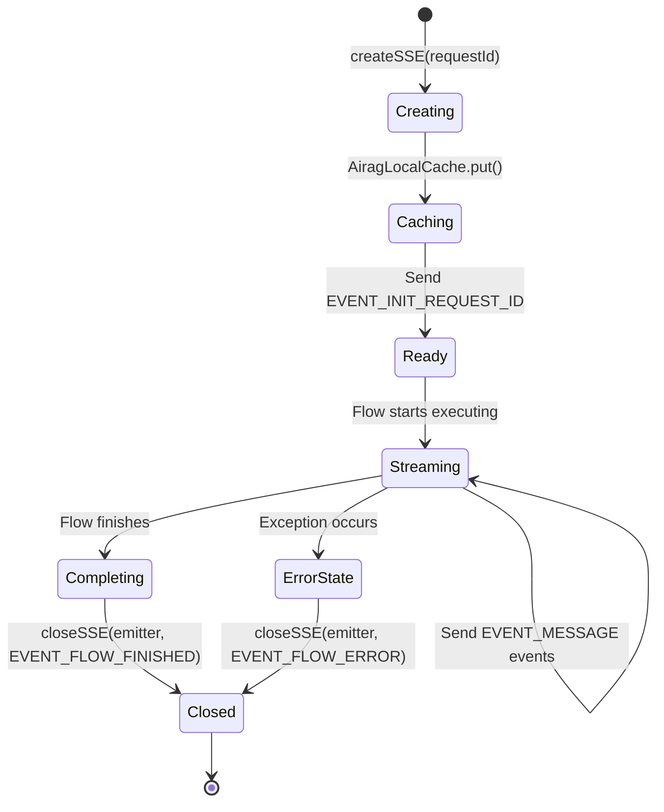
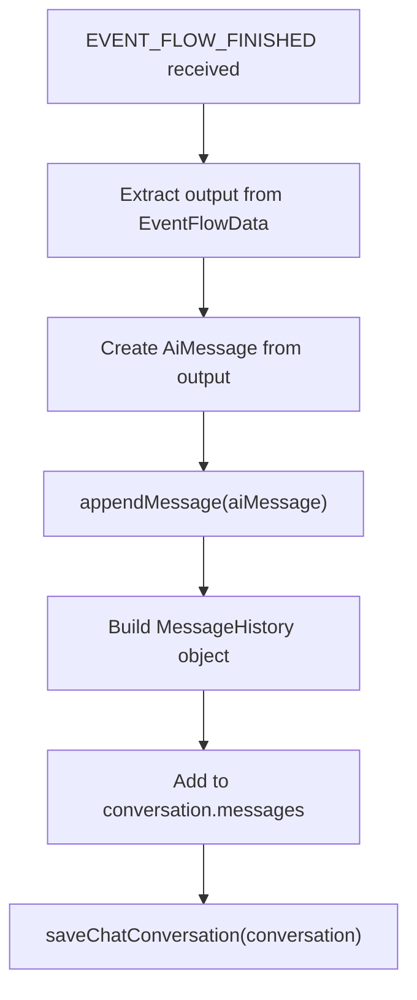

<!-- source: DeepWiki mcp.deepwiki.com · repo jeecgboot/JeecgBoot · extra page Flow Execution & Event System · fetched 2026-10-29 -->

# Flow Execution & Event System

Relevant source files

The following files were used as context for generating this wiki page:

- [jeecg-boot/UPGRADE-3.9.3.md](jeecg-boot/UPGRADE-3.9.3.md)
- [jeecg-boot/db/Dockerfile](jeecg-boot/db/Dockerfile)
- [jeecg-boot/db/jeecgboot-mysql-5.7.sql](jeecg-boot/db/jeecgboot-mysql-5.7.sql)
- [jeecg-boot/db/tables_xxl_job.sql](jeecg-boot/db/tables_xxl_job.sql)
- [jeecg-boot/jeecg-boot-module/jeecg-boot-module-airag/src/main/java/org/jeecg/modules/airag/app/service/impl/AiragChatServiceImpl.java](jeecg-boot/jeecg-boot-module/jeecg-boot-module-airag/src/main/java/org/jeecg/modules/airag/app/service/impl/AiragChatServiceImpl.java)
- [jeecg-boot/jeecg-module-system/jeecg-system-start/src/main/resources/flyway/sql/mysql/V3.9.0_0__all_upgrade.sql](jeecg-boot/jeecg-module-system/jeecg-system-start/src/main/resources/flyway/sql/mysql/V3.9.0_0__all_upgrade.sql)
- [jeecg-boot/jeecg-module-system/jeecg-system-start/src/main/resources/flyway/sql/mysql/V3.9.1_0__all_upgrade.sql](jeecg-boot/jeecg-module-system/jeecg-system-start/src/main/resources/flyway/sql/mysql/V3.9.1_0__all_upgrade.sql)
- [jeecg-boot/jeecg-server-cloud/jeecg-visual/jeecg-cloud-xxljob/doc/db/tables_xxl_job.sql](jeecg-boot/jeecg-server-cloud/jeecg-visual/jeecg-cloud-xxljob/doc/db/tables_xxl_job.sql)
- [jeecgboot-vue3/src/views/super/airag/aiapp/chat/AiChat.vue](jeecgboot-vue3/src/views/super/airag/aiapp/chat/AiChat.vue)
- [jeecgboot-vue3/src/views/super/airag/aiapp/chat/chat.vue](jeecgboot-vue3/src/views/super/airag/aiapp/chat/chat.vue)
- [jeecgboot-vue3/src/views/super/airag/aiapp/chat/portal/LeftPortalSession.vue](jeecgboot-vue3/src/views/super/airag/aiapp/chat/portal/LeftPortalSession.vue)
- [jeecgboot-vue3/src/views/super/airag/aiknowledge/AiKnowledgeBase.data.ts](jeecgboot-vue3/src/views/super/airag/aiknowledge/AiKnowledgeBase.data.ts)
- [jeecgboot-vue3/src/views/super/airag/aiknowledge/AiKnowledgeBaseList.vue](jeecgboot-vue3/src/views/super/airag/aiknowledge/AiKnowledgeBaseList.vue)
- [jeecgboot-vue3/src/views/super/airag/aimodel/AiModelList.vue](jeecgboot-vue3/src/views/super/airag/aimodel/AiModelList.vue)
- [jeecgboot-vue3/src/views/super/airag/aimodel/components/AiModelModal.vue](jeecgboot-vue3/src/views/super/airag/aimodel/components/AiModelModal.vue)

## Purpose and Scope

This document describes the runtime execution model for AI workflows in JeecgBoot's AIGC platform, focusing on how flows execute, how events are emitted and consumed, and how results are streamed to clients using Server-Sent Events (SSE). This page covers the orchestration layer that bridges workflow definitions (see [Workflow Node Types](#3.4.1)) with the chat service and frontend through `AiragChatServiceImpl` [jeecg-boot/jeecg-boot-module/jeecg-boot-module-airag/src/main/java/org/jeecg/modules/airag/app/service/impl/AiragChatServiceImpl.java:92-92]().

---

## Flow Execution Architecture

### Execution Entry Points

Flow execution is triggered when a user sends a message to a `ChatFlow`-type AI application. The main entry point is the `doChat` method in `AiragChatServiceImpl` [jeecg-boot/jeecg-boot-module/jeecg-boot-module-airag/src/main/java/org/jeecg/modules/airag/app/service/impl/AiragChatServiceImpl.java:237-237](), which delegates to `sendWithFlow` for workflow-based applications [jeecg-boot/jeecg-boot-module/jeecg-boot-module-airag/src/main/java/org/jeecg/modules/airag/app/service/impl/AiragChatServiceImpl.java:254-254]().

**Execution Flow Diagram**

Sources: [jeecg-boot/jeecg-boot-module/jeecg-boot-module-airag/src/main/java/org/jeecg/modules/airag/app/service/impl/AiragChatServiceImpl.java:237-254](), [jeecg-boot/jeecg-boot-module/jeecg-boot-module-airag/src/main/java/org/jeecg/modules/airag/app/service/impl/AiragChatServiceImpl.java:819-849]()

**FlowRunParams Configuration**

The `FlowRunParams` object encapsulates all parameters needed for flow execution [jeecg-boot/jeecg-boot-module/jeecg-boot-module-airag/src/main/java/org/jeecg/modules/airag/app/service/impl/AiragChatServiceImpl.java:819-849]():

| Parameter | Type | Description |
|-----------|------|-------------|
| `requestId` | String | Unique identifier for this execution request |
| `flowId` | String | ID of the workflow to execute |
| `conversationId` | String | Chat conversation context |
| `topicId` | String | Topic within the conversation |
| `responseMode` | String | `FLOW_RESPONSE_MODE_STREAMING` for SSE |
| `inputParams` | Map | Flow input variables including history, question, images |
| `eventCallback` | Consumer | Callback to handle flow events |
| `httpRequest` | HttpServletRequest | Current HTTP request context |

Sources: [jeecg-boot/jeecg-boot-module/jeecg-boot-module-airag/src/main/java/org/jeecg/modules/airag/app/service/impl/AiragChatServiceImpl.java:819-849]()

---

## Event System

### Event Types and Data Structures

The system uses a hierarchical event model with `EventData` as the base event container [jeecg-boot/jeecg-boot-module/jeecg-boot-module-airag/src/main/java/org/jeecg/modules/airag/app/service/impl/AiragChatServiceImpl.java:852-880]().

**Event Type Hierarchy**

**Event Data Payloads**

| Payload Class | Event Types | Description |
|---------------|-------------|-------------|
| `EventMessageData` | `EVENT_MESSAGE` | Contains partial text chunks for streaming |
| `EventFlowData` | `EVENT_FLOW_FINISHED` | Contains final output and execution status |

Sources: [jeecg-boot/jeecg-boot-module/jeecg-boot-module-airag/src/main/java/org/jeecg/modules/airag/app/service/impl/AiragChatServiceImpl.java:795-805](), [jeecg-boot/jeecg-boot-module/jeecg-boot-module-airag/src/main/java/org/jeecg/modules/airag/app/service/impl/AiragChatServiceImpl.java:852-880]()

### Event Callback Mechanism

Flow executions register a callback function that receives events as the flow progresses. The callback is invoked by the workflow engine as nodes execute [jeecg-boot/jeecg-boot-module/jeecg-boot-module-airag/src/main/java/org/jeecg/modules/airag/app/service/impl/AiragChatServiceImpl.java:852-880]().

The callback registered in `sendWithFlow` handles:
1. **`EVENT_FLOW_FINISHED`**: Logs duration, saves AI response to conversation history, and marks conversation complete [jeecg-boot/jeecg-boot-module/jeecg-boot-module-airag/src/main/java/org/jeecg/modules/airag/app/service/impl/AiragChatServiceImpl.java:857-874]().
2. **Streaming**: Forwards all events to `SseEmitter` for client consumption [jeecg-boot/jeecg-boot-module/jeecg-boot-module-airag/src/main/java/org/jeecg/modules/airag/app/service/impl/AiragChatServiceImpl.java:875-875]().
3. **Error Handling**: Captures `EVENT_FLOW_ERROR` to close the SSE connection with error details [jeecg-boot/jeecg-boot-module/jeecg-boot-module-airag/src/main/java/org/jeecg/modules/airag/app/service/impl/AiragChatServiceImpl.java:798-803]().

Sources: [jeecg-boot/jeecg-boot-module/jeecg-boot-module-airag/src/main/java/org/jeecg/modules/airag/app/service/impl/AiragChatServiceImpl.java:852-880]()

---

## SSE (Server-Sent Events) Streaming

### SSE Architecture

The system uses Spring's `SseEmitter` to stream flow execution events to clients in real-time [jeecg-boot/jeecg-boot-module/jeecg-boot-module-airag/src/main/java/org/jeecg/modules/airag/app/service/impl/AiragChatServiceImpl.java:752-771]().

**SSE Lifecycle Management**

Sources: [jeecg-boot/jeecg-boot-module/jeecg-boot-module-airag/src/main/java/org/jeecg/modules/airag/app/service/impl/AiragChatServiceImpl.java:752-771](), [jeecg-boot/jeecg-boot-module/jeecg-boot-module-airag/src/main/java/org/jeecg/modules/airag/app/service/impl/AiragChatServiceImpl.java:170-195]()

### SSE Reconnection Mechanism

The `receiveByRequestId` method enables clients to reconnect to an ongoing SSE stream if their connection drops [jeecg-boot/jeecg-boot-module/jeecg-boot-module-airag/src/main/java/org/jeecg/modules/airag/app/service/impl/AiragChatServiceImpl.java:356-423](). It uses a dedicated `SSE_THREAD_POOL` [jeecg-boot/jeecg-boot-module/jeecg-boot-module-airag/src/main/java/org/jeecg/modules/airag/app/service/impl/AiragChatServiceImpl.java:138-138]() to replay buffered messages from `CACHE_TYPE_SSE_HISTORY_MSG` [jeecg-boot/jeecg-boot-module/jeecg-boot-module-airag/src/main/java/org/jeecg/modules/airag/app/service/impl/AiragChatServiceImpl.java:374-374]().

Sources: [jeecg-boot/jeecg-boot-module/jeecg-boot-module-airag/src/main/java/org/jeecg/modules/airag/app/service/impl/AiragChatServiceImpl.java:356-423]()

---

## Flow Execution Lifecycle

### Input Parameter Mapping

When executing a flow, specific input parameters are mapped into the context [jeecg-boot/jeecg-boot-module/jeecg-boot-module-airag/src/main/java/org/jeecg/modules/airag/app/service/impl/AiragChatServiceImpl.java:828-844]():

| Parameter Name | Source | Description |
|----------------|--------|-------------|
| `history` | `chatConversation.getMessages()` | Previous messages in topic (excluding current) |
| `content` | `sendParams.getContent()` | Current user question text |
| `images` | `sendParams.getImages()` | Attached image URLs |
| `flowInputs` | `chatConversation.getFlowInputs()` | User-defined flow variables |

Sources: [jeecg-boot/jeecg-boot-module/jeecg-boot-module-airag/src/main/java/org/jeecg/modules/airag/app/service/impl/AiragChatServiceImpl.java:828-844]()

### Message History Management

After flow completion, the AI's response is appended to the conversation history and persisted to Redis [jeecg-boot/jeecg-boot-module/jeecg-boot-module-airag/src/main/java/org/jeecg/modules/airag/app/service/impl/AiragChatServiceImpl.java:867-871](). The `appendMessage` function handles the creation of `MessageHistory` objects [jeecg-boot/jeecg-boot-module/jeecg-boot-module-airag/src/main/java/org/jeecg/modules/airag/app/service/impl/AiragChatServiceImpl.java:682-739]().

**History Append Process**

Sources: [jeecg-boot/jeecg-boot-module/jeecg-boot-module-airag/src/main/java/org/jeecg/modules/airag/app/service/impl/AiragChatServiceImpl.java:867-871](), [jeecg-boot/jeecg-boot-module/jeecg-boot-module-airag/src/main/java/org/jeecg/modules/airag/app/service/impl/AiragChatServiceImpl.java:682-739]()

---

## Stop/Cancel Mechanism

Clients can stop an ongoing flow execution via the `/airag/chat/stop/{requestId}` endpoint [jeecg-boot/jeecg-boot-module/jeecg-boot-module-airag/src/main/java/org/jeecg/modules/airag/app/service/impl/AiragChatServiceImpl.java:148-159](). This removes the `SseEmitter` from `AiragLocalCache` and sends a final `EVENT_MESSAGE_END` to the client [jeecg-boot/jeecg-boot-module/jeecg-boot-module-airag/src/main/java/org/jeecg/modules/airag/app/service/impl/AiragChatServiceImpl.java:154-156]().

Sources: [jeecg-boot/jeecg-boot-module/jeecg-boot-module-airag/src/main/java/org/jeecg/modules/airag/app/service/impl/AiragChatServiceImpl.java:148-159]()

---

