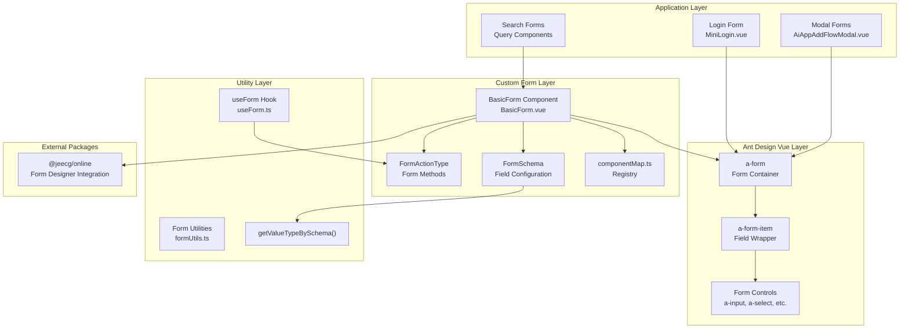
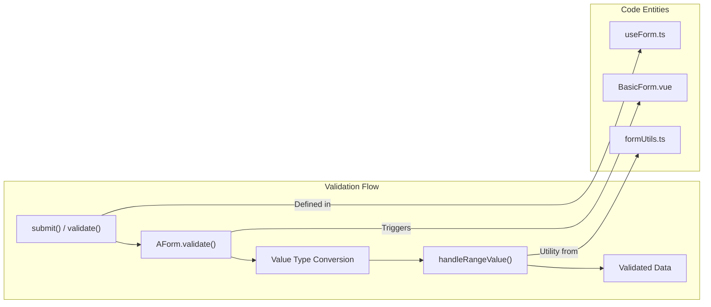

<!-- source: DeepWiki mcp.deepwiki.com · repo jeecgboot/JeecgBoot · extra page Form Components · fetched 2026-10-29 -->

# Form Components

<details>
<summary>Relevant source files</summary>

The following files were used as context for generating this wiki page:

- [jeecgboot-vue3/build/utils.ts](jeecgboot-vue3/build/utils.ts)
- [jeecgboot-vue3/build/vite/plugin/index.ts](jeecgboot-vue3/build/vite/plugin/index.ts)
- [jeecgboot-vue3/src/api/sys/menu.ts](jeecgboot-vue3/src/api/sys/menu.ts)
- [jeecgboot-vue3/src/api/sys/user.ts](jeecgboot-vue3/src/api/sys/user.ts)
- [jeecgboot-vue3/src/assets/icons/collaborationNotice.png](jeecgboot-vue3/src/assets/icons/collaborationNotice.png)
- [jeecgboot-vue3/src/assets/icons/superviseNotice.png](jeecgboot-vue3/src/assets/icons/superviseNotice.png)
- [jeecgboot-vue3/src/components/Form/index.ts](jeecgboot-vue3/src/components/Form/index.ts)
- [jeecgboot-vue3/src/components/Form/src/BasicForm.vue](jeecgboot-vue3/src/components/Form/src/BasicForm.vue)
- [jeecgboot-vue3/src/components/Form/src/componentMap.ts](jeecgboot-vue3/src/components/Form/src/componentMap.ts)
- [jeecgboot-vue3/src/components/Form/src/hooks/useForm.ts](jeecgboot-vue3/src/components/Form/src/hooks/useForm.ts)
- [jeecgboot-vue3/src/components/Form/src/jeecg/components/JTreeSelect.vue](jeecgboot-vue3/src/components/Form/src/jeecg/components/JTreeSelect.vue)
- [jeecgboot-vue3/src/components/Form/src/jeecg/components/TreeIcon/TreeIcon.vue](jeecgboot-vue3/src/components/Form/src/jeecg/components/TreeIcon/TreeIcon.vue)
- [jeecgboot-vue3/src/components/Icon/src/Icon.vue](jeecgboot-vue3/src/components/Icon/src/Icon.vue)
- [jeecgboot-vue3/src/components/Table/src/components/editable/EditableCell.vue](jeecgboot-vue3/src/components/Table/src/components/editable/EditableCell.vue)
- [jeecgboot-vue3/src/components/Table/src/components/editable/index.ts](jeecgboot-vue3/src/components/Table/src/components/editable/index.ts)
- [jeecgboot-vue3/src/components/Table/src/components/settings/ColumnSetting.vue](jeecgboot-vue3/src/components/Table/src/components/settings/ColumnSetting.vue)
- [jeecgboot-vue3/src/components/Table/src/hooks/useColumnsCache.ts](jeecgboot-vue3/src/components/Table/src/hooks/useColumnsCache.ts)
- [jeecgboot-vue3/src/components/jeecg/JVxeTable/index.ts](jeecgboot-vue3/src/components/jeecg/JVxeTable/index.ts)
- [jeecgboot-vue3/src/components/jeecg/JVxeTable/useVxeTableRegister.ts](jeecgboot-vue3/src/components/jeecg/JVxeTable/useVxeTableRegister.ts)
- [jeecgboot-vue3/src/components/registerGlobComp.ts](jeecgboot-vue3/src/components/registerGlobComp.ts)
- [jeecgboot-vue3/src/router/helper/routeHelper.ts](jeecgboot-vue3/src/router/helper/routeHelper.ts)
- [jeecgboot-vue3/src/utils/dynamicPages.ts](jeecgboot-vue3/src/utils/dynamicPages.ts)
- [jeecgboot-vue3/src/utils/monorepo/registerPackages.ts](jeecgboot-vue3/src/utils/monorepo/registerPackages.ts)

</details>


## Purpose and Scope

This document covers the form component library and development patterns in JeecgBoot's Vue3 frontend. It describes the core form components from Ant Design Vue, the schema-based `BasicForm` system, validation patterns, and utility functions for form handling. JeecgBoot provides a high-level abstraction layer over Ant Design Vue to enable dynamic, schema-driven form generation and integration with the low-code form designer.

---

## Form Component Architecture

JeecgBoot uses a layered form architecture built on Ant Design Vue with custom wrappers and schema-driven configuration.



**Key Code Entities:**

| Layer | Component/Class | Purpose |
|-------|-----------|---------|
| **Core** | `BasicForm` | The main form wrapper that renders items based on schemas. [src/components/Form/src/BasicForm.vue:67-67]() |
| **Hook** | `useForm` | Hook to create and control form instances programmatically. [src/components/Form/src/hooks/useForm.ts:13-13]() |
| **Registry** | `componentMap` | A Map mapping component names to Vue components (Antd or Jeecg custom). [src/components/Form/src/componentMap.ts:11-11]() |
| **Action** | `FormActionType` | Interface defining methods like `validate`, `setFieldsValue`, and `updateSchema`. [src/components/Form/src/types/form.ts]() |
| **Custom** | `JTreeSelect` | Jeecg-specific tree select with async loading capabilities. [src/components/Form/src/jeecg/components/JTreeSelect.vue:2-23]() |

Sources: [jeecgboot-vue3/src/components/Form/src/BasicForm.vue:1-68](), [jeecgboot-vue3/src/components/Form/src/hooks/useForm.ts:1-148](), [jeecgboot-vue3/src/components/Form/src/componentMap.ts:1-86]()

---

## The BasicForm System

The `BasicForm` component is the foundation of JeecgBoot's dynamic forms. It iterates over an array of `FormSchema` objects to render `FormItem` components.

### Component Registration

JeecgBoot registers a wide variety of components in `componentMap.ts`. This includes standard Ant Design Vue components and custom Jeecg components (prefixed with `J`).

| Key | Component Source | Description |
|-----|------------------|-------------|
| `Input` | `ant-design-vue/es/input` | Standard text input. [src/components/Form/src/componentMap.ts:14-14]() |
| `JTreeSelect` | `./jeecg/components/JTreeSelect.vue` | Async tree selection from dictionary. [src/components/Form/src/componentMap.ts:80-80]() |
| `JDictSelectTag` | `./jeecg/components/JDictSelectTag.vue` | Dictionary-based select/radio/checkbox. [src/components/Form/src/componentMap.ts:58-58]() |
| `JEditor` | `./jeecg/components/JEditor.vue` | TinyMCE rich text editor. [src/components/Form/src/componentMap.ts:63-63]() |
| `ApiSelect` | `./components/ApiSelect.vue` | Select component that fetches data from an API. [src/components/Form/src/componentMap.ts:23-23]() |

Sources: [jeecgboot-vue3/src/components/Form/src/componentMap.ts:1-86]()

### Dynamic Form Hook: useForm

Developers interact with forms primarily through the `useForm` hook. It returns a `register` function to bind to the `BasicForm` and a `methods` object to manipulate the form.

```typescript
// Example usage
const [register, { validate, setFieldsValue }] = useForm({
  schemas: mySchemas,
  labelWidth: 120,
});
```

The `methods` object provides high-level control:
- `validate`: Performs validation and returns values. It includes logic to join array values into strings if the schema `valueType` is 'string'. [src/components/Form/src/hooks/useForm.ts:123-140]()
- `getFieldsValue`: Retrieves current form values, automatically handling array-to-string conversion for specific Jeecg components. [src/components/Form/src/hooks/useForm.ts:85-100]()
- `updateSchema`: Dynamically modifies field configurations at runtime. [src/components/Form/src/hooks/useForm.ts:59-62]()

Sources: [jeecgboot-vue3/src/components/Form/src/hooks/useForm.ts:49-145]()

---

## Form Validation and Data Flow

JeecgBoot extends standard validation with automatic data type conversion and range value handling.



### Automatic Type Conversion
When calling `validate()`, the system checks the `valueType` defined in the schema via `getValueTypeBySchema`. If the value is an array but the expected type is a string, it automatically performs a `join(',')`. [src/components/Form/src/hooks/useForm.ts:126-133]()

### Range Value Handling
For date range components, `handleRangeValue` (imported from `formUtils.ts`) processes the array of dates into the specific start/end fields expected by the backend. [src/components/Form/src/hooks/useForm.ts:136-136]()

Sources: [jeecgboot-vue3/src/components/Form/src/hooks/useForm.ts:123-140](), [jeecgboot-vue3/src/components/Form/src/utils/formUtils.ts]()

---

## Custom Component: JTreeSelect

`JTreeSelect` is a critical component for enterprise forms, allowing users to select from hierarchical data stored in the database.

**Key Features:**
- **Dictionary Integration**: Loads data using a `dict` string (format: `table,text,code`). [src/components/Form/src/jeecg/components/JTreeSelect.vue:27-29]()
- **Async Loading**: Uses `asyncLoadTreeData` to fetch child nodes only when expanded, reducing initial load time. [src/components/Form/src/jeecg/components/JTreeSelect.vue:235-240]()
- **Internationalization**: Supports `t()` syntax in node titles for dynamic translation. [src/components/Form/src/jeecg/components/JTreeSelect.vue:226-231]()
- **Self-Exclusion**: The `hiddenNodeKey` prop prevents selecting a node or its descendants as its own parent during tree editing. [src/components/Form/src/jeecg/components/JTreeSelect.vue:98-107]()

Sources: [jeecgboot-vue3/src/components/Form/src/jeecg/components/JTreeSelect.vue:1-240]()

---

## Integration with Table Components

Forms are frequently used within `BasicTable` for inline editing via `EditableCell.vue`.

- **Component Mapping**: Editable cells use `getComponent` to determine which form control to render (defaulting to 'Input'). [src/components/Table/src/components/editable/EditableCell.vue:99-99]()
- **Validation Sync**: The `renderEditCell` function in `index.ts` binds validation callbacks (`validCbs`) to the table record, allowing the table to trigger validation before saving a row. [src/components/Table/src/components/editable/index.ts:14-29]()
- **Edit Modes**: Supports both row-level editing and individual cell editing. [src/components/Table/src/components/editable/EditableCell.vue:25-28]()

Sources: [jeecgboot-vue3/src/components/Table/src/components/editable/EditableCell.vue:1-136](), [jeecgboot-vue3/src/components/Table/src/components/editable/index.ts:14-59]()

---

## Monorepo and Dynamic Loading

For large-scale applications, form components from sub-packages like `@jeecg/online` or `@jeecg/aiflow` are loaded dynamically.

- **registerPackages**: Saves the app instance to allow sub-modules to register their own components and routes later. [src/utils/monorepo/registerPackages.ts:17-28]()
- **loadPackageComponent**: When a route or form requires a component from a monorepo package, this function triggers the `importer` and registers the package using `app.use(mod)`. [src/utils/monorepo/registerPackages.ts:101-113]()
- **Dynamic Views**: The `dynamicImport` helper in the router checks both local `dynamicPages` and monorepo `packageViews` to resolve component paths. [src/router/helper/routeHelper.ts:108-136]()

Sources: [jeecgboot-vue3/src/utils/monorepo/registerPackages.ts:1-113](), [jeecgboot-vue3/src/router/helper/routeHelper.ts:108-136]()

---

