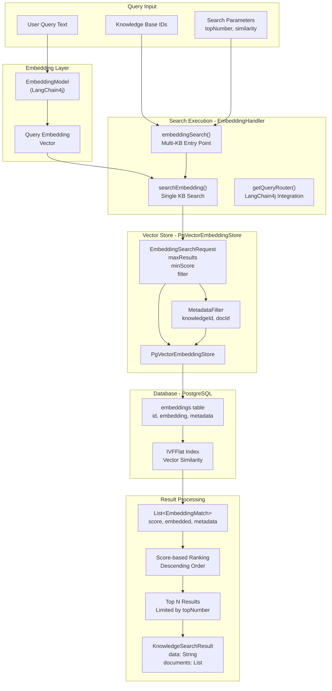
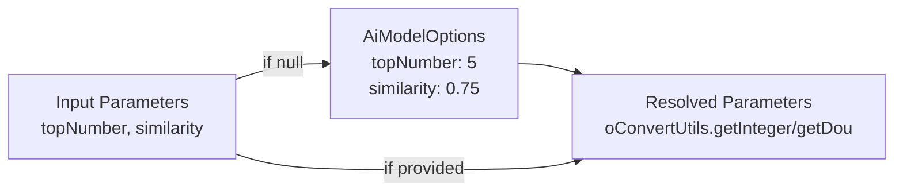
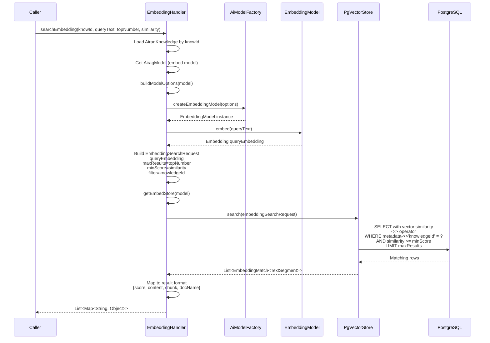
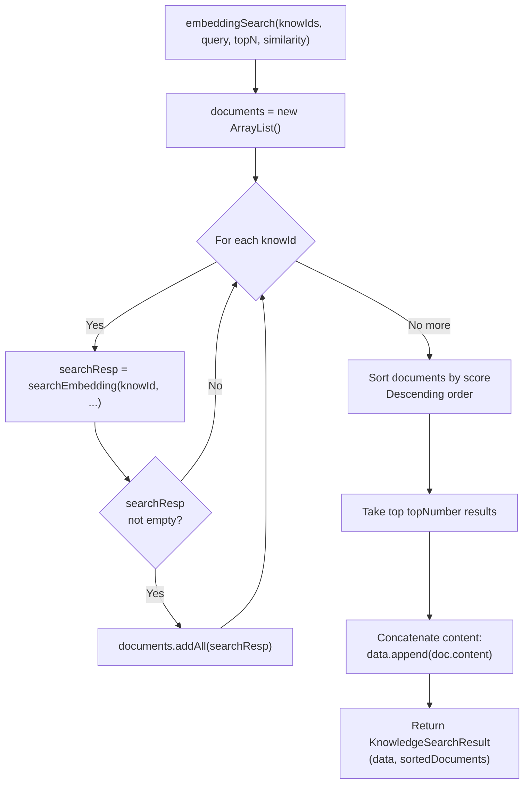
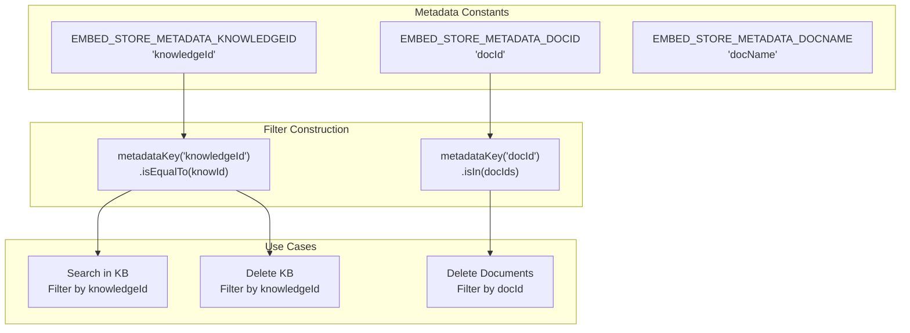

<!-- source: DeepWiki mcp.deepwiki.com · repo jeecgboot/JeecgBoot · extra page Knowledge Retrieval & Query · fetched 2026-10-29 -->

# Knowledge Retrieval & Query

Relevant source files

The following files were used as context for generating this wiki page:

- [jeecg-boot/jeecg-boot-base-core/src/main/resources/config/default-spring-doc.properties](jeecg-boot/jeecg-boot-base-core/src/main/resources/config/default-spring-doc.properties)
- [jeecg-boot/jeecg-boot-module/jeecg-boot-module-airag/src/main/java/org/jeecg/modules/airag/llm/handler/EmbeddingHandler.java](jeecg-boot/jeecg-boot-module/jeecg-boot-module-airag/src/main/java/org/jeecg/modules/airag/llm/handler/EmbeddingHandler.java)
- [jeecg-boot/jeecg-boot-module/jeecg-boot-module-airag/src/main/java/org/jeecg/modules/airag/llm/service/impl/AiragKnowledgeDocServiceImpl.java](jeecg-boot/jeecg-boot-module/jeecg-boot-module-airag/src/main/java/org/jeecg/modules/airag/llm/service/impl/AiragKnowledgeDocServiceImpl.java)
- [jeecg-boot/jeecg-module-system/jeecg-system-start/src/main/resources/application-dev.yml](jeecg-boot/jeecg-module-system/jeecg-system-start/src/main/resources/application-dev.yml)
- [jeecg-boot/jeecg-module-system/jeecg-system-start/src/main/resources/application-dm8.yml](jeecg-boot/jeecg-module-system/jeecg-system-start/src/main/resources/application-dm8.yml)
- [jeecg-boot/jeecg-module-system/jeecg-system-start/src/main/resources/application-docker.yml](jeecg-boot/jeecg-module-system/jeecg-system-start/src/main/resources/application-docker.yml)
- [jeecg-boot/jeecg-module-system/jeecg-system-start/src/main/resources/application-kingbase8.yml](jeecg-boot/jeecg-module-system/jeecg-system-start/src/main/resources/application-kingbase8.yml)
- [jeecg-boot/jeecg-module-system/jeecg-system-start/src/main/resources/application-oracle.yml](jeecg-boot/jeecg-module-system/jeecg-system-start/src/main/resources/application-oracle.yml)
- [jeecg-boot/jeecg-module-system/jeecg-system-start/src/main/resources/application-postgresql.yml](jeecg-boot/jeecg-module-system/jeecg-system-start/src/main/resources/application-postgresql.yml)
- [jeecg-boot/jeecg-module-system/jeecg-system-start/src/main/resources/application-prod.yml](jeecg-boot/jeecg-module-system/jeecg-system-start/src/main/resources/application-prod.yml)
- [jeecg-boot/jeecg-module-system/jeecg-system-start/src/main/resources/application-sqlserver.yml](jeecg-boot/jeecg-module-system/jeecg-system-start/src/main/resources/application-sqlserver.yml)
- [jeecg-boot/jeecg-module-system/jeecg-system-start/src/main/resources/application-test.yml](jeecg-boot/jeecg-module-system/jeecg-system-start/src/main/resources/application-test.yml)
- [jeecg-boot/jeecg-module-system/jeecg-system-start/src/main/resources/logback-spring.xml](jeecg-boot/jeecg-module-system/jeecg-system-start/src/main/resources/logback-spring.xml)

## Purpose and Scope

This document describes the knowledge retrieval and query mechanisms in JeecgBoot's AI RAG system. It covers how user queries are converted to vector embeddings, how semantic search is performed against the pgvector database, and how results are ranked and filtered.

**Retrieval vs Ingestion:**
- **Ingestion** (covered in 3.3.1): Documents → Text Chunks → Embeddings → Storage
- **Retrieval** (this page): User Query → Query Embedding → Vector Search → Ranked Results

This document focuses on the retrieval phase of the RAG pipeline. The same embedding model used during document ingestion must be used for query embedding to ensure vector compatibility.

---

## Retrieval Architecture Overview

The knowledge retrieval system uses vector similarity search to find relevant document segments from one or more knowledge bases. The architecture leverages LangChain4j's embedding abstractions and PostgreSQL's pgvector extension.

### System Components

**Sources:** [jeecg-boot/jeecg-boot-module/jeecg-boot-module-airag/src/main/java/org/jeecg/modules/airag/llm/handler/EmbeddingHandler.java:196-313]()

---

## Search Parameters

The retrieval system accepts three primary parameters that control search behavior:

| Parameter | Type | Default | Description | Code Reference |
|-----------|------|---------|-------------|----------------|
| `topNumber` | Integer | 5 | Maximum number of results to return per knowledge base | [jeecg-boot/jeecg-boot-module/jeecg-boot-module-airag/src/main/java/org/jeecg/modules/airag/llm/handler/EmbeddingHandler.java:200]() |
| `similarity` | Double | 0.75 | Minimum similarity score threshold (0.0-1.0) | [jeecg-boot/jeecg-boot-module/jeecg-boot-module-airag/src/main/java/org/jeecg/modules/airag/llm/handler/EmbeddingHandler.java:246]() |
| `knowIds` | List&lt;String&gt; | Required | List of knowledge base IDs to search | [jeecg-boot/jeecg-boot-module/jeecg-boot-module-airag/src/main/java/org/jeecg/modules/airag/llm/handler/EmbeddingHandler.java:197]() |

### Parameter Resolution

**Default Value Logic:**
- `topNumber`: Falls back to `modelOptions.getTopNumber()` (default 5). [jeecg-boot/jeecg-boot-module/jeecg-boot-module-airag/src/main/java/org/jeecg/modules/airag/llm/handler/EmbeddingHandler.java:245]()
- `similarity`: Falls back to `modelOptions.getSimilarity()` (default 0.75). [jeecg-boot/jeecg-boot-module/jeecg-boot-module-airag/src/main/java/org/jeecg/modules/airag/llm/handler/EmbeddingHandler.java:246]()

**Sources:** [jeecg-boot/jeecg-boot-module/jeecg-boot-module-airag/src/main/java/org/jeecg/modules/airag/llm/handler/EmbeddingHandler.java:245-246]()

---

## Query Execution Flow

### Single Knowledge Base Retrieval

The `searchEmbedding` method executes retrieval against a single knowledge base:

**Key Methods:**
- `EmbeddingHandler.searchEmbedding()` [jeecg-boot/jeecg-boot-module/jeecg-boot-module-airag/src/main/java/org/jeecg/modules/airag/llm/handler/EmbeddingHandler.java:234-269]()
- `EmbeddingHandler.getEmbedStore()` [jeecg-boot/jeecg-boot-module/jeecg-boot-module-airag/src/main/java/org/jeecg/modules/airag/llm/handler/EmbeddingHandler.java:373-422]()
- `EmbeddingHandler.buildModelOptions()` [jeecg-boot/jeecg-boot-module/jeecg-boot-module-airag/src/main/java/org/jeecg/modules/airag/llm/handler/EmbeddingHandler.java:432-445]()

**Sources:** [jeecg-boot/jeecg-boot-module/jeecg-boot-module-airag/src/main/java/org/jeecg/modules/airag/llm/handler/EmbeddingHandler.java:234-269](), [jeecg-boot/jeecg-boot-module/jeecg-boot-module-airag/src/main/java/org/jeecg/modules/airag/llm/handler/EmbeddingHandler.java:373-422]()

---

## Multi-Knowledge Base Retrieval

When searching across multiple knowledge bases, the system aggregates results and re-ranks them globally:

### Aggregation and Ranking Algorithm

**Implementation Details:**

The `embeddingSearch` method [jeecg-boot/jeecg-boot-module/jeecg-boot-module-airag/src/main/java/org/jeecg/modules/airag/llm/handler/EmbeddingHandler.java:196-221]() performs the following:

1. **Collection Phase**: Iterate through each knowledge base ID and collect all results.
2. **Re-ranking Phase**: Sort all collected results by score (descending) and take top N.
3. **Result Assembly**: Concatenate all content into a single string while preserving individual document metadata.

**Sources:** [jeecg-boot/jeecg-boot-module/jeecg-boot-module-airag/src/main/java/org/jeecg/modules/airag/llm/handler/EmbeddingHandler.java:196-221]()

---

## Metadata-Based Filtering

Vector searches use metadata filters to scope results to specific knowledge bases and documents:

### Filter Predicates

**Metadata Fields Stored:**
- `knowledgeId`: Links vector to source knowledge base. [jeecg-boot/jeecg-boot-module/jeecg-boot-module-airag/src/main/java/org/jeecg/modules/airag/llm/handler/EmbeddingHandler.java:118]()
- `docId`: Links vector to source document. [jeecg-boot/jeecg-boot-module/jeecg-boot-module-airag/src/main/java/org/jeecg/modules/airag/llm/handler/EmbeddingHandler.java:128]()
- `docName`: Human-readable document name. [jeecg-boot/jeecg-boot-module/jeecg-boot-module-airag/src/main/java/org/jeecg/modules/airag/llm/handler/EmbeddingHandler.java:133]()

**Sources:** [jeecg-boot/jeecg-boot-module/jeecg-boot-module-airag/src/main/java/org/jeecg/modules/airag/llm/handler/EmbeddingHandler.java:118-133](), [jeecg-boot/jeecg-boot-module/jeecg-boot-module-airag/src/main/java/org/jeecg/modules/airag/llm/handler/EmbeddingHandler.java:247-252]()

---

## Result Format and Structure

### KnowledgeSearchResult Class

The retrieval system returns results wrapped in a `KnowledgeSearchResult` object [jeecg-boot/jeecg-boot-module/jeecg-boot-module-airag/src/main/java/org/jeecg/modules/airag/common/vo/knowledge/KnowledgeSearchResult.java]():

| Field | Type | Description | Source |
|-------|------|-------------|--------|
| `data` | String | Concatenated content from all matching documents | [jeecg-boot/jeecg-boot-module/jeecg-boot-module-airag/src/main/java/org/jeecg/modules/airag/llm/handler/EmbeddingHandler.java:218]() |
| `documents` | List&lt;Map&gt; | Individual document metadata and content | [jeecg-boot/jeecg-boot-module/jeecg-boot-module-airag/src/main/java/org/jeecg/modules/airag/llm/handler/EmbeddingHandler.java:214]() |

**Sources:** [jeecg-boot/jeecg-boot-module/jeecg-boot-module-airag/src/main/java/org/jeecg/modules/airag/llm/handler/EmbeddingHandler.java:211-220]()

---

## Integration with LangChain4j QueryRouter

For advanced RAG pipelines, the system provides a `QueryRouter` that integrates with LangChain4j's retrieval abstractions:

### QueryRouter Construction

The `getQueryRouter` method [jeecg-boot/jeecg-boot-module/jeecg-boot-module-airag/src/main/java/org/jeecg/modules/airag/llm/handler/EmbeddingHandler.java:282-313]() builds a `DefaultQueryRouter` containing `EmbeddingStoreContentRetriever` instances for each specified knowledge base.

**Sources:** [jeecg-boot/jeecg-boot-module/jeecg-boot-module-airag/src/main/java/org/jeecg/modules/airag/llm/handler/EmbeddingHandler.java:282-313]()

---

## PgVectorEmbeddingStore Configuration

The vector store is initialized with specific PostgreSQL pgvector settings and cached for reuse.

### Database Connection Configuration

The system retrieves vector store credentials from `EmbedStoreConfigBean` [jeecg-boot/jeecg-boot-module/jeecg-boot-module-airag/src/main/java/org/jeecg/modules/airag/llm/config/EmbedStoreConfigBean.java]().

Default configuration in `application-dev.yml`:
- **Host**: 127.0.0.1
- **Port**: 5432
- **Database**: vector_db
- **Table**: embeddings

**Sources:** [jeecg-boot/jeecg-module-system/jeecg-system-start/src/main/resources/application-dev.yml:245-248](), [jeecg-boot/jeecg-boot-module/jeecg-boot-module-airag/src/main/java/org/jeecg/modules/airag/llm/handler/EmbeddingHandler.java:373-422]()

### Dimension-Specific Tables

To prevent conflicts between embedding models with different dimensions, the system appends the dimension to the table name if it differs from the default 1536. [jeecg-boot/jeecg-boot-module/jeecg-boot-module-airag/src/main/java/org/jeecg/modules/airag/llm/handler/EmbeddingHandler.java:388-395]()

**Sources:** [jeecg-boot/jeecg-boot-module/jeecg-boot-module-airag/src/main/java/org/jeecg/modules/airag/llm/handler/EmbeddingHandler.java:388-395]()

---

## Error Handling and Edge Cases

### Missing Knowledge Base
If a knowledge base ID is invalid, the system throws a `JeecgBootException` with the message "知识库不存在". [jeecg-boot/jeecg-boot-module/jeecg-boot-module-airag/src/main/java/org/jeecg/modules/airag/llm/handler/EmbeddingHandler.java:170]()

### Empty Result Handling
If no matches are found, the `searchEmbedding` method returns an empty list rather than null. [jeecg-boot/jeecg-boot-module/jeecg-boot-module-airag/src/main/java/org/jeecg/modules/airag/llm/handler/EmbeddingHandler.java:256-269]()

**Sources:** [jeecg-boot/jeecg-boot-module/jeecg-boot-module-airag/src/main/java/org/jeecg/modules/airag/llm/handler/EmbeddingHandler.java:170](), [jeecg-boot/jeecg-boot-module/jeecg-boot-module-airag/src/main/java/org/jeecg/modules/airag/llm/handler/EmbeddingHandler.java:256-269]()

---

