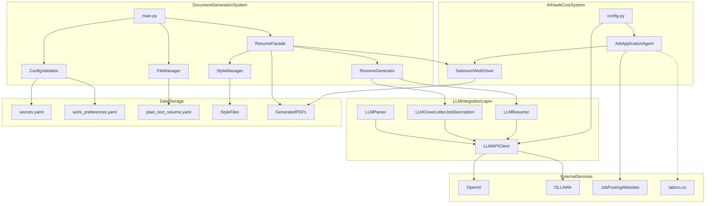
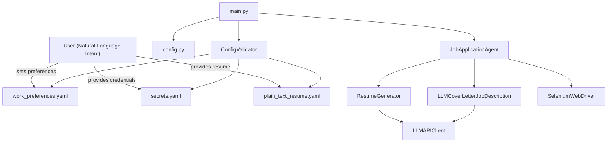

<!-- source: DeepWiki mcp.deepwiki.com · repo feder-cr/Jobs_Applier_AI_Agent_AIHawk · page 1 Overview · fetched 2026-10-29 -->

# Overview

Relevant source files

The following files were used as context for generating this wiki page:

- [README.md](README.md)
- [config.py](config.py)

This document introduces **AIHawk**, an open-source automated job application AI agent. It explains the system’s purpose, high-level capabilities, and the distinction between the open-source core and the commercial offering. This overview is intended for technical users seeking to understand what AIHawk is, what it does, and how its main systems are organized. For a detailed breakdown of the system’s architecture, see [System Architecture](#2). For user setup and usage, see [User Guide](#3).

---

## Purpose and Scope

AIHawk is designed to automate the process of searching for jobs, generating tailored application documents (resumes and cover letters), and submitting applications on behalf of users. The system leverages browser automation, configuration-driven workflows, and integration with Large Language Models (LLMs) such as OpenAI and OLLAMA.

This page covers:

- The overall goals and capabilities of AIHawk
- The distinction between the open-source and commercial versions
- A high-level summary of the system’s architecture and main components
- How the system bridges user intent (natural language) to code-level automation

For in-depth technical details on individual subsystems, refer to the following pages:
- [System Architecture](#2)
- [Component Overview](#2.1)
- [Configuration System](#2.2)
- [LLM Integration](#2.3)
- [Job Application Agent](#2.4)
- [Browser Automation](#2.5)

**Sources:**  
[README.md:5-27]()

---

## What is AIHawk?

AIHawk is an open-source project that automates the end-to-end job application process. Its core features include:

- Automated job search and scraping from job boards
- Suitability scoring of job postings using LLMs
- Generation of tailored resumes and cover letters using LLMs and style templates
- Automated application submission via browser automation
- Configuration-driven operation for flexibility and extensibility

The open-source version provides the core automation and document generation logic. Third-party provider plugins are excluded due to copyright. For a fully managed, integrated experience (including proprietary provider connections), a commercial version is available via laboro.co.

**Sources:**  
[README.md:5-27]()

---

## Open Source vs. Commercial Offering

AIHawk is available in two forms:

| Version         | Description                                                                 | Codebase Location         | Extensibility | Provider Integrations |
|-----------------|-----------------------------------------------------------------------------|--------------------------|---------------|----------------------|
| Open Source     | Core automation, document generation, browser integration. No proprietary plugins. | GitHub (this repo)       | High          | User-configured only |
| Commercial      | Fully managed, integrated with third-party providers, AI-driven job board.         | laboro.co (external)     | Limited       | Managed by platform  |

- The open-source core is extensible and can be self-hosted or modified.
- The commercial platform (laboro.co) builds on the open-source core, adding managed provider connections and additional features.

**Sources:**  
[README.md:8-10]()

---

## High-Level System Architecture

The AIHawk system is organized into several major subsystems:

- **Configuration System**: Centralizes all settings, credentials, and user preferences.
- **Job Application Agent**: Automates job search, scraping, suitability scoring, and application submission.
- **Document Generation System**: Produces tailored resumes and cover letters using LLMs and style templates.
- **LLM Integration Layer**: Abstracts access to LLM providers (OpenAI, OLLAMA) for content generation and parsing.
- **Browser Automation**: Uses Selenium WebDriver to interact with job sites and render documents as PDFs.

### Diagram: "Overall System Architecture"

**Sources:**  
[README.md:5-27]()  
[config.py:1-23]()

---

## Bridging Natural Language to Code Entities

AIHawk translates user intent (e.g., "apply to jobs matching my preferences") into automated actions through a series of code entities and configuration files. The following diagram shows how user-facing concepts map to code-level constructs.

### Diagram: "User Intent to Code Entity Mapping"

**Sources:**  
[README.md:5-27]()  
[config.py:1-23]()

---

## Key Code Entities and Their Roles

| Code Entity/Class                  | File/Location         | Role                                                                 |
|------------------------------------|----------------------|----------------------------------------------------------------------|
| `main.py`                         | main.py              | Orchestrates the overall workflow                                    |
| `config.py`                       | config.py            | Central configuration, including LLM and job search settings         |
| `ConfigValidator`                 | (see architecture)   | Validates configuration and user input files                         |
| `JobApplicationAgent`             | (see architecture)   | Automates job search, scraping, scoring, and application submission  |
| `ResumeGenerator`                 | (see architecture)   | Generates resumes using LLMs and templates                           |
| `LLMCoverLetterJobDescription`    | (see architecture)   | Generates cover letters tailored to job descriptions                 |
| `LLMAPIClient`                    | (see architecture)   | Abstracts LLM provider access (OpenAI, OLLAMA)                       |
| `SeleniumWebDriver`               | (see architecture)   | Automates browser actions for scraping and PDF generation            |

**Sources:**  
[README.md:5-27]()  
[config.py:1-23]()

---

## Summary

AIHawk is an open-source, configuration-driven system for automating job applications. It combines browser automation, LLM-powered document generation, and a modular architecture to enable extensibility and integration with both open and commercial platforms. The system is designed for technical users who want to automate or extend the job application process.

For further details on the system’s architecture and subsystems, see [System Architecture](#2).

**Sources:**  
[README.md:5-27]()  
[config.py:1-23]()

---

