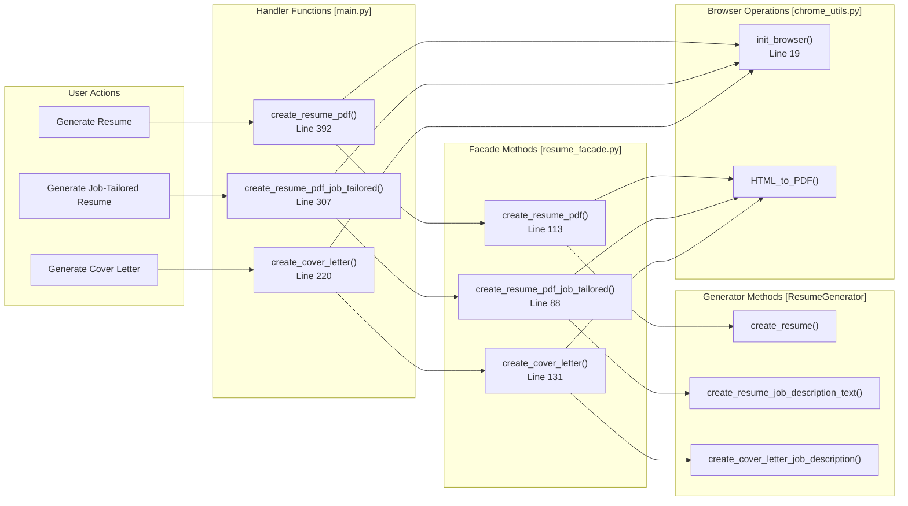
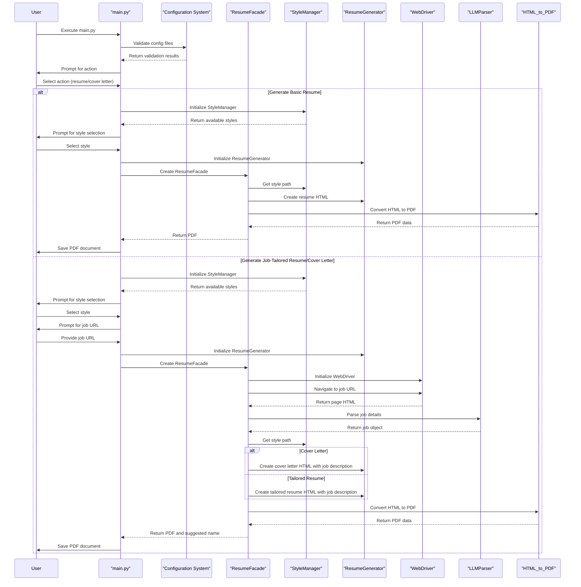
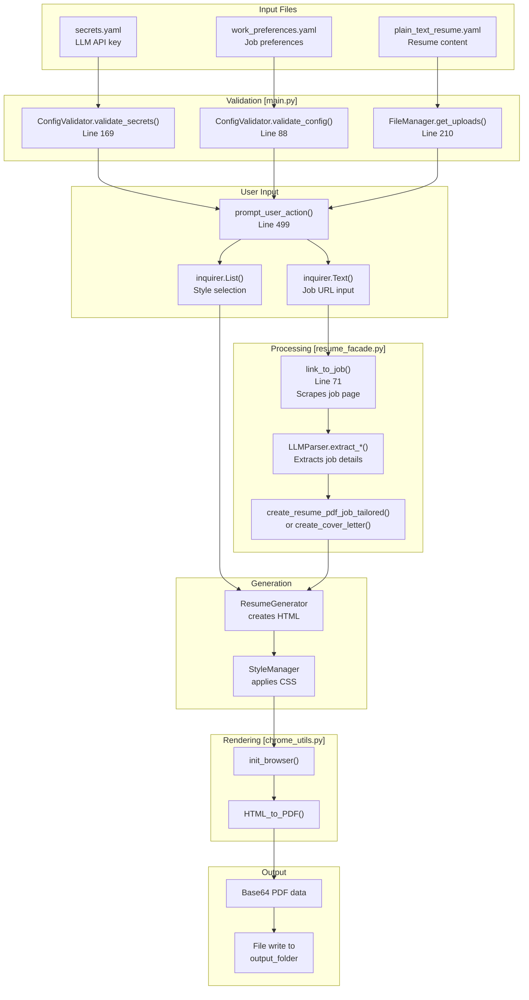

<!-- source: DeepWiki mcp.deepwiki.com · repo feder-cr/Jobs_Applier_AI_Agent_AIHawk · page 2.1 Component Overview · fetched 2026-10-29 -->

# Component Overview

<details>
<summary>Relevant source files</summary>

The following files were used as context for generating this wiki page:

- [README.md](README.md)
- [config.py](config.py)
- [main.py](main.py)
- [src/libs/resume_and_cover_builder/resume_facade.py](src/libs/resume_and_cover_builder/resume_facade.py)

</details>


This document provides a detailed overview of the major components in the AIHawk system. The system is organized into four primary subsystems: the **Job Application Agent** (core automation logic), the **Document Generation Pipeline** (resume and cover letter creation), the **Configuration System** (validation and settings management), and the **LLM Integration Layer** (AI-powered content generation).

For detailed information about specific subsystems, see:
- Configuration System: [2.2](#2.2)
- LLM Integration: [2.3](#2.3)
- Job Application Agent: [2.4](#2.4)
- Browser Automation: [2.5](#2.5)

## System Component Map

The AIHawk system consists of the following major components organized by subsystem:

| Subsystem | Key Components | Primary Files |
|-----------|---------------|---------------|
| **Document Generation** | `ResumeFacade`, `ResumeGenerator`, `StyleManager` | [src/libs/resume_and_cover_builder/resume_facade.py](), [main.py]() |
| **Configuration & Validation** | `ConfigValidator`, `FileManager` | [main.py:35-217]() |
| **LLM Integration** | `LLMParser`, `LLMResumer`, `LLMResumeJobDescription`, `LLMCoverLetterJobDescription` | [src/libs/resume_and_cover_builder/llm/]() |
| **Browser Automation** | `init_browser()`, `HTML_to_PDF()` | [src/utils/chrome_utils.py]() |
| **Job Application Agent** | `AIHawkBotFacade`, `AIHawkJobManager`, `GPTAnswerer` (commented out) | [main.py:25-27]() |
| **Orchestration** | `main()`, `handle_inquiries()`, `prompt_user_action()` | [main.py:499-565]() |

**Note**: The core job application agent components (`AIHawkBotFacade`, `AIHawkJobManager`, `GPTAnswerer`) are present in the architecture but currently commented out in the main entry point. The active implementation focuses on document generation capabilities.

Sources: [main.py:1-565](), [src/libs/resume_and_cover_builder/resume_facade.py:1-153]()

## Component Architecture Diagram

This diagram shows the active components in the current implementation, mapping natural language concepts to actual code entities:

```mermaid
graph TB
    subgraph "Entry Point & Orchestration"
        main_func["main()<br/>[main.py:527]"]
        handle_inquiries["handle_inquiries()<br/>[main.py:471]"]
        prompt_user["prompt_user_action()<br/>[main.py:499]"]
    end

    subgraph "Configuration Subsystem"
        ConfigValidator["ConfigValidator<br/>[main.py:35]"]
        FileManager["FileManager<br/>[main.py:184]"]
        validate_config["validate_config()<br/>[main.py:88]"]
        validate_secrets["validate_secrets()<br/>[main.py:169]"]
        
        ConfigValidator --> validate_config
        ConfigValidator --> validate_secrets
    end

    subgraph "Document Generation Subsystem"
        create_resume_pdf["create_resume_pdf()<br/>[main.py:392]"]
        create_resume_job["create_resume_pdf_job_tailored()<br/>[main.py:307]"]
        create_cover["create_cover_letter()<br/>[main.py:220]"]
        
        ResumeFacade["ResumeFacade<br/>[resume_facade.py:16]"]
        ResumeGenerator["ResumeGenerator<br/>[resume_and_cover_builder]"]
        StyleManager["StyleManager<br/>[resume_and_cover_builder]"]
    end

    subgraph "LLM Integration Subsystem"
        LLMParser["LLMParser<br/>[llm/llm_job_parser.py]"]
        extract_role["extract_role()"]
        extract_company["extract_company_name()"]
        extract_description["extract_job_description()"]
        
        LLMParser --> extract_role
        LLMParser --> extract_company
        LLMParser --> extract_description
    end

    subgraph "Browser Automation Subsystem"
        init_browser["init_browser()<br/>[chrome_utils.py:19]"]
        HTML_to_PDF["HTML_to_PDF()<br/>[chrome_utils.py]"]
        WebDriver["Selenium WebDriver"]
        
        init_browser --> WebDriver
        HTML_to_PDF --> WebDriver
    end

    subgraph "Data Models"
        Resume["Resume<br/>[resume_schemas/resume.py]"]
        Job["Job<br/>[src/job.py]"]
        config_dict["config: dict"]
        llm_api_key["llm_api_key: str"]
    end

    subgraph "Configuration Files"
        secrets_yaml["secrets.yaml"]
        work_pref_yaml["work_preferences.yaml"]
        resume_yaml["plain_text_resume.yaml"]
    end

    main_func --> prompt_user
    prompt_user --> handle_inquiries
    
    main_func --> ConfigValidator
    main_func --> FileManager
    
    ConfigValidator --> secrets_yaml
    ConfigValidator --> work_pref_yaml
    FileManager --> resume_yaml
    
    ConfigValidator --> llm_api_key
    ConfigValidator --> config_dict
    
    handle_inquiries --> create_resume_pdf
    handle_inquiries --> create_resume_job
    handle_inquiries --> create_cover
    
    create_resume_pdf --> StyleManager
    create_resume_pdf --> ResumeGenerator
    create_resume_pdf --> ResumeFacade
    
    create_resume_job --> ResumeFacade
    create_cover --> ResumeFacade
    
    ResumeFacade --> StyleManager
    ResumeFacade --> ResumeGenerator
    ResumeFacade --> LLMParser
    
    ResumeFacade --> init_browser
    ResumeFacade --> HTML_to_PDF
    
    ResumeGenerator --> Resume
    LLMParser --> Job
```



Sources: [main.py:1-565](), [src/libs/resume_and_cover_builder/resume_facade.py:16-153]()

## Code Entity to Function Mapping

This diagram bridges natural language descriptions to specific code functions and classes:



Sources: [main.py:220-468](), [src/libs/resume_and_cover_builder/resume_facade.py:88-153]()

## Component Interactions

The following sequence diagram illustrates how the components interact during a typical resume or cover letter generation process:



Sources: [main.py:220-468](), [src/libs/resume_and_cover_builder/resume_facade.py:88-153]()

## Subsystem Details

### 1. Configuration System

The configuration system validates and manages application settings through two primary classes:

#### ConfigValidator Class

Located at [main.py:35-181](), `ConfigValidator` performs validation of configuration files with the following key methods:

| Method | Purpose | Key Validations |
|--------|---------|-----------------|
| `validate_config()` | Validates `work_preferences.yaml` | Checks experience levels, job types, distance values against whitelists |
| `validate_secrets()` | Validates `secrets.yaml` | Ensures `llm_api_key` is present and non-empty |
| `validate_email()` | Email format validation | Uses regex pattern: `^[a-zA-Z0-9._%+-]+@[a-zA-Z0-9.-]+\.[a-zA-Z]{2,}$` |
| `_validate_experience_levels()` | Experience level validation | Checks against: `["internship", "entry", "associate", "mid_senior_level", "director", "executive"]` |
| `_validate_job_types()` | Job type validation | Checks against: `["full_time", "contract", "part_time", "temporary", "internship", "other", "volunteer"]` |
| `_validate_distance()` | Distance validation | Must be in: `{0, 5, 10, 25, 50, 100}` |

#### FileManager Class

Located at [main.py:184-217](), `FileManager` handles file system operations:

- `validate_data_folder()`: Ensures required files exist (`secrets.yaml`, `work_preferences.yaml`, `plain_text_resume.yaml`)
- `get_uploads()`: Creates path mappings for resume files

Sources: [main.py:35-217]()

### 2. Document Generation Pipeline

The document generation pipeline is the core active component, orchestrated through three handler functions:

#### Handler Functions

Three main handler functions coordinate document generation:

1. **`create_resume_pdf()`** [main.py:392-468]() - Generates a general resume
2. **`create_resume_pdf_job_tailored()`** [main.py:307-389]() - Generates job-specific resume
3. **`create_cover_letter()`** [main.py:220-304]() - Generates job-specific cover letter

#### ResumeFacade Class

The `ResumeFacade` class [src/libs/resume_and_cover_builder/resume_facade.py:16-153]() provides a unified interface to document generation:

| Method | Returns | Purpose |
|--------|---------|---------|
| `__init__()` | None | Initializes with `api_key`, `style_manager`, `resume_generator`, `resume_object`, `output_path` |
| `set_driver()` | None | Sets the Selenium WebDriver instance |
| `link_to_job()` | None | Scrapes job page and extracts details using `LLMParser` |
| `create_resume_pdf()` | `bytes` | Generates general resume PDF (Base64 encoded) |
| `create_resume_pdf_job_tailored()` | `tuple[bytes, str]` | Generates tailored resume PDF with suggested filename |
| `create_cover_letter()` | `tuple[bytes, str]` | Generates cover letter PDF with suggested filename |

#### Key Dependencies

- **StyleManager**: Manages resume visual styles and templates
- **ResumeGenerator**: Generates HTML content from resume data
- **LLMParser**: Parses job descriptions from web pages

Sources: [main.py:220-468](), [src/libs/resume_and_cover_builder/resume_facade.py:16-153]()

### 3. LLM Integration Layer

The LLM integration layer uses the `LLMParser` class to extract job information:

#### LLMParser Operations

Located at [src/libs/resume_and_cover_builder/resume_facade.py:71-87](), the `LLMParser` performs:

```python
# Job information extraction flow
llm_job_parser = LLMParser(openai_api_key=global_config.API_KEY)
llm_job_parser.set_body_html(body_element)

job = Job()
job.role = llm_job_parser.extract_role()
job.company = llm_job_parser.extract_company_name()
job.description = llm_job_parser.extract_job_description()
job.location = llm_job_parser.extract_location()
```

The extracted `Job` object is used to tailor resume and cover letter content.

Sources: [src/libs/resume_and_cover_builder/resume_facade.py:71-87]()

### 4. Job Application Agent (Inactive)

The job application agent components are present in the architecture but currently commented out:

```python
# from ai_hawk.bot_facade import AIHawkBotFacade
# from ai_hawk.job_manager import AIHawkJobManager
# from ai_hawk.llm.llm_manager import GPTAnswerer
```

These components would provide:
- **AIHawkBotFacade**: Main interface for automated job applications
- **AIHawkJobManager**: Job search and application management
- **GPTAnswerer**: AI-powered form filling and question answering

The architecture supports these components, but they are not active in the current main entry point.

Sources: [main.py:25-27]()

## Data Flow Through Components

This diagram shows the flow of data through the system with specific file and function references:



Sources: [main.py:220-468](), [main.py:527-565](), [src/libs/resume_and_cover_builder/resume_facade.py:16-153]()

## Component Initialization and Configuration

### Global Configuration Setup

The `ResumeFacade.__init__()` method [src/libs/resume_and_cover_builder/resume_facade.py:17-38]() sets up global configuration:

```python
# Configuration paths set during initialization
global_config.STRINGS_MODULE_RESUME_PATH = lib_directory / "resume_prompt/strings_feder-cr.py"
global_config.STRINGS_MODULE_RESUME_JOB_DESCRIPTION_PATH = lib_directory / "resume_job_description_prompt/strings_feder-cr.py"
global_config.STRINGS_MODULE_COVER_LETTER_JOB_DESCRIPTION_PATH = lib_directory / "cover_letter_prompt/strings_feder-cr.py"
global_config.STYLES_DIRECTORY = lib_directory / "resume_style"
global_config.LOG_OUTPUT_FILE_PATH = output_path
global_config.API_KEY = api_key
```

### Style Management

The `StyleManager` class provides style-related functionality:

- `get_styles()`: Returns available styles from the styles directory
- `format_choices()`: Formats styles for user selection
- `set_selected_style()`: Sets the active style
- `get_style_path()`: Returns path to the selected style file

User interaction flow for style selection [main.py:232-256]():

```python
style_manager = StyleManager()
available_styles = style_manager.get_styles()
choices = style_manager.format_choices(available_styles)
questions = [inquirer.List("style", message="Select a style for the resume:", choices=choices)]
style_answer = inquirer.prompt(questions)
style_manager.set_selected_style(style_name)
```

Sources: [main.py:231-256](), [main.py:318-342](), [main.py:404-428](), [src/libs/resume_and_cover_builder/resume_facade.py:17-38]()

### Resume Generation Flow

The `ResumeGenerator` class handles content generation with different methods for different document types:

| Method | Input | Output | Usage |
|--------|-------|--------|-------|
| `create_resume()` | `style_path` | HTML string | General resume without job targeting |
| `create_resume_job_description_text()` | `style_path`, `job_description` | HTML string | Job-tailored resume |
| `create_cover_letter_job_description()` | `style_path`, `job_description` | HTML string | Job-tailored cover letter |
| `set_resume_object()` | `Resume` object | None | Sets the resume data to use |

Sources: [main.py:261-274](), [main.py:346-359](), [main.py:431-445](), [src/libs/resume_and_cover_builder/resume_facade.py:88-153]()

## Browser Automation and PDF Generation

### Browser Initialization

The `init_browser()` function [src/utils/chrome_utils.py:19]() initializes a Selenium Chrome WebDriver with specific options for PDF generation:

- Headless mode for background operation
- Disabled GPU for stability
- No sandbox mode
- Configured for PDF rendering

Usage pattern in main.py:
```python
driver = init_browser()  # Line 263, 348, 433
resume_facade.set_driver(driver)  # Set driver on facade
```

### HTML to PDF Conversion

The `HTML_to_PDF()` function converts HTML content to PDF using Chrome DevTools Protocol (CDP):

**Process Flow:**
1. HTML content is loaded into the WebDriver
2. Chrome's native PDF generation via CDP
3. Returns Base64-encoded PDF data

**Invocation Points:**
- [src/libs/resume_and_cover_builder/resume_facade.py:107]() - For job-tailored resumes
- [src/libs/resume_and_cover_builder/resume_facade.py:127]() - For general resumes
- [src/libs/resume_and_cover_builder/resume_facade.py:151]() - For cover letters

**Output Handling** [main.py:277-301](), [main.py:361-386](), [main.py:447-465]():
```python
result_base64, suggested_name = resume_facade.create_resume_pdf_job_tailored()
pdf_data = base64.b64decode(result_base64)
output_path = output_dir / "resume_tailored.pdf"
with open(output_path, "wb") as file:
    file.write(pdf_data)
```

Sources: [main.py:263-301](), [main.py:348-386](), [main.py:433-465](), [src/libs/resume_and_cover_builder/resume_facade.py:88-153]()

## Error Handling and Orchestration

### Main Entry Point

The `main()` function [main.py:527-565]() serves as the application entry point with comprehensive error handling:

```python
def main():
    try:
        # Validation phase
        data_folder = Path("data_folder")
        secrets_file, config_file, plain_text_resume_file, output_folder = 
            FileManager.validate_data_folder(data_folder)
        config = ConfigValidator.validate_config(config_file)
        llm_api_key = ConfigValidator.validate_secrets(secrets_file)
        
        # Preparation phase
        config["uploads"] = FileManager.get_uploads(plain_text_resume_file)
        config["outputFileDirectory"] = output_folder
        
        # Execution phase
        selected_actions = prompt_user_action()
        handle_inquiries(selected_actions, config, llm_api_key)
        
    except ConfigError as ce:
        # Configuration validation errors
    except FileNotFoundError as fnf:
        # Missing file errors
    except RuntimeError as re:
        # Runtime execution errors
    except Exception as e:
        # Unexpected errors
```

### Request Routing

The `handle_inquiries()` function [main.py:471-497]() routes user selections to appropriate handlers:

| User Selection | Handler Function | Line Number |
|----------------|------------------|-------------|
| "Generate Resume" | `create_resume_pdf()` | 483 |
| "Generate Resume Tailored for Job Description" | `create_resume_pdf_job_tailored()` | 487 |
| "Generate Tailored Cover Letter for Job Description" | `create_cover_letter()` | 491 |

Sources: [main.py:471-565]()

## Key Data Models

### Configuration Dictionary Structure

After validation, the configuration dictionary contains:

```python
config = {
    "remote": bool,                    # Remote work preference
    "experience_level": dict,          # Experience level filters
    "job_types": dict,                 # Job type filters
    "date": dict,                      # Date filters
    "positions": list,                 # Target positions
    "locations": list,                 # Target locations
    "location_blacklist": list,        # Excluded locations
    "distance": int,                   # Search radius
    "company_blacklist": list,         # Excluded companies
    "title_blacklist": list,           # Excluded job titles
    "uploads": dict,                   # File path mappings
    "outputFileDirectory": Path        # Output directory
}
```

### Job Object Structure

The `Job` object [src/libs/resume_and_cover_builder/resume_facade.py:79-85]() stores extracted job information:

```python
job = Job()
job.role = llm_job_parser.extract_role()           # Job title
job.company = llm_job_parser.extract_company_name() # Company name
job.description = llm_job_parser.extract_job_description() # Full description
job.location = llm_job_parser.extract_location()    # Job location
job.link = job_url                                  # Original URL
```

### Resume Object

The `Resume` object [main.py:262-263](), [main.py:347-348](), [main.py:432-433]() is created from the YAML resume file:

```python
with open(parameters["uploads"]["plainTextResume"], "r", encoding="utf-8") as file:
    plain_text_resume = file.read()
resume_object = Resume(plain_text_resume)
```

Sources: [main.py:35-110](), [main.py:262-274](), [main.py:347-359](), [main.py:432-445](), [src/libs/resume_and_cover_builder/resume_facade.py:79-87]()

## Summary

The AIHawk system employs a modular architecture with clear separation of concerns between components. The main application controller coordinates the workflow, while specialized components handle specific tasks such as configuration validation, resume generation, and PDF conversion. This design allows for flexibility and extensibility, enabling the system to support different resume styles, LLM integrations, and output formats.

The system follows a facade pattern through the `ResumeFacade` class, which simplifies the interaction between the main application and the various subsystems. This pattern enhances maintainability and provides a clean interface for future enhancements.

---

