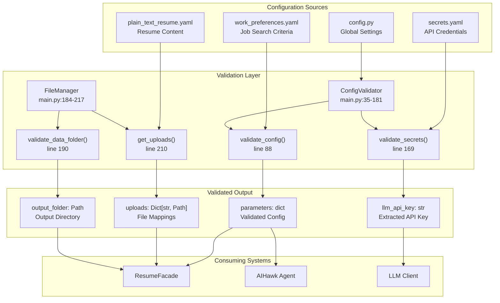
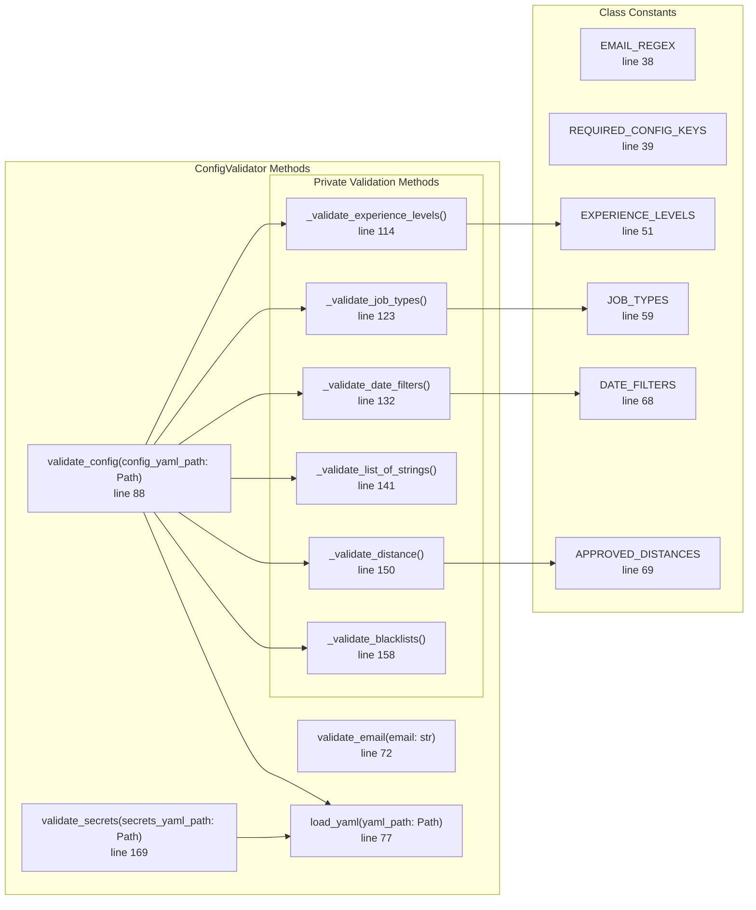
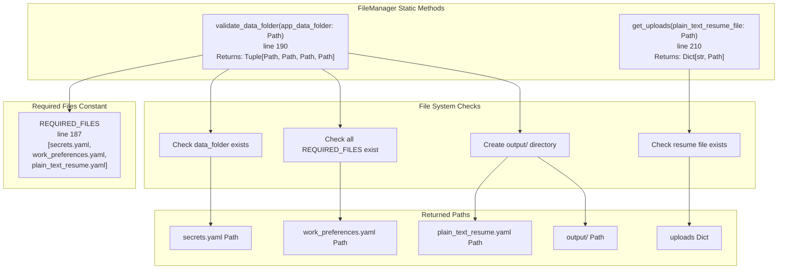
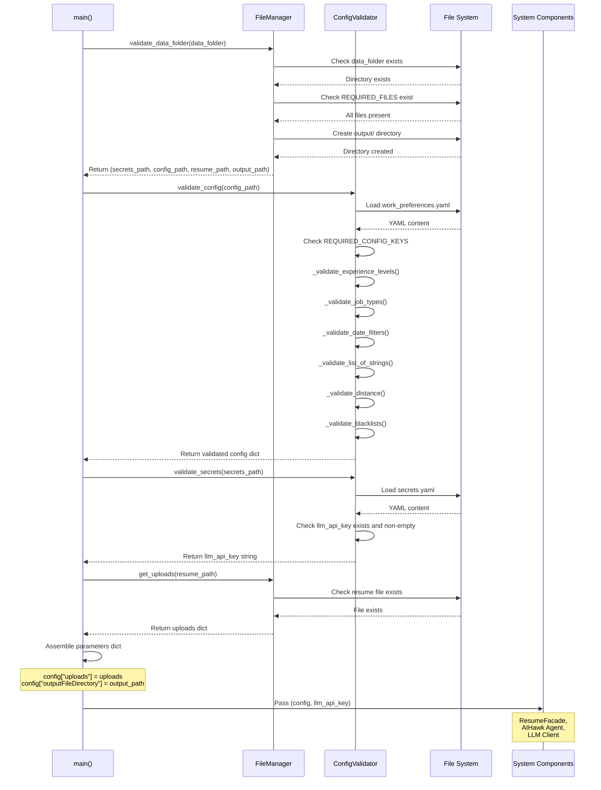

<!-- source: DeepWiki mcp.deepwiki.com · repo feder-cr/Jobs_Applier_AI_Agent_AIHawk · page 2.2 Configuration System · fetched 2026-10-29 -->

# Configuration System

<details>
<summary>Relevant source files</summary>

The following files were used as context for generating this wiki page:

- [README.md](README.md)
- [config.py](config.py)
- [main.py](main.py)
- [src/libs/resume_and_cover_builder/config.py](src/libs/resume_and_cover_builder/config.py)

</details>


## Purpose and Scope

The Configuration System manages all application settings, validates user-provided configuration files, and ensures that the AIHawk system operates with valid parameters. This system acts as a central hub that provides validated configuration to all other subsystems including the job application agent, document generation pipeline, and LLM integration layer.

This page covers the configuration validation architecture, file management, and validation rules. For information about how to configure the system as an end user, see [Configuration Files](#3.2). For LLM-specific configuration details, see [LLM Integration](#2.3).

**Sources:** [README.md:1-27](), [main.py:30-217](), [config.py:1-23]()

---

## Configuration Architecture

The configuration system is built around two primary classes: `ConfigValidator` and `FileManager`. These classes work together to load, validate, and prepare configuration data from multiple YAML files and the global `config.py` module.



**Configuration Flow from Files to System Consumers**

The `main()` function in [main.py:527-562]() orchestrates the configuration loading process, calling validation methods in sequence and assembling a complete configuration dictionary that is passed to consuming systems.

**Sources:** [main.py:30-217](), [main.py:527-562](), [config.py:1-23]()

---

## Configuration Files

The system requires four configuration sources to operate:

| File | Location | Purpose | Validation Class |
|------|----------|---------|------------------|
| `config.py` | Project root | Global application settings (logging, LLM model, job limits) | Module import |
| `secrets.yaml` | `data_folder/` | Sensitive credentials (API keys) | `ConfigValidator.validate_secrets()` |
| `work_preferences.yaml` | `data_folder/` | Job search preferences (locations, experience levels, job types) | `ConfigValidator.validate_config()` |
| `plain_text_resume.yaml` | `data_folder/` | User resume content in YAML format | `FileManager.get_uploads()` |

### config.py - Global Settings

The `config.py` module [config.py:1-23]() defines application-wide constants:

| Setting | Type | Purpose | Default Value |
|---------|------|---------|---------------|
| `LOG_LEVEL` | str | Logging verbosity | `'ERROR'` |
| `LOG_SELENIUM_LEVEL` | int | Selenium driver log level | `ERROR` constant |
| `LOG_TO_FILE` | bool | Enable file logging | `False` |
| `LOG_TO_CONSOLE` | bool | Enable console logging | `False` |
| `MINIMUM_WAIT_TIME_IN_SECONDS` | int | Rate limiting between applications | `60` |
| `JOB_APPLICATIONS_DIR` | str | Directory for storing applications | `"job_applications"` |
| `JOB_SUITABILITY_SCORE` | int | Minimum score to apply (1-10) | `7` |
| `JOB_MAX_APPLICATIONS` | int | Maximum applications per session | `5` |
| `JOB_MIN_APPLICATIONS` | int | Minimum applications before stopping | `1` |
| `LLM_MODEL_TYPE` | str | LLM provider (`'openai'` or `'ollama'`) | `'openai'` |
| `LLM_MODEL` | str | Specific model name | `'gpt-4o-mini'` |
| `LLM_API_URL` | str | OLLAMA endpoint URL (if applicable) | `''` |

These settings are imported directly by other modules and do not undergo validation.

**Sources:** [config.py:1-23]()

### secrets.yaml - API Credentials

Contains sensitive authentication credentials. The `validate_secrets()` method [main.py:169-181]() ensures the `llm_api_key` field is present and non-empty.

**Required fields:**
- `llm_api_key`: API key for OpenAI or OLLAMA service

**Sources:** [main.py:169-181]()

### work_preferences.yaml - Job Search Configuration

Contains all job search criteria and preferences. This file undergoes extensive validation through `validate_config()` [main.py:88-111]().

**Sources:** [main.py:88-111]()

### plain_text_resume.yaml - Resume Content

Contains the user's resume data in structured YAML format. The `FileManager.get_uploads()` method [main.py:210-217]() validates file existence and creates a file path mapping.

**Sources:** [main.py:210-217]()

---

## ConfigValidator Class

The `ConfigValidator` class [main.py:35-181]() implements comprehensive validation logic for configuration files. It is implemented as a class with static methods and class methods, serving as a stateless validator.



**ConfigValidator Class Structure and Methods**

### Validation Constants

The class defines several constants that serve as whitelists and validation schemas [main.py:38-69]():

| Constant | Purpose | Values |
|----------|---------|--------|
| `EMAIL_REGEX` | Email format validation | Regex pattern: `^[a-zA-Z0-9._%+-]+@[a-zA-Z0-9.-]+\.[a-zA-Z]{2,}$` |
| `REQUIRED_CONFIG_KEYS` | Required fields in work_preferences.yaml | See table below |
| `EXPERIENCE_LEVELS` | Valid experience level values | `["internship", "entry", "associate", "mid_senior_level", "director", "executive"]` |
| `JOB_TYPES` | Valid job type values | `["full_time", "contract", "part_time", "temporary", "internship", "other", "volunteer"]` |
| `DATE_FILTERS` | Valid date filter values | `["all_time", "month", "week", "24_hours"]` |
| `APPROVED_DISTANCES` | Valid distance values in miles | `{0, 5, 10, 25, 50, 100}` |

### Required Configuration Keys

The `REQUIRED_CONFIG_KEYS` dictionary [main.py:39-50]() defines the schema for `work_preferences.yaml`:

| Key | Expected Type | Description |
|-----|---------------|-------------|
| `remote` | `bool` | Enable remote job search |
| `experience_level` | `dict` | Dictionary of experience levels with boolean values |
| `job_types` | `dict` | Dictionary of job types with boolean values |
| `date` | `dict` | Dictionary of date filters with boolean values |
| `positions` | `list` | List of job titles/positions to search for |
| `locations` | `list` | List of geographic locations to search in |
| `location_blacklist` | `list` | List of locations to exclude |
| `distance` | `int` | Maximum distance from location (in miles) |
| `company_blacklist` | `list` | List of companies to exclude |
| `title_blacklist` | `list` | List of job title keywords to exclude |

### Core Validation Methods

**validate_email(email: str) → bool** [main.py:72-74]()

Validates email format using the `EMAIL_REGEX` pattern. Returns `True` if valid, `False` otherwise.

**load_yaml(yaml_path: Path) → dict** [main.py:77-85]()

Loads a YAML file and returns its contents as a dictionary. Raises `ConfigError` if the file is not found or contains invalid YAML syntax.

**validate_config(config_yaml_path: Path) → dict** [main.py:88-111]()

Main validation method for `work_preferences.yaml`. Performs the following checks:
1. Loads the YAML file
2. Verifies all required keys are present
3. Validates data types for each key
4. Calls specialized validation methods for each configuration category
5. Initializes optional blacklist fields to empty lists if missing

Returns the validated configuration dictionary.

**validate_secrets(secrets_yaml_path: Path) → str** [main.py:169-181]()

Validates `secrets.yaml` and extracts the LLM API key. Checks that:
- The `llm_api_key` field exists
- The `llm_api_key` value is non-empty

Returns the API key as a string.

### Specialized Validation Methods

These private methods enforce specific validation rules for different configuration categories:

**_validate_experience_levels(experience_levels: dict, config_path: Path)** [main.py:114-120]()

Ensures each experience level in `EXPERIENCE_LEVELS` is present in the configuration with a boolean value.

**_validate_job_types(job_types: dict, config_path: Path)** [main.py:123-129]()

Ensures each job type in `JOB_TYPES` is present with a boolean value.

**_validate_date_filters(date_filters: dict, config_path: Path)** [main.py:132-138]()

Ensures each date filter in `DATE_FILTERS` is present with a boolean value.

**_validate_list_of_strings(parameters: dict, keys: list, config_path: Path)** [main.py:141-147]()

Validates that specified keys contain lists of strings (used for `positions`, `locations`, blacklists).

**_validate_distance(distance: int, config_path: Path)** [main.py:150-155]()

Validates that the distance value is one of the approved values in `APPROVED_DISTANCES`.

**_validate_blacklists(parameters: dict, config_path: Path)** [main.py:158-166]()

Ensures blacklist fields (`company_blacklist`, `title_blacklist`, `location_blacklist`) are lists, initializing them to empty lists if `None`.

**Sources:** [main.py:35-181]()

---

## FileManager Class

The `FileManager` class [main.py:184-217]() handles file system operations and validations for the configuration system.



**FileManager Methods and File Path Management**

### Class Constants

**REQUIRED_FILES** [main.py:187]()

A list of required YAML files that must be present in the `data_folder`:
- `SECRETS_YAML` (`"secrets.yaml"`)
- `WORK_PREFERENCES_YAML` (`"work_preferences.yaml"`)
- `PLAIN_TEXT_RESUME_YAML` (`"plain_text_resume.yaml"`)

These constants are imported from [src/utils/constants.py:20-24]().

### Methods

**validate_data_folder(app_data_folder: Path) → Tuple[Path, Path, Path, Path]** [main.py:190-207]()

Validates the existence of the data folder and all required files. Returns a tuple of paths:
1. `secrets.yaml` full path
2. `work_preferences.yaml` full path
3. `plain_text_resume.yaml` full path
4. `output/` directory path (created if it doesn't exist)

Raises `FileNotFoundError` if:
- The `data_folder` directory does not exist
- Any of the required files are missing

**get_uploads(plain_text_resume_file: Path) → Dict[str, Path]** [main.py:210-217]()

Converts the resume file path into a dictionary mapping used by the document generation system. Returns:
```python
{
    "plainTextResume": <Path to plain_text_resume.yaml>
}
```

Raises `FileNotFoundError` if the resume file does not exist.

**Sources:** [main.py:184-217](), [src/utils/constants.py:20-24]()

---

## Configuration Validation Rules

The configuration system enforces strict validation rules to ensure system reliability. This section details each validation rule category.

### Experience Level Validation

Experience levels are validated through `_validate_experience_levels()` [main.py:114-120](). Each level must be a boolean indicating whether to search for jobs at that level.

**Valid Experience Levels:**

| Level | Description |
|-------|-------------|
| `internship` | Internship positions |
| `entry` | Entry-level positions |
| `associate` | Associate-level positions |
| `mid_senior_level` | Mid to senior-level positions |
| `director` | Director-level positions |
| `executive` | Executive-level positions |

**Example Configuration:**
```yaml
experience_level:
  internship: false
  entry: true
  associate: true
  mid_senior_level: true
  director: false
  executive: false
```

### Job Type Validation

Job types are validated through `_validate_job_types()` [main.py:123-129](). Each type must be a boolean indicating whether to search for that job type.

**Valid Job Types:**

| Type | Description |
|------|-------------|
| `full_time` | Full-time employment |
| `contract` | Contract/consulting positions |
| `part_time` | Part-time employment |
| `temporary` | Temporary positions |
| `internship` | Internship programs |
| `other` | Other employment types |
| `volunteer` | Volunteer positions |

### Date Filter Validation

Date filters control how recent job postings should be. Validated through `_validate_date_filters()` [main.py:132-138]().

**Valid Date Filters:**

| Filter | Description |
|--------|-------------|
| `all_time` | All job postings |
| `month` | Posted within the last month |
| `week` | Posted within the last week |
| `24_hours` | Posted within the last 24 hours |

### Distance Validation

Distance values must be one of the approved values in miles, validated through `_validate_distance()` [main.py:150-155]().

**Approved Distance Values:** `0, 5, 10, 25, 50, 100` miles

### List Validations

Several fields must be lists of strings, validated through `_validate_list_of_strings()` [main.py:141-147]():

| Field | Description | Can be Empty |
|-------|-------------|--------------|
| `positions` | Job titles to search for | No (must have at least one) |
| `locations` | Geographic locations to search | No (must have at least one) |
| `location_blacklist` | Locations to exclude | Yes |
| `company_blacklist` | Companies to exclude | Yes |
| `title_blacklist` | Job title keywords to exclude | Yes |

### Blacklist Validation

Blacklists are validated through `_validate_blacklists()` [main.py:158-166]() and automatically initialized to empty lists if not provided or set to `None`.

**Sources:** [main.py:114-166]()

---

## Configuration Flow Through the System

The following diagram illustrates how configuration data flows from initial loading through validation and into consuming systems.



**Configuration Loading and Validation Sequence**

### Main Execution Flow

The `main()` function [main.py:527-562]() orchestrates the configuration loading:

1. **Define data folder** [main.py:531]()
   ```python
   data_folder = Path("data_folder")
   ```

2. **Validate data folder and get paths** [main.py:532]()
   ```python
   secrets_file, config_file, plain_text_resume_file, output_folder = FileManager.validate_data_folder(data_folder)
   ```

3. **Validate configuration** [main.py:535]()
   ```python
   config = ConfigValidator.validate_config(config_file)
   ```

4. **Validate secrets and extract API key** [main.py:536]()
   ```python
   llm_api_key = ConfigValidator.validate_secrets(secrets_file)
   ```

5. **Get file uploads mapping** [main.py:539]()
   ```python
   config["uploads"] = FileManager.get_uploads(plain_text_resume_file)
   ```

6. **Add output directory to config** [main.py:540]()
   ```python
   config["outputFileDirectory"] = output_folder
   ```

7. **Pass validated config to consuming functions** [main.py:546]()
   ```python
   handle_inquiries(selected_actions, config, llm_api_key)
   ```

### Error Handling

The configuration system implements comprehensive error handling [main.py:548-561]():

| Exception Type | Cause | User Guidance |
|----------------|-------|---------------|
| `ConfigError` | Validation failures in YAML files | Link to configuration guide |
| `FileNotFoundError` | Missing required files | Instruction to ensure files exist in data folder |
| `RuntimeError` | Runtime errors during validation | Stack trace logged |
| `Exception` | Unexpected errors | Full exception logged |

**Sources:** [main.py:527-562]()

---

## GlobalConfig Object

The document generation system uses an additional configuration object defined in [src/libs/resume_and_cover_builder/config.py:7-36]().

```mermaid
graph TB
    subgraph "GlobalConfig Class"
        GlobalConfig["GlobalConfig<br/>src/libs/resume_and_cover_builder/config.py:7"]
        
        subgraph "Prompt Module Paths"
            STRINGS_MODULE_RESUME_PATH["STRINGS_MODULE_RESUME_PATH: Path"]
            STRINGS_MODULE_RESUME_JOB_DESCRIPTION_PATH["STRINGS_MODULE_RESUME_JOB_DESCRIPTION_PATH: Path"]
            STRINGS_MODULE_COVER_LETTER_JOB_DESCRIPTION_PATH["STRINGS_MODULE_COVER_LETTER_JOB_DESCRIPTION_PATH: Path"]
            STRINGS_MODULE_NAME["STRINGS_MODULE_NAME: str"]
        end
        
        subgraph "Resource Directories"
            STYLES_DIRECTORY["STYLES_DIRECTORY: Path"]
            LOG_OUTPUT_FILE_PATH["LOG_OUTPUT_FILE_PATH: Path"]
        end
        
        subgraph "API Configuration"
            API_KEY["API_KEY: str"]
        end
        
        subgraph "Templates"
            html_template["html_template: str<br/>HTML Document Template"]
        end
    end
    
    subgraph "Singleton Instance"
        global_config["global_config<br/>Module-level instance"]
    end
    
    GlobalConfig --> STRINGS_MODULE_RESUME_PATH
    GlobalConfig --> STRINGS_MODULE_RESUME_JOB_DESCRIPTION_PATH
    GlobalConfig --> STRINGS_MODULE_COVER_LETTER_JOB_DESCRIPTION_PATH
    GlobalConfig --> STRINGS_MODULE_NAME
    GlobalConfig --> STYLES_DIRECTORY
    GlobalConfig --> LOG_OUTPUT_FILE_PATH
    GlobalConfig --> API_KEY
    GlobalConfig --> html_template
    
    GlobalConfig --> global_config
```



**GlobalConfig Architecture for Document Generation**

### GlobalConfig Fields

The `GlobalConfig` class [src/libs/resume_and_cover_builder/config.py:7-36]() stores paths and settings used throughout the document generation pipeline:

| Field | Type | Purpose |
|-------|------|---------|
| `STRINGS_MODULE_RESUME_PATH` | `Path` | Path to prompt strings for general resume generation |
| `STRINGS_MODULE_RESUME_JOB_DESCRIPTION_PATH` | `Path` | Path to prompt strings for job-tailored resume generation |
| `STRINGS_MODULE_COVER_LETTER_JOB_DESCRIPTION_PATH` | `Path` | Path to prompt strings for cover letter generation |
| `STRINGS_MODULE_NAME` | `str` | Name of the active prompt module |
| `STYLES_DIRECTORY` | `Path` | Directory containing CSS style files |
| `LOG_OUTPUT_FILE_PATH` | `Path` | Path for logging output |
| `API_KEY` | `str` | LLM API key (copied from validated secrets) |
| `html_template` | `str` | HTML template with placeholders for CSS and body content |

### HTML Template Structure

The `html_template` field [src/libs/resume_and_cover_builder/config.py:16-34]() defines the document structure:

```html
<!DOCTYPE html>
<html lang="en">
<head>
    <meta charset="UTF-8">
    <meta name="viewport" content="width=device-width, initial-scale=1.0">
    <title>Resume</title>
    <link href="https://fonts.googleapis.com/css2?family=Barlow:wght@400;600&display=swap" rel="stylesheet" />
    <link rel="stylesheet" href="https://cdnjs.cloudflare.com/ajax/libs/font-awesome/5.15.3/css/all.min.css" /> 
    <style>
        $style_css
    </style>
</head>
<body>
$body
</body>
</html>
```

The template uses placeholder variables:
- `$style_css`: Replaced with selected CSS style content
- `$body`: Replaced with generated resume/cover letter HTML

### Singleton Pattern

The module creates a single instance `global_config` [src/libs/resume_and_cover_builder/config.py:36]() that is imported and used throughout the document generation system. This ensures configuration consistency across all components.

**Sources:** [src/libs/resume_and_cover_builder/config.py:1-37]()

---

## Configuration Usage Examples

### Example 1: Creating Documents with Configuration

From [main.py:392-468](), the `create_resume_pdf()` function demonstrates configuration usage:

```python
# Load plain text resume using validated path
with open(parameters["uploads"]["plainTextResume"], "r", encoding="utf-8") as file:
    plain_text_resume = file.read()

# Use output directory from validated configuration
output_dir = Path(parameters["outputFileDirectory"])
output_path = output_dir / "resume_base.pdf"
```

The `parameters` dictionary contains:
- `parameters["uploads"]["plainTextResume"]`: Path from `FileManager.get_uploads()`
- `parameters["outputFileDirectory"]`: Path from `FileManager.validate_data_folder()`

**Sources:** [main.py:392-468]()

### Example 2: Job-Tailored Documents

From [main.py:307-389](), job-tailored document generation uses additional configuration:

```python
# Create subfolder using suggested job name
output_dir = Path(parameters["outputFileDirectory"]) / suggested_name
output_dir.mkdir(parents=True, exist_ok=True)

output_path = output_dir / "resume_tailored.pdf"
```

This creates a hierarchical structure:
```
data_folder/
└── output/
    └── <suggested_job_name>/
        └── resume_tailored.pdf
```

**Sources:** [main.py:307-389]()

### Example 3: Configuration Error Handling

From [main.py:548-561](), the main function demonstrates proper error handling:

```python
except ConfigError as ce:
    logger.error(f"Configuration error: {ce}")
    logger.error(
        "Refer to the configuration guide for troubleshooting: "
        "https://github.com/feder-cr/Auto_Jobs_Applier_AIHawk?tab=readme-ov-file#configuration"
    )
except FileNotFoundError as fnf:
    logger.error(f"File not found: {fnf}")
    logger.error("Ensure all required files are present in the data folder.")
```

This provides actionable error messages to users when configuration fails.

**Sources:** [main.py:548-561]()

---

## Summary

The Configuration System is a robust validation and file management layer that ensures AIHawk operates with valid settings. Key components include:

- **ConfigValidator**: Validates YAML files against strict schemas with whitelisted values
- **FileManager**: Manages file system operations and path mappings
- **GlobalConfig**: Provides document generation-specific configuration
- **Multi-source configuration**: Separates concerns across `config.py`, `secrets.yaml`, `work_preferences.yaml`, and `plain_text_resume.yaml`

The system enforces type checking, whitelist validation, and required field verification to prevent runtime errors. All configuration data flows through validation before reaching consuming systems, ensuring reliability and predictable behavior.

For information on how to configure these files as an end user, see [Configuration Files](#3.2). For details on extending the configuration system, see [Configuration and Validation](#4.6).

**Sources:** [main.py:30-562](), [config.py:1-23](), [src/libs/resume_and_cover_builder/config.py:1-37]()

---

