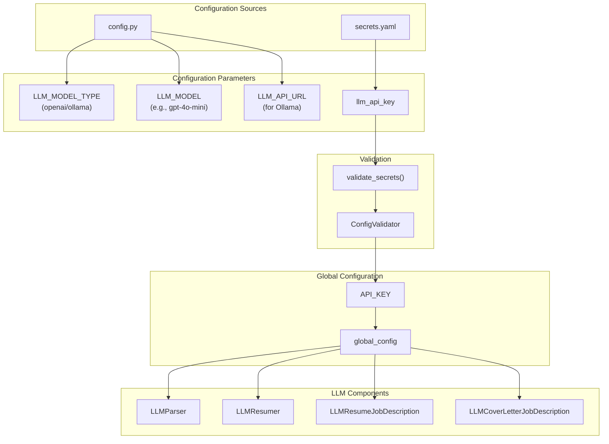
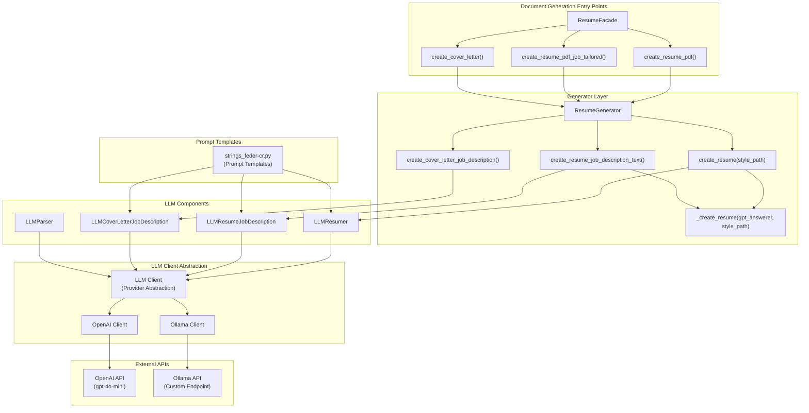
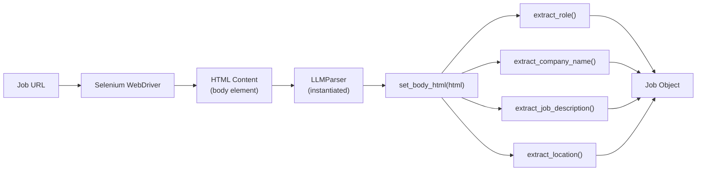
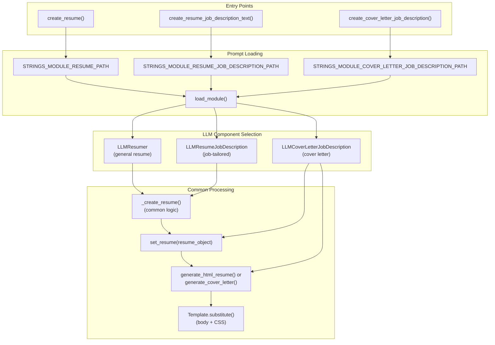

<!-- source: DeepWiki mcp.deepwiki.com · repo feder-cr/Jobs_Applier_AI_Agent_AIHawk · page 2.3 LLM Integration · fetched 2026-10-29 -->

# LLM Integration

<details>
<summary>Relevant source files</summary>

The following files were used as context for generating this wiki page:

- [README.md](README.md)
- [config.py](config.py)
- [src/libs/resume_and_cover_builder/resume_facade.py](src/libs/resume_and_cover_builder/resume_facade.py)
- [src/libs/resume_and_cover_builder/resume_generator.py](src/libs/resume_and_cover_builder/resume_generator.py)

</details>


This document details how the AIHawk job application system integrates with various Large Language Models (LLMs) to power its core document generation capabilities. The LLM integration component serves as the intelligence layer that transforms user resume data and job descriptions into professionally formatted resumes and cover letters.

## Purpose and Scope

The LLM integration in AIHawk serves three main purposes:
1. Generate standard resumes from user profile data
2. Create job-tailored resumes that highlight relevant skills based on job descriptions
3. Craft personalized cover letters for specific job opportunities

This document focuses specifically on the technical implementation of how different LLM providers are integrated and utilized within the system. For information about the actual document generation process, see [Resume Generation System](#4.1) and [Cover Letter Generation](#4.2).

## Supported LLM Providers

AIHawk uses a provider-agnostic architecture that currently supports two LLM providers: OpenAI and Ollama. This design allows the system to route requests to different backends based on configuration without changing the application logic.

| Provider | Default Model | Configuration Required | Use Case |
|----------|---------------|----------------------|----------|
| OpenAI | `gpt-4o-mini` | API key via `secrets.yaml` | Cloud-based LLM with consistent availability |
| Ollama | User-specified | API key + `LLM_API_URL` endpoint | Local/self-hosted LLM for privacy and cost control |

The provider selection is determined by the `LLM_MODEL_TYPE` configuration parameter in [config.py:19]().

Sources: [config.py:19-22](), [README.md:1-27]()

## Configuration System

### LLM Configuration Parameters

The LLM integration is configured through two main files that control provider selection, model specification, and authentication:

**1. config.py** - Defines operational parameters:
- `LLM_MODEL_TYPE`: Selects the LLM provider (`'openai'` or `'ollama'`)
- `LLM_MODEL`: Specifies the model name (e.g., `'gpt-4o-mini'`)
- `LLM_API_URL`: Required for Ollama to specify the local endpoint URL (e.g., `'http://127.0.0.1:11434/'`)

**2. secrets.yaml** - Contains authentication credentials:
- `llm_api_key`: The API key for authenticating with the LLM provider

The API key is extracted and validated by the configuration system before being passed to LLM components. The `global_config.API_KEY` is set during initialization in [src/libs/resume_and_cover_builder/resume_facade.py:34]().

Sources: [config.py:19-22](), [src/libs/resume_and_cover_builder/resume_facade.py:27-34]()

### Configuration Flow Diagram



This diagram shows how configuration parameters flow from source files through validation into the global configuration object, which is then consumed by all LLM components.

Sources: [config.py:19-22](), [src/libs/resume_and_cover_builder/resume_facade.py:27-34]()

## LLM Integration Architecture

The LLM integration uses a layered architecture with clear separation between document generation logic, LLM components, and provider-specific clients.

### Component Layer Architecture



This architecture ensures that document generation logic is decoupled from the specific LLM provider implementation. The `ResumeGenerator` class [src/libs/resume_and_cover_builder/resume_generator.py:13-65]() orchestrates LLM component instantiation, while the LLM client layer handles provider-specific API communication.

Sources: [src/libs/resume_and_cover_builder/resume_facade.py:16-153](), [src/libs/resume_and_cover_builder/resume_generator.py:13-65]()

## LLM Component Classes

The system uses specialized LLM component classes that handle different document generation tasks. Each component follows the same pattern: accepting an API key and prompt strings during initialization, then generating specific document types.

### LLM Component Overview

| Component Class | Purpose | Key Methods | Input Data |
|----------------|---------|-------------|------------|
| `LLMParser` | Extract structured job data from HTML | `extract_role()`, `extract_company_name()`, `extract_job_description()` | Job page HTML |
| `LLMResumer` | Generate general resume | `generate_html_resume()`, `set_resume()` | User resume data |
| `LLMResumeJobDescription` | Generate job-tailored resume | `generate_html_resume()`, `set_job_description_from_text()` | Resume data + job description |
| `LLMCoverLetterJobDescription` | Generate cover letter | `generate_cover_letter()`, `set_job_description_from_text()` | Resume data + job description |

### Component Instantiation Pattern

All LLM components follow a consistent instantiation pattern in the `ResumeGenerator` class:

1. **Load prompt templates** using `load_module()` from the appropriate strings file
2. **Instantiate the LLM component** with the API key and loaded strings
3. **Set context data** (resume, job description) using component-specific methods
4. **Generate output** by calling the component's generation method

Example from [src/libs/resume_and_cover_builder/resume_generator.py:42-45]():
```python
def create_resume(self, style_path):
    strings = load_module(global_config.STRINGS_MODULE_RESUME_PATH, 
                         global_config.STRINGS_MODULE_NAME)
    gpt_answerer = LLMResumer(global_config.API_KEY, strings)
    return self._create_resume(gpt_answerer, style_path)
```

### Job Description Parser Flow

The `LLMParser` component is used specifically for extracting structured information from job postings. The flow is:



Implementation in [src/libs/resume_and_cover_builder/resume_facade.py:71-85]():
```python
def link_to_job(self, job_url):
    self.driver.get(job_url)
    self.driver.implicitly_wait(10)
    body_element = self.driver.find_element("tag name", "body")
    body_element = body_element.get_attribute("outerHTML")
    self.llm_job_parser = LLMParser(openai_api_key=global_config.API_KEY)
    self.llm_job_parser.set_body_html(body_element)
    
    self.job = Job()
    self.job.role = self.llm_job_parser.extract_role()
    self.job.company = self.llm_job_parser.extract_company_name()
    self.job.description = self.llm_job_parser.extract_job_description()
    self.job.location = self.llm_job_parser.extract_location()
    self.job.link = job_url
```

Sources: [src/libs/resume_and_cover_builder/resume_facade.py:71-85](), [src/libs/resume_and_cover_builder/resume_generator.py:42-62]()

## Document Generation with LLM Components

### Generation Flow

The `ResumeGenerator` uses different LLM components depending on the document type being generated. All generation flows converge on the `_create_resume()` method [src/libs/resume_and_cover_builder/resume_generator.py:21-40](), which handles common tasks:

1. Set resume data on the LLM component using `set_resume()`
2. Load CSS style from the specified `style_path`
3. Generate HTML content by calling the component's generation method
4. Combine HTML body with CSS using the HTML template
5. Return complete HTML document



### Basic Resume Generation

The `create_resume()` method [src/libs/resume_and_cover_builder/resume_generator.py:42-45]() generates a standard resume:

```python
def create_resume(self, style_path):
    strings = load_module(global_config.STRINGS_MODULE_RESUME_PATH, 
                         global_config.STRINGS_MODULE_NAME)
    gpt_answerer = LLMResumer(global_config.API_KEY, strings)
    return self._create_resume(gpt_answerer, style_path)
```

This instantiates `LLMResumer` with prompt templates from `STRINGS_MODULE_RESUME_PATH` and delegates to `_create_resume()`.

### Job-Tailored Resume Generation

The `create_resume_job_description_text()` method [src/libs/resume_and_cover_builder/resume_generator.py:47-51]() generates a resume tailored to a specific job:

```python
def create_resume_job_description_text(self, style_path: str, job_description_text: str):
    strings = load_module(global_config.STRINGS_MODULE_RESUME_JOB_DESCRIPTION_PATH, 
                         global_config.STRINGS_MODULE_NAME)
    gpt_answerer = LLMResumeJobDescription(global_config.API_KEY, strings)
    gpt_answerer.set_job_description_from_text(job_description_text)
    return self._create_resume(gpt_answerer, style_path)
```

This uses `LLMResumeJobDescription` and provides the job description via `set_job_description_from_text()` before generation.

### Cover Letter Generation

The `create_cover_letter_job_description()` method [src/libs/resume_and_cover_builder/resume_generator.py:53-62]() generates a personalized cover letter:

```python
def create_cover_letter_job_description(self, style_path: str, job_description_text: str):
    strings = load_module(global_config.STRINGS_MODULE_COVER_LETTER_JOB_DESCRIPTION_PATH, 
                         global_config.STRINGS_MODULE_NAME)
    gpt_answerer = LLMCoverLetterJobDescription(global_config.API_KEY, strings)
    gpt_answerer.set_resume(self.resume_object)
    gpt_answerer.set_job_description_from_text(job_description_text)
    cover_letter_html = gpt_answerer.generate_cover_letter()
    template = Template(global_config.html_template)
    with open(style_path, "r") as f:
        style_css = f.read()
    return template.substitute(body=cover_letter_html, style_css=style_css)
```

Unlike resume generation, cover letters use `generate_cover_letter()` and handle HTML template substitution directly rather than delegating to `_create_resume()`.

Sources: [src/libs/resume_and_cover_builder/resume_generator.py:21-62]()

## Prompt Engineering Integration

The LLM integration relies heavily on prompt templates stored in the `strings_feder-cr.py` files. These templates are loaded dynamically based on the document type being generated.

### Prompt Module Paths

The `ResumeFacade` initialization [src/libs/resume_and_cover_builder/resume_facade.py:27-32]() configures prompt module paths:

```python
global_config.STRINGS_MODULE_RESUME_PATH = lib_directory / "resume_prompt/strings_feder-cr.py"
global_config.STRINGS_MODULE_RESUME_JOB_DESCRIPTION_PATH = lib_directory / "resume_job_description_prompt/strings_feder-cr.py"
global_config.STRINGS_MODULE_COVER_LETTER_JOB_DESCRIPTION_PATH = lib_directory / "cover_letter_prompt/strings_feder-cr.py"
global_config.STRINGS_MODULE_NAME = "strings_feder_cr"
```

### Prompt Loading Mechanism

The `module_loader.load_module()` function dynamically imports prompt templates:

1. Receives path to prompt module and module name
2. Dynamically imports the module
3. Returns the module object containing prompt strings
4. Prompt strings are passed to LLM component constructors

This design allows prompt templates to be modified without changing code, enabling easier prompt engineering iteration.

Sources: [src/libs/resume_and_cover_builder/resume_facade.py:27-32](), [src/libs/resume_and_cover_builder/resume_generator.py:10-11]()

## Configuration Best Practices

### OpenAI Configuration
- **Model Selection**: Use `gpt-4o-mini` (default) for cost-effective processing with good quality
- **API Key**: Store in `secrets.yaml` with sufficient quota
- **Rate Limits**: The system respects rate limits through the API client

### Ollama Configuration
- **Local Setup**: Ensure Ollama is running before starting the application
- **Endpoint**: Set `LLM_API_URL = 'http://127.0.0.1:11434/'` in [config.py:22]()
- **Model Selection**: Specify model name in `LLM_MODEL` (e.g., `'llama2'`, `'mistral'`)
- **Performance**: Local models provide privacy but require adequate hardware resources

### Configuration Validation
The system validates LLM configuration during startup to catch errors early:
- API key presence and format
- Provider compatibility with model selection
- Endpoint reachability for Ollama configurations

Sources: [config.py:19-22](), [README.md:1-27]()

## Conclusion

The LLM integration component is a critical part of the AIHawk system, providing the intelligence needed to transform user data into professional documents. The modular design allows for flexible configuration with different LLM providers while maintaining a consistent API for the rest of the system.

By supporting multiple LLM providers, the system gives users options based on their specific needs, whether they prioritize performance, cost, or privacy.

---

