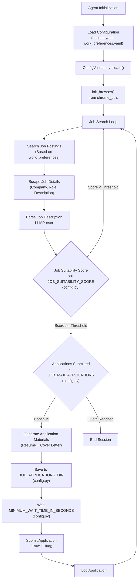
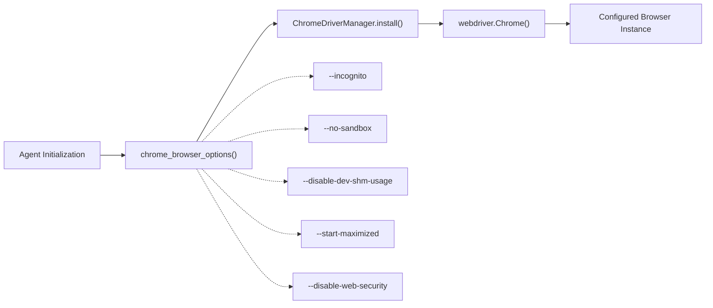
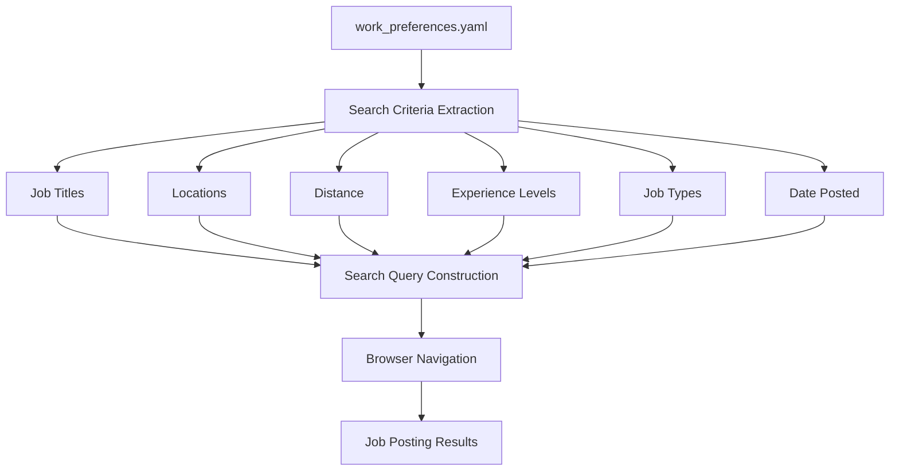
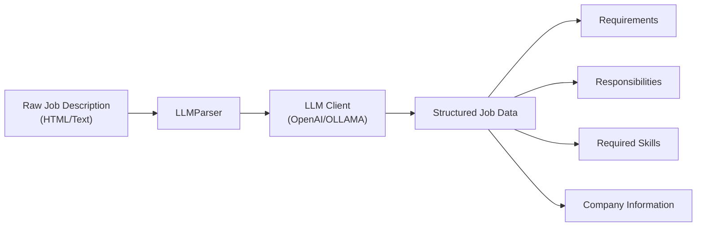
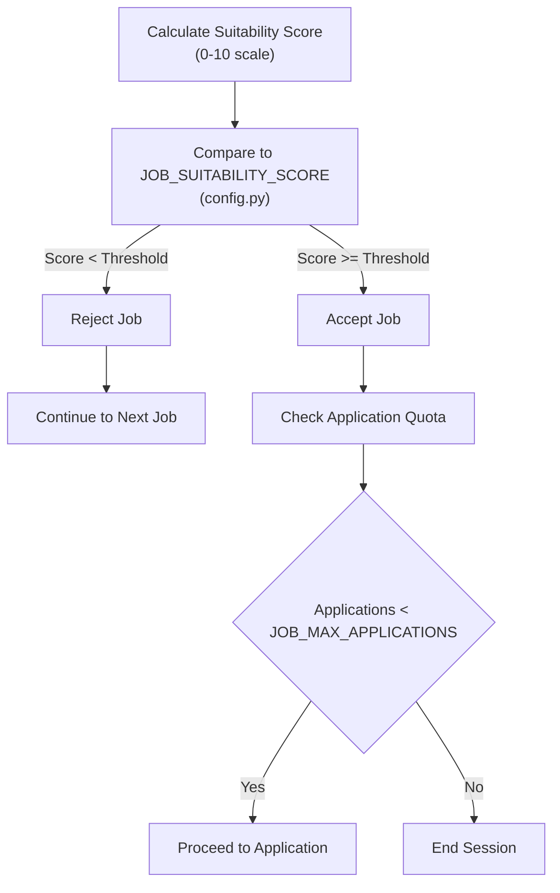
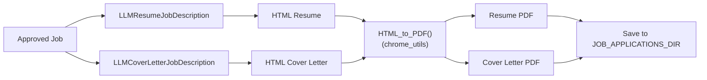
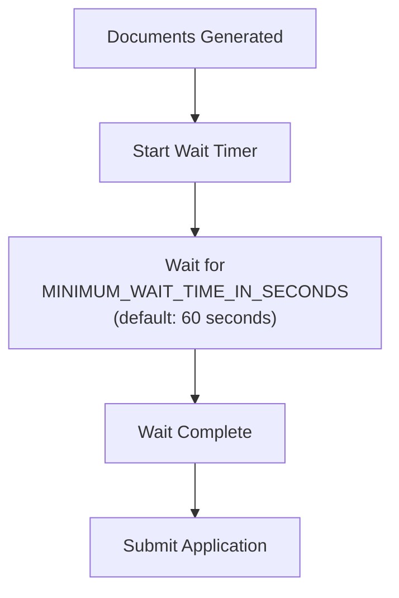
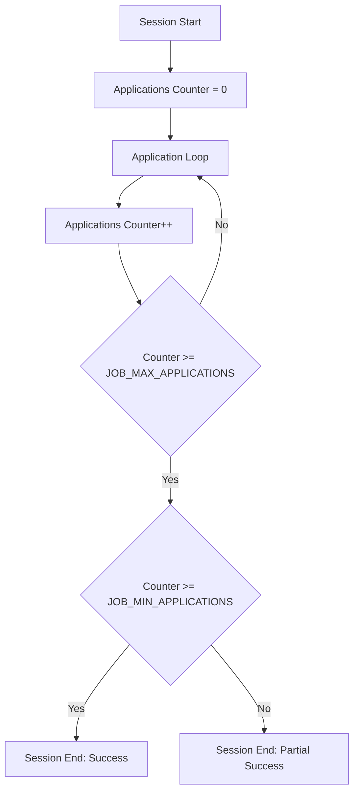
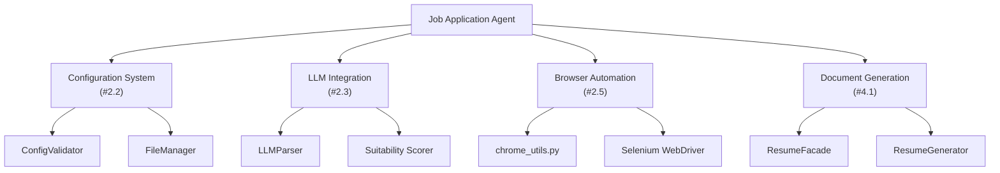

<!-- source: DeepWiki mcp.deepwiki.com · repo feder-cr/Jobs_Applier_AI_Agent_AIHawk · page 2.4 Job Application Agent · fetched 2026-10-29 -->

# Job Application Agent

<details>
<summary>Relevant source files</summary>

The following files were used as context for generating this wiki page:

- [README.md](README.md)
- [config.py](config.py)
- [src/utils/chrome_utils.py](src/utils/chrome_utils.py)

</details>


## Purpose and Scope

This document describes the core automated job application agent, which is the primary automation component of the AIHawk system. The agent orchestrates the end-to-end process of searching for jobs, evaluating their suitability, generating customized application materials, and submitting applications.

This page covers:
- Agent architecture and operational flow
- Job search and scraping mechanisms
- Suitability scoring and filtering logic
- Application submission and rate limiting
- State management and logging

For information about browser automation details, see [Browser Automation](#2.5). For configuration of the agent, see [Configuration System](#2.2). For document generation logic, see [Document Generation Architecture](#4.1).

**Note**: Due to copyright considerations, third-party provider plugins have been removed from the open-source repository. The core architecture is documented here, with the understanding that full provider integrations are available in the commercial [laboro.co](https://laboro.co/) platform.

---

## Agent Architecture

The job application agent operates as a continuous automation loop that searches for job postings, evaluates their suitability against user preferences, generates tailored application materials, and submits applications while respecting rate limits and application quotas.

### Core Agent Flow



**Sources:** [config.py:1-23](), Diagram 2 from high-level architecture

### Configuration-Driven Behavior

The agent's behavior is controlled by several configuration parameters:

| Configuration Parameter | Location | Default Value | Description |
|------------------------|----------|---------------|-------------|
| `MINIMUM_WAIT_TIME_IN_SECONDS` | [config.py:11]() | 60 | Minimum time between application submissions |
| `JOB_APPLICATIONS_DIR` | [config.py:13]() | "job_applications" | Directory for storing generated documents |
| `JOB_SUITABILITY_SCORE` | [config.py:14]() | 7 | Minimum score (0-10) for job to be considered |
| `JOB_MAX_APPLICATIONS` | [config.py:16]() | 5 | Maximum number of applications per session |
| `JOB_MIN_APPLICATIONS` | [config.py:17]() | 1 | Minimum application target |

**Sources:** [config.py:11-17]()

---

## Agent Initialization

### Browser Initialization

The agent initializes a Chrome browser instance using Selenium WebDriver with specific options optimized for automation:



The `chrome_browser_options()` function in [src/utils/chrome_utils.py:10-36]() configures Chrome with:

- **Incognito mode** ([src/utils/chrome_utils.py:31]()): Prevents cookie/cache interference
- **Security flags** ([src/utils/chrome_utils.py:14-16]()): `--no-sandbox`, `--ignore-certificate-errors`
- **Performance optimizations** ([src/utils/chrome_utils.py:20-30]()): Disables background throttling, animations, cache
- **File access** ([src/utils/chrome_utils.py:32-33]()): Enables local file access for HTML-to-PDF conversion

The browser instance is created via `init_browser()` ([src/utils/chrome_utils.py:38-47]()), which uses `webdriver_manager` to automatically download and manage the ChromeDriver binary.

**Sources:** [src/utils/chrome_utils.py:10-47]()

### Configuration Validation

Before the agent begins operation, all configuration files are validated by the `ConfigValidator` component (see [Configuration System](#2.2)). This ensures:

- Required API keys are present
- Work preferences conform to allowed values
- File paths exist and are accessible
- LLM configuration is properly specified

**Sources:** Diagram 4 from high-level architecture, [config.py:1-23]()

---

## Job Search and Scraping

### Search Process

The agent searches for job postings based on criteria specified in `work_preferences.yaml`:



The agent constructs search queries by combining user preferences and navigates to job sites using the browser automation layer.

**Sources:** Diagram 2 from high-level architecture, [README.md:8-10]()

### Scraping Job Details

For each job posting discovered in search results, the agent scrapes:

| Data Field | Purpose |
|-----------|---------|
| Company Name | Identification and targeting |
| Job Title | Role matching |
| Job Description | Content for LLM parsing and tailoring |
| Application URL | Navigation for submission |
| Required Qualifications | Suitability assessment |
| Salary Information | Filtering (if specified) |
| Location Details | Verification against preferences |

The scraped data is passed to the LLM integration layer for processing (see [LLM Integration](#2.3)).

**Sources:** Diagram 2 from high-level architecture

---

## Suitability Scoring and Filtering

### Job Description Parsing

The agent uses the `LLMParser` component to extract structured information from job descriptions:



**Sources:** Diagram 2 and Diagram 6 from high-level architecture

### Suitability Scoring Algorithm

After parsing, the agent calculates a suitability score (0-10 scale) by comparing:

1. **Resume Skills** vs. **Required Skills** - Weighted matching
2. **Experience Level** - Years of experience vs. job requirements
3. **Location Preferences** - Distance and remote work options
4. **Job Type Preferences** - Full-time, part-time, contract alignment
5. **Salary Expectations** - If specified in preferences

The score calculation logic compares the parsed job data against the user's `plain_text_resume.yaml` and `work_preferences.yaml`.

### Filtering Decision



The `JOB_SUITABILITY_SCORE` threshold ([config.py:14]()) allows users to control how selective the agent should be. A higher threshold (e.g., 8-9) results in fewer but more targeted applications, while a lower threshold (e.g., 5-6) casts a wider net.

**Sources:** [config.py:14-17](), Diagram 2 from high-level architecture

---

## Application Submission

### Document Generation Integration

Once a job passes the suitability filter, the agent generates customized application materials:



The `HTML_to_PDF()` function ([src/utils/chrome_utils.py:51-93]()) uses Chrome DevTools Protocol to convert HTML to PDF with specific formatting:

- Paper size: A4 (8.27" × 11.69")
- Margins: Top/Bottom 0.8", Left/Right 0.5"
- Background printing enabled
- Portrait orientation
- Returns base64-encoded PDF

**Sources:** [src/utils/chrome_utils.py:51-93](), Diagram 3 from high-level architecture

### Rate Limiting

Before submitting each application, the agent enforces a mandatory wait period:



The `MINIMUM_WAIT_TIME_IN_SECONDS` configuration ([config.py:11]()) serves multiple purposes:

1. **Rate limiting**: Prevents overwhelming job sites with requests
2. **Detection avoidance**: Mimics human behavior patterns
3. **System stability**: Allows LLM and browser operations to complete
4. **Ethical compliance**: Respects job site terms of service

**Sources:** [config.py:11]()

### Form Filling and Submission

The agent uses browser automation to:

1. Navigate to the application URL
2. Fill form fields based on scraped requirements
3. Upload generated resume and cover letter PDFs
4. Complete any additional required fields
5. Submit the application

This logic is part of the excluded third-party provider plugins, as different job sites have different form structures and submission flows.

**Sources:** [README.md:8-10](), Diagram 2 from high-level architecture

---

## State Management and Logging

### Application Tracking

The agent maintains state to track:

| State Component | Purpose |
|----------------|---------|
| Application Counter | Enforces `JOB_MAX_APPLICATIONS` quota |
| Submitted Job IDs | Prevents duplicate applications |
| Session Statistics | Success/failure rates, timing metrics |
| Error Log | Tracks failures for debugging |

### File Organization

Application materials are saved in the `JOB_APPLICATIONS_DIR` ([config.py:13]()) with a structured naming convention:

```
job_applications/
├── [company_name]_[job_title]_[date]/
│   ├── resume.pdf
│   ├── cover_letter.pdf
│   ├── job_description.txt
│   └── application_metadata.json
```

This organization allows users to review generated materials and track application history.

**Sources:** [config.py:13]()

### Logging Configuration

The agent's logging behavior is controlled by configuration flags:

| Configuration | Location | Default | Purpose |
|--------------|----------|---------|---------|
| `LOG_LEVEL` | [config.py:6]() | 'ERROR' | Controls verbosity |
| `LOG_TO_FILE` | [config.py:8]() | False | Enables file logging |
| `LOG_TO_CONSOLE` | [config.py:9]() | False | Enables console output |
| `LOG_SELENIUM_LEVEL` | [config.py:7]() | ERROR | Selenium-specific logging |

Setting `LOG_LEVEL` to 'DEBUG' provides detailed execution traces, while 'ERROR' only logs failures.

**Sources:** [config.py:6-9]()

---

## Session Management

### Application Quota Control

The agent enforces both minimum and maximum application targets:



- `JOB_MIN_APPLICATIONS` ([config.py:17]()): Target minimum for a successful session
- `JOB_MAX_APPLICATIONS` ([config.py:16]()): Hard limit to prevent excessive applications

This quota system ensures the agent operates within reasonable bounds while allowing users to control automation intensity.

**Sources:** [config.py:16-17]()

### Error Handling

The agent implements error recovery strategies:

1. **Browser crashes**: Reinitialize browser via `init_browser()` ([src/utils/chrome_utils.py:38-47]())
2. **Network failures**: Retry with exponential backoff
3. **LLM errors**: Skip job and continue (see [LLM Integration](#2.3))
4. **Form filling failures**: Log and move to next application

Critical errors that cannot be recovered from cause the session to terminate gracefully, ensuring any completed applications are properly logged.

**Sources:** [src/utils/chrome_utils.py:38-47]()

---

## Integration with Other Components

### Component Dependencies



The agent orchestrates these components to execute the complete application workflow. Each component is documented in its respective wiki page.

**Sources:** Diagrams 1-6 from high-level architecture

---

## Commercial Platform Integration

As noted in [README.md:8-10](), the open-source repository contains the core agent architecture but excludes third-party provider plugins. The commercial **[laboro.co](https://laboro.co/)** platform provides:

- **Managed Provider Connections**: Pre-configured integrations with major job sites
- **AI-Driven Job Board**: Curated job matching using enhanced algorithms
- **Automatic Application System**: Seamless form filling across multiple providers
- **Enhanced Monitoring**: Real-time application tracking and analytics

Users requiring full provider integrations should evaluate the commercial offering.

**Sources:** [README.md:1-27](), Diagram 5 from high-level architecture

---

