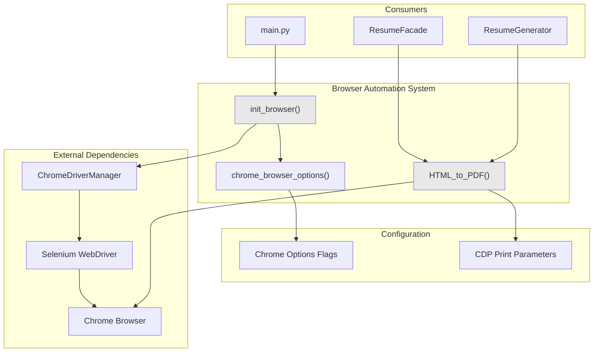
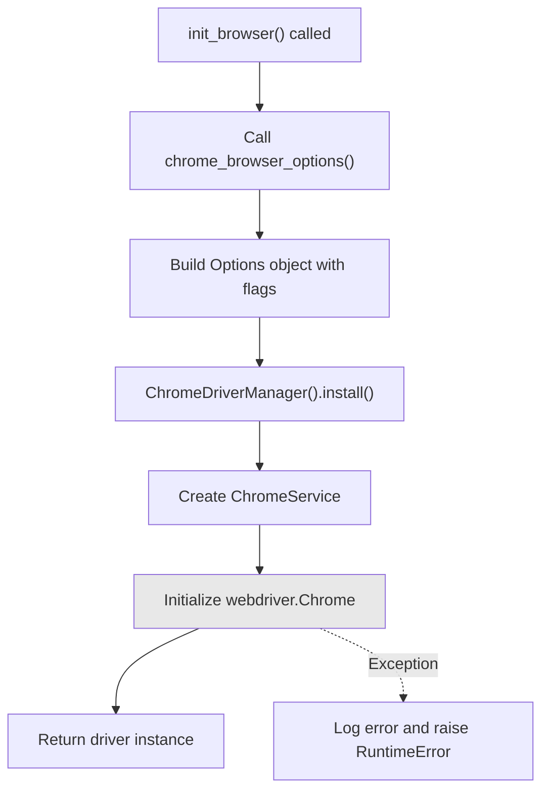
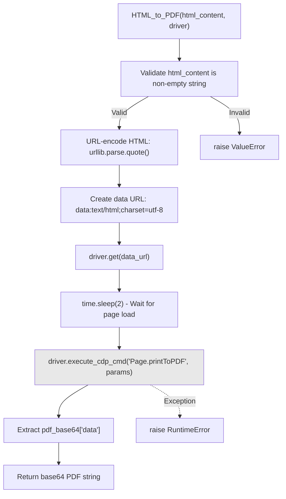
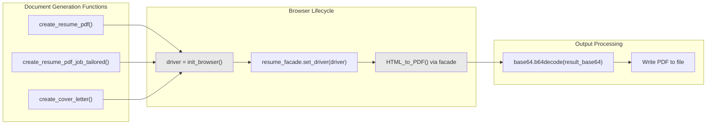

<!-- source: DeepWiki mcp.deepwiki.com · repo feder-cr/Jobs_Applier_AI_Agent_AIHawk · page 2.5 Browser Automation · fetched 2026-10-29 -->

# Browser Automation

<details>
<summary>Relevant source files</summary>

The following files were used as context for generating this wiki page:

- [main.py](main.py)
- [src/utils/chrome_utils.py](src/utils/chrome_utils.py)

</details>


## Purpose and Scope

This page documents the browser automation system used by AIHawk for HTML rendering and PDF generation. The system leverages Selenium WebDriver with Google Chrome and Chrome DevTools Protocol (CDP) to convert HTML documents into PDF format. This capability is essential for generating professional resumes and cover letters from HTML templates.

For information about how these generated PDFs fit into the broader document generation workflow, see [Document Generation Architecture](#4.1). For configuration of the overall system, see [Configuration System](#2.2).

---

## Overview

The browser automation system consists of two primary components:

1. **Chrome WebDriver Initialization**: Configures and launches a headless Chrome browser instance with specific options optimized for PDF generation
2. **HTML to PDF Conversion**: Uses Chrome DevTools Protocol to render HTML content and export it as a PDF document

The implementation is centralized in `src/utils/chrome_utils.py` and integrated throughout the document generation pipeline.



**Sources:** [src/utils/chrome_utils.py:1-94](), [main.py:10-13](), [main.py:263-272]()

---

## Chrome WebDriver Initialization

### Browser Setup Process

The `init_browser()` function initializes a Chrome WebDriver instance with a comprehensive set of options designed for automated document rendering. The function uses `webdriver_manager` to automatically handle ChromeDriver installation and version management.



**Sources:** [src/utils/chrome_utils.py:38-47]()

### Chrome Browser Options

The `chrome_browser_options()` function configures Chrome with 20+ command-line arguments to optimize the browser for automated PDF generation. These options disable unnecessary features, improve performance, and ensure consistent rendering behavior.

| Category | Option | Purpose |
|----------|--------|---------|
| **Window Management** | `--start-maximized` | Maximize browser window on start |
| | `window-size=1200x800` | Set default window dimensions |
| **Security** | `--no-sandbox` | Disable Chrome sandbox (required in containerized environments) |
| | `--disable-web-security` | Disable web security for local file access |
| | `--allow-file-access-from-files` | Enable local file access |
| **Performance** | `--disable-dev-shm-usage` | Overcome limited resource issues |
| | `--disable-gpu` | Disable GPU hardware acceleration |
| | `--disable-background-timer-throttling` | Prevent background tab throttling |
| | `--disable-backgrounding-occluded-windows` | Maintain full rendering for occluded windows |
| | `--disable-cache` | Disable browser cache |
| **Features** | `--disable-extensions` | Disable browser extensions |
| | `--disable-translate` | Disable translation prompts |
| | `--disable-popup-blocking` | Allow popups |
| | `--disable-autofill` | Disable form autofill |
| | `--disable-plugins` | Disable plugins |
| | `--disable-animations` | Disable animations for faster rendering |
| **Privacy** | `--incognito` | Launch in incognito mode |
| **Initialization** | `--no-first-run` | Skip first-run experience |
| | `--no-default-browser-check` | Skip default browser check |
| | `--disable-logging` | Disable logging |
| **Misc** | `--ignore-certificate-errors` | Ignore SSL certificate errors |

**Sources:** [src/utils/chrome_utils.py:10-36]()

### Implementation Details

```python
# Browser initialization in main.py
driver = init_browser()  # Lines 263, 348, 433
resume_facade.set_driver(driver)  # Lines 272, 357, 444
```

The driver instance is created once per document generation workflow and passed to the `ResumeFacade`, which manages its lifecycle and uses it for PDF conversion operations.

**Sources:** [main.py:263](), [main.py:348](), [main.py:433]()

---

## HTML to PDF Conversion

### Chrome DevTools Protocol Integration

The `HTML_to_PDF()` function converts HTML content to PDF format using Chrome DevTools Protocol's `Page.printToPDF` command. This method leverages Chrome's native PDF rendering engine, ensuring high-fidelity output with proper CSS support.



**Sources:** [src/utils/chrome_utils.py:51-93]()

### PDF Generation Parameters

The `Page.printToPDF` command is invoked with the following parameters to ensure consistent, professional-quality output:

| Parameter | Value | Description |
|-----------|-------|-------------|
| `printBackground` | `True` | Include background colors and images in the PDF |
| `landscape` | `False` | Portrait orientation |
| `paperWidth` | `8.27` inches | A4 paper width |
| `paperHeight` | `11.69` inches | A4 paper height |
| `marginTop` | `0.8` inches | ~2 cm top margin |
| `marginBottom` | `0.8` inches | ~2 cm bottom margin |
| `marginLeft` | `0.5` inches | ~1.27 cm left margin |
| `marginRight` | `0.5` inches | ~1.27 cm right margin |
| `displayHeaderFooter` | `False` | Disable headers and footers |
| `preferCSSPageSize` | `True` | Respect CSS page size definitions |
| `generateDocumentOutline` | `False` | Do not generate document outline |
| `generateTaggedPDF` | `False` | Do not generate tagged PDF |
| `transferMode` | `"ReturnAsBase64"` | Return PDF as base64-encoded string |

These parameters are configured for A4 paper size with standard margins, matching typical resume and cover letter formatting requirements.

**Sources:** [src/utils/chrome_utils.py:75-89]()

### Data URL Rendering

The function converts HTML content into a data URL for rendering:

1. **URL Encoding**: The HTML string is URL-encoded using `urllib.parse.quote()` to ensure special characters are properly escaped
2. **Data URL Construction**: Creates a data URL with the format `data:text/html;charset=utf-8,{encoded_html}`
3. **Navigation**: Uses `driver.get(data_url)` to load the HTML content in the browser
4. **Wait Period**: Implements a 2-second sleep to allow complex HTML/CSS to fully render before PDF generation

**Sources:** [src/utils/chrome_utils.py:66-72]()

### Error Handling

The function implements two levels of error handling:

- **Input Validation**: Raises `ValueError` if the HTML content is not a valid non-empty string
- **Runtime Errors**: Catches WebDriver exceptions and raises `RuntimeError` with descriptive error messages

**Sources:** [src/utils/chrome_utils.py:62-63](), [src/utils/chrome_utils.py:91-93]()

---

## Integration with Document Generation Pipeline

### Workflow Integration

The browser automation system is integrated into the document generation workflow at three key points:



**Sources:** [main.py:263-272](), [main.py:348-357](), [main.py:433-444]()

### Driver Lifecycle Management

Each document generation operation follows this lifecycle:

1. **Initialization**: Call `init_browser()` to create a new WebDriver instance
2. **Configuration**: Pass the driver to `ResumeFacade` via `set_driver()`
3. **Usage**: The facade uses the driver internally to convert generated HTML to PDF
4. **Output**: The PDF is returned as a base64-encoded string
5. **Cleanup**: The driver instance is implicitly cleaned up when the function completes

**Sources:** [main.py:263](), [main.py:272](), [main.py:274](), [main.py:363]()

### Base64 PDF Handling

The PDF conversion returns data as a base64-encoded string, which is then:

1. Decoded using `base64.b64decode(result_base64)` to convert to binary data
2. Written to a file in the output directory with appropriate naming

```python
# Example from main.py:277-281
pdf_data = base64.b64decode(result_base64)
output_path = output_dir / "cover_letter_tailored.pdf"
with open(output_path, "wb") as file:
    file.write(pdf_data)
```

**Sources:** [main.py:277-301](), [main.py:361-386](), [main.py:447-465]()

---

## Technical Considerations

### Dependency Management

The system uses `webdriver_manager` to automatically handle ChromeDriver installation and version compatibility:

- **Auto-installation**: ChromeDriver is downloaded and cached automatically on first run
- **Version Matching**: The manager ensures ChromeDriver version matches the installed Chrome browser version
- **Cross-platform**: Works on Windows, macOS, and Linux without manual configuration

**Sources:** [src/utils/chrome_utils.py:6](), [src/utils/chrome_utils.py:42]()

### Performance Optimization

Several Chrome options are specifically configured for optimal performance in automated environments:

- **Resource Management**: `--disable-dev-shm-usage` prevents issues in low-memory environments
- **Rendering Optimization**: `--disable-gpu`, `--disable-animations`, and `--disable-cache` reduce rendering overhead
- **Background Process Control**: `--disable-background-timer-throttling` ensures consistent rendering timing

**Sources:** [src/utils/chrome_utils.py:14-30]()

### Security Considerations

The browser is configured with relaxed security settings to enable local file access and HTML rendering:

- `--disable-web-security`: Required for rendering local HTML content
- `--allow-file-access-from-files`: Enables access to local file resources
- `--no-sandbox`: Necessary in containerized environments (Docker, CI/CD)

These settings are appropriate for the automated document generation use case but should not be used for general web browsing.

**Sources:** [src/utils/chrome_utils.py:32-33](), [src/utils/chrome_utils.py:14]()

### Error Recovery

The initialization function includes error handling to provide clear diagnostics when browser setup fails:

```python
except Exception as e:
    logger.error(f"Failed to initialize browser: {str(e)}")
    raise RuntimeError(f"Failed to initialize browser: {str(e)}")
```

Common failure scenarios include:
- Chrome browser not installed
- ChromeDriver version mismatch
- Insufficient system resources
- Permission issues in containerized environments

**Sources:** [src/utils/chrome_utils.py:45-47]()

---

## File Structure

| File | Purpose |
|------|---------|
| `src/utils/chrome_utils.py` | Core browser automation utilities |
| `main.py` | Integration point for document generation workflows |

**Sources:** [src/utils/chrome_utils.py:1-94](), [main.py:1-566]()

---

