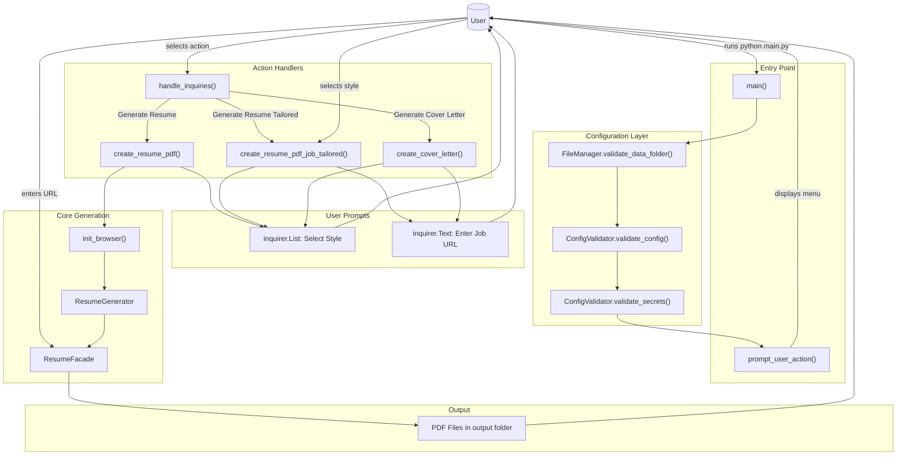
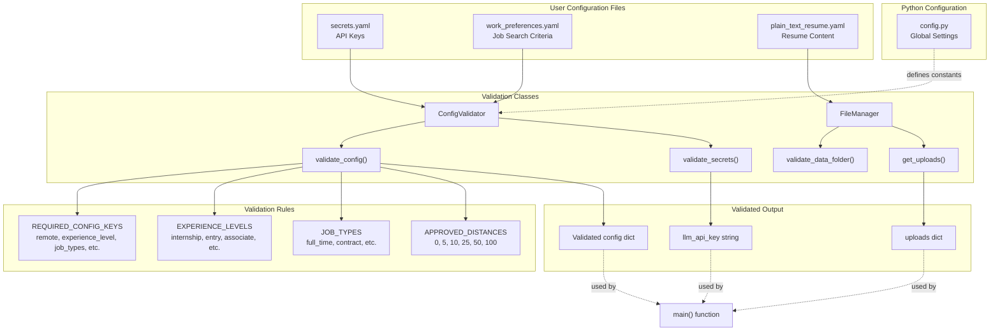
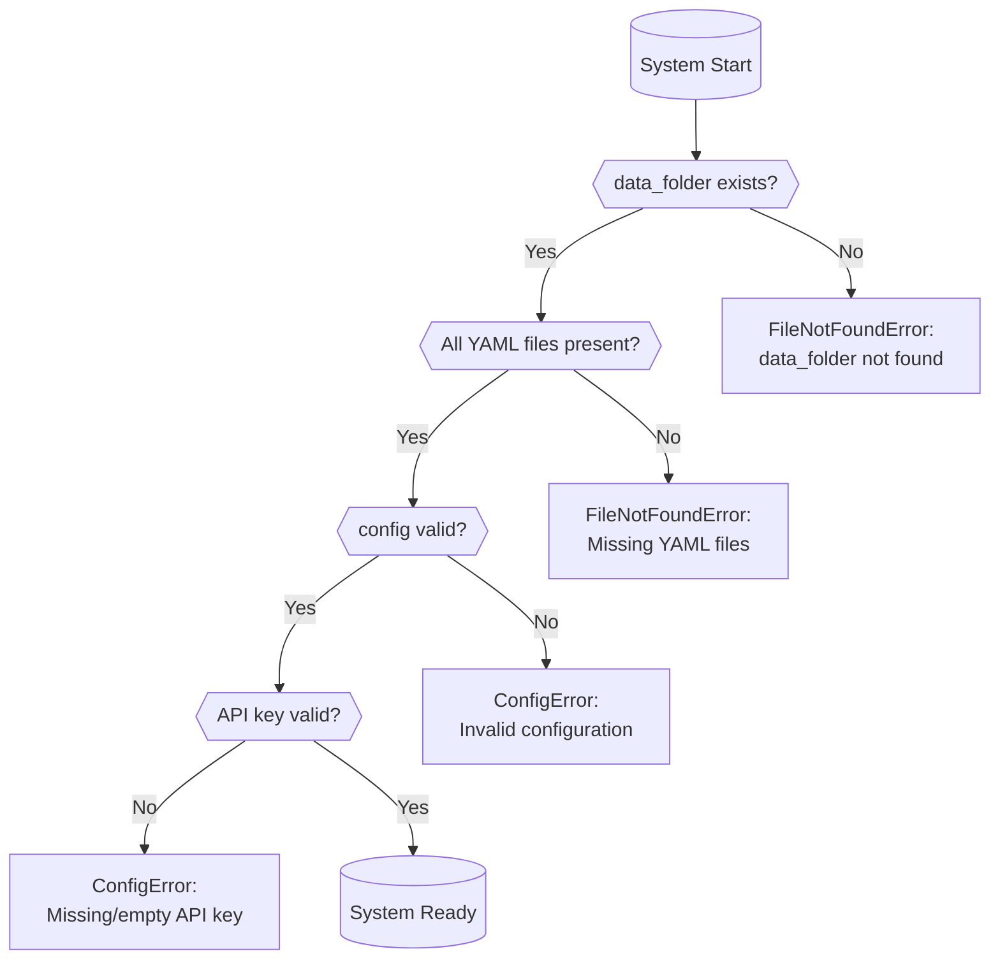

<!-- source: DeepWiki mcp.deepwiki.com · repo feder-cr/Jobs_Applier_AI_Agent_AIHawk · page 3 User Guide · fetched 2026-10-29 -->

# User Guide

<details>
<summary>Relevant source files</summary>

The following files were used as context for generating this wiki page:

- [README.md](README.md)
- [config.py](config.py)
- [main.py](main.py)

</details>


This guide provides practical instructions for end users who want to install, configure, and use the AIHawk system to automate job applications and generate tailored professional documents. It covers setup, configuration, document generation, and running the automated job application agent.

For technical details on system architecture and components, see [System Architecture](#2). For information on extending or modifying the system, see [Development Guide](#4). For contribution guidelines, see [Contributing](#5).

## What is AIHawk?

AIHawk is an automated job application system that combines browser automation with Large Language Model (LLM) integration to:

1. **Generate professional resumes** using AI-powered content optimization
2. **Create job-tailored resumes** customized to specific job descriptions
3. **Generate cover letters** tailored to job postings
4. **Automate job applications** by searching, evaluating, and submitting applications

The system consists of two main operational modes:

| Mode | Description | Entry Point |
|------|-------------|-------------|
| **Document Generation** | Interactive document creation for resumes and cover letters | `main.py` with user prompts |
| **Automated Agent** | Continuous job search and application submission | `AIHawkBotFacade` (not included in open source) |

**Note:** The core architecture is open source, but automated job application features require the commercial platform at [laboro.co](https://laboro.co/).

Sources: [README.md:1-27](), [main.py:527-566]()

---

## System Requirements

### Software Prerequisites

- **Python**: Version 3.10 or higher
- **Google Chrome**: Latest version (required for browser automation)
- **ChromeDriver**: Automatically managed by `webdriver-manager`

### API Access

The system requires access to a Large Language Model API:

| Provider | Model | Configuration |
|----------|-------|---------------|
| **OpenAI** | `gpt-4o-mini` (default) | Requires API key in `secrets.yaml` |
| **OLLAMA** | Custom models | Requires local OLLAMA server and API URL |

Sources: [config.py:1-23](), [main.py:10-13]()

---

## User Interaction Flow

The following diagram shows how users interact with the system and which code components handle each action:



**Key Functions:**
- `main()` [main.py:527-562](): Entry point that orchestrates configuration and action handling
- `prompt_user_action()` [main.py:499-524](): Interactive menu using `inquirer` library
- `handle_inquiries()` [main.py:471-497](): Routes user selection to appropriate generation function
- `create_resume_pdf()` [main.py:392-468](): Generates base resume
- `create_resume_pdf_job_tailored()` [main.py:307-389](): Generates job-tailored resume
- `create_cover_letter()` [main.py:220-304](): Generates cover letter

Sources: [main.py:220-566]()

---

## Configuration Architecture

Understanding the configuration system is essential for using AIHawk. The following diagram maps configuration files to their validation components:



**Key Classes:**
- `ConfigValidator` [main.py:35-181](): Validates `work_preferences.yaml` and `secrets.yaml` against defined rules
- `FileManager` [main.py:184-217](): Validates file existence and prepares file paths
- `REQUIRED_CONFIG_KEYS` [main.py:39-50](): Dictionary defining required configuration keys and their types
- `EXPERIENCE_LEVELS` [main.py:51-58](): Whitelist of valid experience level values
- `JOB_TYPES` [main.py:59-67](): Whitelist of valid job type values
- `APPROVED_DISTANCES` [main.py:69](): Set of valid distance values in miles

Sources: [main.py:35-217](), [config.py:1-23]()

---

## Getting Started

To use AIHawk, follow these steps in order:

### Step 1: Setup and Installation
Install Python dependencies, set up Chrome, and prepare the directory structure. See [Setup and Installation](#3.1) for detailed instructions.

### Step 2: Configure the System
Create and populate three required YAML files in the `data_folder` directory:

| File | Purpose | Details |
|------|---------|---------|
| `secrets.yaml` | API credentials | Contains LLM API key |
| `work_preferences.yaml` | Job search preferences | Defines experience levels, job types, locations, etc. |
| `plain_text_resume.yaml` | Your resume data | Structured resume content for document generation |

See [Configuration Files](#3.2) for complete configuration reference.

### Step 3: Generate Documents
Run the interactive document generator to create resumes and cover letters:

```bash
python main.py
```

The system will prompt you to:
1. Select an action (Generate Resume, Generate Resume Tailored, or Generate Cover Letter)
2. Choose a style from available templates
3. (For tailored documents) Enter the job posting URL

See [Generating Documents](#3.3) for usage details and examples.

### Step 4: Run the Job Application Agent
Configure and launch the automated job application agent. This requires additional setup beyond the core open-source system. See [Running the Job Application Agent](#3.4) for instructions.

Sources: [main.py:527-566]()

---

## Main Workflows

### Workflow 1: Generate Base Resume

```mermaid
sequenceDiagram
    actor User
    participant Main as main.py
    participant Prompt as prompt_user_action()
    participant Handler as handle_inquiries()
    participant Create as create_resume_pdf()
    participant Style as StyleManager
    participant Facade as ResumeFacade
    participant Output as output folder
    
    User->>Main: python main.py
    Main->>Main: Validate configuration
    Main->>Prompt: Display action menu
    Prompt-->>User: Show choices
    User->>Prompt: Select "Generate Resume"
    Prompt-->>Handler: Return action
    Handler->>Create: Call function
    Create->>Style: Get available styles
    Style-->>Create: Return style list
    Create->>User: Prompt style selection
    User->>Create: Select style
    Create->>Facade: create_resume_pdf()
    Facade-->>Create: Return base64 PDF
    Create->>Output: Save resume_base.pdf
    Output-->>User: File saved
```

**Process:**
1. User runs `python main.py`
2. System validates configuration files [main.py:530-536]()
3. Interactive menu displays three options [main.py:506-516]()
4. User selects "Generate Resume"
5. System prompts for style selection [main.py:410-428]()
6. `ResumeFacade` generates PDF using LLM and selected style
7. PDF saved to `data_folder/output/resume_base.pdf` [main.py:458-462]()

Sources: [main.py:392-468](), [main.py:471-497]()

### Workflow 2: Generate Job-Tailored Resume

```mermaid
sequenceDiagram
    actor User
    participant Main as main.py
    participant Create as create_resume_pdf_job_tailored()
    participant Inquirer as inquirer prompts
    participant Facade as ResumeFacade
    participant Browser as Browser
    participant Output as output folder
    
    User->>Main: Select "Generate Resume Tailored"
    Main->>Create: Call function
    Create->>Inquirer: Prompt style selection
    Inquirer-->>User: Display styles
    User->>Inquirer: Select style
    Create->>Inquirer: Prompt job URL
    Inquirer-->>User: Request URL
    User->>Inquirer: Enter job URL
    Create->>Browser: init_browser()
    Browser-->>Create: WebDriver instance
    Create->>Facade: Set driver and job URL
    Facade->>Facade: link_to_job(job_url)
    Facade->>Facade: create_resume_pdf_job_tailored()
    Facade-->>Create: Return base64 PDF + suggested_name
    Create->>Output: Save to suggested_name folder
    Output->>Output: Create resume_tailored.pdf
    Output-->>User: File saved
```

**Process:**
1. User selects "Generate Resume Tailored for Job Description"
2. System prompts for style [main.py:325-342]()
3. System prompts for job URL [main.py:343-345]()
4. Browser instance created [main.py:348]()
5. `ResumeFacade` fetches job description from URL
6. LLM tailors resume to job requirements
7. PDF saved to `data_folder/output/{suggested_name}/resume_tailored.pdf` [main.py:369-379]()

Sources: [main.py:307-389]()

### Workflow 3: Generate Cover Letter

The cover letter workflow is identical to the job-tailored resume workflow, except:
- Final output is `cover_letter_tailored.pdf` instead of `resume_tailored.pdf` [main.py:294]()
- Uses `ResumeFacade.create_cover_letter()` instead of `create_resume_pdf_job_tailored()` [main.py:274]()

Sources: [main.py:220-304]()

---

## Directory Structure

After setup, your AIHawk installation should have this structure:

```
AIHawk/
├── data_folder/
│   ├── secrets.yaml              # API keys (required)
│   ├── work_preferences.yaml     # Job search settings (required)
│   ├── plain_text_resume.yaml    # Your resume content (required)
│   └── output/                   # Generated documents
│       ├── resume_base.pdf
│       └── {job_name}/
│           ├── resume_tailored.pdf
│           └── cover_letter_tailored.pdf
├── main.py                       # Entry point
├── config.py                     # Global configuration
└── src/
    ├── libs/
    │   └── resume_and_cover_builder/  # Document generation
    ├── resume_schemas/           # Data models
    └── utils/                    # Helper functions
```

The `data_folder` directory must be present in the root of the project with all three YAML files before running the system [main.py:531]().

Sources: [main.py:187-207](), [main.py:531]()

---

## Error Handling

The system provides detailed error messages for common configuration issues:

| Error Type | Trigger | Resolution |
|------------|---------|------------|
| `ConfigError` | Invalid or missing configuration | Check `work_preferences.yaml` format and required keys [main.py:548-553]() |
| `FileNotFoundError` | Missing YAML files | Ensure all three YAML files exist in `data_folder` [main.py:554-556]() |
| `RuntimeError` | Browser or LLM failures | Check Chrome installation and API key validity [main.py:557-559]() |

All errors are logged with detailed stack traces when `LOG_TO_FILE = True` in `config.py` [config.py:8]().

**Common Validation Errors:**



Sources: [main.py:548-562](), [main.py:35-181]()

---

## Configuration Constants

Key configuration constants from `config.py`:

| Constant | Default Value | Purpose |
|----------|---------------|---------|
| `LOG_LEVEL` | `'ERROR'` | Logging verbosity |
| `LOG_TO_FILE` | `False` | Enable file logging |
| `LOG_TO_CONSOLE` | `False` | Enable console logging |
| `MINIMUM_WAIT_TIME_IN_SECONDS` | `60` | Rate limiting between applications |
| `JOB_APPLICATIONS_DIR` | `"job_applications"` | Directory for application logs |
| `JOB_SUITABILITY_SCORE` | `7` | Minimum score threshold (0-10) |
| `JOB_MAX_APPLICATIONS` | `5` | Maximum applications per session |
| `JOB_MIN_APPLICATIONS` | `1` | Minimum applications before stopping |
| `LLM_MODEL_TYPE` | `'openai'` | LLM provider (`'openai'` or `'ollama'`) |
| `LLM_MODEL` | `'gpt-4o-mini'` | Specific model to use |
| `LLM_API_URL` | `''` | OLLAMA server URL (if applicable) |

These can be modified in `config.py` to customize system behavior. Changes require restarting the application.

Sources: [config.py:1-23]()

---

## Next Steps

For detailed information on each aspect of using AIHawk:

- **[Setup and Installation](#3.1)**: Detailed installation instructions, dependency setup, and troubleshooting
- **[Configuration Files](#3.2)**: Complete reference for all configuration options and validation rules
- **[Generating Documents](#3.3)**: Detailed guide to document generation, style customization, and best practices
- **[Running the Job Application Agent](#3.4)**: Instructions for automated job application workflow and monitoring

For technical details on how the system works internally, see [System Architecture](#2) and [Development Guide](#4).

Sources: [main.py:1-566](), [config.py:1-23]()

---

