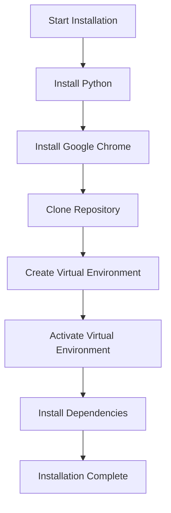
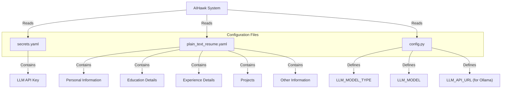
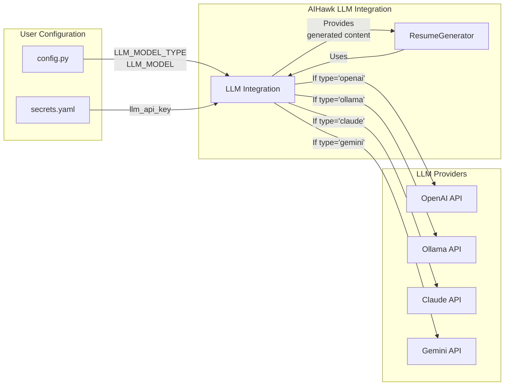

<!-- source: DeepWiki mcp.deepwiki.com · repo feder-cr/Jobs_Applier_AI_Agent_AIHawk · page 3.1 Setup and Installation · fetched 2026-10-29 -->

# Setup and Installation

<details>
<summary>Relevant source files</summary>

The following files were used as context for generating this wiki page:

- [README.md](README.md)
- [config.py](config.py)
- [main.py](main.py)

</details>


This document provides a comprehensive guide for installing and configuring the Jobs_Applier_AI_Agent_AIHawk system on your local machine. It covers all necessary prerequisites, installation steps, and initial configuration to get the system up and running.

For information about creating your resume profile after installation, see [Creating Your Resume Profile](#3.2). For using the application to generate resumes and cover letters, see [Using the Application](#3.3).

## 1. System Requirements

Before beginning the installation process, ensure your system meets the following requirements:

### Compatible Operating Systems
- Windows 10
- Ubuntu 22
- macOS (with limitations)

### Supported Python Versions
- Python 3.10
- Python 3.11.9 (64-bit)
- Python 3.12.5 (64-bit)

### Hardware Requirements
- Minimum 4GB RAM
- At least 1GB of free disk space
- Internet connection

Sources: [README.md:50-58]()

## 2. Installation Process

The installation process consists of several steps, including setting up Python, installing Chrome, and configuring the virtual environment.



### 2.1 Installing Python

1. Download and install Python from the [official Python website](https://www.python.org/downloads/)
2. Ensure you select the option to add Python to your PATH during installation
3. Verify the installation by opening a terminal/command prompt and running:
   ```
   python --version
   ```

Sources: [README.md:62-68]()

### 2.2 Installing Google Chrome

Download and install the latest version of Google Chrome from its [official website](https://www.google.com/chrome). This browser is required as the system uses Chrome's WebDriver for job page scraping.

Sources: [README.md:70-71]()

### 2.3 Cloning the Repository

Clone the repository using Git:

```bash
git clone https://github.com/feder-cr/Jobs_Applier_AI_Agent_AIHawk.git
cd Jobs_Applier_AI_Agent_AIHawk
```

Sources: [README.md:75-78]()

### 2.4 Setting up the Virtual Environment

Create and activate a Python virtual environment to isolate the project dependencies:

#### For Unix-based systems (Linux/macOS):
```bash
python3 -m venv virtual
source virtual/bin/activate
```

#### For Windows:
```bash
python3 -m venv virtual
.\virtual\Scripts\activate
```

Sources: [README.md:81-99]()

### 2.5 Installing Dependencies

Before installing the required Python packages:

1. **Windows users**: Install Visual C++ Build Tools
   - Download from [Visual Studio](https://visualstudio.microsoft.com/visual-cpp-build-tools/)
   - During installation, select "Desktop development with C++"

2. Install Python dependencies:
   ```bash
   pip install -r requirements.txt
   ```

Sources: [README.md:101-107]()

## 3. Configuration

After installation, you need to configure the system with your personal information and API keys.



### 3.1 Creating the Data Folder

Create a `data_folder` directory in the root of the project. This is where all your configuration files will be stored:

```
Jobs_Applier_AI_Agent_AIHawk/
│
├── data_folder/
│   ├── secrets.yaml
│   └── plain_text_resume.yaml
```

You can use the examples in the `data_folder_example` as templates.

Sources: [README.md:421-441]()

### 3.2 Configuring API Keys (secrets.yaml)

Create a `secrets.yaml` file in your data folder with the following structure:

```yaml
llm_api_key: "YOUR_API_KEY_HERE"
```

Replace `YOUR_API_KEY_HERE` with your chosen LLM provider's API key:
- For OpenAI (GPT models), get a key from the [OpenAI platform](https://platform.openai.com/account/api-keys)
- For Gemini, get a key from [Google AI Studio](https://ai.google.dev/)
- For Claude, get a key from Anthropic
- For Ollama (local models), no API key is required

**Note on OpenAI limits**: New OpenAI accounts may be limited to 200 requests per day with the Free tier. If you encounter rate limit errors, you may need to wait for your account to be upgraded after adding credit.

Sources: [README.md:111-124](), [config.py:19-22]()

### 3.3 Configuring LLM Settings (config.py)

Edit the `config.py` file to set your preferred LLM model:

```python
LLM_MODEL_TYPE = 'openai'  # Options: 'openai', 'ollama', 'claude', 'gemini'
LLM_MODEL = 'gpt-4o-mini'  # Model name depends on LLM_MODEL_TYPE
LLM_API_URL = ''  # Only required for Ollama (typically 'http://127.0.0.1:11434/')
```

Supported configurations include:
- OpenAI: 'gpt-4o', 'gpt-4o-mini', etc.
- Ollama: 'llama2', 'mistral:v0.3', 'llama3.2:1b', etc.
- Claude: Any Claude model
- Gemini: Any Gemini model

Sources: [README.md:127-144](), [config.py:19-22]()

#### Ollama Setup

If using Ollama (local LLM):

1. Install Ollama from [ollama.com/download](https://ollama.com/download)
2. Verify it's running by navigating to `localhost:11434` in your browser
3. Configure `config.py` with:
   ```python
   LLM_MODEL_TYPE = 'ollama'
   LLM_MODEL = 'llama3.2:1b'  # Or another model you've pulled
   LLM_API_URL = 'http://127.0.0.1:11434/'
   ```

Sources: [README.md:515-527]()

### 3.4 Creating Your Resume Profile (plain_text_resume.yaml)

Create a `plain_text_resume.yaml` file in your data folder with your personal and professional information. This file should include:

- Personal information (name, contact details)
- Education history
- Work experience
- Skills and certifications
- Projects
- Additional sections (languages, preferences, etc.)

A template with detailed explanations of each section is available in the README or the provided example folder.

Sources: [README.md:146-419]()

## 4. LLM Integration Architecture

The AIHawk system is designed to work with multiple LLM providers. Here's how the different components connect:



Sources: [README.md:111-144](), [config.py:19-22]()

## 5. Verification and Troubleshooting

After completing the installation and configuration steps, you can verify that everything is working correctly.

### 5.1 Verifying Installation

Run the main script to verify the installation:

```bash
python main.py
```

If everything is configured correctly, you should see the application menu.

Sources: [README.md:451-458]()

### 5.2 Common Issues and Solutions

#### OpenAI API Rate Limit Errors

If you encounter errors like:
```
openai.RateLimitError: Error code: 429 - {'error': {'message': 'You exceeded your current quota...'}}
```

Solutions:
- Check your OpenAI API billing at platform.openai.com/account/billing
- Ensure you've added a valid payment method to your OpenAI account
- Wait 12-24 hours after adding funds for changes to take effect
- Consider switching to Ollama for local LLM processing

#### YAML Configuration Errors

For YAML parsing errors:

- Copy the example files and modify them gradually
- Ensure proper indentation and spacing
- Use a YAML validator tool
- Avoid unnecessary special characters

#### General Troubleshooting

- Ensure all dependencies are installed and updated
- Check your internet connection
- Verify Chrome is installed in the default location
- Clear browser cache and cookies if issues persist

For further assistance, create an issue on the [GitHub repository](https://github.com/feder-cr/Jobs_Applier_AI_Agent_AIHawk/issues).

Sources: [README.md:462-509]()

## 6. Next Steps

After completing the setup and installation process, you're ready to:

1. Customize your resume profile in detail ([Creating Your Resume Profile](#3.2))
2. Generate your first resume or cover letter ([Using the Application](#3.3))

The AIHawk system is now ready to help you create personalized, AI-generated resumes and cover letters tailored to specific job descriptions.

Sources: [README.md:444-461]()

---

